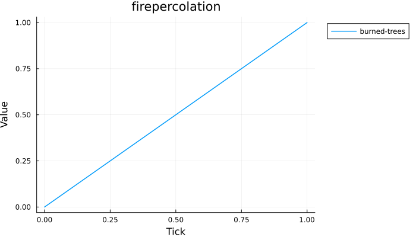
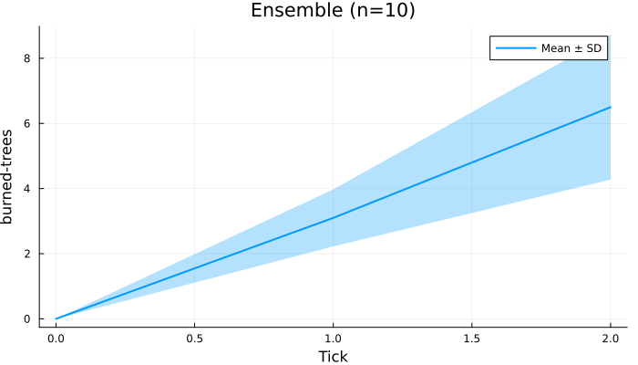
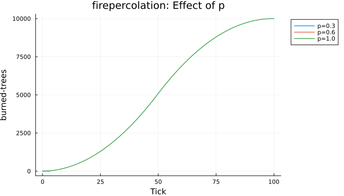

## Overview

### WHAT IS IT?

This project simulates the spread of a fire through a forest.  It shows that the fire's chance of reaching the right edge of the forest depends critically on the density of trees. This is an example of a common feature of complex systems, the presence of a non-linear threshold or critical parameter.

### HOW IT WORKS

The fire starts on the left edge of the forest, and spreads to neighboring trees. The fire spreads in four directions: north, east, south, and west.

The model assumes there is no wind.  So, the fire must have trees along its path in order to advance.  That is, the fire cannot skip over an unwooded area (patch), so such a patch blocks the fire's motion in that direction.

### THINGS TO NOTICE

When you run the model, how much of the forest burns. If you run it again with the same settings, do the same trees burn? How similar is the burn from run to run?

Each turtle that represents a piece of the fire is born and then dies without ever moving. If the fire is made of turtles but no turtles are moving, what does it mean to say that the fire moves? This is an example of different levels in a system: at the level of the individual turtles, there is no motion, but at the level of the turtles collectively over time, the fire moves.

### THINGS TO TRY

Set the density of trees to 55%. At this setting, there is virtually no chance that the fire will reach the right edge of the forest. Set the density of trees to 70%. At this setting, it is almost certain that the fire will reach the right edge. There is a sharp transition around 59% density. At 59% density, the fire has a 50/50 chance of reaching the right edge.

Try setting up and running a BehaviorSpace experiment (see Tools menu) to analyze the percent burned at different tree density levels. Plot the burn-percentage against the density. What kind of curve do you get?

Try changing the size of the lattice (`max-pxcor` and `max-pycor` in the Model Settings). Does it change the burn behavior of the fire?

### EXTENDING THE MODEL

What if the fire could spread in eight directions (including diagonals)? To do that, use `neighbors` instead of `neighbors4`. How would that change the fire's chances of reaching the right edge? In this model, what "critical density" of trees is needed for the fire to propagate?

Add wind to the model so that the fire can "jump" greater distances in certain directions.

Add the ability to plant trees where you want them. What configurations of trees allow the fire to cross the forest? Which don't? Why is over 59% density likely to result in a tree configuration that works? Why does the likelihood of such a configuration increase so rapidly at the 59% density?

The physicist Per Bak asked why we frequently see systems undergoing critical changes. He answers this by proposing the concept of [self-organzing criticality] (https://en.wikipedia.org/wiki/Self-organized_criticality) (SOC). Can you create a version of the fire model that exhibits SOC?

### NETLOGO FEATURES

Unburned trees are represented by green patches; burning trees are represented by turtles.  Two breeds of turtles are used, "fires" and "embers".  When a tree catches fire, a new fire turtle is created; a fire turns into an ember on the next turn.  Notice how the program gradually darkens the color of embers to achieve the visual effect of burning out.

The `neighbors4` primitive is used to spread the fire.

You could also write the model without turtles by just having the patches spread the fire, and doing it that way makes the code a little simpler.   Written that way, the model would run much slower, since all of the patches would always be active.  By using turtles, it's much easier to restrict the model's activity to just the area around the leading edge of the fire.

See the "CA 1D Rule 30" and "CA 1D Rule 30 Turtle" for an example of a model written both with and without turtles.

### RELATED MODELS

* Percolation
* Rumor Mill

### CREDITS AND REFERENCES

https://en.wikipedia.org/wiki/Forest-fire_model

### HOW TO CITE

If you mention this model or the NetLogo software in a publication, we ask that you include the citations below.

For the model itself:

* Wilensky, U. (1997).  NetLogo Fire model.  http://ccl.northwestern.edu/netlogo/models/Fire.  Center for Connected Learning and Computer-Based Modeling, Northwestern University, Evanston, IL.

Please cite the NetLogo software as:

* Wilensky, U. (1999). NetLogo. http://ccl.northwestern.edu/netlogo/. Center for Connected Learning and Computer-Based Modeling, Northwestern University, Evanston, IL.

### COPYRIGHT AND LICENSE

Copyright 1997 Uri Wilensky.


This model is licensed under the Creative Commons Attribution-NonCommercial-ShareAlike 3.0 License.  To view a copy of this license, visit https://creativecommons.org/licenses/by-nc-sa/3.0/ or send a letter to Creative Commons, 559 Nathan Abbott Way, Stanford, California 94305, USA.

NetLogo itself is free software for non-commercial use under the terms of the GNU General Public License ([see full license information here](https://ccl.northwestern.edu/netlogo/docs/copyright.html)).

To inquire about commercial licenses for either NetLogo or specific models from the models library, please contact netlogo-commercial-admin@ccl.northwestern.edu.

This model was created as part of the project: CONNECTED MATHEMATICS: MAKING SENSE OF COMPLEX PHENOMENA THROUGH BUILDING OBJECT-BASED PARALLEL MODELS (OBPML).  The project gratefully acknowledges the support of the National Science Foundation (Applications of Advanced Technologies Program) -- grant numbers RED #9552950 and REC #9632612.

This model was developed at the MIT Media Lab using CM StarLogo.  See Resnick, M. (1994) "Turtles, Termites and Traffic Jams: Explorations in Massively Parallel Microworlds."  Cambridge, MA: MIT Press.  Adapted to StarLogoT, 1997, as part of the Connected Mathematics Project.

This model was converted to NetLogo as part of the projects: PARTICIPATORY SIMULATIONS: NETWORK-BASED DESIGN FOR SYSTEMS LEARNING IN CLASSROOMS and/or INTEGRATED SIMULATION AND MODELING ENVIRONMENT. The project gratefully acknowledges the support of the National Science Foundation (REPP & ROLE programs) -- grant numbers REC #9814682 and REC-0126227. Converted from StarLogoT to NetLogo, 2001.

<!-- 1997 2001 MIT -->

## Parameters

| Parameter | Type | Default | Description |
|-----------|------|---------|-------------|
| `p` | `Float64` | `0.6` | p |
| `grid_width` | `Int` | `100` | grid width |
| `grid_height` | `Int` | `100` | grid height |
| `max_ticks` | `Int` | `100` | max ticks |

## Source Code

The Julia code to run this model:

```julia
using ArkModelZoo
_, trajectory = run_firepercolation()
```

## Time Series

{width=100%}

## Ensemble Runs

Ten replicates with different random seeds, showing mean ± standard deviation.

{width=100%}

## Parameter Sensitivity

Varying `p`.

{width=100%}


## Appendix: Source Code

This model is implemented in the [Ark.jl](https://github.com/sdwfrost/Ark.jl) Entity-Component-System (ECS) framework. The code is split into five files, each with a distinct role:

- **Parameters**: a mutable struct holding all configurable values.
- **Components**: lightweight data types attached to individual entities (agents).
- **Resources**: world-level shared state accessible to all systems.
- **Systems**: functions that operate on entities each tick, defining model behavior.
- **Model**: wiring that assembles the world, registers resources and systems, and provides the run entry point.

### Parameters (`parameters.jl`)

The parameter struct uses `@kwdef` so that every field has a default value and can be overridden by keyword. These defaults match the original NetLogo model's slider settings.

```julia
Base.@kwdef mutable struct FirePercolationParams
    p::Float64 = 0.6
    grid_width::Int = 100
    grid_height::Int = 100
    max_ticks::Int = 100
    seed::Int = 42
end
```

### Components (`components.jl`)

Components are lightweight data types attached to individual entities (agents). Mutable structs hold per-entity state, while empty tag structs act as markers for the ECS query system to efficiently filter entities.

```julia
struct FirePercDummy end
```

### Resources (`resources.jl`)

Resources are world-level singletons shared across all systems, used for global state and aggregate statistics.

```julia
mutable struct FirePercGrid
    width::Int
    height::Int
    state::Matrix{Int}       # 0=empty, 1=green(tree), 2=red(burned)
    fire_front::Set{Tuple{Int,Int}}
end
FirePercGrid(w, h) = FirePercGrid(w, h, zeros(Int, w, h), Set{Tuple{Int,Int}}())

mutable struct FirePercStats
    fire_size::Int
end
FirePercStats() = FirePercStats(0)
```

### Systems (`systems.jl`)

Systems contain the model logic and execute in a defined order each tick. Each system struct implements either `initialize!` (run once at setup) or `update!` (run every tick).

```julia
# --- Initialization ---
# NetLogo: ask n-of (p * count patches) patches [set pcolor green]

struct InitFirePercSystem <: System end

function initialize!(::InitFirePercSystem, world::World)
    params = get_resource(world, FirePercolationParams)
    rng = get_resource(world, RNGResource).rng
    grid = get_resource(world, FirePercGrid)
    stats = get_resource(world, FirePercStats)

    N = grid.width * grid.height
    n_green = floor(Int, params.p * N)

    perm = randperm(rng, N)
    for i in 1:n_green
        idx = perm[i]
        x = mod1(idx, grid.width)
        y = div(idx - 1, grid.width) + 1
        grid.state[x, y] = 1  # green
    end

    stats.fire_size = 0
    return nothing
end

# --- Fire Spread ---
# Tick 0: ignite one random green patch, then spread.
# Tick 1+: spread from current fire front to green Von Neumann neighbors (toroidal).

struct FirePercSpreadSystem <: System end

function update!(::FirePercSpreadSystem, world::World)
    grid = get_resource(world, FirePercGrid)
    tick = get_resource(world, Tick)
    rng = get_resource(world, RNGResource).rng
    w, h = grid.width, grid.height

    if tick.tick == 0
        # Ignite one random green patch
        green_patches = Tuple{Int,Int}[]
        for x in 1:w, y in 1:h
            if grid.state[x, y] == 1
                push!(green_patches, (x, y))
            end
        end
        if isempty(green_patches)
            return nothing
        end
        ix, iy = green_patches[rand(rng, 1:length(green_patches))]
        grid.state[ix, iy] = 2  # red
        push!(grid.fire_front, (ix, iy))
    end

    # Spread fire from current front
    new_front = Set{Tuple{Int,Int}}()
    for (x, y) in grid.fire_front
        for (nx, ny) in ((mod1(x - 1, w), y),
                         (mod1(x + 1, w), y),
                         (x, mod1(y - 1, h)),
                         (x, mod1(y + 1, h)))
            if grid.state[nx, ny] == 1
                push!(new_front, (nx, ny))
            end
        end
    end

    for (x, y) in new_front
        grid.state[x, y] = 2  # red
    end

    grid.fire_front = new_front
    return nothing
end

# --- Stats ---

struct FirePercStatsSystem <: System end

function update!(::FirePercStatsSystem, world::World)
    grid = get_resource(world, FirePercGrid)
    stats = get_resource(world, FirePercStats)
    stats.fire_size = count(==(2), grid.state)
    return nothing
end

# --- Termination ---
# Stop when fire front is empty or max_ticks reached.

struct FirePercTerminationSystem <: System end

function update!(::FirePercTerminationSystem, world::World)
    grid = get_resource(world, FirePercGrid)
    params = get_resource(world, FirePercolationParams)
    tick = get_resource(world, Tick)

    if isempty(grid.fire_front) || tick.tick + 1 >= params.max_ticks
        get_resource(world, Terminate).stop = true
    end
    return nothing
end
```

### Model (`model.jl`)

The model file assembles all pieces: it creates the ECS `World` with the required component types, registers resources, builds the `Scheduler` with systems in execution order, and exposes the public `run` entry point. The observer pattern records the trajectory each tick.

```julia
function firepercolation_world(; initial_capacity::Int = 128)
    return World(
        FirePercDummy;
        initial_capacity = initial_capacity,
        allow_mutable = true,
    )
end

function firepercolation_systems()
    return (
        InitFirePercSystem(),
        FirePercSpreadSystem(),
        FirePercStatsSystem(),
        FirePercTerminationSystem(),
    )
end

function firepercolation_model(params::FirePercolationParams = FirePercolationParams())
    world = firepercolation_world()
    _add_standard_resources!(world, params)
    add_resource!(world, FirePercGrid(params.grid_width, params.grid_height))
    add_resource!(world, FirePercStats())
    scheduler = Scheduler(world, firepercolation_systems())
    initialize!(scheduler)
    return scheduler
end

struct FirePercolationObserver end

function firepercolation_headers(::FirePercolationObserver)
    return ["FireSize"]
end

function firepercolation_values(::FirePercolationObserver, world::World)
    stats = get_resource(world, FirePercStats)
    return Float64[stats.fire_size]
end

function run_firepercolation(; params::FirePercolationParams = FirePercolationParams(), observe::Bool = true)
    return _run_model(firepercolation_model, FirePercolationObserver(), firepercolation_values; params, observe)
end
```
