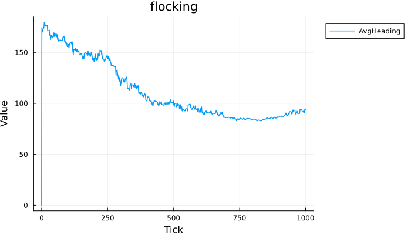
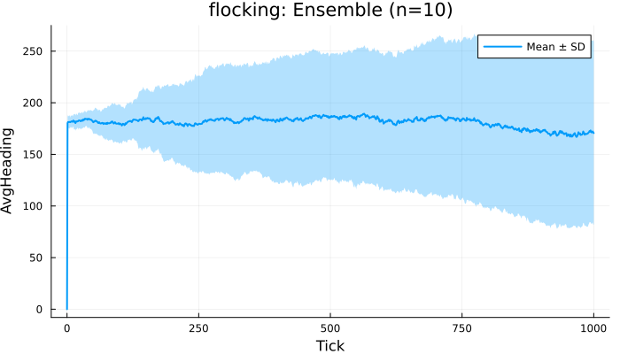
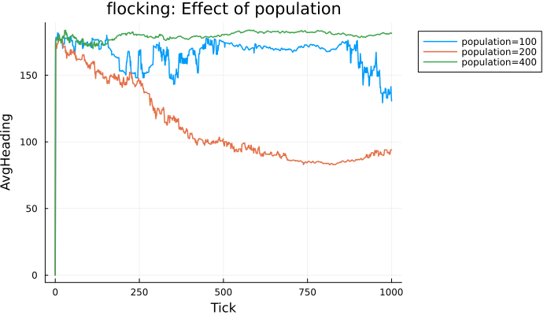

# Flocking


- [Overview](#overview)
  - [WHAT IS IT?](#what-is-it)
  - [HOW IT WORKS](#how-it-works)
  - [THINGS TO NOTICE](#things-to-notice)
  - [THINGS TO TRY](#things-to-try)
  - [EXTENDING THE MODEL](#extending-the-model)
  - [NETLOGO FEATURES](#netlogo-features)
  - [RELATED MODELS](#related-models)
  - [CREDITS AND REFERENCES](#credits-and-references)
  - [HOW TO CITE](#how-to-cite)
  - [COPYRIGHT AND LICENSE](#copyright-and-license)
- [Parameters](#parameters)
- [Source Code](#source-code)
- [Time Series](#time-series)
- [Ensemble Runs](#ensemble-runs)
- [Parameter Sensitivity](#parameter-sensitivity)
- [Appendix: Source Code](#appendix-source-code)
  - [Parameters (`parameters.jl`)](#parameters-parametersjl)
  - [Components (`components.jl`)](#components-componentsjl)
  - [Resources (`resources.jl`)](#resources-resourcesjl)
  - [Systems (`systems.jl`)](#systems-systemsjl)
  - [Model (`model.jl`)](#model-modeljl)

## Overview

### WHAT IS IT?

This model is an attempt to mimic the flocking of birds. (The resulting
motion also resembles schools of fish.) The flocks that appear in this
model are not created or led in any way by special leader birds. Rather,
each bird is following exactly the same set of rules, from which flocks
emerge.

### HOW IT WORKS

The birds follow three rules: “alignment”, “separation”, and “cohesion”.

“Alignment” means that a bird tends to turn so that it is moving in the
same direction that nearby birds are moving.

“Separation” means that a bird will turn to avoid another bird which
gets too close.

“Cohesion” means that a bird will move towards other nearby birds
(unless another bird is too close).

When two birds are too close, the “separation” rule overrides the other
two, which are deactivated until the minimum separation is achieved.

The three rules affect only the bird’s heading. Each bird always moves
forward at the same constant speed.

### THINGS TO NOTICE

Central to the model is the observation that flocks form without a
leader.

There are no random numbers used in this model, except to position the
birds initially. The fluid, lifelike behavior of the birds is produced
entirely by deterministic rules.

Also, notice that each flock is dynamic. A flock, once together, is not
guaranteed to keep all of its members. Why do you think this is?

After running the model for a while, all of the birds have approximately
the same heading. Why?

Sometimes a bird breaks away from its flock. How does this happen? You
may need to slow down the model or run it step by step in order to
observe this phenomenon.

### THINGS TO TRY

Play with the sliders to see if you can get tighter flocks, looser
flocks, fewer flocks, more flocks, more or less splitting and joining of
flocks, more or less rearranging of birds within flocks, etc.

You can turn off a rule entirely by setting that rule’s angle slider to
zero. Is one rule by itself enough to produce at least some flocking?
What about two rules? What’s missing from the resulting behavior when
you leave out each rule?

Will running the model for a long time produce a static flock? Or will
the birds never settle down to an unchanging formation? Remember, there
are no random numbers used in this model.

### EXTENDING THE MODEL

Currently the birds can “see” all around them. What happens if birds can
only see in front of them? The `in-cone` primitive can be used for this.

Is there some way to get V-shaped flocks, like migrating geese?

What happens if you put walls around the edges of the world that the
birds can’t fly into?

Can you get the birds to fly around obstacles in the middle of the
world?

What would happen if you gave the birds different velocities? For
example, you could make birds that are not near other birds fly faster
to catch up to the flock. Or, you could simulate the diminished air
resistance that birds experience when flying together by making them fly
faster when in a group.

Are there other interesting ways you can make the birds different from
each other? There could be random variation in the population, or you
could have distinct “species” of bird.

### NETLOGO FEATURES

Notice the need for the `subtract-headings` primitive and special
procedure for averaging groups of headings. Just subtracting the
numbers, or averaging the numbers, doesn’t give you the results you’d
expect, because of the discontinuity where headings wrap back to 0 once
they reach 360.

### RELATED MODELS

- Moths
- Flocking Vee Formation
- Flocking - Alternative Visualizations

### CREDITS AND REFERENCES

This model is inspired by the Boids simulation invented by Craig
Reynolds. The algorithm we use here is roughly similar to the original
Boids algorithm, but it is not the same. The exact details of the
algorithm tend not to matter very much – as long as you have alignment,
separation, and cohesion, you will usually get flocking behavior
resembling that produced by Reynolds’ original model. Information on
Boids is available at
https://web.archive.org/web/20210818090425/http://www.red3d.com/cwr/boids/.

### HOW TO CITE

If you mention this model or the NetLogo software in a publication, we
ask that you include the citations below.

For the model itself:

- Wilensky, U. (1998). NetLogo Flocking model.
  http://ccl.northwestern.edu/netlogo/models/Flocking. Center for
  Connected Learning and Computer-Based Modeling, Northwestern
  University, Evanston, IL.

Please cite the NetLogo software as:

- Wilensky, U. (1999). NetLogo. http://ccl.northwestern.edu/netlogo/.
  Center for Connected Learning and Computer-Based Modeling,
  Northwestern University, Evanston, IL.

### COPYRIGHT AND LICENSE

Copyright 1998 Uri Wilensky.


This model is licensed under the Creative Commons
Attribution-NonCommercial-ShareAlike 3.0 License. To view a copy of this
license, visit https://creativecommons.org/licenses/by-nc-sa/3.0/ or
send a letter to Creative Commons, 559 Nathan Abbott Way, Stanford,
California 94305, USA.

NetLogo itself is free software for non-commercial use under the terms
of the GNU General Public License ([see full license information
here](https://ccl.northwestern.edu/netlogo/docs/copyright.html)).

To inquire about commercial licenses for either NetLogo or specific
models from the models library, please contact
netlogo-commercial-admin@ccl.northwestern.edu.

This model was created as part of the project: CONNECTED MATHEMATICS:
MAKING SENSE OF COMPLEX PHENOMENA THROUGH BUILDING OBJECT-BASED PARALLEL
MODELS (OBPML). The project gratefully acknowledges the support of the
National Science Foundation (Applications of Advanced Technologies
Program) – grant numbers RED \#9552950 and REC \#9632612.

This model was converted to NetLogo as part of the projects:
PARTICIPATORY SIMULATIONS: NETWORK-BASED DESIGN FOR SYSTEMS LEARNING IN
CLASSROOMS and/or INTEGRATED SIMULATION AND MODELING ENVIRONMENT. The
project gratefully acknowledges the support of the National Science
Foundation (REPP & ROLE programs) – grant numbers REC \#9814682 and
REC-0126227. Converted from StarLogoT to NetLogo, 2002.

<!-- 1998 2002 -->

## Parameters

| Parameter            | Type      | Default | Description        |
|----------------------|-----------|---------|--------------------|
| `population`         | `Int`     | `200`   | population         |
| `max_align_turn`     | `Float64` | `5.0`   | max align turn     |
| `max_cohere_turn`    | `Float64` | `3.0`   | max cohere turn    |
| `max_separate_turn`  | `Float64` | `1.5`   | max separate turn  |
| `vision`             | `Float64` | `3.0`   | vision             |
| `minimum_separation` | `Float64` | `1.0`   | minimum separation |
| `grid_width`         | `Int`     | `91`    | grid width         |
| `grid_height`        | `Int`     | `91`    | grid height        |
| `max_ticks`          | `Int`     | `1000`  | max ticks          |

## Source Code

The Julia code to run this model:

``` julia
using ArkModelZoo
_, trajectory = run_flocking()
```

## Time Series



## Ensemble Runs

Ten replicates with different random seeds, showing mean ± standard
deviation.



## Parameter Sensitivity

Varying `population`.



## Appendix: Source Code

This model is implemented in the
[Ark.jl](https://github.com/sdwfrost/Ark.jl) Entity-Component-System
(ECS) framework. The code is split into five files, each with a distinct
role:

- **Parameters**: a mutable struct holding all configurable values.
- **Components**: lightweight data types attached to individual entities
  (agents).
- **Resources**: world-level shared state accessible to all systems.
- **Systems**: functions that operate on entities each tick, defining
  model behavior.
- **Model**: wiring that assembles the world, registers resources and
  systems, and provides the run entry point.

### Parameters (`parameters.jl`)

The parameter struct uses `@kwdef` so that every field has a default
value and can be overridden by keyword. These defaults match the
original NetLogo model’s slider settings.

``` julia
Base.@kwdef mutable struct FlockingParams
    population::Int = 200
    max_align_turn::Float64 = 5.0
    max_cohere_turn::Float64 = 3.0
    max_separate_turn::Float64 = 1.5
    vision::Float64 = 3.0
    minimum_separation::Float64 = 1.0
    grid_width::Int = 91
    grid_height::Int = 91
    max_ticks::Int = 1000
    seed::Int = 42
end
```

### Components (`components.jl`)

Components are lightweight data types attached to individual entities
(agents). Mutable structs hold per-entity state, while empty tag structs
act as markers for the ECS query system to efficiently filter entities.

``` julia
mutable struct FlockPosition
    x::Float64
    y::Float64
end

mutable struct FlockHeading
    angle::Float64
end
```

### Resources (`resources.jl`)

Resources are world-level singletons shared across all systems, used for
global state and aggregate statistics.

``` julia
mutable struct FlockStats
    avg_heading::Float64
end
FlockStats() = FlockStats(0.0)
```

### Systems (`systems.jl`)

Systems contain the model logic and execute in a defined order each
tick. Each system struct implements either `initialize!` (run once at
setup) or `update!` (run every tick).

``` julia
# ── Helper functions for NetLogo heading math ──

# NetLogo heading: 0=north, 90=east, clockwise
# NetLogo dx = sin(heading°), dy = cos(heading°)

function _nl_heading_to_rad(h::Float64)
    return h * π / 180.0
end

function _nl_dx(h::Float64)
    return sin(_nl_heading_to_rad(h))
end

function _nl_dy(h::Float64)
    return cos(_nl_heading_to_rad(h))
end

# NetLogo atan x y → heading in [0, 360)
function _nl_atan(x::Float64, y::Float64)
    if x == 0.0 && y == 0.0
        return 0.0
    end
    a = atan(x, y) * 180.0 / π
    return mod(a, 360.0)
end

# subtract-headings h1 h2 → difference in [-180, 180]
function _subtract_headings(h1::Float64, h2::Float64)
    diff = mod(h1 - h2, 360.0)
    if diff > 180.0
        diff -= 360.0
    end
    return diff
end

# Toroidal distance
function _torus_dist(x1::Float64, y1::Float64, x2::Float64, y2::Float64, w::Float64, h::Float64)
    dx = abs(x1 - x2)
    dy = abs(y1 - y2)
    dx = min(dx, w - dx)
    dy = min(dy, h - dy)
    return sqrt(dx * dx + dy * dy)
end

# Toroidal shortest displacement from (x1,y1) to (x2,y2)
function _torus_dx_dy(x1::Float64, y1::Float64, x2::Float64, y2::Float64, w::Float64, h::Float64)
    dx = x2 - x1
    if dx > w / 2.0
        dx -= w
    elseif dx < -w / 2.0
        dx += w
    end
    dy = y2 - y1
    if dy > h / 2.0
        dy -= h
    elseif dy < -h / 2.0
        dy += h
    end
    return dx, dy
end

# NetLogo towards: heading from (x1,y1) to (x2,y2) on torus
function _nl_towards(x1::Float64, y1::Float64, x2::Float64, y2::Float64, w::Float64, h::Float64)
    dx, dy = _torus_dx_dy(x1, y1, x2, y2, w, h)
    return _nl_atan(dx, dy)
end

# turn-at-most: clamp turn to max_turn degrees
function _turn_at_most(turn::Float64, max_turn::Float64)
    if abs(turn) > max_turn
        return turn > 0.0 ? max_turn : -max_turn
    else
        return turn
    end
end

# ── Initialization ──

struct InitFlockingSystem <: System end

function initialize!(::InitFlockingSystem, world::World)
    params = get_resource(world, FlockingParams)
    rng = get_resource(world, RNGResource).rng
    w = Float64(params.grid_width)
    h = Float64(params.grid_height)
    half_w = w / 2.0
    half_h = h / 2.0

    for _ in 1:params.population
        # random-xcor/ycor in NetLogo for 91x91 world: [-45, 45)
        x = rand(rng) * w - half_w
        y = rand(rng) * h - half_h
        # crt gives random integer heading [0, 359]
        heading = Float64(rand(rng, 0:359))
        new_entity!(world, (
            FlockPosition(x, y),
            FlockHeading(heading),
        ))
    end
    return nothing
end

# ── Flock System (ask turtles [flock]) ──

struct FlockSystem <: System
    order::Vector{Int}
end
FlockSystem() = FlockSystem(Int[])

function update!(system::FlockSystem, world::World)
    params = get_resource(world, FlockingParams)
    rng = get_resource(world, RNGResource).rng
    w = Float64(params.grid_width)
    h = Float64(params.grid_height)
    vision = params.vision
    min_sep = params.minimum_separation

    # Collect all entities into flat arrays for O(n²) access
    n = 0
    for (eids, _, _) in Query(world, (FlockPosition, FlockHeading))
        n += length(eids)
    end
    n == 0 && return nothing

    entities = Vector{Entity}(undef, n)
    positions_x = Vector{Float64}(undef, n)
    positions_y = Vector{Float64}(undef, n)
    headings = Vector{Float64}(undef, n)

    idx = 0
    for (eids, positions, heads) in Query(world, (FlockPosition, FlockHeading))
        @inbounds for i in eachindex(eids)
            idx += 1
            entities[idx] = eids[i]
            positions_x[idx] = positions[i].x
            positions_y[idx] = positions[i].y
            headings[idx] = heads[i].angle
        end
    end

    # Shuffled order for sequential processing
    resize!(system.order, n)
    for i in 1:n
        system.order[i] = i
    end
    for i in n:-1:2
        j = rand(rng, 1:i)
        system.order[i], system.order[j] = system.order[j], system.order[i]
    end

    # Pre-allocate flockmate buffer
    flockmates = Int[]

    for ord_idx in 1:n
        ti = system.order[ord_idx]
        tx = positions_x[ti]
        ty = positions_y[ti]

        # find-flockmates: other turtles in-radius vision (toroidal)
        empty!(flockmates)
        for j in 1:n
            j == ti && continue
            d = _torus_dist(tx, ty, positions_x[j], positions_y[j], w, h)
            if d <= vision
                push!(flockmates, j)
            end
        end

        isempty(flockmates) && continue

        # find-nearest-neighbor
        nearest = flockmates[1]
        nearest_dist = _torus_dist(tx, ty, positions_x[nearest], positions_y[nearest], w, h)
        for k in 2:length(flockmates)
            fj = flockmates[k]
            d = _torus_dist(tx, ty, positions_x[fj], positions_y[fj], w, h)
            if d < nearest_dist
                nearest = fj
                nearest_dist = d
            end
        end

        if nearest_dist < min_sep
            # separate: turn-away nearest-neighbor's heading
            nn_heading = headings[nearest]
            turn = _subtract_headings(headings[ti], nn_heading)
            delta = _turn_at_most(turn, params.max_separate_turn)
            headings[ti] = mod(headings[ti] + delta, 360.0)
        else
            # align: turn-towards average-flockmate-heading
            sum_dx = 0.0
            sum_dy = 0.0
            for fj in flockmates
                sum_dx += _nl_dx(headings[fj])
                sum_dy += _nl_dy(headings[fj])
            end
            avg_flock_heading = _nl_atan(sum_dx, sum_dy)
            turn_align = _subtract_headings(avg_flock_heading, headings[ti])
            delta_align = _turn_at_most(turn_align, params.max_align_turn)
            headings[ti] = mod(headings[ti] + delta_align, 360.0)

            # cohere: turn-towards average-heading-towards-flockmates
            nf = length(flockmates)
            sum_sin = 0.0
            sum_cos = 0.0
            for fj in flockmates
                # towards myself + 180 from each flockmate's perspective
                towards_me = _nl_towards(positions_x[fj], positions_y[fj], tx, ty, w, h)
                angle_away = towards_me + 180.0
                sum_sin += sin(angle_away * π / 180.0)
                sum_cos += cos(angle_away * π / 180.0)
            end
            mean_sin = sum_sin / nf
            mean_cos = sum_cos / nf
            avg_heading_towards = _nl_atan(mean_sin, mean_cos)
            turn_cohere = _subtract_headings(avg_heading_towards, headings[ti])
            delta_cohere = _turn_at_most(turn_cohere, params.max_cohere_turn)
            headings[ti] = mod(headings[ti] + delta_cohere, 360.0)
        end
    end

    # Write headings back to world
    idx = 0
    for (_, _, heads) in Query(world, (FlockPosition, FlockHeading))
        @inbounds for i in eachindex(heads)
            idx += 1
            heads[i].angle = headings[idx]
        end
    end
    return nothing
end

# ── Movement System: repeat 5 [ask turtles [fd 0.2]] ──

struct FlockMoveSystem <: System end

function update!(::FlockMoveSystem, world::World)
    params = get_resource(world, FlockingParams)
    w = Float64(params.grid_width)
    h = Float64(params.grid_height)
    half_w = w / 2.0
    half_h = h / 2.0

    for _ in 1:5
        for (_, positions, heads) in Query(world, (FlockPosition, FlockHeading))
            @inbounds for i in eachindex(positions)
                θ = _nl_heading_to_rad(heads[i].angle)
                positions[i].x += sin(θ) * 0.2
                positions[i].y += cos(θ) * 0.2
                # Wrap toroidally to [-half_w, half_w) and [-half_h, half_h)
                positions[i].x = mod(positions[i].x + half_w, w) - half_w
                positions[i].y = mod(positions[i].y + half_h, h) - half_h
            end
        end
    end
    return nothing
end

# ── Stats System ──

struct FlockStatsSystem <: System end

function update!(::FlockStatsSystem, world::World)
    stats = get_resource(world, FlockStats)
    total = 0
    sum_heading = 0.0

    for (_, _, heads) in Query(world, (FlockPosition, FlockHeading))
        @inbounds for i in eachindex(heads)
            sum_heading += heads[i].angle
            total += 1
        end
    end

    # mean [heading] of turtles is arithmetic mean in NetLogo
    stats.avg_heading = total > 0 ? sum_heading / total : 0.0
    return nothing
end

# ── Termination System ──

struct FlockTerminationSystem <: System end

function update!(::FlockTerminationSystem, world::World)
    params = get_resource(world, FlockingParams)
    tick = get_resource(world, Tick)
    if tick.tick + 1 >= params.max_ticks
        get_resource(world, Terminate).stop = true
    end
    return nothing
end
```

### Model (`model.jl`)

The model file assembles all pieces: it creates the ECS `World` with the
required component types, registers resources, builds the `Scheduler`
with systems in execution order, and exposes the public `run` entry
point. The observer pattern records the trajectory each tick.

``` julia
function flocking_world(; initial_capacity::Int = 2048)
    return World(
        FlockPosition,
        FlockHeading;
        initial_capacity = initial_capacity,
        allow_mutable = true,
    )
end

function flocking_systems()
    return (
        InitFlockingSystem(),
        FlockSystem(),
        FlockMoveSystem(),
        FlockStatsSystem(),
        FlockTerminationSystem(),
    )
end

function flocking_model(params::FlockingParams = FlockingParams())
    world = flocking_world()
    _add_standard_resources!(world, params)
    add_resource!(world, FlockStats())
    scheduler = Scheduler(world, flocking_systems())
    initialize!(scheduler)
    return scheduler
end

struct FlockingObserver end

function flocking_headers(::FlockingObserver)
    return ["AvgHeading"]
end

function flocking_values(::FlockingObserver, world::World)
    stats = get_resource(world, FlockStats)
    return Float64[stats.avg_heading]
end

function run_flocking(; params::FlockingParams = FlockingParams(), observe::Bool = true)
    return _run_model(flocking_model, FlockingObserver(), flocking_values; params, observe)
end
```
