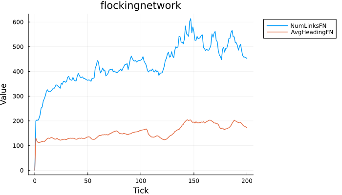
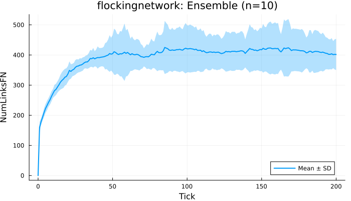
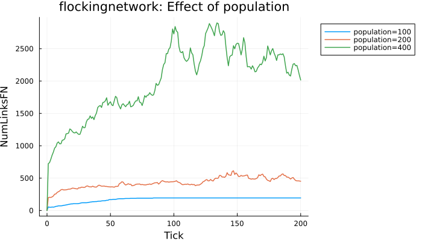

# Flocking Network


- [Overview](#overview)
  - [WHAT IS IT?](#what-is-it)
  - [HOW IT WORKS](#how-it-works)
  - [THINGS TO NOTICE](#things-to-notice)
  - [THINGS TO TRY](#things-to-try)
  - [EXTENDING THE MODEL](#extending-the-model)
  - [NETLOGO FEATURES](#netlogo-features)
  - [RELATED MODELS](#related-models)
  - [CREDITS AND REFERENCES](#credits-and-references)
  - [HOW TO CITE](#how-to-cite)
  - [COPYRIGHT AND LICENSE](#copyright-and-license)
- [Parameters](#parameters)
- [Source Code](#source-code)
- [Time Series](#time-series)
- [Ensemble Runs](#ensemble-runs)
- [Parameter Sensitivity](#parameter-sensitivity)
- [Appendix: Source Code](#appendix-source-code)
  - [Parameters (`parameters.jl`)](#parameters-parametersjl)
  - [Components (`components.jl`)](#components-componentsjl)
  - [Resources (`resources.jl`)](#resources-resourcesjl)
  - [Systems (`systems.jl`)](#systems-systemsjl)
  - [Model (`model.jl`)](#model-modeljl)

## Overview

### WHAT IS IT?

This model is an attempt to mimic the flocking of birds. (The resulting
motion also resembles schools of fish.) The flocks that appear in this
model are not created or led in any way by special leader birds. Rather,
each bird is following exactly the same set of rules, from which flocks
emerge.

### HOW IT WORKS

The birds follow three rules: “alignment”, “separation”, and “cohesion”.

“Alignment” means that a bird tends to turn so that it is moving in the
same direction that nearby birds are moving.

“Separation” means that a bird will turn to avoid another bird which
gets too close.

“Cohesion” means that a bird will move towards other nearby birds
(unless another bird is too close).

When two birds are too close, the “separation” rule overrides the other
two, which are deactivated until the minimum separation is achieved.

The three rules affect only the bird’s heading. Each bird always moves
forward at the same constant speed.

### THINGS TO NOTICE

Central to the model is the observation that flocks form without a
leader.

There are no random numbers used in this model, except to position the
birds initially. The fluid, lifelike behavior of the birds is produced
entirely by deterministic rules.

Also, notice that each flock is dynamic. A flock, once together, is not
guaranteed to keep all of its members. Why do you think this is?

After running the model for a while, all of the birds have approximately
the same heading. Why?

Sometimes a bird breaks away from its flock. How does this happen? You
may need to slow down the model or run it step by step in order to
observe this phenomenon.

### THINGS TO TRY

Play with the sliders to see if you can get tighter flocks, looser
flocks, fewer flocks, more flocks, more or less splitting and joining of
flocks, more or less rearranging of birds within flocks, etc.

You can turn off a rule entirely by setting that rule’s angle slider to
zero. Is one rule by itself enough to produce at least some flocking?
What about two rules? What’s missing from the resulting behavior when
you leave out each rule?

Will running the model for a long time produce a static flock? Or will
the birds never settle down to an unchanging formation? Remember, there
are no random numbers used in this model.

### EXTENDING THE MODEL

Currently the birds can “see” all around them. What happens if birds can
only see in front of them? The `in-cone` primitive can be used for this.

Is there some way to get V-shaped flocks, like migrating geese?

What happens if you put walls around the edges of the world that the
birds can’t fly into?

Can you get the birds to fly around obstacles in the middle of the
world?

What would happen if you gave the birds different velocities? For
example, you could make birds that are not near other birds fly faster
to catch up to the flock. Or, you could simulate the diminished air
resistance that birds experience when flying together by making them fly
faster when in a group.

Are there other interesting ways you can make the birds different from
each other? There could be random variation in the population, or you
could have distinct “species” of bird.

### NETLOGO FEATURES

Notice the need for the `subtract-headings` primitive and special
procedure for averaging groups of headings. Just subtracting the
numbers, or averaging the numbers, doesn’t give you the results you’d
expect, because of the discontinuity where headings wrap back to 0 once
they reach 360.

### RELATED MODELS

- Moths
- Flocking Vee Formation
- Flocking - Alternative Visualizations

### CREDITS AND REFERENCES

This model is inspired by the Boids simulation invented by Craig
Reynolds. The algorithm we use here is roughly similar to the original
Boids algorithm, but it is not the same. The exact details of the
algorithm tend not to matter very much – as long as you have alignment,
separation, and cohesion, you will usually get flocking behavior
resembling that produced by Reynolds’ original model. Information on
Boids is available at
https://web.archive.org/web/20210818090425/http://www.red3d.com/cwr/boids/.

### HOW TO CITE

If you mention this model or the NetLogo software in a publication, we
ask that you include the citations below.

For the model itself:

- Wilensky, U. (1998). NetLogo Flocking model.
  http://ccl.northwestern.edu/netlogo/models/Flocking. Center for
  Connected Learning and Computer-Based Modeling, Northwestern
  University, Evanston, IL.

Please cite the NetLogo software as:

- Wilensky, U. (1999). NetLogo. http://ccl.northwestern.edu/netlogo/.
  Center for Connected Learning and Computer-Based Modeling,
  Northwestern University, Evanston, IL.

### COPYRIGHT AND LICENSE

Copyright 1998 Uri Wilensky.


This model is licensed under the Creative Commons
Attribution-NonCommercial-ShareAlike 3.0 License. To view a copy of this
license, visit https://creativecommons.org/licenses/by-nc-sa/3.0/ or
send a letter to Creative Commons, 559 Nathan Abbott Way, Stanford,
California 94305, USA.

NetLogo itself is free software for non-commercial use under the terms
of the GNU General Public License ([see full license information
here](https://ccl.northwestern.edu/netlogo/docs/copyright.html)).

To inquire about commercial licenses for either NetLogo or specific
models from the models library, please contact
netlogo-commercial-admin@ccl.northwestern.edu.

This model was created as part of the project: CONNECTED MATHEMATICS:
MAKING SENSE OF COMPLEX PHENOMENA THROUGH BUILDING OBJECT-BASED PARALLEL
MODELS (OBPML). The project gratefully acknowledges the support of the
National Science Foundation (Applications of Advanced Technologies
Program) – grant numbers RED \#9552950 and REC \#9632612.

This model was converted to NetLogo as part of the projects:
PARTICIPATORY SIMULATIONS: NETWORK-BASED DESIGN FOR SYSTEMS LEARNING IN
CLASSROOMS and/or INTEGRATED SIMULATION AND MODELING ENVIRONMENT. The
project gratefully acknowledges the support of the National Science
Foundation (REPP & ROLE programs) – grant numbers REC \#9814682 and
REC-0126227. Converted from StarLogoT to NetLogo, 2002.

<!-- 1998 2002 -->

## Parameters

| Parameter             | Type      | Default | Description         |
|-----------------------|-----------|---------|---------------------|
| `population`          | `Int`     | `200`   | population          |
| `maximum_separation`  | `Float64` | `3.0`   | maximum separation  |
| `minimum_separation`  | `Float64` | `1.0`   | minimum separation  |
| `coupling_strength`   | `Float64` | `0.5`   | coupling strength   |
| `coherence_strength`  | `Float64` | `0.5`   | coherence strength  |
| `separation_strength` | `Float64` | `0.5`   | separation strength |
| `alignment_strength`  | `Float64` | `0.5`   | alignment strength  |
| `grid_width`          | `Int`     | `81`    | grid width          |
| `grid_height`         | `Int`     | `81`    | grid height         |
| `max_ticks`           | `Int`     | `200`   | max ticks           |

## Source Code

The Julia code to run this model:

``` julia
using ArkModelZoo
_, trajectory = run_flockingnetwork()
```

## Time Series



## Ensemble Runs

Ten replicates with different random seeds, showing mean ± standard
deviation.



## Parameter Sensitivity

Varying `population`.



## Appendix: Source Code

This model is implemented in the
[Ark.jl](https://github.com/sdwfrost/Ark.jl) Entity-Component-System
(ECS) framework. The code is split into five files, each with a distinct
role:

- **Parameters**: a mutable struct holding all configurable values.
- **Components**: lightweight data types attached to individual entities
  (agents).
- **Resources**: world-level shared state accessible to all systems.
- **Systems**: functions that operate on entities each tick, defining
  model behavior.
- **Model**: wiring that assembles the world, registers resources and
  systems, and provides the run entry point.

### Parameters (`parameters.jl`)

The parameter struct uses `@kwdef` so that every field has a default
value and can be overridden by keyword. These defaults match the
original NetLogo model’s slider settings.

``` julia
Base.@kwdef mutable struct FlockingNetworkParams
    population::Int = 200
    maximum_separation::Float64 = 3.0
    minimum_separation::Float64 = 1.0
    coupling_strength::Float64 = 0.5
    coherence_strength::Float64 = 0.5
    separation_strength::Float64 = 0.5
    alignment_strength::Float64 = 0.5
    grid_width::Int = 81
    grid_height::Int = 81
    max_ticks::Int = 200
    seed::Int = 42
end
```

### Components (`components.jl`)

Components are lightweight data types attached to individual entities
(agents). Mutable structs hold per-entity state, while empty tag structs
act as markers for the ECS query system to efficiently filter entities.

``` julia
mutable struct FNPosition
    x::Float64
    y::Float64
end

mutable struct FNHeading
    angle::Float64
end

struct FNTag end
```

### Resources (`resources.jl`)

Resources are world-level singletons shared across all systems, used for
global state and aggregate statistics.

``` julia
mutable struct FNStats
    num_links::Int
    avg_heading::Float64
end
FNStats() = FNStats(0, 0.0)
```

### Systems (`systems.jl`)

Systems contain the model logic and execute in a defined order each
tick. Each system struct implements either `initialize!` (run once at
setup) or `update!` (run every tick).

``` julia
# Flocking with Network Links
# Turtles form pos/neg weighted links based on distance and adjust heading

struct InitFlockingNetworkSystem <: System end

function initialize!(::InitFlockingNetworkSystem, world::World)
    params = get_resource(world, FlockingNetworkParams)
    rng = get_resource(world, RNGResource).rng

    wf = Float64(params.grid_width)
    hf = Float64(params.grid_height)
    for _ in 1:params.population
        x = rand(rng) * wf
        y = rand(rng) * hf
        heading = Float64(rand(rng, 0:359))
        new_entity!(world, (FNPosition(x, y), FNHeading(heading), FNTag()))
    end
    return nothing
end

struct FNFlockSystem <: System
    positions::Vector{Tuple{Entity,Float64,Float64,Float64}}
end
FNFlockSystem() = FNFlockSystem(Tuple{Entity,Float64,Float64,Float64}[])

function update!(sys::FNFlockSystem, world::World)
    params = get_resource(world, FlockingNetworkParams)
    rng = get_resource(world, RNGResource).rng
    stats = get_resource(world, FNStats)
    wf = Float64(params.grid_width)
    hf = Float64(params.grid_height)
    max_sep = params.maximum_separation
    min_sep = params.minimum_separation
    coupling = params.coupling_strength
    coherence = params.coherence_strength
    separation = params.separation_strength
    alignment = params.alignment_strength

    # Collect all agents
    empty!(sys.positions)
    for (eids, positions, headings) in Query(world, (FNPosition, FNHeading); with=(FNTag,))
        @inbounds for i in eachindex(eids)
            push!(sys.positions, (eids[i], positions[i].x, positions[i].y, headings[i].angle))
        end
    end

    n = length(sys.positions)
    num_links = 0

    # For each turtle: find neighbors, compute avg headings, update heading
    # NetLogo ask shuffles
    order = collect(1:n)
    Random.shuffle!(rng, order)

    for idx in order
        (eid, x, y, h) = sys.positions[idx]

        # Find negative neighbors (within minimum_separation)
        neg_headings = Float64[]
        # Find positive neighbors (within maximum_separation but outside minimum_separation)
        pos_headings = Float64[]

        for jdx in 1:n
            jdx == idx && continue
            (_, ox, oy, oh) = sys.positions[jdx]
            # Toroidal distance
            ddx = abs(x - ox)
            ddx = min(ddx, wf - ddx)
            ddy = abs(y - oy)
            ddy = min(ddy, hf - ddy)
            dist = sqrt(ddx * ddx + ddy * ddy)

            if dist <= min_sep
                push!(neg_headings, oh)
                num_links += 1
            elseif dist <= max_sep
                push!(pos_headings, oh)
                num_links += 1
            end
        end

        avg_head_pos = 0.0
        avg_head_neg = 0.0
        if !isempty(pos_headings)
            avg_head_pos = sum(pos_headings) / length(pos_headings)
        end
        if !isempty(neg_headings)
            avg_head_neg = sum(neg_headings) / length(neg_headings)
        end

        # NetLogo: heading + coupling * (coherence*(avg_pos - heading) + separation*(180+avg_neg-heading) + alignment*(0.5*(avg_neg+avg_pos)-heading))
        new_h = h + coupling * (
            coherence * (avg_head_pos - h) +
            separation * (180.0 + avg_head_neg - h) +
            alignment * (0.5 * (avg_head_neg + avg_head_pos) - h)
        )

        # Update heading in ECS
        for (_, _, headings) in Query(world, (FNPosition, FNHeading); with=(FNTag,))
            @inbounds for i in eachindex(headings)
                # Find matching entity by comparing stored data
            end
        end
        # Store updated heading back
        sys.positions[idx] = (eid, x, y, new_h)
    end

    # Apply heading updates and move forward by 1
    # Build a map from entity to new heading
    heading_map = Dict{Entity, Float64}()
    for (eid, _, _, h) in sys.positions
        heading_map[eid] = h
    end

    for (eids, positions, headings) in Query(world, (FNPosition, FNHeading); with=(FNTag,))
        @inbounds for i in eachindex(eids)
            if haskey(heading_map, eids[i])
                headings[i].angle = heading_map[eids[i]]
            end
            θ = deg2rad(headings[i].angle)
            positions[i].x = mod(positions[i].x + sin(θ), wf)
            positions[i].y = mod(positions[i].y + cos(θ), hf)
        end
    end

    # Links are undirected, counted from both sides
    stats.num_links = div(num_links, 1)  # each pair counted once per idx
    # Compute average heading
    if n > 0
        total_h = 0.0
        for (_, _, _, h) in sys.positions
            total_h += h
        end
        stats.avg_heading = total_h / n
    else
        stats.avg_heading = 0.0
    end

    return nothing
end

struct FNTerminationSystem <: System end

function update!(::FNTerminationSystem, world::World)
    params = get_resource(world, FlockingNetworkParams)
    tick = get_resource(world, Tick)
    if tick.tick + 1 >= params.max_ticks
        get_resource(world, Terminate).stop = true
    end
    return nothing
end
```

### Model (`model.jl`)

The model file assembles all pieces: it creates the ECS `World` with the
required component types, registers resources, builds the `Scheduler`
with systems in execution order, and exposes the public `run` entry
point. The observer pattern records the trajectory each tick.

``` julia
function flockingnetwork_world(; initial_capacity::Int = 256)
    return World(FNPosition, FNHeading, FNTag; initial_capacity = initial_capacity, allow_mutable = true)
end

function flockingnetwork_systems()
    return (InitFlockingNetworkSystem(), FNFlockSystem(), FNTerminationSystem())
end

function flockingnetwork_model(params::FlockingNetworkParams = FlockingNetworkParams())
    world = flockingnetwork_world()
    _add_standard_resources!(world, params)
    add_resource!(world, FNStats())
    scheduler = Scheduler(world, flockingnetwork_systems())
    initialize!(scheduler)
    return scheduler
end

struct FNObserver end

function flockingnetwork_headers(::FNObserver)
    return ["NumLinksFN", "AvgHeadingFN"]
end

function flockingnetwork_values(::FNObserver, world::World)
    stats = get_resource(world, FNStats)
    return Float64[stats.num_links, stats.avg_heading]
end

function run_flockingnetwork(; params::FlockingNetworkParams = FlockingNetworkParams(), observe::Bool = true)
    return _run_model(flockingnetwork_model, FNObserver(), flockingnetwork_values; params, observe)
end
```
