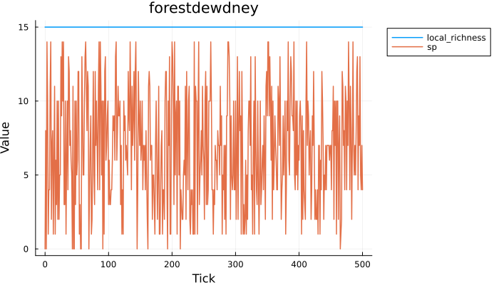
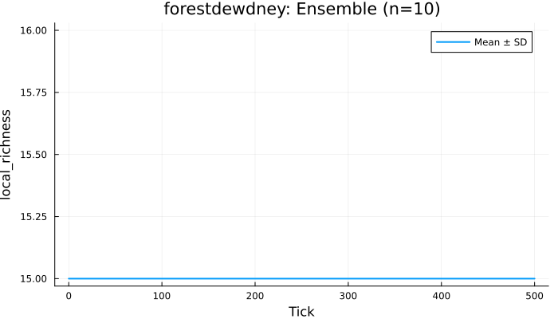
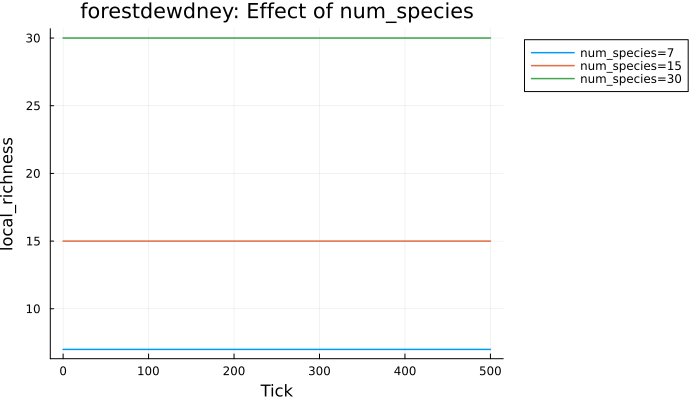

# Forest Dewdney


- [Overview](#overview)
- [Parameters](#parameters)
- [Source Code](#source-code)
- [Time Series](#time-series)
- [Ensemble Runs](#ensemble-runs)
- [Parameter Sensitivity](#parameter-sensitivity)
- [Appendix: Source Code](#appendix-source-code)
  - [Parameters (`parameters.jl`)](#parameters-parametersjl)
  - [Components (`components.jl`)](#components-componentsjl)
  - [Resources (`resources.jl`)](#resources-resourcesjl)
  - [Systems (`systems.jl`)](#systems-systemsjl)
  - [Model (`model.jl`)](#model-modeljl)

## Overview

This vignette demonstrates the **Forest Dewdney** model implemented in
[ArkModelZoo.jl](https://github.com/sdwfrost/ArkModelZoo.jl) using the
Ark.jl ECS framework.

## Parameters

| Parameter     | Type  | Default | Description |
|---------------|-------|---------|-------------|
| `grid_width`  | `Int` | `15`    | grid width  |
| `grid_height` | `Int` | `15`    | grid height |
| `num_species` | `Int` | `15`    | num species |
| `max_ticks`   | `Int` | `500`   | max ticks   |

## Source Code

The Julia code to run this model:

``` julia
using ArkModelZoo
_, trajectory = run_forestdewdney()
```

## Time Series



## Ensemble Runs

Ten replicates with different random seeds, showing mean ± standard
deviation.



## Parameter Sensitivity

Varying `num_species`.



## Appendix: Source Code

This model is implemented in the
[Ark.jl](https://github.com/sdwfrost/Ark.jl) Entity-Component-System
(ECS) framework. The code is split into five files, each with a distinct
role:

- **Parameters**: a mutable struct holding all configurable values.
- **Components**: lightweight data types attached to individual entities
  (agents).
- **Resources**: world-level shared state accessible to all systems.
- **Systems**: functions that operate on entities each tick, defining
  model behavior.
- **Model**: wiring that assembles the world, registers resources and
  systems, and provides the run entry point.

### Parameters (`parameters.jl`)

The parameter struct uses `@kwdef` so that every field has a default
value and can be overridden by keyword. These defaults match the
original NetLogo model’s slider settings.

``` julia
Base.@kwdef mutable struct FDParams
    grid_width::Int = 15
    grid_height::Int = 15
    num_species::Int = 15
    max_ticks::Int = 500
    seed::Int = 42
end
```

### Components (`components.jl`)

Components are lightweight data types attached to individual entities
(agents). Mutable structs hold per-entity state, while empty tag structs
act as markers for the ECS query system to efficiently filter entities.

``` julia
struct FDDummy end
```

### Resources (`resources.jl`)

Resources are world-level singletons shared across all systems, used for
global state and aggregate statistics.

``` julia
mutable struct FDTree
    x::Int
    y::Int
    species::Int
end

mutable struct FDForest
    width::Int
    height::Int
    trees::Vector{FDTree}
    last_x::Int    # x-cor from NetLogo (position of last killed tree)
    last_y::Int    # y-cor from NetLogo
end

function FDForest(w::Int, h::Int)
    FDForest(w, h, FDTree[], 0, 0)
end

mutable struct FDStats
    local_richness::Int
    sp::Int          # species of last selected candidate
end
FDStats() = FDStats(0, 0)
```

### Systems (`systems.jl`)

Systems contain the model logic and execute in a defined order each
tick. Each system struct implements either `initialize!` (run once at
setup) or `update!` (run every tick).

``` julia
# --- Initialization ---
# NetLogo: create one tree per cell with random species 0..14, then update-richness

struct InitFDSystem <: System end

function initialize!(::InitFDSystem, world::World)
    params = get_resource(world, FDParams)
    rng = get_resource(world, RNGResource).rng
    forest = get_resource(world, FDForest)
    stats = get_resource(world, FDStats)

    empty!(forest.trees)
    for y in 1:params.grid_height, x in 1:params.grid_width
        push!(forest.trees, FDTree(x, y, rand(rng, 0:params.num_species - 1)))
    end

    # update-richness: count unique species
    stats.local_richness = length(Set(t.species for t in forest.trees))
    stats.sp = 0
    return nothing
end

# --- Go (ingest + reproduce + update-richness) ---
# NetLogo per tick:
#   ingest-process: pick random tree candidate, record sp = species.
#     If count trees with that species > 1, kill it and record x-cor, y-cor.
#     Retry up to 100 times if species count <= 1.
#   reproduce-process: pick random tree, hatch copy at (last_x, last_y).
#   update-richness: count unique species.

struct FDGoSystem <: System end

function update!(::FDGoSystem, world::World)
    rng = get_resource(world, RNGResource).rng
    forest = get_resource(world, FDForest)
    stats = get_resource(world, FDStats)

    # --- ingest-process ---
    victim_idx = 0
    attempts = 0
    while victim_idx == 0 && attempts < 100
        idx = rand(rng, 1:length(forest.trees))
        candidate = forest.trees[idx]
        stats.sp = candidate.species
        n = count(t -> t.species == candidate.species, forest.trees)
        if n > 1
            victim_idx = idx
        end
        attempts += 1
    end

    if victim_idx != 0
        victim = forest.trees[victim_idx]
        forest.last_x = victim.x
        forest.last_y = victim.y
        # Remove victim (swap-remove for efficiency)
        forest.trees[victim_idx] = forest.trees[end]
        pop!(forest.trees)
    end

    # --- reproduce-process ---
    if !isempty(forest.trees)
        parent = forest.trees[rand(rng, 1:length(forest.trees))]
        push!(forest.trees, FDTree(forest.last_x, forest.last_y, parent.species))
    end

    # --- update-richness ---
    stats.local_richness = length(Set(t.species for t in forest.trees))

    return nothing
end

# --- Termination ---

struct FDTerminationSystem <: System end

function update!(::FDTerminationSystem, world::World)
    params = get_resource(world, FDParams)
    tick = get_resource(world, Tick)

    if tick.tick + 1 >= params.max_ticks
        get_resource(world, Terminate).stop = true
    end
    return nothing
end
```

### Model (`model.jl`)

The model file assembles all pieces: it creates the ECS `World` with the
required component types, registers resources, builds the `Scheduler`
with systems in execution order, and exposes the public `run` entry
point. The observer pattern records the trajectory each tick.

``` julia
function forestdewdney_world(; initial_capacity::Int = 256)
    return World(
        FDDummy;
        initial_capacity = initial_capacity,
        allow_mutable = true,
    )
end

function forestdewdney_systems()
    return (
        InitFDSystem(),
        FDGoSystem(),
        FDTerminationSystem(),
    )
end

function forestdewdney_model(params::FDParams = FDParams())
    world = forestdewdney_world()
    _add_standard_resources!(world, params)
    add_resource!(world, FDForest(params.grid_width, params.grid_height))
    add_resource!(world, FDStats())
    scheduler = Scheduler(world, forestdewdney_systems())
    initialize!(scheduler)
    return scheduler
end

struct FDObserver end

function forestdewdney_headers(::FDObserver)
    return ["local_richness", "sp"]
end

function forestdewdney_values(::FDObserver, world::World)
    stats = get_resource(world, FDStats)
    return Float64[stats.local_richness, stats.sp]
end

function run_forestdewdney(; params::FDParams = FDParams(), observe::Bool = true)
    return _run_model(forestdewdney_model, FDObserver(), forestdewdney_values; params, observe)
end
```
