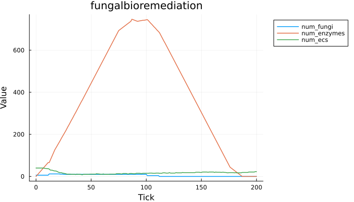
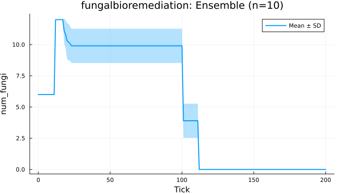
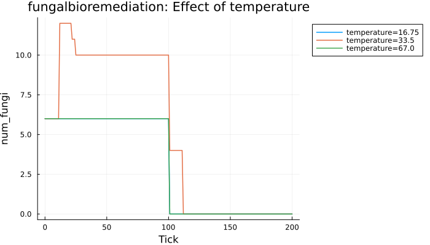

## Overview

### WHAT IS IT?

This is a model of fungal bioremediation. In this model, white rot fungus produces enzymes that serve two purposes: breaking down lignin (a complex polymer found in wood) and degrading neonicotinoids (contaminants). 

Lignin is broken down into glucose, which is then consumed by bacteria and fungi in cellular respiration. The fungi and bacteria have a symbiotic relationship. Since bacteria cannot break down lignin, they rely on fungal enzymes to break down lignin to produce glucose in the absence of other glucose. 

The fungal enzymes also degrade neonicotinoids (contaminants in the water). While in reality, the neonicotinoids would be degraded into a potentially less harmful product, in this model, the neonicotinoids are simply modeled as being eliminated. 

For further context, in a real world setting, white rot fungi growing on wood chips would function as a filter. As contaminated water flows through the fungi filter, the fungi convert neonicotinoids in the water into potentially less harmful products. 

This model includes elements of enzyme kinetics and organisms' competition for food.

### HOW IT WORKS

When the experiment is set up, fungi, bacteria, and contaminants are randomly placed in the grid. 

New fungi grow outward from old fungi, and as fungi age, they become less active and eventually die off. The fungi become whiter in color as they age. Fungi consume nutrients, glucose, and dissolved oxygen in the surrounding patches and produce enzymes that degrade lignin and neonicotinoids. 

Bacteria also consume glucose, nutrients, and dissolved oxygen in the surrounding patches. 

Nutrients and dissolved oxygen diffuse throughout the water. 

Sliders control various factors that influence reaction rates, reproduction rates, water speed, oxygen levels, the starting amount of ECs, and the amount of energy gained from glucose consumption.

The first switch allows for the user to turn on nutrient replenishing, and the second switch allows for the user to turn on background coloring so that the background changes colors based on the levels of glucose present.

### THINGS TO NOTICE

Notice the time it takes for a certain amount of contaminants to be removed and the percent of contaminants that are removed before all fungi die off. 

Notice the colors of the patches. What does that indicate about the diffusing behavior of the nutrients and dissolved oxygen?

Notice the behavios of the fungi, bacteria, and enzyme populations. Are the populations always increasing? Always decreasing? Do they rapidly increase and then decrease?

Notice the shapes of the graphs for glucose, nutrients, lignin, and dissolved O2. 

Notice the behavior at low and high water flow.

### THINGS TO TRY

Task 1: There are three different sliders related to the reaction rate: temperature, pH, and uv-light. For each condition, there's an optimal condition where the enzymes function best. Try to figure out what the optimal conditions are. Consider isolating each condition (don't change multiple at once as that will make it difficult to determine how each change affected the experiment). Consider a model where the water speed = 0 and a model where the water speed = 1.

Task 2: There's a cost associated with each of these conditions (e.g. keeping the solution at a constant temperature). Assuming all of the conditions cost the same amount to make optimal, figure out which two conditions at their optimal have the greatest positive impact on the rate. Which condition can be sub-optimal while having the smallest negative impact on the rate? Consider a model where the water speed = 0 and a model where the water speed = 1.

Task 3: Now, figure out which condition should be optimal if you can only have one optimal condition and the other two must be sub-optimal. Can you rank the conditions from least to greatest impact on rate?

Task 4: Consider changing the replenish O2 time. What happens when replenish O2 time is smaller? How about when it is larger?

Task 5: Considering all four sliders (temperature, pH, UV light, and replenish O2 time), try to modify the conditions so that you produce four different results in a model where water speed = 0: no removal of ECs, low removal of ECs, moderate removal of ECs, and high removal of ECs. For a model where water speed = 1, try to create conditions where there is low, moderate, and high numbers of ECs escaping.

Task 6: Determine the optimal water speed (1-5) for fungi survival and ensuring that few contaminants escape the filter. Why do you think this speed is the best? How does the idea of water speed apply in the real world? What engineering mechanisms could be added to ensure the optimal water speed?

Task 7: Using the different sliders and input boxes, find conditions that cause less fungi growth. Why do you think these conditions hurt fungi growth?

Final Task Part 1: Using any or all of the sliders, try to create a scenario where no species is too dominant or too weak, the reaction proceeds relatively quickly, and few contaminants escape.

Final Task Part 2: How many of sliders can you have at sub-optimal conditions while allowing minimal numbers of contaminants to escape. How far from the optimal condition can the sliders be while still maintaining low numbers of contaminants escaping.

### EXTENDING THE MODEL

(suggested things to add or change in the Code tab to make the model more complicated, detailed, accurate, etc.)

### NETLOGO FEATURES

(interesting or unusual features of NetLogo that the model uses, particularly in the Code tab; or where workarounds were needed for missing features)

### RELATED MODELS

The wolf-sheep predation model similarly shows competition between biological organisms. It also shows how the various agents/turtles rely on the patches for food. 

The enzyme kinetics model illustrates the relationship between Kc, Kd, and Kr. It also illustrates the lock and key model for how enzymes function as a catalyst in a reaction.

### CREDITS AND REFERENCES

(a reference to the model's URL on the web if it has one, as well as any other necessary credits, citations, and links)

## Parameters

| Parameter | Type | Default | Description |
|-----------|------|---------|-------------|
| `temperature` | `Float64` | `33.5` | temperature |
| `pH` | `Float64` | `5.0` | pH |
| `fungi_species` | `String` | `"Pleurotus Ostreatus"` | fungi species |
| `initial_fungi` | `Int` | `6` | initial fungi |
| `initial_ecs` | `Int` | `40` | initial ecs |
| `ms` | `Float64` | `0.5` | mortality speed |
| `grid_width` | `Int` | `33` | -16..16 |
| `grid_height` | `Int` | `33` | grid height |
| `max_ticks` | `Int` | `200` | max ticks |

## Source Code

The Julia code to run this model:

```julia
using ArkModelZoo
_, trajectory = run_fungalbioremediation()
```

## Time Series

{width=100%}

## Ensemble Runs

Ten replicates with different random seeds, showing mean ± standard deviation.

{width=100%}

## Parameter Sensitivity

Varying `temperature`.

{width=100%}


## Appendix: Source Code

This model is implemented in the [Ark.jl](https://github.com/sdwfrost/Ark.jl) Entity-Component-System (ECS) framework. The code is split into five files, each with a distinct role:

- **Parameters**: a mutable struct holding all configurable values.
- **Components**: lightweight data types attached to individual entities (agents).
- **Resources**: world-level shared state accessible to all systems.
- **Systems**: functions that operate on entities each tick, defining model behavior.
- **Model**: wiring that assembles the world, registers resources and systems, and provides the run entry point.

### Parameters (`parameters.jl`)

The parameter struct uses `@kwdef` so that every field has a default value and can be overridden by keyword. These defaults match the original NetLogo model's slider settings.

```julia
Base.@kwdef mutable struct FBRParams
    temperature::Float64 = 33.5
    pH::Float64 = 5.0
    fungi_species::String = "Pleurotus Ostreatus"
    initial_fungi::Int = 6
    initial_ecs::Int = 40
    ms::Float64 = 0.5         # mortality speed
    grid_width::Int = 33      # -16..16
    grid_height::Int = 33
    max_ticks::Int = 200
    seed::Int = 42
end
```

### Components (`components.jl`)

Components are lightweight data types attached to individual entities (agents). Mutable structs hold per-entity state, while empty tag structs act as markers for the ECS query system to efficiently filter entities.

```julia
struct FBRDummy end
```

### Resources (`resources.jl`)

Resources are world-level singletons shared across all systems, used for global state and aggregate statistics.

```julia
# Species-specific parameters for fungi
struct FBRFungiSpecies
    growth_temp::Float64
    growth_pH::Float64
    enzyme_production_cost::Float64
    enzyme_production_pH::Float64
end

const FBR_SPECIES = Dict(
    "Pleurotus Ostreatus" => FBRFungiSpecies(33.5, 4.0, 2.5, 5.0),
    "Trametes Versicolor" => FBRFungiSpecies(24.0, 1.0, 1.0, 3.75),
    "Phanerodontia Chrysosporium" => FBRFungiSpecies(30.0, 2.0, 1.0, 4.0),
)

mutable struct FBRFungus
    x::Float64
    y::Float64
    age::Float64
    energy::Float64
    NH4::Float64
    partner::Int      # 0 = no partner, else index into ecs vector
    alive::Bool
end

mutable struct FBREnzyme
    x::Float64
    y::Float64
    age::Float64
    heading::Float64
    partner::Int      # 0 = no partner, else index into ecs vector
    turn::Float64
    pause_time::Float64
    alive::Bool
end

mutable struct FBREC
    x::Float64
    y::Float64
    heading::Float64
    partner::Int      # 0 = no partner
    locked_time::Int
    taken::Bool       # absorbed by a fungus intracellularly
    alive::Bool
end

mutable struct FBRPatchGrid
    width::Int
    height::Int
    glucose::Matrix{Float64}
    O2::Matrix{Float64}
    lignin::Matrix{Float64}
end

function FBRPatchGrid(w::Int, h::Int)
    FBRPatchGrid(w, h, fill(4.0, w, h), fill(25.0, w, h), fill(100.0, w, h))
end

mutable struct FBRWorld
    fungi::Vector{FBRFungus}
    enzymes::Vector{FBREnzyme}
    ecs::Vector{FBREC}
    species_params::FBRFungiSpecies
    ec_added::Int
    intracellularly::Int
    Kc::Int
    Kr::Int
    Kd::Int
    complexes_formed::Int
    dissociated::Int
    adjuster_enzymes::Int
    adjuster_fungi::Int
end

function FBRWorld(sp::FBRFungiSpecies)
    FBRWorld(FBRFungus[], FBREnzyme[], FBREC[], sp,
             0, 0, 0, 0, 0, 0, 0, 1, 1)
end

mutable struct FBRStats
    num_fungi::Int
    num_enzymes::Int
    num_ecs::Int
end
FBRStats() = FBRStats(0, 0, 0)
```

### Systems (`systems.jl`)

Systems contain the model logic and execute in a defined order each tick. Each system struct implements either `initialize!` (run once at setup) or `update!` (run every tick).

```julia
# ============================================================
# Fungal Bioremediation – Systems
# Port of the NetLogo "Fungal Bioremediation" model.
# ============================================================

# ---------- helpers ----------

# Map continuous coordinate to 1-based grid index (world is -16..16, grid is 1..33)
@inline function _fbr_to_patch(v::Float64, size::Int)
    clamp(round(Int, v) + (size ÷ 2 + 1), 1, size)
end

# Boundary-reflecting heading-based movement (NetLogo style)
function _fbr_move!(x::Ref{Float64}, y::Ref{Float64}, heading::Ref{Float64},
                    rng, half::Float64)
    # random turn
    heading[] += rand(rng) * 90.0 - 45.0
    θ = deg2rad(heading[])
    dx = sin(θ)
    dy = cos(θ)
    nx = x[] + dx
    ny = y[] + dy
    # Reflect off boundaries
    if nx > half
        nx = 2.0 * half - nx
        heading[] = 360.0 - heading[]
    elseif nx < -half
        nx = -2.0 * half - nx
        heading[] = 360.0 - heading[]
    end
    if ny > half
        ny = 2.0 * half - ny
        heading[] = 180.0 - heading[]
    elseif ny < -half
        ny = -2.0 * half - ny
        heading[] = 180.0 - heading[]
    end
    x[] = clamp(nx, -half, half)
    y[] = clamp(ny, -half, half)
    heading[] = mod(heading[], 360.0)
    return nothing
end

# Compact alive agents in-place (swap-remove dead ones)
function _fbr_compact!(v::Vector{T}) where {T}
    i = 1
    while i <= length(v)
        if !v[i].alive
            v[i] = v[end]
            pop!(v)
        else
            i += 1
        end
    end
    return nothing
end

# ============================================================
# Init system
# ============================================================

struct InitFBRSystem <: System end

function initialize!(::InitFBRSystem, world::World)
    params = get_resource(world, FBRParams)
    rng    = get_resource(world, RNGResource).rng
    fbr    = get_resource(world, FBRWorld)
    grid   = get_resource(world, FBRPatchGrid)
    stats  = get_resource(world, FBRStats)

    sp = FBR_SPECIES[params.fungi_species]
    fbr.species_params = sp

    # Reset patch grid
    w, h = grid.width, grid.height
    fill!(grid.glucose, 4.0)
    fill!(grid.O2, 25.0)
    fill!(grid.lignin, 100.0)

    # Create fungi at random positions within [-14,14]
    empty!(fbr.fungi)
    for _ in 1:params.initial_fungi
        fx = rand(rng) * 28.0 - 14.0
        fy = rand(rng) * 28.0 - 14.0
        push!(fbr.fungi, FBRFungus(fx, fy, 0.0, 30.0, 12.0, 0, true))
    end

    # Create ECs: x random in [-16,16], y = one-of(-16, 16)
    empty!(fbr.ecs)
    half = Float64(params.grid_width ÷ 2)
    for _ in 1:params.initial_ecs
        ex = rand(rng) * 2.0 * half - half
        ey = rand(rng, Bool) ? half : -half
        eh = rand(rng) * 360.0
        push!(fbr.ecs, FBREC(ex, ey, eh, 0, 0, false, true))
    end

    empty!(fbr.enzymes)
    fbr.ec_added = 0
    fbr.intracellularly = 0
    fbr.Kc = 0; fbr.Kr = 0; fbr.Kd = 0
    fbr.complexes_formed = 0; fbr.dissociated = 0
    fbr.adjuster_enzymes = 1; fbr.adjuster_fungi = 1

    # Stats
    stats.num_fungi   = length(fbr.fungi)
    stats.num_enzymes = 0
    stats.num_ecs     = length(fbr.ecs)
    return nothing
end

# ============================================================
# Main go system – one NetLogo tick
# ============================================================

struct FBRGoSystem <: System end

function update!(::FBRGoSystem, world::World)
    params = get_resource(world, FBRParams)
    rng    = get_resource(world, RNGResource).rng
    fbr    = get_resource(world, FBRWorld)
    grid   = get_resource(world, FBRPatchGrid)
    stats  = get_resource(world, FBRStats)
    tick   = get_resource(world, Tick).tick
    sp     = fbr.species_params
    half   = Float64(params.grid_width ÷ 2)   # 16.0
    w, h   = grid.width, grid.height

    n_fungi   = count(f -> f.alive, fbr.fungi)
    n_enzymes = count(e -> e.alive, fbr.enzymes)
    n_ecs     = count(e -> e.alive, fbr.ecs)

    # --- stop conditions ---
    if tick > 400 && n_ecs == 0
        get_resource(world, Terminate).stop = true
        return nothing
    end
    if tick > 1000
        get_resource(world, Terminate).stop = true
        return nothing
    end

    # --- diffuse glucose & O2 ---
    diffuse_bounded!(grid.glucose, 0.5, w, h)
    diffuse_bounded!(grid.O2, 0.5, w, h)

    # --- update adjusters ---
    fbr.adjuster_enzymes = max(round(Int, n_enzymes > 0 ? n_enzymes^(1/4) : 1.0), 1)
    fbr.adjuster_fungi   = max(round(Int, n_enzymes > 0 ? n_enzymes^(1/5) : 1.0), 1)

    # --- move agents ---
    _fbr_move_agents!(fbr, rng, half)

    # --- break down lignin ---
    _fbr_break_down_lignin!(fbr, grid, rng, n_enzymes, w, h)

    # --- eat glucose ---
    _fbr_eat_glucose!(fbr, grid, sp, w, h)

    # --- replenish O2 ---
    if tick > 0 && tick % 5 == 0
        @inbounds for j in 1:h, i in 1:w
            if grid.O2[i, j] <= 50.0
                grid.O2[i, j] += 30.0
            end
        end
    end

    # --- reproduce ---
    _fbr_reproduce!(fbr, grid, rng, params, sp, tick, w, h)

    # --- produce ECs ---
    if tick > 32 && tick % 6 == 0
        for _ in 1:2
            ex = rand(rng) * 2.0 * half - half
            ey = rand(rng, Bool) ? half : -half
            eh = rand(rng) * 360.0
            push!(fbr.ecs, FBREC(ex, ey, eh, 0, 0, false, true))
            fbr.ec_added += 1
        end
    end

    # --- age fungus ---
    for f in fbr.fungi
        f.alive || continue
        f.age += 1.0
    end

    # --- age enzymes ---
    for e in fbr.enzymes
        e.alive || continue
        e.age += 1.0
    end

    # --- check death ---
    _fbr_check_death!(fbr, params)

    # --- nutrient status (energy decay) ---
    for f in fbr.fungi
        f.alive || continue
        f.energy -= 0.5
        f.NH4 -= 0.1
    end

    # --- intracellular degrade ---
    _fbr_intracellular_degrade!(fbr, rng, half)

    # --- denature ---
    _fbr_denature!(fbr, params)

    # --- degrade ECs (complex formation / dissociation / react-forward) ---
    _fbr_degrade_ecs!(fbr, rng)

    # --- compact dead agents ---
    _fbr_compact!(fbr.fungi)
    _fbr_compact!(fbr.enzymes)
    _fbr_compact!(fbr.ecs)

    # --- reindex partners after compaction ---
    _fbr_clear_stale_partners!(fbr)

    # --- stats ---
    stats.num_fungi   = length(fbr.fungi)
    stats.num_enzymes = length(fbr.enzymes)
    stats.num_ecs     = length(fbr.ecs)

    return nothing
end

# ---- sub-procedures ----

function _fbr_move_agents!(fbr::FBRWorld, rng, half::Float64)
    for e in fbr.enzymes
        e.alive || continue
        e.partner != 0 && continue   # partnered enzymes don't move
        xr = Ref(e.x); yr = Ref(e.y); hr = Ref(e.heading)
        _fbr_move!(xr, yr, hr, rng, half)
        e.x = xr[]; e.y = yr[]; e.heading = hr[]
    end
    for ec in fbr.ecs
        ec.alive || continue
        ec.partner != 0 && continue  # partnered ECs don't move
        ec.taken && continue
        xr = Ref(ec.x); yr = Ref(ec.y); hr = Ref(ec.heading)
        _fbr_move!(xr, yr, hr, rng, half)
        ec.x = xr[]; ec.y = yr[]; ec.heading = hr[]
    end
end

function _fbr_break_down_lignin!(fbr::FBRWorld, grid::FBRPatchGrid,
                                  rng, n_enzymes::Int, w::Int, h::Int)
    # Unpartnered enzymes convert lignin → glucose
    for e in fbr.enzymes
        e.alive || continue
        e.partner != 0 && continue
        px = _fbr_to_patch(e.x, w)
        py = _fbr_to_patch(e.y, h)
        if grid.lignin[px, py] > 0.0
            amt = min(grid.lignin[px, py], 1.0)
            grid.lignin[px, py] -= amt
            grid.glucose[px, py] += amt * 0.5
        end
    end
    # If few enzymes, fungi also break down lignin
    if n_enzymes < 5
        for f in fbr.fungi
            f.alive || continue
            px = _fbr_to_patch(f.x, w)
            py = _fbr_to_patch(f.y, h)
            if grid.lignin[px, py] > 0.0
                amt = min(grid.lignin[px, py], 0.5)
                grid.lignin[px, py] -= amt
                grid.glucose[px, py] += amt * 0.25
            end
        end
    end
end

function _fbr_eat_glucose!(fbr::FBRWorld, grid::FBRPatchGrid,
                            sp::FBRFungiSpecies, w::Int, h::Int)
    for f in fbr.fungi
        f.alive || continue
        px = _fbr_to_patch(f.x, w)
        py = _fbr_to_patch(f.y, h)
        avail_g = grid.glucose[px, py]
        avail_o = grid.O2[px, py]
        consume_g = min(avail_g, 2.0)
        consume_o = min(avail_o, 1.0)
        if consume_g > 0.0 && consume_o > 0.0
            grid.glucose[px, py] -= consume_g
            grid.O2[px, py] -= consume_o
            f.energy += consume_g * 1.5
        end
    end
end

function _fbr_reproduce!(fbr::FBRWorld, grid::FBRPatchGrid, rng,
                          params::FBRParams, sp::FBRFungiSpecies,
                          tick::Int, w::Int, h::Int)
    new_fungi = FBRFungus[]
    new_enzymes = FBREnzyme[]
    for f in fbr.fungi
        f.alive || continue
        # Reproduce conditions: age > 10, energy > 20, correct temp/pH ranges
        temp_ok = abs(params.temperature - sp.growth_temp) < 5.0
        pH_ok   = abs(params.pH - sp.growth_pH) < 3.0
        if f.age > 10.0 && f.energy > 20.0 && temp_ok && pH_ok
            # Produce offspring fungus
            f.energy /= 2.0
            nx = f.x + rand(rng) * 2.0 - 1.0
            ny = f.y + rand(rng) * 2.0 - 1.0
            half = Float64(params.grid_width ÷ 2)
            nx = clamp(nx, -half, half)
            ny = clamp(ny, -half, half)
            push!(new_fungi, FBRFungus(nx, ny, 0.0, f.energy, 12.0, 0, true))
        else
            # Produce enzyme if conditions met
            pH_enz_ok = abs(params.pH - sp.enzyme_production_pH) < 2.0
            if f.energy > sp.enzyme_production_cost && pH_enz_ok
                f.energy -= sp.enzyme_production_cost
                eh = rand(rng) * 360.0
                push!(new_enzymes, FBREnzyme(f.x, f.y, 0.0, eh, 0, 0.0, 0.0, true))
            end
        end
    end
    append!(fbr.fungi, new_fungi)
    append!(fbr.enzymes, new_enzymes)
end

function _fbr_check_death!(fbr::FBRWorld, params::FBRParams)
    ms = params.ms
    # Fungi die if energy <= 0 or age > threshold
    for f in fbr.fungi
        f.alive || continue
        if f.energy <= 0.0 || f.age > 200.0 * ms
            f.alive = false
        end
    end
    # Enzymes die if age > threshold
    for e in fbr.enzymes
        e.alive || continue
        if e.age > 150.0 * ms
            e.alive = false
            # Release partner EC if any
            if e.partner != 0 && e.partner <= length(fbr.ecs)
                ec = fbr.ecs[e.partner]
                if ec.alive
                    ec.partner = 0
                end
            end
            e.partner = 0
        end
    end
end

function _fbr_intracellular_degrade!(fbr::FBRWorld, rng, half::Float64)
    # Fungi absorb nearby free ECs
    for f in fbr.fungi
        f.alive || continue
        f.partner != 0 && continue
        for (idx, ec) in enumerate(fbr.ecs)
            ec.alive || continue
            ec.taken && continue
            ec.partner != 0 && continue
            dist = sqrt((f.x - ec.x)^2 + (f.y - ec.y)^2)
            if dist < 1.5
                ec.taken = true
                ec.locked_time = 0
                f.partner = idx
                fbr.intracellularly += 1
                break
            end
        end
    end
    # Intracellularly absorbed ECs degrade after 34 ticks
    for f in fbr.fungi
        f.alive || continue
        f.partner == 0 && continue
        pidx = f.partner
        if pidx <= length(fbr.ecs) && fbr.ecs[pidx].alive && fbr.ecs[pidx].taken
            fbr.ecs[pidx].locked_time += 1
            if fbr.ecs[pidx].locked_time >= 34
                fbr.ecs[pidx].alive = false
                f.partner = 0
            end
        else
            f.partner = 0
        end
    end
end

function _fbr_denature!(fbr::FBRWorld, params::FBRParams)
    # Enzymes age faster based on pH distance from optimal
    ph_diff = abs(params.pH - 5.0)
    extra_age = ph_diff * 0.5
    for e in fbr.enzymes
        e.alive || continue
        e.age += extra_age
    end
end

function _fbr_degrade_ecs!(fbr::FBRWorld, rng)
    # Form complexes: free enzyme + free EC within distance
    for (eidx, e) in enumerate(fbr.enzymes)
        e.alive || continue
        e.partner != 0 && continue
        for (cidx, ec) in enumerate(fbr.ecs)
            ec.alive || continue
            ec.partner != 0 && continue
            ec.taken && continue
            dist = sqrt((e.x - ec.x)^2 + (e.y - ec.y)^2)
            if dist < 2.0
                e.partner = cidx
                ec.partner = eidx
                fbr.complexes_formed += 1
                fbr.Kc += 1
                break
            end
        end
    end

    # Dissociate some complexes (stochastic)
    for (eidx, e) in enumerate(fbr.enzymes)
        e.alive || continue
        e.partner == 0 && continue
        pidx = e.partner
        (pidx > length(fbr.ecs) || !fbr.ecs[pidx].alive) && begin
            e.partner = 0; continue
        end
        ec = fbr.ecs[pidx]
        ec.taken && continue  # intracellular, skip
        # Dissociation probability
        if rand(rng) < 0.1
            ec.partner = 0
            e.partner = 0
            fbr.dissociated += 1
            fbr.Kr += 1
        end
    end

    # React forward: enzyme-EC complex → EC destroyed, enzyme released
    for (eidx, e) in enumerate(fbr.enzymes)
        e.alive || continue
        e.partner == 0 && continue
        pidx = e.partner
        (pidx > length(fbr.ecs) || !fbr.ecs[pidx].alive) && begin
            e.partner = 0; continue
        end
        ec = fbr.ecs[pidx]
        ec.taken && continue
        # Reaction probability
        if rand(rng) < 0.15
            ec.alive = false
            e.partner = 0
            fbr.Kd += 1
        end
    end
end

# After compaction, partner indices may be stale – clear them.
function _fbr_clear_stale_partners!(fbr::FBRWorld)
    # Build lookup: old indices are invalid after compact, so reset all partnerships
    # and re-establish based on proximity is too expensive; instead just clear stale refs.
    for f in fbr.fungi
        if f.partner != 0
            if f.partner > length(fbr.ecs) || !fbr.ecs[f.partner].alive || !fbr.ecs[f.partner].taken
                f.partner = 0
            end
        end
    end
    for e in fbr.enzymes
        if e.partner != 0
            if e.partner > length(fbr.ecs) || !fbr.ecs[e.partner].alive
                e.partner = 0
            end
        end
    end
    for ec in fbr.ecs
        if ec.partner != 0
            if ec.partner > length(fbr.enzymes) || !fbr.enzymes[ec.partner].alive
                ec.partner = 0
            end
        end
    end
end

# ============================================================
# Termination system
# ============================================================

struct FBRTerminationSystem <: System end

function update!(::FBRTerminationSystem, world::World)
    params = get_resource(world, FBRParams)
    tick   = get_resource(world, Tick)

    if tick.tick + 1 >= params.max_ticks
        get_resource(world, Terminate).stop = true
    end
    return nothing
end
```

### Model (`model.jl`)

The model file assembles all pieces: it creates the ECS `World` with the required component types, registers resources, builds the `Scheduler` with systems in execution order, and exposes the public `run` entry point. The observer pattern records the trajectory each tick.

```julia
function fungalbioremediation_world(; initial_capacity::Int = 256)
    return World(
        FBRDummy;
        initial_capacity = initial_capacity,
        allow_mutable = true,
    )
end

function fungalbioremediation_systems()
    return (
        InitFBRSystem(),
        FBRGoSystem(),
        FBRTerminationSystem(),
    )
end

function fungalbioremediation_model(params::FBRParams = FBRParams())
    world = fungalbioremediation_world()
    sp = get(FBR_SPECIES, params.fungi_species,
             FBRFungiSpecies(33.5, 4.0, 2.5, 5.0))
    _add_standard_resources!(world, params)
    add_resource!(world, FBRPatchGrid(params.grid_width, params.grid_height))
    add_resource!(world, FBRWorld(sp))
    add_resource!(world, FBRStats())
    scheduler = Scheduler(world, fungalbioremediation_systems())
    initialize!(scheduler)
    return scheduler
end

struct FBRObserver end

function fungalbioremediation_headers(::FBRObserver)
    return ["num_fungi", "num_enzymes", "num_ecs"]
end

function fungalbioremediation_values(::FBRObserver, world::World)
    stats = get_resource(world, FBRStats)
    return Float64[stats.num_fungi, stats.num_enzymes, stats.num_ecs]
end

function run_fungalbioremediation(; params::FBRParams = FBRParams(), observe::Bool = true)
    return _run_model(fungalbioremediation_model, FBRObserver(), fungalbioremediation_values; params, observe)
end
```
