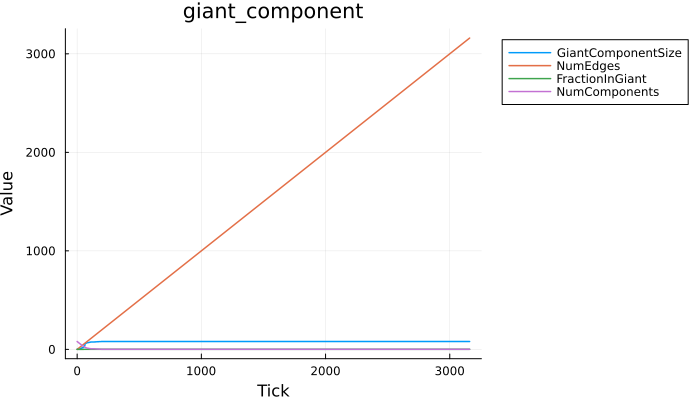
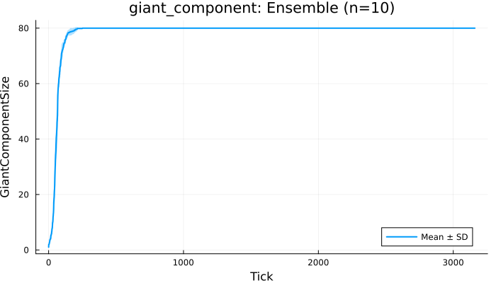
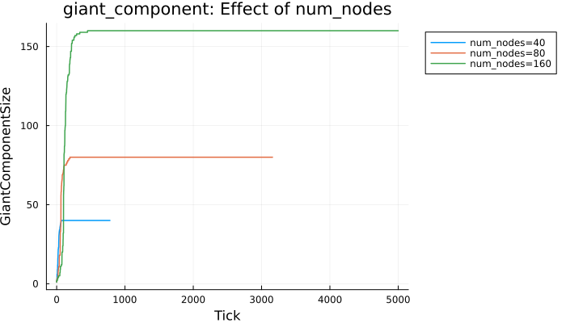

# Giant Component


- [Overview](#overview)
  - [WHAT IS IT?](#what-is-it)
  - [HOW IT WORKS](#how-it-works)
  - [THINGS TO NOTICE](#things-to-notice)
  - [THINGS TO TRY](#things-to-try)
  - [EXTENDING THE MODEL](#extending-the-model)
  - [NETLOGO FEATURES](#netlogo-features)
  - [RELATED MODELS](#related-models)
  - [CREDITS AND REFERENCES](#credits-and-references)
  - [HOW TO CITE](#how-to-cite)
  - [COPYRIGHT AND LICENSE](#copyright-and-license)
- [Parameters](#parameters)
- [Source Code](#source-code)
- [Time Series](#time-series)
- [Ensemble Runs](#ensemble-runs)
- [Parameter Sensitivity](#parameter-sensitivity)
- [Appendix: Source Code](#appendix-source-code)
  - [Parameters (`parameters.jl`)](#parameters-parametersjl)
  - [Components (`components.jl`)](#components-componentsjl)
  - [Resources (`resources.jl`)](#resources-resourcesjl)
  - [Systems (`systems.jl`)](#systems-systemsjl)
  - [Model (`model.jl`)](#model-modeljl)

## Overview

### WHAT IS IT?

In a network, a “component” is a group of nodes (people) that are all
connected to each other, directly or indirectly. So if a network has a
“giant component”, that means almost every node is reachable from almost
every other. This model shows how quickly a giant component arises if
you grow a random network.

### HOW IT WORKS

Initially we have nodes but no connections (edges) between them. At each
step, we pick two nodes at random which were not directly connected
before and add an edge between them. All possible connections between
them have exactly the same probability of occurring.

As the model runs, small chain-like “components” are formed, where the
members in each component are either directly or indirectly connected to
each other. If an edge is created between nodes from two different
components, then those two components merge into one. The component with
the most members at any given point in time is the “giant” component and
it is colored red. (If there is a tie for largest, we pick a random
component to color.)

### THINGS TO NOTICE

The y-axis of the plot shows the fraction of all nodes that are included
in the giant component. The x-axis shows the average number of
connections per node. The vertical line on the plot shows where the
average number of connections per node equals 1. What happens to the
rate of growth of the giant component at this point?

The model demonstrates one of the early proofs of random graph theory by
the mathematicians Paul Erdos and Alfred Renyi (1959). They showed that
the largest connected component of a network formed by randomly
connecting two existing nodes per time step, rapidly grows after the
average number of connections per node equals 1. In other words, the
average number of connections has a “critical point” where the network
undergoes a “phase transition” from a rather unconnected world of a
bunch of small, fragmented components, to a world where most nodes
belong to the same connected component.

### THINGS TO TRY

Let the model run until the end. Does the “giant component” live up to
its name?

Run the model again, this time slowly, a step at a time. Watch how the
components grow. What is happening when the plot is steepest?

Run it with a small number of nodes (like 10) and watch the plot. How
does it differ from the plot you get when you run it with a large number
of nodes (like 300)? If you do multiple runs with the same number of
nodes, how much does the shape of the plot vary from run to run? You can
turn off the LAYOUT? switch to get results faster.

### EXTENDING THE MODEL

Right now the probability of any two nodes getting connected to each
other is the same. Can you think of ways to make some nodes more
attractive to connect to than others? How would that impact the
formation of the giant component?

When creating new links in the `add-edge` procedure, you might be
wondering why we don’t do something like this:

    ask one-of turtles [
      create-link-with one-of other turtles with [ not link-neighbor? myself ]
    ]

Imagine that we have one node in the network that is already connected
to most of the other nodes. In the original version of `add-edge`, if
that node is picked as one of the two nodes between which we try to
create an edge, it will probably get rejected because it is likely that
it’s already linked with the other node picked. In this alternate
version of `add-edge`, however, we tell NetLogo to explicitly go looking
for a node that is not already connected to the first one (even if there
are very few of those). That makes a big difference. Try it and see how
it impacts the formation of the giant component.

### NETLOGO FEATURES

Nodes are turtle agents and edges are link agents. The `layout-spring`
primitive places the nodes, as if the edges are springs and the nodes
are repelling each other.

Though it is not used in this model, there exists a network extension
for NetLogo that you can download at:
https://github.com/NetLogo/NW-Extension.

### RELATED MODELS

See other models in the Networks section of the Models Library, such as
Preferential Attachment.

See also Network Example, in the Code Examples section.

There is also a version of this model using the (NW
extension)\[https://github.com/NetLogo/NW-Extension\] in the `demo`
folder of the extension.

### CREDITS AND REFERENCES

This model is adapted from: Duncan J. Watts. Six Degrees: The Science of
a Connected Age (W.W. Norton & Company, New York, 2003), pages 43-47.

The work Watts describes was originally published in: P. Erdos and A.
Renyi. On random graphs. Publ. Math. Debrecen, 6:290-297, 1959.

This paper has some additional analysis: S. Janson, D.E. Knuth, T.
Luczak, and B. Pittel. The birth of the giant component. Random
Structures & Algorithms 4, 3 (1993), pages 233-358.

### HOW TO CITE

If you mention this model or the NetLogo software in a publication, we
ask that you include the citations below.

For the model itself:

- Wilensky, U. (2005). NetLogo Giant Component model.
  http://ccl.northwestern.edu/netlogo/models/GiantComponent. Center for
  Connected Learning and Computer-Based Modeling, Northwestern
  University, Evanston, IL.

Please cite the NetLogo software as:

- Wilensky, U. (1999). NetLogo. http://ccl.northwestern.edu/netlogo/.
  Center for Connected Learning and Computer-Based Modeling,
  Northwestern University, Evanston, IL.

### COPYRIGHT AND LICENSE

Copyright 2005 Uri Wilensky.


This model is licensed under the Creative Commons
Attribution-NonCommercial-ShareAlike 3.0 License. To view a copy of this
license, visit https://creativecommons.org/licenses/by-nc-sa/3.0/ or
send a letter to Creative Commons, 559 Nathan Abbott Way, Stanford,
California 94305, USA.

NetLogo itself is free software for non-commercial use under the terms
of the GNU General Public License ([see full license information
here](https://ccl.northwestern.edu/netlogo/docs/copyright.html)).

To inquire about commercial licenses for either NetLogo or specific
models from the models library, please contact
netlogo-commercial-admin@ccl.northwestern.edu.

<!-- 2005 -->

## Parameters

| Parameter   | Type  | Default | Description                |
|-------------|-------|---------|----------------------------|
| `num_nodes` | `Int` | `80`    | num nodes                  |
| `max_ticks` | `Int` | `5000`  | enough for full connection |

## Source Code

The Julia code to run this model:

``` julia
using ArkModelZoo
_, trajectory = run_giant_component()
```

## Time Series



## Ensemble Runs

Ten replicates with different random seeds, showing mean ± standard
deviation.



## Parameter Sensitivity

Varying `num_nodes`.



## Appendix: Source Code

This model is implemented in the
[Ark.jl](https://github.com/sdwfrost/Ark.jl) Entity-Component-System
(ECS) framework. The code is split into five files, each with a distinct
role:

- **Parameters**: a mutable struct holding all configurable values.
- **Components**: lightweight data types attached to individual entities
  (agents).
- **Resources**: world-level shared state accessible to all systems.
- **Systems**: functions that operate on entities each tick, defining
  model behavior.
- **Model**: wiring that assembles the world, registers resources and
  systems, and provides the run entry point.

### Parameters (`parameters.jl`)

The parameter struct uses `@kwdef` so that every field has a default
value and can be overridden by keyword. These defaults match the
original NetLogo model’s slider settings.

``` julia
Base.@kwdef mutable struct GCParams
    num_nodes::Int = 80
    max_ticks::Int = 5000  # enough for full connection
    seed::Int = 42
end
```

### Components (`components.jl`)

Components are lightweight data types attached to individual entities
(agents). Mutable structs hold per-entity state, while empty tag structs
act as markers for the ECS query system to efficiently filter entities.

``` julia
mutable struct GCDummy
    _::Int
end
GCDummy() = GCDummy(0)
```

### Resources (`resources.jl`)

Resources are world-level singletons shared across all systems, used for
global state and aggregate statistics.

``` julia
mutable struct GCNetwork
    num_nodes::Int
    adj::Vector{Set{Int}}  # adjacency list: adj[i] = set of neighbors of node i
    num_edges::Int
end
function GCNetwork(n::Int)
    GCNetwork(n, [Set{Int}() for _ in 1:n], 0)
end

mutable struct GCStats
    giant_component_size::Int
    num_edges::Int
    num_components::Int
    fraction_in_giant::Float64
end
GCStats() = GCStats(0, 0, 0, 0.0)
```

### Systems (`systems.jl`)

Systems contain the model logic and execute in a defined order each
tick. Each system struct implements either `initialize!` (run once at
setup) or `update!` (run every tick).

``` julia
# --- Initialization ---

struct InitGCSystem <: System end

function initialize!(::InitGCSystem, world::World)
    params = get_resource(world, GCParams)
    net = get_resource(world, GCNetwork)
    stats = get_resource(world, GCStats)

    # Create a single dummy entity (network is tracked in resources)
    new_entity!(world, (GCDummy(),))

    # Initial state: no edges, each node is its own component
    _gc_find_components!(net, stats)
    return nothing
end

# --- Main Go System ---

struct GCGoSystem <: System end

function update!(::GCGoSystem, world::World)
    net = get_resource(world, GCNetwork)
    stats = get_resource(world, GCStats)
    rng = get_resource(world, RNGResource).rng

    n = net.num_nodes
    max_edges = n * (n - 1) ÷ 2

    # Fully connected check
    net.num_edges >= max_edges && return nothing

    # Add one random edge between two unconnected nodes
    _gc_add_edge!(net, rng)

    # Recompute components
    _gc_find_components!(net, stats)
    return nothing
end

function _gc_add_edge!(net::GCNetwork, rng)
    n = net.num_nodes
    for _ in 1:10_000
        a = rand(rng, 1:n)
        b = rand(rng, 1:n)
        a == b && continue
        b ∈ net.adj[a] && continue
        push!(net.adj[a], b)
        push!(net.adj[b], a)
        net.num_edges += 1
        return nothing
    end
    return nothing
end

function _gc_find_components!(net::GCNetwork, stats::GCStats)
    n = net.num_nodes
    visited = falses(n)
    giant = 0
    num_components = 0

    # BFS for each unvisited node
    queue = Int[]
    for start in 1:n
        visited[start] && continue
        num_components += 1
        comp_size = 0

        # BFS from start
        empty!(queue)
        push!(queue, start)
        visited[start] = true
        while !isempty(queue)
            node = popfirst!(queue)
            comp_size += 1
            for neighbor in net.adj[node]
                if !visited[neighbor]
                    visited[neighbor] = true
                    push!(queue, neighbor)
                end
            end
        end

        if comp_size > giant
            giant = comp_size
        end
    end

    stats.giant_component_size = giant
    stats.num_edges = net.num_edges
    stats.num_components = num_components
    stats.fraction_in_giant = n > 0 ? giant / n : 0.0
    return nothing
end

# --- Termination ---

struct GCTerminationSystem <: System end

function update!(::GCTerminationSystem, world::World)
    net = get_resource(world, GCNetwork)
    params = get_resource(world, GCParams)
    tick = get_resource(world, Tick)

    n = net.num_nodes
    max_edges = n * (n - 1) ÷ 2

    if net.num_edges >= max_edges || tick.tick + 1 >= params.max_ticks
        get_resource(world, Terminate).stop = true
    end
    return nothing
end
```

### Model (`model.jl`)

The model file assembles all pieces: it creates the ECS `World` with the
required component types, registers resources, builds the `Scheduler`
with systems in execution order, and exposes the public `run` entry
point. The observer pattern records the trajectory each tick.

``` julia
function gc_world(; initial_capacity::Int = 256)
    return World(GCDummy; initial_capacity = initial_capacity, allow_mutable = true)
end

function gc_systems()
    return (InitGCSystem(), GCGoSystem(), GCTerminationSystem())
end

function gc_model(params::GCParams = GCParams())
    world = gc_world()
    _add_standard_resources!(world, params)
    add_resource!(world, GCNetwork(params.num_nodes))
    add_resource!(world, GCStats())
    scheduler = Scheduler(world, gc_systems())
    initialize!(scheduler)
    return scheduler
end

struct GCObserver end

function gc_headers(::GCObserver)
    return ["GiantComponentSize", "NumEdges", "FractionInGiant", "NumComponents"]
end

function gc_values(::GCObserver, world::World)
    stats = get_resource(world, GCStats)
    return Float64[stats.giant_component_size, stats.num_edges,
                    stats.fraction_in_giant, stats.num_components]
end

function run_giant_component(; params::GCParams = GCParams(), observe::Bool = true)
    return _run_model(gc_model, GCObserver(), gc_values; params, observe)
end
```
