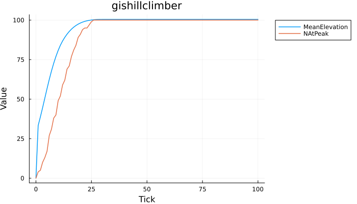
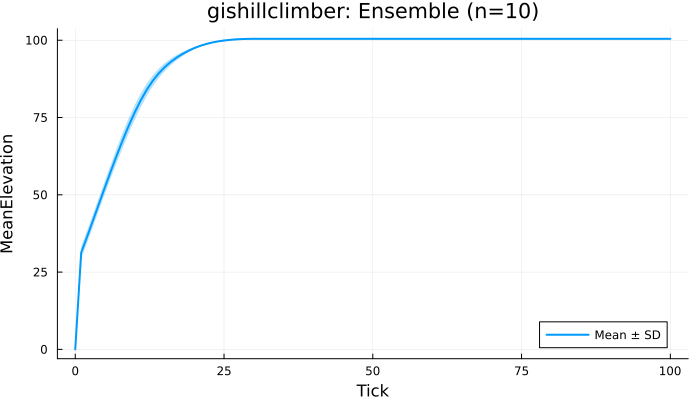
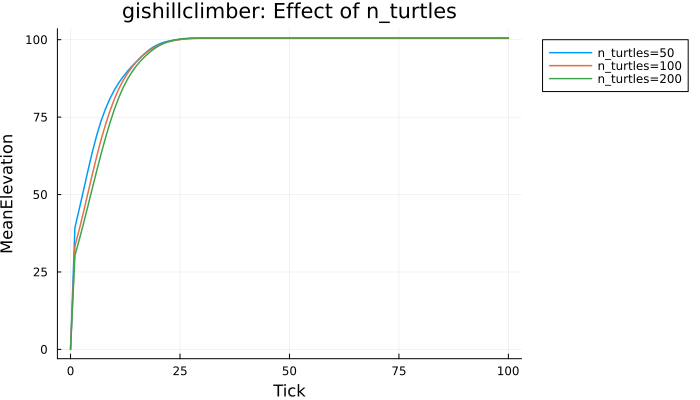

# GIS HillClimber


- [Overview](#overview)
- [Parameters](#parameters)
- [Source Code](#source-code)
- [Time Series](#time-series)
- [Ensemble Runs](#ensemble-runs)
- [Parameter Sensitivity](#parameter-sensitivity)
- [Appendix: Source Code](#appendix-source-code)
  - [Parameters (`parameters.jl`)](#parameters-parametersjl)
  - [Components (`components.jl`)](#components-componentsjl)
  - [Resources (`resources.jl`)](#resources-resourcesjl)
  - [Systems (`systems.jl`)](#systems-systemsjl)
  - [Model (`model.jl`)](#model-modeljl)

## Overview

This vignette demonstrates the **GIS HillClimber** model implemented in
[ArkModelZoo.jl](https://github.com/sdwfrost/ArkModelZoo.jl) using the
Ark.jl ECS framework.

## Parameters

| Parameter   | Type  | Default | Description |
|-------------|-------|---------|-------------|
| `max_ticks` | `Int` | `100`   | max ticks   |
| `n_turtles` | `Int` | `100`   | n turtles   |
| `grid_size` | `Int` | `51`    | grid size   |

## Source Code

The Julia code to run this model:

``` julia
using ArkModelZoo
_, trajectory = run_gishillclimber()
```

## Time Series



## Ensemble Runs

Ten replicates with different random seeds, showing mean ± standard
deviation.



## Parameter Sensitivity

Varying `n_turtles`.



## Appendix: Source Code

This model is implemented in the
[Ark.jl](https://github.com/sdwfrost/Ark.jl) Entity-Component-System
(ECS) framework. The code is split into five files, each with a distinct
role:

- **Parameters**: a mutable struct holding all configurable values.
- **Components**: lightweight data types attached to individual entities
  (agents).
- **Resources**: world-level shared state accessible to all systems.
- **Systems**: functions that operate on entities each tick, defining
  model behavior.
- **Model**: wiring that assembles the world, registers resources and
  systems, and provides the run entry point.

### Parameters (`parameters.jl`)

The parameter struct uses `@kwdef` so that every field has a default
value and can be overridden by keyword. These defaults match the
original NetLogo model’s slider settings.

``` julia
Base.@kwdef mutable struct GHCParams
    max_ticks::Int = 100
    seed::Int = 42
    n_turtles::Int = 100
    grid_size::Int = 51
end
```

### Components (`components.jl`)

Components are lightweight data types attached to individual entities
(agents). Mutable structs hold per-entity state, while empty tag structs
act as markers for the ECS query system to efficiently filter entities.

``` julia
mutable struct GHCPosition
    x::Int
    y::Int
end
GHCPosition() = GHCPosition(0, 0)

struct GHCTag end
```

### Resources (`resources.jl`)

Resources are world-level singletons shared across all systems, used for
global state and aggregate statistics.

``` julia
mutable struct GHCGrid
    width::Int
    height::Int
    elev::Matrix{Float64}
    slope_x::Matrix{Float64}
    slope_y::Matrix{Float64}
end
function GHCGrid(w::Int, h::Int)
    GHCGrid(w, h, zeros(w, h), zeros(w, h), zeros(w, h))
end

mutable struct GHCStats
    mean_elevation::Float64
    n_at_peak::Int
end
GHCStats() = GHCStats(0.0, 0)
```

### Systems (`systems.jl`)

Systems contain the model logic and execute in a defined order each
tick. Each system struct implements either `initialize!` (run once at
setup) or `update!` (run every tick).

``` julia
# GIS Hill Climber systems
# Order: init → move → stats → termination

# --- Initialization ---
struct InitGHCSystem <: System end

function initialize!(::InitGHCSystem, world::World)
    params = get_resource(world, GHCParams)
    rng    = get_resource(world, RNGResource).rng
    grid   = get_resource(world, GHCGrid)
    n      = params.grid_size

    # Create synthetic Gaussian elevation raster
    env = GisEnvelope(-25.0, 25.0, -25.0, 25.0)
    raster = gis_create_raster(n, n, env)
    cs = 50.0 / n
    for row in 0:(n-1), col in 0:(n-1)
        x = -25.0 + (col + 0.5) * cs
        y =  25.0 - (row + 0.5) * cs
        z1 = 100.0 * exp(-(x^2 + y^2) / 128.0)
        z2 =  80.0 * exp(-((x - 12)^2 + (y + 10)^2) / 50.0)
        z3 =  60.0 * exp(-((x + 15)^2 + (y - 8)^2) / 72.0)
        gis_set_raster_value!(raster, col, row, z1 + z2 + z3)
    end

    grid.elev = gis_apply_raster_simple(raster)

    # Sobel gradient computation
    sx_raster = gis_convolve(raster, SOBEL_X)
    sy_raster = gis_convolve(raster, SOBEL_Y)
    grid.slope_x = gis_apply_raster_simple(sx_raster)
    grid.slope_y = gis_apply_raster_simple(sy_raster)

    # Spawn turtles at random grid positions
    for _ in 1:params.n_turtles
        x = rand(rng, 1:n)
        y = rand(rng, 1:n)
        new_entity!(world, (GHCPosition(x, y), GHCTag()))
    end

    return nothing
end

# --- Movement: climb to highest Moore neighbor (wrapping) ---
struct GHCMoveSystem <: System end

function update!(::GHCMoveSystem, world::World)
    grid = get_resource(world, GHCGrid)
    n = grid.width

    for (_, positions, _) in Query(world, (GHCPosition, GHCTag))
        @inbounds for i in eachindex(positions)
            pos = positions[i]
            best_elev = grid.elev[pos.x, pos.y]
            best_x, best_y = pos.x, pos.y

            for dx in -1:1, dy in -1:1
                (dx == 0 && dy == 0) && continue
                nx = mod1(pos.x + dx, n)
                ny = mod1(pos.y + dy, n)
                e = grid.elev[nx, ny]
                if e > best_elev
                    best_elev = e
                    best_x = nx
                    best_y = ny
                end
            end

            pos.x = best_x
            pos.y = best_y
        end
    end
    return nothing
end

# --- Statistics ---
struct GHCStatsSystem <: System end

function update!(::GHCStatsSystem, world::World)
    grid  = get_resource(world, GHCGrid)
    stats = get_resource(world, GHCStats)

    total_elev = 0.0
    count      = 0
    n_peak     = 0

    for (_, positions, _) in Query(world, (GHCPosition, GHCTag))
        @inbounds for i in eachindex(positions)
            pos = positions[i]
            e = grid.elev[pos.x, pos.y]
            total_elev += e
            count += 1
            if e > 90.0
                n_peak += 1
            end
        end
    end

    stats.mean_elevation = count > 0 ? total_elev / count : 0.0
    stats.n_at_peak = n_peak
    return nothing
end

# --- Termination ---
struct GHCTerminationSystem <: System end

function update!(::GHCTerminationSystem, world::World)
    params = get_resource(world, GHCParams)
    tick   = get_resource(world, Tick)
    if tick.tick + 1 >= params.max_ticks
        get_resource(world, Terminate).stop = true
    end
    return nothing
end
```

### Model (`model.jl`)

The model file assembles all pieces: it creates the ECS `World` with the
required component types, registers resources, builds the `Scheduler`
with systems in execution order, and exposes the public `run` entry
point. The observer pattern records the trajectory each tick.

``` julia
function gishillclimber_world(; initial_capacity::Int = 256)
    return World(
        GHCPosition,
        GHCTag;
        initial_capacity = initial_capacity,
        allow_mutable = true,
    )
end

function gishillclimber_systems()
    return (
        InitGHCSystem(),
        GHCMoveSystem(),
        GHCStatsSystem(),
        GHCTerminationSystem(),
    )
end

function gishillclimber_model(params::GHCParams = GHCParams())
    world = gishillclimber_world()
    _add_standard_resources!(world, params)
    add_resource!(world, GHCGrid(params.grid_size, params.grid_size))
    add_resource!(world, GHCStats())
    scheduler = Scheduler(world, gishillclimber_systems())
    initialize!(scheduler)
    return scheduler
end

struct GHCObserver end

function gishillclimber_headers(::GHCObserver)
    return ["MeanElevation", "NAtPeak"]
end

function gishillclimber_values(::GHCObserver, world::World)
    stats = get_resource(world, GHCStats)
    return Float64[stats.mean_elevation, Float64(stats.n_at_peak)]
end

function run_gishillclimber(; params::GHCParams = GHCParams(), observe::Bool = true)
    return _run_model(gishillclimber_model, GHCObserver(), gishillclimber_values; params, observe)
end
```
