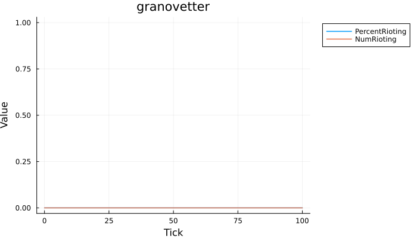
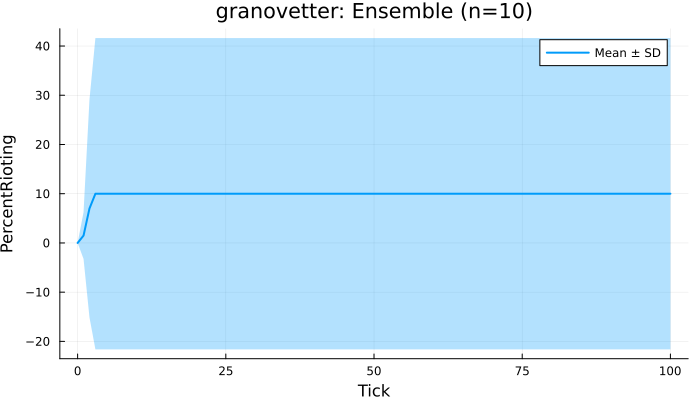
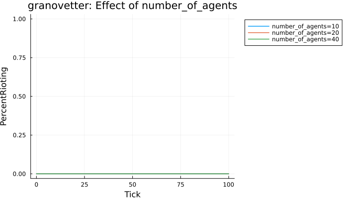

# Granovetter


- [Overview](#overview)
  - [WHAT IS IT?](#what-is-it)
  - [HOW IT WORKS](#how-it-works)
  - [THINGS TO NOTICE](#things-to-notice)
- [Parameters](#parameters)
- [Source Code](#source-code)
- [Time Series](#time-series)
- [Ensemble Runs](#ensemble-runs)
- [Parameter Sensitivity](#parameter-sensitivity)
- [Appendix: Source Code](#appendix-source-code)
  - [Parameters (`parameters.jl`)](#parameters-parametersjl)
  - [Components (`components.jl`)](#components-componentsjl)
  - [Resources (`resources.jl`)](#resources-resourcesjl)
  - [Systems (`systems.jl`)](#systems-systemsjl)
  - [Model (`model.jl`)](#model-modeljl)

## Overview

### WHAT IS IT?

This model reproduces [Mark Granovetter’s
(1978)](http://www.jstor.org/stable/2778111) threshold model of
collective behavior with different network structures.

### HOW IT WORKS

Agents face a binary decision: to participate or not in a riot,
following Granovetter’s original example. They are represented as nodes
in a network. Each agent holds a threshold representing the minimum
proportion (in % terms) of its network neighbours that need to
participate in the riot to be willing to enter the riot itself. In each
round, agents check whether this condition is satisfied and, in case,
begin to riot themselves.

### THINGS TO NOTICE

How the riots spread under different threshold distributions and network
shapes. Which are the conditions helping or hindering the spreading of
the riots?

## Parameters

| Parameter | Type | Default | Description |
|----|----|----|----|
| `number_of_agents` | `Int` | `20` | number of agents |
| `network` | `String` | `"random"` | “random”, “fully connected”, “small-world” |
| `threshold_distribution` | `String` | `"normal"` | “uniform”, “normal” |
| `number_of_links` | `Int` | `2` | number of links |
| `rewire_prop` | `Float64` | `0.2` | rewire prop |
| `min_threshold` | `Float64` | `0.0` | for uniform |
| `max_threshold` | `Float64` | `75.0` | for uniform |
| `mean_threshold` | `Float64` | `25.0` | for normal |
| `sd_threshold` | `Float64` | `10.0` | for normal |
| `max_ticks` | `Int` | `100` | max ticks |

## Source Code

The Julia code to run this model:

``` julia
using ArkModelZoo
_, trajectory = run_granovetter()
```

## Time Series



## Ensemble Runs

Ten replicates with different random seeds, showing mean ± standard
deviation.



## Parameter Sensitivity

Varying `number_of_agents`.



## Appendix: Source Code

This model is implemented in the
[Ark.jl](https://github.com/sdwfrost/Ark.jl) Entity-Component-System
(ECS) framework. The code is split into five files, each with a distinct
role:

- **Parameters**: a mutable struct holding all configurable values.
- **Components**: lightweight data types attached to individual entities
  (agents).
- **Resources**: world-level shared state accessible to all systems.
- **Systems**: functions that operate on entities each tick, defining
  model behavior.
- **Model**: wiring that assembles the world, registers resources and
  systems, and provides the run entry point.

### Parameters (`parameters.jl`)

The parameter struct uses `@kwdef` so that every field has a default
value and can be overridden by keyword. These defaults match the
original NetLogo model’s slider settings.

``` julia
Base.@kwdef mutable struct GRANParams
    number_of_agents::Int = 20
    network::String = "random"              # "random", "fully connected", "small-world"
    threshold_distribution::String = "normal" # "uniform", "normal"
    number_of_links::Int = 2
    rewire_prop::Float64 = 0.2
    min_threshold::Float64 = 0.0            # for uniform
    max_threshold::Float64 = 75.0           # for uniform
    mean_threshold::Float64 = 25.0          # for normal
    sd_threshold::Float64 = 10.0            # for normal
    max_ticks::Int = 100
    seed::Int = 42
end
```

### Components (`components.jl`)

Components are lightweight data types attached to individual entities
(agents). Mutable structs hold per-entity state, while empty tag structs
act as markers for the ECS query system to efficiently filter entities.

``` julia
mutable struct GRANAgent
    id::Int
    threshold::Float64
    riot::Bool
end
GRANAgent() = GRANAgent(0, 0.0, false)
```

### Resources (`resources.jl`)

Resources are world-level singletons shared across all systems, used for
global state and aggregate statistics.

``` julia
mutable struct GRANNetwork
    num_agents::Int
    neighbors::Vector{Vector{Int}}   # adjacency list (1-indexed agent IDs)
end
GRANNetwork(n::Int) = GRANNetwork(n, [Int[] for _ in 1:n])

mutable struct GRANStats
    percent_rioting::Float64
    num_rioting::Int
end
GRANStats() = GRANStats(0.0, 0)
```

### Systems (`systems.jl`)

Systems contain the model logic and execute in a defined order each
tick. Each system struct implements either `initialize!` (run once at
setup) or `update!` (run every tick).

``` julia
# --- Initialization ---

struct InitGRANSystem <: System end

function initialize!(::InitGRANSystem, world::World)
    params = get_resource(world, GRANParams)
    rng = get_resource(world, RNGResource).rng
    n = params.number_of_agents
    network = get_resource(world, GRANNetwork)

    # Create agents
    agent_eids = Entity[]
    agents = GRANAgent[]
    for i in 1:n
        ag = GRANAgent()
        ag.id = i
        ag.riot = false

        if params.threshold_distribution == "uniform"
            lo = params.min_threshold
            hi = params.max_threshold
            ag.threshold = lo + rand(rng) * (hi - lo)
        else
            ag.threshold = round(params.mean_threshold + params.sd_threshold * randn(rng))
        end
        ag.threshold = clamp(ag.threshold, 0.0, 100.0)

        eid = new_entity!(world, (ag,))
        push!(agent_eids, eid)
        push!(agents, ag)
    end

    # Build network
    if params.network == "fully connected"
        for i in 1:n, j in i+1:n
            _gran_add_edge!(network, i, j)
        end
    elseif params.network == "small-world"
        # Ring lattice
        for i in 1:n
            for k in 1:params.number_of_links
                j = mod1(i + k, n)
                if !(j in network.neighbors[i])
                    _gran_add_edge!(network, i, j)
                end
            end
        end
        # Rewire
        nrewire = round(Int, params.rewire_prop * n)
        for _ in 1:nrewire
            i = rand(rng, 1:n)
            if !isempty(network.neighbors[i])
                # Remove a random edge
                j_idx = rand(rng, 1:length(network.neighbors[i]))
                j = network.neighbors[i][j_idx]
                deleteat!(network.neighbors[i], j_idx)
                filter!(x -> x != i, network.neighbors[j])
                # Add random edge
                candidates = [k for k in 1:n if k != i && !(k in network.neighbors[i])]
                if !isempty(candidates)
                    new_j = candidates[rand(rng, 1:length(candidates))]
                    _gran_add_edge!(network, i, new_j)
                end
            end
        end
    else  # random
        for i in 1:n
            candidates = [k for k in 1:n if k != i && !(k in network.neighbors[i])]
            nlinks = min(params.number_of_links, length(candidates))
            if nlinks > 0
                Random.shuffle!(rng, candidates)
                for j in candidates[1:nlinks]
                    if !(j in network.neighbors[i])
                        _gran_add_edge!(network, i, j)
                    end
                end
            end
        end
    end

    _gran_update_stats!(world)
    return nothing
end

function _gran_add_edge!(nw::GRANNetwork, i::Int, j::Int)
    if !(j in nw.neighbors[i])
        push!(nw.neighbors[i], j)
    end
    if !(i in nw.neighbors[j])
        push!(nw.neighbors[j], i)
    end
end

# --- Go ---

struct GRANGoSystem <: System end

function update!(::GRANGoSystem, world::World)
    network = get_resource(world, GRANNetwork)

    # Collect all agents keyed by id
    agent_map = Dict{Int, GRANAgent}()
    for (_, agents) in Query(world, (GRANAgent,))
        for ag in agents
            agent_map[ag.id] = ag
        end
    end

    # Each agent checks proportion of rioting neighbors
    for (_, agents) in Query(world, (GRANAgent,))
        for ag in agents
            nbrs = network.neighbors[ag.id]
            isempty(nbrs) && continue
            rioting_nbrs = count(j -> agent_map[j].riot, nbrs)
            prop_rioting = 100.0 * rioting_nbrs / length(nbrs)
            if prop_rioting >= ag.threshold
                ag.riot = true
            end
        end
    end

    _gran_update_stats!(world)
    return nothing
end

function _gran_update_stats!(world::World)
    stats = get_resource(world, GRANStats)
    total = 0
    rioting = 0
    for (_, agents) in Query(world, (GRANAgent,))
        for ag in agents
            total += 1
            if ag.riot
                rioting += 1
            end
        end
    end
    stats.num_rioting = rioting
    stats.percent_rioting = total > 0 ? 100.0 * rioting / total : 0.0
end

# --- Termination ---

struct GRANTerminationSystem <: System end

function update!(::GRANTerminationSystem, world::World)
    params = get_resource(world, GRANParams)
    tick = get_resource(world, Tick)
    if tick.tick + 1 >= params.max_ticks
        get_resource(world, Terminate).stop = true
    end
    return nothing
end
```

### Model (`model.jl`)

The model file assembles all pieces: it creates the ECS `World` with the
required component types, registers resources, builds the `Scheduler`
with systems in execution order, and exposes the public `run` entry
point. The observer pattern records the trajectory each tick.

``` julia
function gran_world(; initial_capacity::Int = 256)
    return World(GRANAgent; initial_capacity = initial_capacity, allow_mutable = true)
end

function gran_systems()
    return (
        InitGRANSystem(),
        GRANGoSystem(),
        GRANTerminationSystem(),
    )
end

function gran_model(params::GRANParams = GRANParams())
    world = gran_world()
    _add_standard_resources!(world, params)
    add_resource!(world, GRANNetwork(params.number_of_agents))
    add_resource!(world, GRANStats())
    scheduler = Scheduler(world, gran_systems())
    initialize!(scheduler)
    return scheduler
end

struct GRANObserver end

function gran_headers(::GRANObserver)
    return ["PercentRioting", "NumRioting"]
end

function gran_values(::GRANObserver, world::World)
    stats = get_resource(world, GRANStats)
    return Float64[stats.percent_rioting, Float64(stats.num_rioting)]
end

function run_granovetter(; params::GRANParams = GRANParams(), observe::Bool = true)
    return _run_model(gran_model, GRANObserver(), gran_values; params, observe)
end
```
