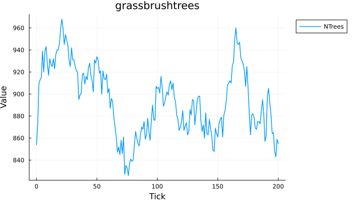
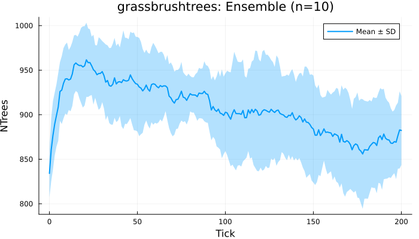
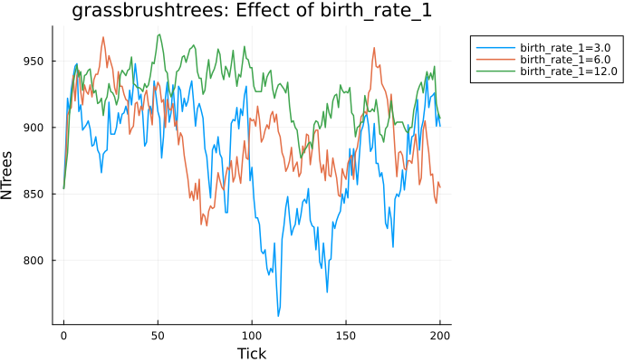

# Grass Brush Trees


- [Overview](#overview)
- [Parameters](#parameters)
- [Source Code](#source-code)
- [Time Series](#time-series)
- [Ensemble Runs](#ensemble-runs)
- [Parameter Sensitivity](#parameter-sensitivity)
- [Appendix: Source Code](#appendix-source-code)
  - [Parameters (`parameters.jl`)](#parameters-parametersjl)
  - [Components (`components.jl`)](#components-componentsjl)
  - [Resources (`resources.jl`)](#resources-resourcesjl)
  - [Systems (`systems.jl`)](#systems-systemsjl)
  - [Model (`model.jl`)](#model-modeljl)

## Overview

This vignette demonstrates the **Grass Brush Trees** model implemented
in [ArkModelZoo.jl](https://github.com/sdwfrost/ArkModelZoo.jl) using
the Ark.jl ECS framework.

## Parameters

| Parameter      | Type      | Default | Description      |
|----------------|-----------|---------|------------------|
| `grid_width`   | `Int`     | `50`    | grid width       |
| `grid_height`  | `Int`     | `50`    | grid height      |
| `birth_rate_1` | `Float64` | `6.0`   | brush birth rate |
| `birth_rate_2` | `Float64` | `2.0`   | tree birth rate  |
| `max_ticks`    | `Int`     | `200`   | max ticks        |

## Source Code

The Julia code to run this model:

``` julia
using ArkModelZoo
_, trajectory = run_gbt()
```

## Time Series



## Ensemble Runs

Ten replicates with different random seeds, showing mean ± standard
deviation.



## Parameter Sensitivity

Varying `birth_rate_1`.



## Appendix: Source Code

This model is implemented in the
[Ark.jl](https://github.com/sdwfrost/Ark.jl) Entity-Component-System
(ECS) framework. The code is split into five files, each with a distinct
role:

- **Parameters**: a mutable struct holding all configurable values.
- **Components**: lightweight data types attached to individual entities
  (agents).
- **Resources**: world-level shared state accessible to all systems.
- **Systems**: functions that operate on entities each tick, defining
  model behavior.
- **Model**: wiring that assembles the world, registers resources and
  systems, and provides the run entry point.

### Parameters (`parameters.jl`)

The parameter struct uses `@kwdef` so that every field has a default
value and can be overridden by keyword. These defaults match the
original NetLogo model’s slider settings.

``` julia
Base.@kwdef mutable struct GBTParams
    grid_width::Int = 50
    grid_height::Int = 50
    birth_rate_1::Float64 = 6.0  # brush birth rate
    birth_rate_2::Float64 = 2.0  # tree birth rate
    max_ticks::Int = 200
    seed::Int = 42
end
```

### Components (`components.jl`)

Components are lightweight data types attached to individual entities
(agents). Mutable structs hold per-entity state, while empty tag structs
act as markers for the ECS query system to efficiently filter entities.

``` julia
# GrassBrushTrees model has no entity components — purely patch-based
struct GBTDummy end
```

### Resources (`resources.jl`)

Resources are world-level singletons shared across all systems, used for
global state and aggregate statistics.

``` julia
mutable struct GBTGrid
    width::Int
    height::Int
    types::Matrix{Int}  # 0=grass, 1=brush, 2=tree
end
GBTGrid(w, h) = GBTGrid(w, h, zeros(Int, w, h))

mutable struct GBTStats
    n_trees::Int
end
GBTStats() = GBTStats(0)
```

### Systems (`systems.jl`)

Systems contain the model logic and execute in a defined order each
tick. Each system struct implements either `initialize!` (run once at
setup) or `update!` (run every tick).

``` julia
# --- Initialization ---

struct InitGBTSystem <: System end

function initialize!(::InitGBTSystem, world::World)
    params = get_resource(world, GBTParams)
    rng = get_resource(world, RNGResource).rng
    grid = get_resource(world, GBTGrid)
    stats = get_resource(world, GBTStats)

    # Each patch gets random type 0, 1, or 2
    for x in 1:grid.width, y in 1:grid.height
        grid.types[x, y] = rand(rng, 0:2)
    end

    stats.n_trees = count(==(2), grid.types)
    return nothing
end

# --- GBT Update ---
# NetLogo: repeat N [ ask one-of patches [ coin-flip death-event or birth-event ] ]
# Death: any type → grass with prob norm-d
# Birth: brush spreads to grass neighbor (prob norm-b-1), tree spreads to grass/brush neighbor (prob norm-b-2)

struct GBTUpdateSystem <: System end

function update!(::GBTUpdateSystem, world::World)
    grid = get_resource(world, GBTGrid)
    params = get_resource(world, GBTParams)
    rng = get_resource(world, RNGResource).rng
    w, h = grid.width, grid.height
    n = w * h

    max_rate = max(params.birth_rate_1, params.birth_rate_2)
    norm_d = 1.0 / max_rate
    norm_b_1 = params.birth_rate_1 / max_rate
    norm_b_2 = params.birth_rate_2 / max_rate

    for _ in 1:n
        # Pick a random patch
        x = rand(rng, 1:w)
        y = rand(rng, 1:h)

        if rand(rng, 0:1) == 1
            # Death event: any type → grass with prob norm_d
            if rand(rng) < norm_d
                grid.types[x, y] = 0
            end
        else
            # Birth event
            ptype = grid.types[x, y]
            if ptype == 1
                # Brush spreads to a grass neighbor
                if rand(rng) < norm_b_1
                    dir = rand(rng, 1:4)
                    nx, ny = if dir == 1
                        (mod1(x - 1, w), y)
                    elseif dir == 2
                        (mod1(x + 1, w), y)
                    elseif dir == 3
                        (x, mod1(y - 1, h))
                    else
                        (x, mod1(y + 1, h))
                    end
                    if grid.types[nx, ny] == 0
                        grid.types[nx, ny] = 1
                    end
                end
            elseif ptype == 2
                # Tree spreads to a grass or brush neighbor
                if rand(rng) < norm_b_2
                    dir = rand(rng, 1:4)
                    nx, ny = if dir == 1
                        (mod1(x - 1, w), y)
                    elseif dir == 2
                        (mod1(x + 1, w), y)
                    elseif dir == 3
                        (x, mod1(y - 1, h))
                    else
                        (x, mod1(y + 1, h))
                    end
                    if grid.types[nx, ny] < 2
                        grid.types[nx, ny] = 2
                    end
                end
            end
        end
    end
    return nothing
end

# --- Stats ---

struct GBTStatsSystem <: System end

function update!(::GBTStatsSystem, world::World)
    grid = get_resource(world, GBTGrid)
    stats = get_resource(world, GBTStats)
    stats.n_trees = count(==(2), grid.types)
    return nothing
end

# --- Termination ---

struct GBTTerminationSystem <: System end

function update!(::GBTTerminationSystem, world::World)
    params = get_resource(world, GBTParams)
    tick = get_resource(world, Tick)

    if tick.tick + 1 >= params.max_ticks
        get_resource(world, Terminate).stop = true
    end
    return nothing
end
```

### Model (`model.jl`)

The model file assembles all pieces: it creates the ECS `World` with the
required component types, registers resources, builds the `Scheduler`
with systems in execution order, and exposes the public `run` entry
point. The observer pattern records the trajectory each tick.

``` julia
function gbt_world(; initial_capacity::Int = 128)
    return World(
        GBTDummy;
        initial_capacity = initial_capacity,
        allow_mutable = true,
    )
end

function gbt_systems()
    return (
        InitGBTSystem(),
        GBTUpdateSystem(),
        GBTStatsSystem(),
        GBTTerminationSystem(),
    )
end

function gbt_model(params::GBTParams = GBTParams())
    world = gbt_world()
    _add_standard_resources!(world, params)
    add_resource!(world, GBTGrid(params.grid_width, params.grid_height))
    add_resource!(world, GBTStats())
    scheduler = Scheduler(world, gbt_systems())
    initialize!(scheduler)
    return scheduler
end

struct GBTObserver end

function gbt_headers(::GBTObserver)
    return ["NTrees"]
end

function gbt_values(::GBTObserver, world::World)
    stats = get_resource(world, GBTStats)
    return Float64[stats.n_trees]
end

function run_gbt(; params::GBTParams = GBTParams(), observe::Bool = true)
    return _run_model(gbt_model, GBTObserver(), gbt_values; params, observe)
end
```
