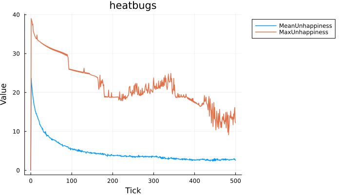
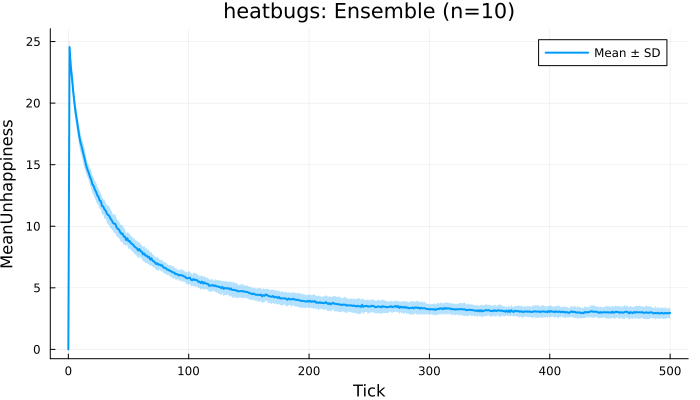
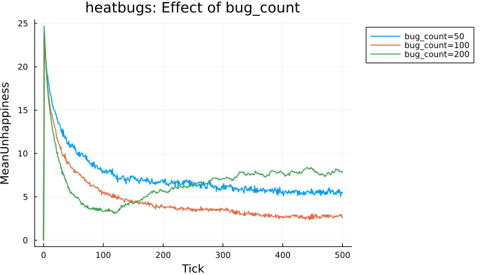

## Overview

### WHAT IS IT?

Heatbugs is an abstract model of the behavior of biologically-inspired agents that attempt to maintain an optimum temperature around themselves.  It demonstrates how simple rules defining the behavior of agents can produce several different kinds of emergent behavior.

Heatbugs has been used as a demonstration model for many agent-based modeling toolkits. We provide a NetLogo version to assist users in learning and comparing different toolkits.  It demonstrates coding techniques in NetLogo and may be useful as a starting point for building other models.

While this NetLogo model attempts to match the Repast and Swarm versions (see "Credits" below), we haven't done a rigorous comparative analysis of the different versions, so it is possible that there are small inadvertent differences in the underlying rules and behavior.

### HOW IT WORKS

The bugs move around on a grid of square "patches".  A bug may not move to a patch that already has another bug on it.

Each bug radiates a small amount of heat.  Heat gradually diffuses through the world; some heat is lost to cooling.

Each bug has an "ideal" temperature it wants to be.  The bigger the difference between the temperature of the patch where the bug is and the bug's ideal temperature, the more "unhappy" the bug is.  When a bug is unhappy, it moves.  If it is too hot, it moves to the coolest adjacent empty patch.  Conversely, if a bug is too cold, it moves to the warmest adjacent empty patch.  (Note that these bugs aren't smart enough to always move to the best available patch.)

### THINGS TO NOTICE

Depending on their ideal temperatures, some bugs will tend to clump together, while others will tend to avoid all other bugs, and others still flutter around the edges of clumps.  All of these behaviors are affected as well by the evaporation rate.

The diffusion rate affects the cohesiveness of clumps.  If diffusion-rate is slow, many tiny clumps form.  Why?

Most interesting behaviors occur when the number of bugs, how much heat they generate, and how quickly the world cools are balanced such that excessive heat does not build up.

### THINGS TO TRY

Vary DIFFUSION-RATE.

Vary EVAPORATION-RATE in relation to the output-heat range of the bugs.

Use the HEAT-UP button to scramble clumped heatbugs and watch as they re-assemble into new clumps.

### EXTENDING THE MODEL

Randomize the amount of heat bugs generate each cycle.

Allow users to introduce heat into the system with the mouse.

### NETLOGO FEATURES

`n-of` and `sprout` together let us initially place each bug on its own patch with a minimum of code.

Notice how the code does not make any use of X and Y coordinates.  The `neighbors` and `move-to` primitives take care of sensing and motion on a toroidal grid without the need for any explicit coordinate math.

The `diffuse` command is used to diffuse the heat around the patch grid.

### RELATED MODELS

Slime

### CREDITS AND REFERENCES

Swarm version of Heatbugs -- https://web.archive.org/web/20130211011213/http://www.swarm.org/wiki/Examples_of_Swarm_applications

RePast version of Heatbugs -- http://repast.sourceforge.net/repast_3/examples/

### HOW TO CITE

If you mention this model or the NetLogo software in a publication, we ask that you include the citations below.

For the model itself:

* Wilensky, U. (2004).  NetLogo Heatbugs model.  http://ccl.northwestern.edu/netlogo/models/Heatbugs.  Center for Connected Learning and Computer-Based Modeling, Northwestern University, Evanston, IL.

Please cite the NetLogo software as:

* Wilensky, U. (1999). NetLogo. http://ccl.northwestern.edu/netlogo/. Center for Connected Learning and Computer-Based Modeling, Northwestern University, Evanston, IL.

### COPYRIGHT AND LICENSE

Copyright 2004 Uri Wilensky.


This model is licensed under the Creative Commons Attribution-NonCommercial-ShareAlike 3.0 License.  To view a copy of this license, visit https://creativecommons.org/licenses/by-nc-sa/3.0/ or send a letter to Creative Commons, 559 Nathan Abbott Way, Stanford, California 94305, USA.

NetLogo itself is free software for non-commercial use under the terms of the GNU General Public License ([see full license information here](https://ccl.northwestern.edu/netlogo/docs/copyright.html)).

To inquire about commercial licenses for either NetLogo or specific models from the models library, please contact netlogo-commercial-admin@ccl.northwestern.edu.

This model was created as part of the projects: PARTICIPATORY SIMULATIONS: NETWORK-BASED DESIGN FOR SYSTEMS LEARNING IN CLASSROOMS and/or INTEGRATED SIMULATION AND MODELING ENVIRONMENT. The project gratefully acknowledges the support of the National Science Foundation (REPP & ROLE programs) -- grant numbers REC #9814682 and REC-0126227.

<!-- 2004 -->

## Parameters

| Parameter | Type | Default | Description |
|-----------|------|---------|-------------|
| `bug_count` | `Int` | `100` | bug count |
| `min_ideal_temp` | `Float64` | `10.0` | min ideal temp |
| `max_ideal_temp` | `Float64` | `40.0` | max ideal temp |
| `min_output_heat` | `Float64` | `5.0` | min output heat |
| `max_output_heat` | `Float64` | `25.0` | max output heat |
| `evaporation_rate` | `Float64` | `0.01` | evaporation rate |
| `diffusion_rate` | `Float64` | `0.9` | diffusion rate |
| `random_move_chance` | `Float64` | `0.0` | percent |
| `grid_width` | `Int` | `100` | grid width |
| `grid_height` | `Int` | `100` | grid height |
| `max_ticks` | `Int` | `500` | max ticks |

## Source Code

The Julia code to run this model:

```julia
using ArkModelZoo
_, trajectory = run_heatbugs()
```

## Time Series

{width=100%}

## Ensemble Runs

Ten replicates with different random seeds, showing mean ± standard deviation.

{width=100%}

## Parameter Sensitivity

Varying `bug_count`.

{width=100%}


## Appendix: Source Code

This model is implemented in the [Ark.jl](https://github.com/sdwfrost/Ark.jl) Entity-Component-System (ECS) framework. The code is split into five files, each with a distinct role:

- **Parameters**: a mutable struct holding all configurable values.
- **Components**: lightweight data types attached to individual entities (agents).
- **Resources**: world-level shared state accessible to all systems.
- **Systems**: functions that operate on entities each tick, defining model behavior.
- **Model**: wiring that assembles the world, registers resources and systems, and provides the run entry point.

### Parameters (`parameters.jl`)

The parameter struct uses `@kwdef` so that every field has a default value and can be overridden by keyword. These defaults match the original NetLogo model's slider settings.

```julia
Base.@kwdef mutable struct HBParams
    bug_count::Int = 100
    min_ideal_temp::Float64 = 10.0
    max_ideal_temp::Float64 = 40.0
    min_output_heat::Float64 = 5.0
    max_output_heat::Float64 = 25.0
    evaporation_rate::Float64 = 0.01
    diffusion_rate::Float64 = 0.9
    random_move_chance::Float64 = 0.0   # percent
    grid_width::Int = 100
    grid_height::Int = 100
    max_ticks::Int = 500
    seed::Int = 42
end
```

### Components (`components.jl`)

Components are lightweight data types attached to individual entities (agents). Mutable structs hold per-entity state, while empty tag structs act as markers for the ECS query system to efficiently filter entities.

```julia
mutable struct HBPos
    x::Int
    y::Int
end
HBPos() = HBPos(0, 0)

mutable struct HBBug
    ideal_temp::Float64
    output_heat::Float64
    unhappiness::Float64
end
HBBug() = HBBug(0.0, 0.0, 0.0)
```

### Resources (`resources.jl`)

Resources are world-level singletons shared across all systems, used for global state and aggregate statistics.

```julia
mutable struct HBGrid
    width::Int
    height::Int
    cells::Matrix{Entity}      # bug occupancy
    temp::Matrix{Float64}      # patch temperatures
end

function HBGrid(w::Int, h::Int)
    HBGrid(w, h, fill(zero_entity, w, h), zeros(Float64, w, h))
end

function hb_is_empty(grid::HBGrid, x::Int, y::Int)
    is_zero(grid.cells[x, y])
end

mutable struct HBStats
    mean_unhappiness::Float64
    max_unhappiness::Float64
end
HBStats() = HBStats(0.0, 0.0)
```

### Systems (`systems.jl`)

Systems contain the model logic and execute in a defined order each tick. Each system struct implements either `initialize!` (run once at setup) or `update!` (run every tick).

```julia
# --- Initialization ---

struct InitHBSystem <: System end

function initialize!(::InitHBSystem, world::World)
    params = get_resource(world, HBParams)
    rng = get_resource(world, RNGResource).rng
    grid = get_resource(world, HBGrid)

    # Place bugs on random unique patches (n-of bug-count patches)
    all_patches = [(x, y) for x in 1:grid.width for y in 1:grid.height]
    Random.shuffle!(rng, all_patches)
    n = min(params.bug_count, length(all_patches))
    for i in 1:n
        x, y = all_patches[i]
        ideal = params.min_ideal_temp + Float64(rand(rng, 0:Int(params.max_ideal_temp - params.min_ideal_temp) - 1))
        output = params.min_output_heat + Float64(rand(rng, 0:Int(params.max_output_heat - params.min_output_heat) - 1))
        unhappy = abs(ideal - grid.temp[x, y])
        eid = new_entity!(world, (HBPos(x, y), HBBug(ideal, output, unhappy)))
        grid.cells[x, y] = eid
    end
    return nothing
end

# --- Diffuse and Evaporate ---

struct HBDiffuseSystem <: System end

function update!(::HBDiffuseSystem, world::World)
    params = get_resource(world, HBParams)
    grid = get_resource(world, HBGrid)
    w, h = grid.width, grid.height

    # NetLogo diffuse: each patch shares rate/8 of its value with each of 8 neighbors
    diffuse!(grid.temp, params.diffusion_rate, w, h)

    # Evaporation
    evap = 1.0 - params.evaporation_rate
    for i in eachindex(grid.temp)
        grid.temp[i] *= evap
    end
    return nothing
end

# --- Bug Step ---

struct HBGoSystem <: System end

function update!(::HBGoSystem, world::World)
    params = get_resource(world, HBParams)
    rng = get_resource(world, RNGResource).rng
    grid = get_resource(world, HBGrid)
    stats = get_resource(world, HBStats)
    w, h = grid.width, grid.height

    # Collect all bugs
    bugs = Tuple{Entity, Int, Int}[]
    for (eids, positions, bugdata) in Query(world, (HBPos, HBBug))
        @inbounds for i in eachindex(positions)
            push!(bugs, (eids[i], positions[i].x, positions[i].y))
        end
    end

    Random.shuffle!(rng, bugs)

    total_unhappy = 0.0
    max_unhappy = 0.0

    for (eid, ox, oy) in bugs
        bug = get_components(world, eid, (HBBug,))[1]
        pos = get_components(world, eid, (HBPos,))[1]
        # Compute unhappiness
        bug.unhappiness = abs(bug.ideal_temp - grid.temp[pos.x, pos.y])

        if bug.unhappiness > 0
            if rand(rng) * 100.0 < params.random_move_chance
                # Random move to any neighbor
                target = _hb_random_neighbor(rng, pos.x, pos.y, w, h)
                _hb_bug_move!(grid, world, eid, pos, target, rng)
            else
                # Move to best patch
                target = _hb_best_patch(bug, grid, pos.x, pos.y, w, h)
                _hb_bug_move!(grid, world, eid, pos, target, rng)
            end
        end

        # Output heat
        grid.temp[pos.x, pos.y] += bug.output_heat

        total_unhappy += bug.unhappiness
        max_unhappy = max(max_unhappy, bug.unhappiness)
    end

    n = length(bugs)
    stats.mean_unhappiness = n > 0 ? total_unhappy / n : 0.0
    stats.max_unhappiness = max_unhappy
    return nothing
end

function _hb_random_neighbor(rng, x::Int, y::Int, w::Int, h::Int)
    offsets = ((-1,-1),(-1,0),(-1,1),(0,-1),(0,1),(1,-1),(1,0),(1,1))
    dx, dy = offsets[rand(rng, 1:8)]
    return (mod1(x + dx, w), mod1(y + dy, h))
end

function _hb_best_patch(bug::HBBug, grid::HBGrid, x::Int, y::Int, w::Int, h::Int)
    if grid.temp[x, y] < bug.ideal_temp
        # Want hotter: find hottest neighbor
        best = (x, y)
        best_temp = grid.temp[x, y]
        for dx in -1:1, dy in -1:1
            (dx == 0 && dy == 0) && continue
            nx = mod1(x + dx, w)
            ny = mod1(y + dy, h)
            t = grid.temp[nx, ny]
            if t > best_temp
                best_temp = t
                best = (nx, ny)
            end
        end
        return best
    else
        # Want cooler: find coolest neighbor
        best = (x, y)
        best_temp = grid.temp[x, y]
        for dx in -1:1, dy in -1:1
            (dx == 0 && dy == 0) && continue
            nx = mod1(x + dx, w)
            ny = mod1(y + dy, h)
            t = grid.temp[nx, ny]
            if t < best_temp
                best_temp = t
                best = (nx, ny)
            end
        end
        return best
    end
end

function _hb_bug_move!(grid::HBGrid, world::World, eid::Entity, pos::HBPos, target::Tuple{Int,Int}, rng)
    tx, ty = target
    # Already here?
    (tx == pos.x && ty == pos.y) && return
    w, h = grid.width, grid.height
    # Target not occupied?
    if hb_is_empty(grid, tx, ty)
        grid.cells[pos.x, pos.y] = zero_entity
        grid.cells[tx, ty] = eid
        pos.x = tx
        pos.y = ty
        return
    end
    # Try any empty neighbor
    neighbors = Tuple{Int,Int}[]
    for dx in -1:1, dy in -1:1
        (dx == 0 && dy == 0) && continue
        nx = mod1(pos.x + dx, w)
        ny = mod1(pos.y + dy, h)
        if hb_is_empty(grid, nx, ny)
            push!(neighbors, (nx, ny))
        end
    end
    if !isempty(neighbors)
        nx, ny = neighbors[rand(rng, 1:length(neighbors))]
        grid.cells[pos.x, pos.y] = zero_entity
        grid.cells[nx, ny] = eid
        pos.x = nx
        pos.y = ny
    end
end

# --- Termination ---

struct HBTerminationSystem <: System end

function update!(::HBTerminationSystem, world::World)
    params = get_resource(world, HBParams)
    tick = get_resource(world, Tick)
    if tick.tick + 1 >= params.max_ticks
        get_resource(world, Terminate).stop = true
    end
    return nothing
end
```

### Model (`model.jl`)

The model file assembles all pieces: it creates the ECS `World` with the required component types, registers resources, builds the `Scheduler` with systems in execution order, and exposes the public `run` entry point. The observer pattern records the trajectory each tick.

```julia
function heatbugs_world(; initial_capacity::Int = 4096)
    return World(HBPos, HBBug; initial_capacity = initial_capacity, allow_mutable = true)
end

function heatbugs_systems()
    return (InitHBSystem(), HBDiffuseSystem(), HBGoSystem(), HBTerminationSystem())
end

function heatbugs_model(params::HBParams = HBParams())
    world = heatbugs_world()
    _add_standard_resources!(world, params)
    add_resource!(world, HBGrid(params.grid_width, params.grid_height))
    add_resource!(world, HBStats())
    scheduler = Scheduler(world, heatbugs_systems())
    initialize!(scheduler)
    return scheduler
end

struct HBObserver end

function heatbugs_headers(::HBObserver)
    return ["MeanUnhappiness", "MaxUnhappiness"]
end

function heatbugs_values(::HBObserver, world::World)
    stats = get_resource(world, HBStats)
    return Float64[stats.mean_unhappiness, stats.max_unhappiness]
end

function run_heatbugs(; params::HBParams = HBParams(), observe::Bool = true)
    return _run_model(heatbugs_model, HBObserver(), heatbugs_values; params, observe)
end
```
