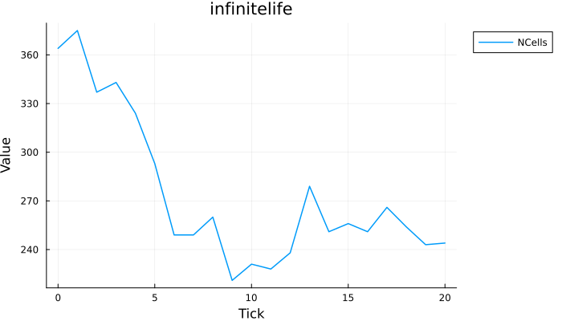
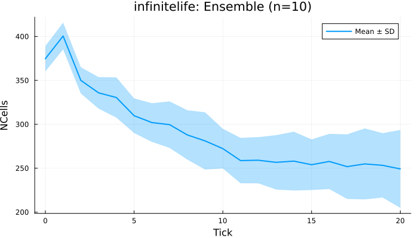
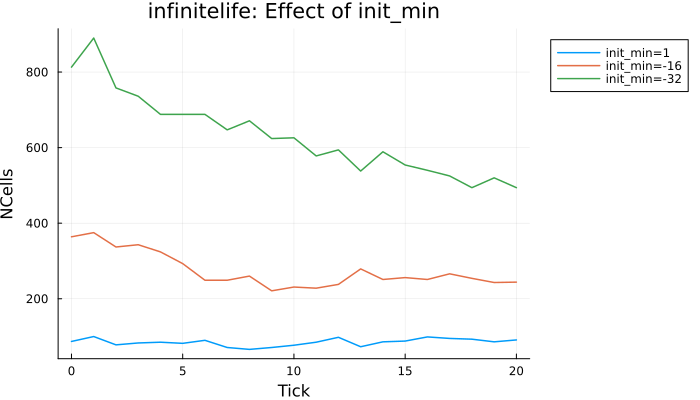

# Infinite Life


- [Overview](#overview)
  - [WHAT IS IT?](#what-is-it)
  - [HOW IT WORKS](#how-it-works)
  - [THINGS TO NOTICE](#things-to-notice)
  - [THINGS TO TRY](#things-to-try)
  - [EXTENDING THE MODEL](#extending-the-model)
  - [NETLOGO FEATURES](#netlogo-features)
  - [RELATED MODELS](#related-models)
  - [CREDITS AND REFERENCES](#credits-and-references)
  - [HOW TO CITE](#how-to-cite)
  - [COPYRIGHT AND LICENSE](#copyright-and-license)
- [Parameters](#parameters)
- [Source Code](#source-code)
- [Time Series](#time-series)
- [Ensemble Runs](#ensemble-runs)
- [Parameter Sensitivity](#parameter-sensitivity)
- [Appendix: Source Code](#appendix-source-code)
  - [Parameters (`parameters.jl`)](#parameters-parametersjl)
  - [Components (`components.jl`)](#components-componentsjl)
  - [Resources (`resources.jl`)](#resources-resourcesjl)
  - [Systems (`systems.jl`)](#systems-systemsjl)
  - [Model (`model.jl`)](#model-modeljl)

## Overview

### WHAT IS IT?

This program is an example of a two-dimensional cellular automaton. This
particular cellular automaton is called The Game of Life.

A cellular automaton is a computational machine that performs actions
based on certain rules. It can be thought of as a board which is divided
into cells (such as square cells of a checkerboard). Each cell can be
either “alive” or “dead.” This is called the “state” of the cell.
According to specified rules, each cell will be alive or dead at the
next time step.

### HOW IT WORKS

The rules of the game are as follows. Each cell checks the state of
itself and its eight surrounding neighbors and then sets itself to
either alive or dead. If there are less than two alive neighbors, then
the cell dies. If there are more than three alive neighbors, the cell
dies. If there are 2 alive neighbors, the cell remains in the state it
is in. If there are exactly three alive neighbors, the cell becomes
alive. This is done in parallel and continues forever.

There are certain recurring shapes in Life, for example, the “glider”
and the “blinker”. The glider is composed of 5 cells which form a small
arrow-headed shape, like this:

``` text
   O
    O
  OOO
```

This glider will wiggle across the world, retaining its shape. A blinker
is a block of three cells (either up and down or left and right) that
rotates between horizontal and vertical orientations.

### THINGS TO NOTICE

Find some objects that are alive, but motionless.

Is there a “critical density” - one at which all change and motion
stops/eternal motion begins?

### THINGS TO TRY

Are there any recurring shapes other than gliders and blinkers?

Build some objects that don’t die (using DRAW-CELLS)

How much life can the board hold and still remain motionless and
unchanging? (use DRAW-CELLS)

The glider gun is a large conglomeration of cells that repeatedly spits
out gliders. Find a “glider gun” (very, very difficult!).

### EXTENDING THE MODEL

Give some different rules to life and see what happens.

Experiment with using neighbors4 instead of neighbors (see below).

### NETLOGO FEATURES

The neighbors primitive returns the agentset of the patches to the
north, south, east, west, northeast, northwest, southeast, and
southwest. So `count neighbors with [living?]` counts how many of those
eight patches have the `living?` patch variable set to true.

`neighbors4` is like `neighbors` but only uses the patches to the north,
south, east, and west. Some cellular automata, like this one, are
defined using the 8-neighbors rule, others the 4-neighbors.

### RELATED MODELS

Life Turtle-Based — same as this, but implemented using turtles instead
of patches, for a more attractive display CA 1D Elementary — a model
that shows all 256 possible simple 1D cellular automata CA 1D Totalistic
— a model that shows all 2,187 possible 1D 3-color totalistic cellular
automata CA 1D Rule 30 — the basic rule 30 model CA 1D Rule 30 Turtle —
the basic rule 30 model implemented using turtles CA 1D Rule 90 — the
basic rule 90 model CA 1D Rule 110 — the basic rule 110 model CA 1D Rule
250 — the basic rule 250 model

### CREDITS AND REFERENCES

The Game of Life was invented by John Horton Conway.

See also:

Von Neumann, J. and Burks, A. W., Eds, 1966. Theory of Self-Reproducing
Automata. University of Illinois Press, Champaign, IL.

“LifeLine: A Quarterly Newsletter for Enthusiasts of John Conway’s Game
of Life”, nos. 1-11, 1971-1973.

Martin Gardner, “Mathematical Games: The fantastic combinations of John
Conway’s new solitaire game \`life’,”, Scientific American, October,
1970, pp. 120-123.

Martin Gardner, “Mathematical Games: On cellular automata,
self-reproduction, the Garden of Eden, and the game \`life’,”,
Scientific American, February, 1971, pp. 112-117.

Berlekamp, Conway, and Guy, Winning Ways for your Mathematical Plays,
Academic Press: New York, 1982.

William Poundstone, The Recursive Universe, William Morrow: New York,
1985.

### HOW TO CITE

If you mention this model or the NetLogo software in a publication, we
ask that you include the citations below.

For the model itself:

- Wilensky, U. (1998). NetLogo Life model.
  http://ccl.northwestern.edu/netlogo/models/Life. Center for Connected
  Learning and Computer-Based Modeling, Northwestern University,
  Evanston, IL.

Please cite the NetLogo software as:

- Wilensky, U. (1999). NetLogo. http://ccl.northwestern.edu/netlogo/.
  Center for Connected Learning and Computer-Based Modeling,
  Northwestern University, Evanston, IL.

### COPYRIGHT AND LICENSE

Copyright 1998 Uri Wilensky.


This model is licensed under the Creative Commons
Attribution-NonCommercial-ShareAlike 3.0 License. To view a copy of this
license, visit https://creativecommons.org/licenses/by-nc-sa/3.0/ or
send a letter to Creative Commons, 559 Nathan Abbott Way, Stanford,
California 94305, USA.

NetLogo itself is free software for non-commercial use under the terms
of the GNU General Public License ([see full license information
here](https://ccl.northwestern.edu/netlogo/docs/copyright.html)).

To inquire about commercial licenses for either NetLogo or specific
models from the models library, please contact
netlogo-commercial-admin@ccl.northwestern.edu.

This model was created as part of the project: CONNECTED MATHEMATICS:
MAKING SENSE OF COMPLEX PHENOMENA THROUGH BUILDING OBJECT-BASED PARALLEL
MODELS (OBPML). The project gratefully acknowledges the support of the
National Science Foundation (Applications of Advanced Technologies
Program) – grant numbers RED \#9552950 and REC \#9632612.

This model was converted to NetLogo as part of the projects:
PARTICIPATORY SIMULATIONS: NETWORK-BASED DESIGN FOR SYSTEMS LEARNING IN
CLASSROOMS and/or INTEGRATED SIMULATION AND MODELING ENVIRONMENT. The
project gratefully acknowledges the support of the National Science
Foundation (REPP & ROLE programs) – grant numbers REC \#9814682 and
REC-0126227. Converted from StarLogoT to NetLogo, 2001.

<!-- 1998 2001 -->

## Parameters

| Parameter      | Type      | Default | Description  |
|----------------|-----------|---------|--------------|
| `init_min`     | `Int`     | `-16`   | init min     |
| `init_max`     | `Int`     | `16`    | init max     |
| `init_density` | `Float64` | `0.35`  | init density |
| `max_ticks`    | `Int`     | `20`    | max ticks    |

## Source Code

The Julia code to run this model:

``` julia
using ArkModelZoo
_, trajectory = run_infinitelife()
```

## Time Series



## Ensemble Runs

Ten replicates with different random seeds, showing mean ± standard
deviation.



## Parameter Sensitivity

Varying `init_min`.



## Appendix: Source Code

This model is implemented in the
[Ark.jl](https://github.com/sdwfrost/Ark.jl) Entity-Component-System
(ECS) framework. The code is split into five files, each with a distinct
role:

- **Parameters**: a mutable struct holding all configurable values.
- **Components**: lightweight data types attached to individual entities
  (agents).
- **Resources**: world-level shared state accessible to all systems.
- **Systems**: functions that operate on entities each tick, defining
  model behavior.
- **Model**: wiring that assembles the world, registers resources and
  systems, and provides the run entry point.

### Parameters (`parameters.jl`)

The parameter struct uses `@kwdef` so that every field has a default
value and can be overridden by keyword. These defaults match the
original NetLogo model’s slider settings.

``` julia
Base.@kwdef mutable struct InfLifeParams
    init_min::Int = -16
    init_max::Int = 16
    init_density::Float64 = 0.35
    max_ticks::Int = 20
    seed::Int = 42
end
```

### Components (`components.jl`)

Components are lightweight data types attached to individual entities
(agents). Mutable structs hold per-entity state, while empty tag structs
act as markers for the ECS query system to efficiently filter entities.

``` julia
struct InfLifeDummy end
```

### Resources (`resources.jl`)

Resources are world-level singletons shared across all systems, used for
global state and aggregate statistics.

``` julia
mutable struct InfLifeGrid
    cells::Set{Tuple{Int,Int}}
end
InfLifeGrid() = InfLifeGrid(Set{Tuple{Int,Int}}())

mutable struct InfLifeStats
    n_cells::Int
end
InfLifeStats() = InfLifeStats(0)
```

### Systems (`systems.jl`)

Systems contain the model logic and execute in a defined order each
tick. Each system struct implements either `initialize!` (run once at
setup) or `update!` (run every tick).

``` julia
const INFLIFE_NEIGHBOR_OFFSETS = (
    (-1, 1), (0, 1), (1, 1),
    (-1, 0),         (1, 0),
    (-1, -1), (0, -1), (1, -1),
)

# --- Initialization ---

struct InitInfLifeSystem <: System end

function initialize!(::InitInfLifeSystem, world::World)
    params = get_resource(world, InfLifeParams)
    rng = get_resource(world, RNGResource).rng
    grid = get_resource(world, InfLifeGrid)
    stats = get_resource(world, InfLifeStats)

    empty!(grid.cells)
    for x in params.init_min:params.init_max
        for y in params.init_min:params.init_max
            if rand(rng) < params.init_density
                push!(grid.cells, (x, y))
            end
        end
    end
    stats.n_cells = length(grid.cells)
    return nothing
end

# --- Game of Life Step ---

struct InfLifeStepSystem <: System end

function update!(::InfLifeStepSystem, world::World)
    grid = get_resource(world, InfLifeGrid)
    stats = get_resource(world, InfLifeStats)
    cells = grid.cells

    # Count neighbors for all candidate cells
    neighbor_counts = Dict{Tuple{Int,Int}, Int}()
    for (cx, cy) in cells
        for (dx, dy) in INFLIFE_NEIGHBOR_OFFSETS
            pos = (cx + dx, cy + dy)
            neighbor_counts[pos] = get(neighbor_counts, pos, 0) + 1
        end
    end

    # Apply GoL rules
    next_cells = Set{Tuple{Int,Int}}()
    for (pos, count) in neighbor_counts
        alive = pos in cells
        if alive
            if count == 2 || count == 3
                push!(next_cells, pos)
            end
        else
            if count == 3
                push!(next_cells, pos)
            end
        end
    end
    # Also check live cells with 0 neighbors (they die, so no need to add)

    grid.cells = next_cells
    stats.n_cells = length(next_cells)
    return nothing
end

# --- Termination ---

struct InfLifeTerminationSystem <: System end

function update!(::InfLifeTerminationSystem, world::World)
    params = get_resource(world, InfLifeParams)
    tick = get_resource(world, Tick)
    stats = get_resource(world, InfLifeStats)
    if stats.n_cells == 0 || tick.tick + 1 >= params.max_ticks
        get_resource(world, Terminate).stop = true
    end
    return nothing
end
```

### Model (`model.jl`)

The model file assembles all pieces: it creates the ECS `World` with the
required component types, registers resources, builds the `Scheduler`
with systems in execution order, and exposes the public `run` entry
point. The observer pattern records the trajectory each tick.

``` julia
function infinitelife_world(; initial_capacity::Int = 128)
    return World(InfLifeDummy; initial_capacity = initial_capacity, allow_mutable = true)
end

function infinitelife_systems()
    return (
        InitInfLifeSystem(),
        InfLifeStepSystem(),
        InfLifeTerminationSystem(),
    )
end

function infinitelife_model(params::InfLifeParams = InfLifeParams())
    world = infinitelife_world()
    _add_standard_resources!(world, params)
    add_resource!(world, InfLifeGrid())
    add_resource!(world, InfLifeStats())
    scheduler = Scheduler(world, infinitelife_systems())
    initialize!(scheduler)
    return scheduler
end

struct InfLifeObserver end

function infinitelife_headers(::InfLifeObserver)
    return ["NCells"]
end

function infinitelife_values(::InfLifeObserver, world::World)
    stats = get_resource(world, InfLifeStats)
    return Float64[stats.n_cells]
end

function run_infinitelife(; params::InfLifeParams = InfLifeParams(), observe::Bool = true)
    return _run_model(infinitelife_model, InfLifeObserver(), infinitelife_values; params, observe)
end
```
