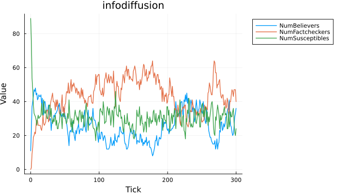
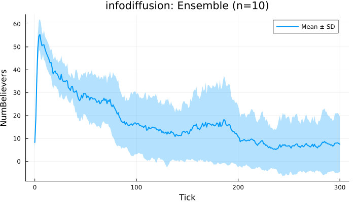
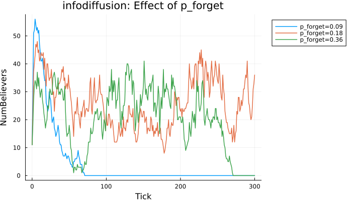

# Info Diffusion


- [Overview](#overview)
- [Parameters](#parameters)
- [Source Code](#source-code)
- [Time Series](#time-series)
- [Ensemble Runs](#ensemble-runs)
- [Parameter Sensitivity](#parameter-sensitivity)
- [Appendix: Source Code](#appendix-source-code)
  - [Parameters (`parameters.jl`)](#parameters-parametersjl)
  - [Components (`components.jl`)](#components-componentsjl)
  - [Resources (`resources.jl`)](#resources-resourcesjl)
  - [Systems (`systems.jl`)](#systems-systemsjl)
  - [Model (`model.jl`)](#model-modeljl)

## Overview

This vignette demonstrates the **Info Diffusion** model implemented in
[ArkModelZoo.jl](https://github.com/sdwfrost/ArkModelZoo.jl) using the
Ark.jl ECS framework.

## Parameters

| Parameter   | Type      | Default | Description |
|-------------|-----------|---------|-------------|
| `p_forget`  | `Float64` | `0.18`  | p forget    |
| `p_verify`  | `Float64` | `0.05`  | p verify    |
| `beta`      | `Float64` | `0.50`  | beta        |
| `alpha`     | `Float64` | `0.30`  | alpha       |
| `n_agents`  | `Int`     | `100`   | n agents    |
| `ba_m`      | `Int`     | `3`     | ba m        |
| `max_ticks` | `Int`     | `300`   | max ticks   |

## Source Code

The Julia code to run this model:

``` julia
using ArkModelZoo
_, trajectory = run_infodiffusion()
```

## Time Series



## Ensemble Runs

Ten replicates with different random seeds, showing mean ± standard
deviation.



## Parameter Sensitivity

Varying `p_forget`.



## Appendix: Source Code

This model is implemented in the
[Ark.jl](https://github.com/sdwfrost/Ark.jl) Entity-Component-System
(ECS) framework. The code is split into five files, each with a distinct
role:

- **Parameters**: a mutable struct holding all configurable values.
- **Components**: lightweight data types attached to individual entities
  (agents).
- **Resources**: world-level shared state accessible to all systems.
- **Systems**: functions that operate on entities each tick, defining
  model behavior.
- **Model**: wiring that assembles the world, registers resources and
  systems, and provides the run entry point.

### Parameters (`parameters.jl`)

The parameter struct uses `@kwdef` so that every field has a default
value and can be overridden by keyword. These defaults match the
original NetLogo model’s slider settings.

``` julia
Base.@kwdef mutable struct InfoDiffParams
    p_forget::Float64 = 0.18
    p_verify::Float64 = 0.05
    beta::Float64 = 0.50
    alpha::Float64 = 0.30
    n_agents::Int = 100
    ba_m::Int = 3
    max_ticks::Int = 300
    seed::Int = 42
end
```

### Components (`components.jl`)

Components are lightweight data types attached to individual entities
(agents). Mutable structs hold per-entity state, while empty tag structs
act as markers for the ECS query system to efficiently filter entities.

``` julia
struct InfoDiffDummy end
```

### Resources (`resources.jl`)

Resources are world-level singletons shared across all systems, used for
global state and aggregate statistics.

``` julia
mutable struct InfoDiffNetwork
    n_agents::Int
    states::Vector{Int}   # 0=S, 1=B, 2=F
    adj::Vector{Set{Int}}
    degree::Vector{Int}
end

function InfoDiffNetwork()
    InfoDiffNetwork(0, Int[], Set{Int}[], Int[])
end

function _infodiff_add_agent!(net::InfoDiffNetwork, state::Int)
    push!(net.states, state)
    push!(net.adj, Set{Int}())
    push!(net.degree, 0)
    net.n_agents += 1
    return net.n_agents
end

function _infodiff_add_edge!(net::InfoDiffNetwork, i::Int, j::Int)
    if j ∉ net.adj[i]
        push!(net.adj[i], j)
        push!(net.adj[j], i)
        net.degree[i] += 1
        net.degree[j] += 1
    end
end

mutable struct InfoDiffStats
    num_believers::Int
    num_factcheckers::Int
    num_susceptibles::Int
end
InfoDiffStats() = InfoDiffStats(0, 0, 0)
```

### Systems (`systems.jl`)

Systems contain the model logic and execute in a defined order each
tick. Each system struct implements either `initialize!` (run once at
setup) or `update!` (run every tick).

``` julia
struct InitInfoDiffSystem <: System end

function _infodiff_build_ba!(net::InfoDiffNetwork, rng, n::Int, m::Int)
    # Start with m+1 fully connected nodes
    for i in 1:(m+1)
        _infodiff_add_agent!(net, 0)
    end
    for i in 1:(m+1), j in (i+1):(m+1)
        _infodiff_add_edge!(net, i, j)
    end
    # Add remaining nodes with preferential attachment
    for _ in (m+2):n
        new_id = _infodiff_add_agent!(net, 0)
        total_degree = sum(net.degree[1:new_id-1])
        targets = Set{Int}()
        attempts = 0
        while length(targets) < m && attempts < 10000
            attempts += 1
            r = rand(rng) * total_degree
            cumulative = 0.0
            for j in 1:(new_id-1)
                cumulative += net.degree[j]
                if cumulative >= r
                    push!(targets, j)
                    break
                end
            end
        end
        for t in targets
            _infodiff_add_edge!(net, new_id, t)
        end
    end
end

function initialize!(::InitInfoDiffSystem, world::World)
    params = get_resource(world, InfoDiffParams)
    rng = get_resource(world, RNGResource).rng
    net = get_resource(world, InfoDiffNetwork)
    stats = get_resource(world, InfoDiffStats)

    _infodiff_build_ba!(net, rng, params.n_agents, params.ba_m)

    # Assign initial states: 90% S, 10% B
    for i in 1:net.n_agents
        if rand(rng, 0:99) <= 90
            net.states[i] = 0  # S
        else
            net.states[i] = 1  # B
        end
    end

    _infodiff_update_counts!(net, stats)
    return nothing
end

function _infodiff_update_counts!(net::InfoDiffNetwork, stats::InfoDiffStats)
    stats.num_believers = count(==(1), net.states)
    stats.num_factcheckers = count(==(2), net.states)
    stats.num_susceptibles = count(==(0), net.states)
end

struct InfoDiffGoSystem <: System end

function update!(::InfoDiffGoSystem, world::World)
    params = get_resource(world, InfoDiffParams)
    rng = get_resource(world, RNGResource).rng
    net = get_resource(world, InfoDiffNetwork)
    stats = get_resource(world, InfoDiffStats)

    # Spreading: S agents may become B or F based on neighbor states
    new_states = copy(net.states)
    for i in 1:net.n_agents
        net.states[i] == 0 || continue  # only S
        nB = 0
        nF = 0
        for j in net.adj[i]
            if net.states[j] == 1
                nB += 1
            elseif net.states[j] == 2
                nF += 1
            end
        end
        _1pa = 1.0 + params.alpha
        _1ma = 1.0 - params.alpha
        den = nB * _1pa + nF * _1ma
        f = 0.0
        g = 0.0
        if den != 0.0
            f = params.beta * (nB * _1pa / den)
            g = params.beta * (nF * _1ma / den)
        end
        r = rand(rng)
        if r < f
            new_states[i] = 1  # B
        elseif r < f + g
            new_states[i] = 2  # F
        end
    end
    copy!(net.states, new_states)

    # Forgetting: B/F → S
    for i in 1:net.n_agents
        if net.states[i] == 1 || net.states[i] == 2
            if rand(rng) < params.p_forget
                net.states[i] = 0
            end
        end
    end

    # Verifying: B → F
    for i in 1:net.n_agents
        if net.states[i] == 1
            if rand(rng) < params.p_verify
                net.states[i] = 2
            end
        end
    end

    _infodiff_update_counts!(net, stats)
    return nothing
end

struct InfoDiffTerminationSystem <: System end

function update!(::InfoDiffTerminationSystem, world::World)
    params = get_resource(world, InfoDiffParams)
    tick = get_resource(world, Tick)
    # NetLogo: tick at start of go, stop if ticks > 300
    if tick.tick + 1 >= params.max_ticks
        get_resource(world, Terminate).stop = true
    end
    return nothing
end
```

### Model (`model.jl`)

The model file assembles all pieces: it creates the ECS `World` with the
required component types, registers resources, builds the `Scheduler`
with systems in execution order, and exposes the public `run` entry
point. The observer pattern records the trajectory each tick.

``` julia
function infodiffusion_world(; initial_capacity::Int = 128)
    return World(InfoDiffDummy; initial_capacity = initial_capacity, allow_mutable = true)
end

function infodiffusion_systems()
    return (InitInfoDiffSystem(), InfoDiffGoSystem(), InfoDiffTerminationSystem())
end

function infodiffusion_model(params::InfoDiffParams = InfoDiffParams())
    world = infodiffusion_world()
    _add_standard_resources!(world, params)
    add_resource!(world, InfoDiffNetwork())
    add_resource!(world, InfoDiffStats())
    scheduler = Scheduler(world, infodiffusion_systems())
    initialize!(scheduler)
    return scheduler
end

struct InfoDiffObserver end

function infodiffusion_headers(::InfoDiffObserver)
    return ["NumBelievers", "NumFactcheckers", "NumSusceptibles"]
end

function infodiffusion_values(::InfoDiffObserver, world::World)
    stats = get_resource(world, InfoDiffStats)
    return Float64[stats.num_believers, stats.num_factcheckers, stats.num_susceptibles]
end

function run_infodiffusion(; params::InfoDiffParams = InfoDiffParams(), observe::Bool = true)
    return _run_model(infodiffusion_model, InfoDiffObserver(), infodiffusion_values; params, observe)
end
```
