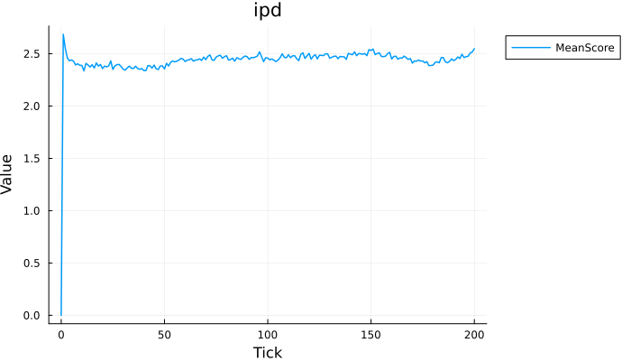
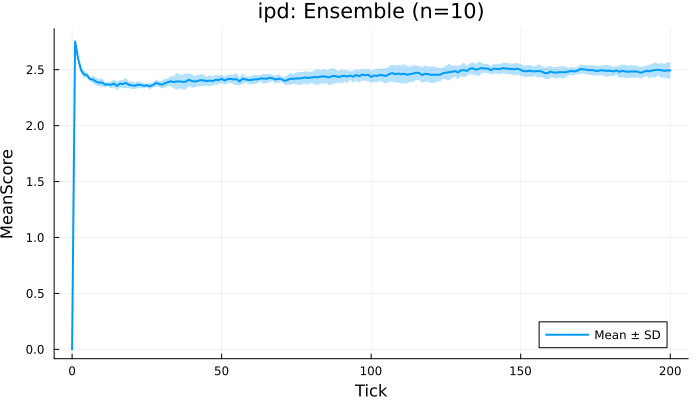
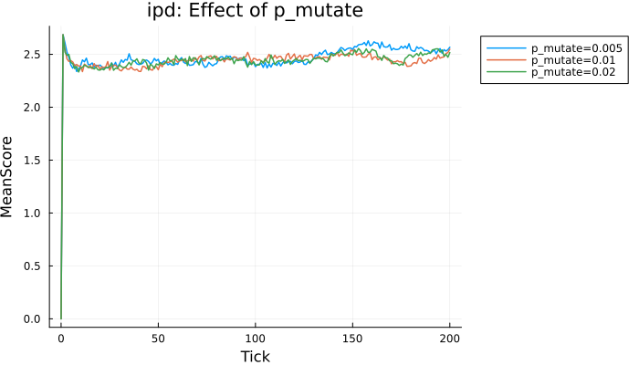

## Overview

This vignette demonstrates the **Spatial IPD** model implemented in [ArkModelZoo.jl](https://github.com/sdwfrost/ArkModelZoo.jl) using the Ark.jl ECS framework.

## Parameters

| Parameter | Type | Default | Description |
|-----------|------|---------|-------------|
| `p_mutate` | `Float64` | `0.01` | p mutate |
| `grid_size` | `Int` | `50` | 50x50 grid |
| `max_ticks` | `Int` | `200` | max ticks |

## Source Code

The Julia code to run this model:

```julia
using ArkModelZoo
_, trajectory = run_ipd()
```

## Time Series

{width=100%}

## Ensemble Runs

Ten replicates with different random seeds, showing mean ± standard deviation.

{width=100%}

## Parameter Sensitivity

Varying `p_mutate`.

{width=100%}


## Appendix: Source Code

This model is implemented in the [Ark.jl](https://github.com/sdwfrost/Ark.jl) Entity-Component-System (ECS) framework. The code is split into five files, each with a distinct role:

- **Parameters**: a mutable struct holding all configurable values.
- **Components**: lightweight data types attached to individual entities (agents).
- **Resources**: world-level shared state accessible to all systems.
- **Systems**: functions that operate on entities each tick, defining model behavior.
- **Model**: wiring that assembles the world, registers resources and systems, and provides the run entry point.

### Parameters (`parameters.jl`)

The parameter struct uses `@kwdef` so that every field has a default value and can be overridden by keyword. These defaults match the original NetLogo model's slider settings.

```julia
Base.@kwdef mutable struct IPDParams
    p_mutate::Float64 = 0.01
    grid_size::Int = 50   # 50x50 grid
    max_ticks::Int = 200
    seed::Int = 42
end
```

### Components (`components.jl`)

Components are lightweight data types attached to individual entities (agents). Mutable structs hold per-entity state, while empty tag structs act as markers for the ECS query system to efficiently filter entities.

```julia
struct IPDDummy end
```

### Resources (`resources.jl`)

Resources are world-level singletons shared across all systems, used for global state and aggregate statistics.

```julia
mutable struct IPDGrid
    width::Int
    height::Int
    s_number::Matrix{Int}          # 4-bit strategy (0-15)
    previous_outcome::Matrix{Int}  # 0=CC, 1=CD, 2=DC, 3=DD
    recent_score::Matrix{Int}
end

function IPDGrid(w::Int, h::Int)
    IPDGrid(w, h, zeros(Int, w, h), zeros(Int, w, h), zeros(Int, w, h))
end

mutable struct IPDStats
    mean_score::Float64
end
IPDStats() = IPDStats(0.0)
```

### Systems (`systems.jl`)

Systems contain the model logic and execute in a defined order each tick. Each system struct implements either `initialize!` (run once at setup) or `update!` (run every tick).

```julia
# --- Initialization ---

struct InitIPDSystem <: System end

function initialize!(::InitIPDSystem, world::World)
    params = get_resource(world, IPDParams)
    rng = get_resource(world, RNGResource).rng
    grid = get_resource(world, IPDGrid)
    w, h = grid.width, grid.height

    for x in 1:w, y in 1:h
        grid.s_number[x, y] = rand(rng, 0:15)
        grid.previous_outcome[x, y] = rand(rng, 0:3)
        grid.recent_score[x, y] = 0
    end
    return nothing
end

# --- Decode move from strategy and previous outcome ---

function decode_move(s_number::Int, prev_outcome::Int)
    if prev_outcome == 0
        return (s_number >> 3) & 1
    elseif prev_outcome == 1
        return (s_number >> 2) & 1
    elseif prev_outcome == 2
        return (s_number >> 1) & 1
    else
        return s_number & 1
    end
end

# --- Play Phase ---

struct IPDPlaySystem <: System end

function update!(::IPDPlaySystem, world::World)
    rng = get_resource(world, RNGResource).rng
    grid = get_resource(world, IPDGrid)
    w, h = grid.width, grid.height
    s_number = grid.s_number
    previous_outcome = grid.previous_outcome
    recent_score = grid.recent_score

    # Von Neumann neighbors: N, E, S, W
    offsets = ((0, 1), (1, 0), (0, -1), (-1, 0))

    # Random order iteration (NetLogo ask patches)
    perm = randperm(rng, w * h)
    for idx in perm
        y = (idx - 1) ÷ w + 1
        x = (idx - 1) % w + 1

        # Pick a random neighbor
        dx, dy = offsets[rand(rng, 1:4)]
        nx = mod1(x + dx, w)
        ny = mod1(y + dy, h)

        # Decode moves
        my_go = decode_move(s_number[x, y], previous_outcome[x, y])
        their_go = decode_move(s_number[nx, ny], previous_outcome[nx, ny])

        # Update outcomes: 2*my_move + their_move
        previous_outcome[x, y] = 2 * my_go + their_go
        previous_outcome[nx, ny] = 2 * their_go + my_go

        # Update scores: 4 + my_go - 4*their_go + my_go*their_go
        recent_score[x, y] = 4 + my_go - 4 * their_go + my_go * their_go
        recent_score[nx, ny] = 4 + their_go - 4 * my_go + their_go * my_go
    end
    return nothing
end

# --- Evolve Phase ---

struct IPDEvolveSystem <: System end

function update!(::IPDEvolveSystem, world::World)
    params = get_resource(world, IPDParams)
    rng = get_resource(world, RNGResource).rng
    grid = get_resource(world, IPDGrid)
    w, h = grid.width, grid.height
    s_number = grid.s_number
    recent_score = grid.recent_score

    # Von Neumann neighbors: N, E, S, W
    offsets = ((0, 1), (1, 0), (0, -1), (-1, 0))

    # Random order iteration
    perm = randperm(rng, w * h)
    for idx in perm
        y = (idx - 1) ÷ w + 1
        x = (idx - 1) % w + 1

        if rand(rng) >= params.p_mutate
            # Copy best neighbor's strategy (reservoir sampling with ties)
            best_score = recent_score[x, y]
            best_s = s_number[x, y]
            tie_count = 1

            for (dx, dy) in offsets
                nx = mod1(x + dx, w)
                ny = mod1(y + dy, h)
                neighbor_score = recent_score[nx, ny]

                # Replicate NetLogo's two separate if statements (not if/else)
                if neighbor_score > best_score
                    best_score = neighbor_score
                    best_s = s_number[nx, ny]
                    tie_count = 1
                end
                if neighbor_score == best_score
                    tie_count += 1
                    if rand(rng, 0:(tie_count - 1)) == 0
                        best_s = s_number[nx, ny]
                    end
                end
            end
            s_number[x, y] = best_s
        else
            # Mutate: flip a random bit
            bit_to_flip = 1 << rand(rng, 0:3)
            s_number[x, y] = xor(s_number[x, y], bit_to_flip)
        end
    end
    return nothing
end

# --- Stats ---

struct IPDStatsSystem <: System end

function update!(::IPDStatsSystem, world::World)
    grid = get_resource(world, IPDGrid)
    stats = get_resource(world, IPDStats)
    stats.mean_score = mean(grid.recent_score)
    return nothing
end

# --- Termination ---

struct IPDTerminationSystem <: System end

function update!(::IPDTerminationSystem, world::World)
    params = get_resource(world, IPDParams)
    tick = get_resource(world, Tick)
    if tick.tick + 1 >= params.max_ticks
        get_resource(world, Terminate).stop = true
    end
    return nothing
end
```

### Model (`model.jl`)

The model file assembles all pieces: it creates the ECS `World` with the required component types, registers resources, builds the `Scheduler` with systems in execution order, and exposes the public `run` entry point. The observer pattern records the trajectory each tick.

```julia
function ipd_world(; initial_capacity::Int = 128)
    return World(IPDDummy; initial_capacity=initial_capacity, allow_mutable=true)
end

function ipd_systems()
    return (
        InitIPDSystem(),
        IPDPlaySystem(),
        IPDEvolveSystem(),
        IPDStatsSystem(),
        IPDTerminationSystem(),
    )
end

function ipd_model(params::IPDParams = IPDParams())
    world = ipd_world()
    _add_standard_resources!(world, params)
    add_resource!(world, IPDGrid(params.grid_size, params.grid_size))
    add_resource!(world, IPDStats())
    scheduler = Scheduler(world, ipd_systems())
    initialize!(scheduler)
    return scheduler
end

struct IPDObserver end

function ipd_headers(::IPDObserver)
    return ["MeanScore"]
end

function ipd_values(::IPDObserver, world::World)
    stats = get_resource(world, IPDStats)
    return Float64[stats.mean_score]
end

function run_ipd(; params::IPDParams = IPDParams(), observe::Bool = true)
    return _run_model(ipd_model, IPDObserver(), ipd_values; params, observe)
end
```
