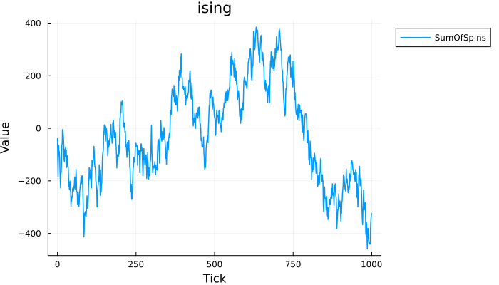
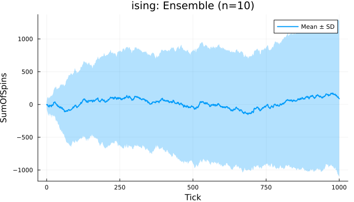
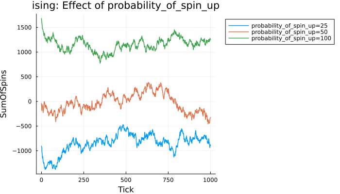

## Overview

### WHAT IS IT?

This is a model of a magnet at the microscopic level. It is a classic model of condensed matter physics. A crystalline material is conceived of as a set of lattice points with spins. The spins (magnetic moments) of the atoms in the magnet can either be up or down. Spins can change as a result of being influenced by neighboring spins and by the ambient temperature. Spins prefer to align with their neighbors. The overall behavior of the system will vary depending on the temperature.

The first version of the model worked on by the physicist Ising was on a 1D lattice. Twenty years later, the physicist Onsager analytically solved the 2D Ising model (the model presented here) and showed that at low temperatures, the spins will tend to align, causing the material to spontaneously magnetize.

In the 2D Ising model, when the temperature is low, there is spontaneous magnetization, and we say that the system is in the ferromagnetic phase. When the temperature is high, there is no spontaneous magnetization, and we say that the system is in the paramagnetic phase. (At room temperature, a refrigerator magnet is ferromagnetic, but an ordinary piece of iron is paramagnetic.)

This very abstract model can be interpreted in other ways as well, for example as a model of liquid/gas phase transitions where the two states are liquid and gas instead of two magnetic spin states. It has also been used as a basis for simulating phenomena in the social sciences that involve phase-transition-like behavior.

### HOW IT WORKS

We represent the two possible spin states with the numbers +1 or -1. Spins of +1 are shown in light blue, spins of -1 in dark blue.

The energy at each spin is defined as the negative of the sum of the products of the spin with each of its neighboring four spins. So for example if a spin is surrounded by four opposing spins, then the energy is 4, the maximum possible. But if a spin is surrounded by four like spins, then the energy is -4, the minimum possible. Basically, the energy measures how many like or opposite neighbors the spin has.

A spin decides whether to "flip" to its opposite as follows. The spins are seeking a low energy state, so a spin will always flip if flipping would decrease its energy. But the spins sometimes also flip into a higher energy state. We calculate the exact probability of flipping using the Metropolis algorithm, which works as follows. Call the potential gain in energy Ediff. Then the probability of flipping is:

e<sup>-Ediff / temperature</sup>.

The gist of this formula is that as the temperature increases, flipping to a higher energy state becomes increasingly likely, but as the energy to be gained by flipping increases, the likelihood of flipping decreases. You could use a different formula with the same gist, but the Metropolis algorithm is most commonly used.

To run the model, we repeatedly pick a single random spin and give it the chance to flip.

In real world materials, many flips can happen at once. In our idealized model, each step in the algorithm corresponds to an attempted flip, not to the passage of time as it would occur in the physical world.

### THINGS TO NOTICE

In the default settings for the model, the temperature is set fairly low.  What happens to the system?

### THINGS TO TRY

What happens when the temperature slider is very high? (This is called the "paramagnetic" state.) Try this with different PROBABILITY-OF-SPIN-UP values.

What happens when the temperature slider is set very low?  (This is called the "ferromagnetic" state.)  Again, try this with different PROBABILITY-OF-SPIN-UP values.

Between these two very different behaviors is a transition point. On an infinite grid, the transition point can be proved to be 2 / ln (1 + sqrt 2), which is about 2.27.  On a large enough finite toroidal grid, the transition point is near this number.

Change the size of the NetLogo patch grid. How does this affect the magnetization?

What happens when the temperature is near, but above the transition point?  What happens when the temperature is near, but below the transition point?  Note that the nearer you are to the transition point, the longer the system takes to exhibit its characteristic behavior -- in such cases, we say that the system has a long "correlation length". So near the transition point, you'll need to do more and longer runs in order to be sure you understand what the typical behavior of the system is.

When the temperature is low, the system should quickly reach a fully magnetized state.  Note that if you set the temperature very low, sometimes fairly stable thick "stripes" of opposite colors can form, preventing the system from reaching full magnetization.  This is an effect of the finite size of the grid.

### EXTENDING THE MODEL

The formula for Ediff given above can be modified by multiplying the result by a "coupling constant" (if we don't do this, effectively we are using a coupling constant of 1).  Using a negative coupling constant changes the model into its "antiferromagnetic" variant. Experiment with the effect of varying the coupling constant.

Can you eliminate the exponential formula for the probability of flipping and replace it with a simple discrete rule that gives similar behavior?

How could you relate TEMPERATURE in this model to temperature in Fahrenheit, Celsius or Kelvin?

If you think of the two grid states as "present" and "absent", then this model can be changed slightly to be a model of the motion of particles if you add a rule that states can only flip in pairs, so that the total number of particles is conserved. Add this rule and see what behaviors result.

At each iteration, we give a fixed number of spins a chance to flip.  There are other possible methods, for example, the "checkerboard" update rule: if you imagine the rectangular lattice as being made of alternating white and black squares like a checkerboard, then at each iteration first all the white squares update simultaneously, then all the black squares update simultaneously.  On a parallel computer with many processors, and a programming language which takes advantage of them, the checkerboard rule would run much much faster. Since NetLogo only simulates parallelism using a single processor, the checkerboard rule does not run dramatically faster. (Note that if you use the checkerboard rule, the grid of spins must have even dimensions.)

### NETLOGO FEATURES

This model makes 1000 attempted flips in every iteration of the `GO` loop. It codes this as:

    repeat 1000 [
      ask one-of patches [ update ]
    ]

Note that this does not change the core Ising algorithm that does one attempted patch flip at a time.

However, this approach does necessitate a departure from the usual NetLogo practice of calling `tick` at the end of the `GO` procedure. If we called `tick` at the end, then the tick counter would advance only once for every 1000 attempted flips and the Ising model measures the magnetization at every attempted flip. We therefore use `tick-advance` primitive to advance the NetLogo clock and sync it up with the traditional Ising model. Because the `tick-advance` primitive doesn't update the NetLogo plots, we have to explicitly call `update-plots`.

This last change also leads to one more departure from conventional NetLogo practice. In the Magnetization plot, we would usually have the code `plot magnetization`. But that code would plot the magnetization every time the `update-plots` code was called, which would be only once in every 1000 attempted flips of the Ising model and the x-axis of the plot would not reflect true Ising time steps. To sync up the plot with the usual measure of time in the Ising model, we use the code `plotxy ticks magnetization`.

A more direct translation of the core Ising algorithm to NetLogo would be as follows:

    to go
      ask one-of patches [ update ]
      tick
    end

However, this more direct version would update the NetLogo view at every tick, which would be at every potential patch flip. Because the view updates happen much more slowly than the calculations, the direct approach would dramatically slow down the model in its normal speed slider state. To significantly speed up the direct version, one would need to set the speed slider to its maximum value, so that NetLogo would not update the view at every tick.

Another "natural" way to write the `GO` procedure in NetLogo would be as follows:

    to go
      ask patches [ update ]
      tick-advance count patches
      update-plots
    end

This version uses the `patches` agentset to control the updating. At every tick, all the patches would update. Note that this does change the core Ising algorithm, as it eliminates the chance that the same patch would be picked more than once in the `GO` loop. However, in practice, we have not seen any changes in the aggregate behavior of the model using this changed algorithm.

### RELATED MODELS

Voting (a social science model, but the update rules are very similar, except that there is no concept of "temperature").

### CREDITS AND REFERENCES

Thanks to Seth Tisue and Bryan Head for their work on this model and to Sara Solla and Kan Chen, for their assistance.

The Ising model was first proposed by Wilhelm Lenz in 1920.  It is named after his student Ernst Ising, who also studied it. This NetLogo model implements the Monte Carlo simulation of the Metropolis algorithm for the two dimensional Ising model. The Metropolis algorithm comes from a 1953 paper by Nicholas Metropolis et al.

There are many web pages which explore the Ising model in greater detail than attempted here. Here are a few:

- https://web.archive.org/web/20210601224436/http://pages.physics.cornell.edu/~sethna/teaching/sss/ising/intro.htm
- http://demonstrations.wolfram.com/IsingModel/

### HOW TO CITE

If you mention this model or the NetLogo software in a publication, we ask that you include the citations below.

For the model itself:

* Wilensky, U. (2003).  NetLogo Ising model.  http://ccl.northwestern.edu/netlogo/models/Ising.  Center for Connected Learning and Computer-Based Modeling, Northwestern University, Evanston, IL.

Please cite the NetLogo software as:

* Wilensky, U. (1999). NetLogo. http://ccl.northwestern.edu/netlogo/. Center for Connected Learning and Computer-Based Modeling, Northwestern University, Evanston, IL.

### COPYRIGHT AND LICENSE

Copyright 2003 Uri Wilensky.


This model is licensed under the Creative Commons Attribution-NonCommercial-ShareAlike 3.0 License.  To view a copy of this license, visit https://creativecommons.org/licenses/by-nc-sa/3.0/ or send a letter to Creative Commons, 559 Nathan Abbott Way, Stanford, California 94305, USA.

NetLogo itself is free software for non-commercial use under the terms of the GNU General Public License ([see full license information here](https://ccl.northwestern.edu/netlogo/docs/copyright.html)).

To inquire about commercial licenses for either NetLogo or specific models from the models library, please contact netlogo-commercial-admin@ccl.northwestern.edu.

This model was created as part of the projects: PARTICIPATORY SIMULATIONS: NETWORK-BASED DESIGN FOR SYSTEMS LEARNING IN CLASSROOMS and/or INTEGRATED SIMULATION AND MODELING ENVIRONMENT. The project gratefully acknowledges the support of the National Science Foundation (REPP & ROLE programs) -- grant numbers REC #9814682 and REC-0126227.

<!-- 2003 -->

## Parameters

| Parameter | Type | Default | Description |
|-----------|------|---------|-------------|
| `probability_of_spin_up` | `Int` | `50` | probability of spin up |
| `temperature` | `Float64` | `2.27` | temperature |
| `grid_width` | `Int` | `41` | grid width |
| `grid_height` | `Int` | `41` | grid height |
| `updates_per_tick` | `Int` | `1000` | updates per tick |
| `max_ticks` | `Int` | `1000` | max ticks |

## Source Code

The Julia code to run this model:

```julia
using ArkModelZoo
_, trajectory = run_ising()
```

## Time Series

{width=100%}

## Ensemble Runs

Ten replicates with different random seeds, showing mean ± standard deviation.

{width=100%}

## Parameter Sensitivity

Varying `probability_of_spin_up`.

{width=100%}


## Appendix: Source Code

This model is implemented in the [Ark.jl](https://github.com/sdwfrost/Ark.jl) Entity-Component-System (ECS) framework. The code is split into five files, each with a distinct role:

- **Parameters**: a mutable struct holding all configurable values.
- **Components**: lightweight data types attached to individual entities (agents).
- **Resources**: world-level shared state accessible to all systems.
- **Systems**: functions that operate on entities each tick, defining model behavior.
- **Model**: wiring that assembles the world, registers resources and systems, and provides the run entry point.

### Parameters (`parameters.jl`)

The parameter struct uses `@kwdef` so that every field has a default value and can be overridden by keyword. These defaults match the original NetLogo model's slider settings.

```julia
Base.@kwdef mutable struct IsingParams
    probability_of_spin_up::Int = 50
    temperature::Float64 = 2.27
    grid_width::Int = 41
    grid_height::Int = 41
    updates_per_tick::Int = 1000
    max_ticks::Int = 1000
    seed::Int = 42
end
```

### Components (`components.jl`)

Components are lightweight data types attached to individual entities (agents). Mutable structs hold per-entity state, while empty tag structs act as markers for the ECS query system to efficiently filter entities.

```julia
# Ising model is purely patch-based
struct IsingDummy end
```

### Resources (`resources.jl`)

Resources are world-level singletons shared across all systems, used for global state and aggregate statistics.

```julia
mutable struct IsingGrid
    width::Int
    height::Int
    spins::Matrix{Int}  # +1 or -1
end
IsingGrid(w, h) = IsingGrid(w, h, ones(Int, w, h))

mutable struct IsingStats
    sum_of_spins::Int
end
IsingStats() = IsingStats(0)
```

### Systems (`systems.jl`)

Systems contain the model logic and execute in a defined order each tick. Each system struct implements either `initialize!` (run once at setup) or `update!` (run every tick).

```julia
# --- Initialization ---

struct InitIsingSystem <: System end

function initialize!(::InitIsingSystem, world::World)
    params = get_resource(world, IsingParams)
    rng = get_resource(world, RNGResource).rng
    grid = get_resource(world, IsingGrid)
    stats = get_resource(world, IsingStats)

    for x in 1:grid.width, y in 1:grid.height
        if rand(rng, 0:99) < params.probability_of_spin_up
            grid.spins[x, y] = 1
        else
            grid.spins[x, y] = -1
        end
    end

    stats.sum_of_spins = sum(grid.spins)
    return nothing
end

# --- Metropolis Update ---
# NetLogo: repeat 1000 [ ask one-of patches [ update-spin ] ]
# Each iteration picks a random patch and applies the Metropolis criterion.

struct IsingUpdateSystem <: System end

function update!(::IsingUpdateSystem, world::World)
    params = get_resource(world, IsingParams)
    rng = get_resource(world, RNGResource).rng
    grid = get_resource(world, IsingGrid)
    stats = get_resource(world, IsingStats)
    w, h = grid.width, grid.height
    spins = grid.spins
    temp = params.temperature

    for _ in 1:params.updates_per_tick
        x = rand(rng, 1:w)
        y = rand(rng, 1:h)

        # Sum of Von Neumann (neighbors4) spins with toroidal wrapping
        neighbor_sum = spins[mod1(x - 1, w), y] +
                       spins[mod1(x + 1, w), y] +
                       spins[x, mod1(y - 1, h)] +
                       spins[x, mod1(y + 1, h)]

        Ediff = 2 * spins[x, y] * neighbor_sum

        if Ediff <= 0 || (temp > 0 && rand(rng) < exp(-Ediff / temp))
            spins[x, y] = -spins[x, y]
            stats.sum_of_spins += 2 * spins[x, y]
        end
    end
    return nothing
end

# --- Termination ---

struct IsingTerminationSystem <: System end

function update!(::IsingTerminationSystem, world::World)
    params = get_resource(world, IsingParams)
    tick = get_resource(world, Tick)
    if tick.tick + 1 >= params.max_ticks
        get_resource(world, Terminate).stop = true
    end
    return nothing
end
```

### Model (`model.jl`)

The model file assembles all pieces: it creates the ECS `World` with the required component types, registers resources, builds the `Scheduler` with systems in execution order, and exposes the public `run` entry point. The observer pattern records the trajectory each tick.

```julia
function ising_world(; initial_capacity::Int = 128)
    return World(
        IsingDummy;
        initial_capacity = initial_capacity,
        allow_mutable = true,
    )
end

function ising_systems()
    return (
        InitIsingSystem(),
        IsingUpdateSystem(),
        IsingTerminationSystem(),
    )
end

function ising_model(params::IsingParams = IsingParams())
    world = ising_world()
    _add_standard_resources!(world, params)
    add_resource!(world, IsingGrid(params.grid_width, params.grid_height))
    add_resource!(world, IsingStats())
    scheduler = Scheduler(world, ising_systems())
    initialize!(scheduler)
    return scheduler
end

struct IsingObserver end

function ising_headers(::IsingObserver)
    return ["SumOfSpins"]
end

function ising_values(::IsingObserver, world::World)
    stats = get_resource(world, IsingStats)
    return Float64[stats.sum_of_spins]
end

function run_ising(; params::IsingParams = IsingParams(), observe::Bool = true)
    return _run_model(ising_model, IsingObserver(), ising_values; params, observe)
end
```
