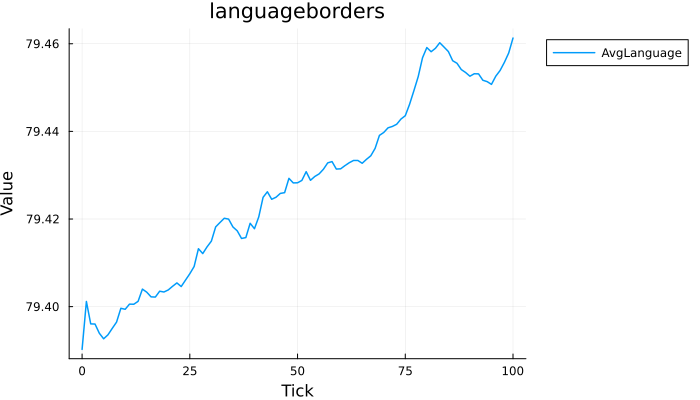
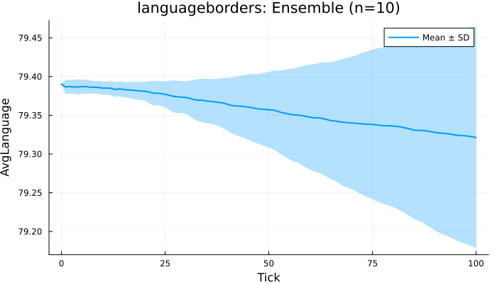
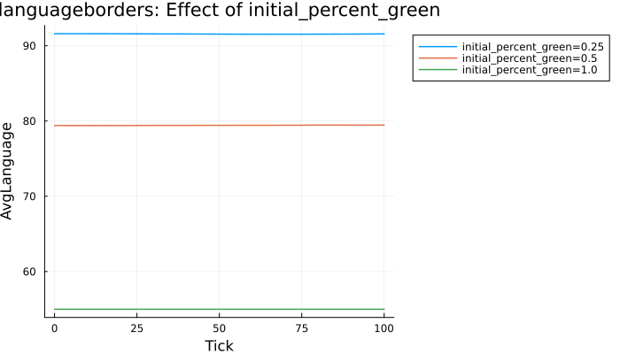

## Overview

This vignette demonstrates the **Language Borders** model implemented in [ArkModelZoo.jl](https://github.com/sdwfrost/ArkModelZoo.jl) using the Ark.jl ECS framework.

## Parameters

| Parameter | Type | Default | Description |
|-----------|------|---------|-------------|
| `initial_percent_green` | `Float64` | `0.5` | initial percent green |
| `normal_mean` | `Float64` | `2.0` | normal mean |
| `grid_width` | `Int` | `41` | grid width |
| `grid_height` | `Int` | `41` | grid height |
| `max_ticks` | `Int` | `100` | max ticks |

## Source Code

The Julia code to run this model:

```julia
using ArkModelZoo
_, trajectory = run_languageborders()
```

## Time Series

{width=100%}

## Ensemble Runs

Ten replicates with different random seeds, showing mean ± standard deviation.

{width=100%}

## Parameter Sensitivity

Varying `initial_percent_green`.

{width=100%}


## Appendix: Source Code

This model is implemented in the [Ark.jl](https://github.com/sdwfrost/Ark.jl) Entity-Component-System (ECS) framework. The code is split into five files, each with a distinct role:

- **Parameters**: a mutable struct holding all configurable values.
- **Components**: lightweight data types attached to individual entities (agents).
- **Resources**: world-level shared state accessible to all systems.
- **Systems**: functions that operate on entities each tick, defining model behavior.
- **Model**: wiring that assembles the world, registers resources and systems, and provides the run entry point.

### Parameters (`parameters.jl`)

The parameter struct uses `@kwdef` so that every field has a default value and can be overridden by keyword. These defaults match the original NetLogo model's slider settings.

```julia
Base.@kwdef mutable struct LanguageBordersParams
    initial_percent_green::Float64 = 0.5
    normal_mean::Float64 = 2.0
    grid_width::Int = 41
    grid_height::Int = 41
    max_ticks::Int = 100
    seed::Int = 42
end
```

### Components (`components.jl`)

Components are lightweight data types attached to individual entities (agents). Mutable structs hold per-entity state, while empty tag structs act as markers for the ECS query system to efficiently filter entities.

```julia
# Language Borders is a purely patch-based model
struct LanguageBordersDummy end
```

### Resources (`resources.jl`)

Resources are world-level singletons shared across all systems, used for global state and aggregate statistics.

```julia
mutable struct LanguageBordersGrid
    width::Int
    height::Int
    language::Matrix{Float64}
    ability::Matrix{Int}
end

function LanguageBordersGrid(w::Int, h::Int)
    LanguageBordersGrid(w, h, zeros(Float64, w, h), zeros(Int, w, h))
end

mutable struct LanguageBordersStats
    avg_language::Float64
end
LanguageBordersStats() = LanguageBordersStats(0.0)
```

### Systems (`systems.jl`)

Systems contain the model logic and execute in a defined order each tick. Each system struct implements either `initialize!` (run once at setup) or `update!` (run every tick).

```julia
# --- Initialization ---

struct InitLanguageBordersSystem <: System end

function initialize!(::InitLanguageBordersSystem, world::World)
    params = get_resource(world, LanguageBordersParams)
    rng = get_resource(world, RNGResource).rng
    grid = get_resource(world, LanguageBordersGrid)
    stats = get_resource(world, LanguageBordersStats)
    w, h = grid.width, grid.height

    # pycor = y - 1 (y=1 → pycor=0, y=h → pycor=h-1=40)
    # boundary: pycor > initial_percent_green * (h-1) → blue (Language=105)
    boundary_y = params.initial_percent_green * (h - 1)  # 0.5 * 40 = 20.0
    for x in 1:w, y in 1:h
        pycor = y - 1
        grid.language[x, y] = pycor > boundary_y ? 105.0 : 55.0
        # ability = round(random-normal(normal_mean, 1)), clamped >= 0
        raw = randn(rng) + params.normal_mean
        grid.ability[x, y] = max(0, round(Int, raw))
    end

    stats.avg_language = Statistics.mean(grid.language)
    return nothing
end

# --- Update ---
# Each tick: ask patches (random order) to update language via neighbor averaging.
# Non-wrapping Moore neighborhood.
# precision(x, n) = round(x * 10^n) / 10^n

struct LanguageBordersUpdateSystem <: System end

function update!(::LanguageBordersUpdateSystem, world::World)
    rng = get_resource(world, RNGResource).rng
    grid = get_resource(world, LanguageBordersGrid)
    stats = get_resource(world, LanguageBordersStats)
    w, h = grid.width, grid.height
    language = grid.language
    ability = grid.ability

    # Random patch order (sequential Gauss-Seidel update)
    indices = Vector{Tuple{Int,Int}}(undef, w * h)
    k = 0
    for x in 1:w, y in 1:h
        k += 1
        indices[k] = (x, y)
    end
    Random.shuffle!(rng, indices)

    for (x, y) in indices
        sum_lang = 0.0
        count = 0
        for dx in -1:1, dy in -1:1
            (dx == 0 && dy == 0) && continue
            nx = x + dx
            ny = y + dy
            if 1 <= nx <= w && 1 <= ny <= h
                sum_lang += language[nx, ny]
                count += 1
            end
        end
        neighbor_av = count > 0 ? sum_lang / count : language[x, y]
        my_average = (neighbor_av + language[x, y]) / 2.0
        a = ability[x, y]
        scale = 10.0^a
        language[x, y] = round(my_average * scale) / scale
    end

    stats.avg_language = Statistics.mean(language)
    return nothing
end

# --- Termination ---

struct LanguageBordersTerminationSystem <: System end

function update!(::LanguageBordersTerminationSystem, world::World)
    params = get_resource(world, LanguageBordersParams)
    tick = get_resource(world, Tick)
    if tick.tick + 1 >= params.max_ticks
        get_resource(world, Terminate).stop = true
    end
    return nothing
end
```

### Model (`model.jl`)

The model file assembles all pieces: it creates the ECS `World` with the required component types, registers resources, builds the `Scheduler` with systems in execution order, and exposes the public `run` entry point. The observer pattern records the trajectory each tick.

```julia
function languageborders_world(; initial_capacity::Int = 128)
    return World(
        LanguageBordersDummy;
        initial_capacity = initial_capacity,
        allow_mutable = true,
    )
end

function languageborders_systems()
    return (
        InitLanguageBordersSystem(),
        LanguageBordersUpdateSystem(),
        LanguageBordersTerminationSystem(),
    )
end

function languageborders_model(params::LanguageBordersParams = LanguageBordersParams())
    world = languageborders_world()
    _add_standard_resources!(world, params)
    add_resource!(world, LanguageBordersGrid(params.grid_width, params.grid_height))
    add_resource!(world, LanguageBordersStats())
    scheduler = Scheduler(world, languageborders_systems())
    initialize!(scheduler)
    return scheduler
end

struct LanguageBordersObserver end

function languageborders_headers(::LanguageBordersObserver)
    return ["AvgLanguage"]
end

function languageborders_values(::LanguageBordersObserver, world::World)
    stats = get_resource(world, LanguageBordersStats)
    return Float64[stats.avg_language]
end

function run_languageborders(; params::LanguageBordersParams = LanguageBordersParams(), observe::Bool = true)
    return _run_model(languageborders_model, LanguageBordersObserver(), languageborders_values; params, observe)
end
```
