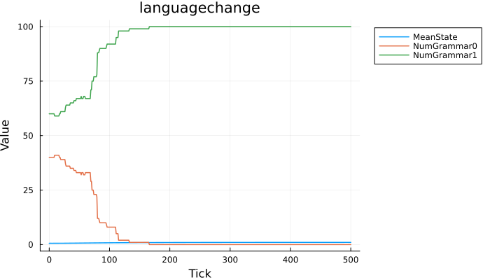
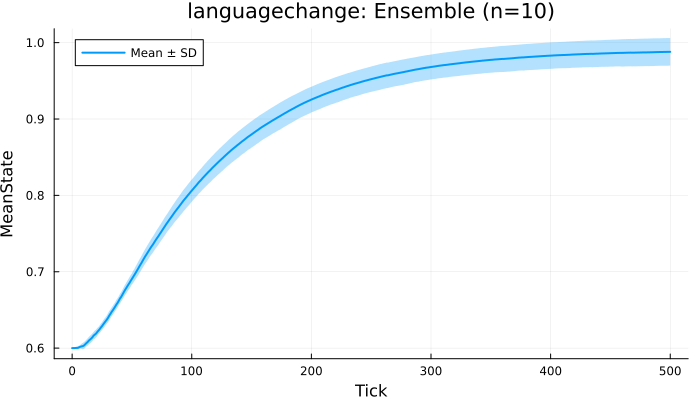
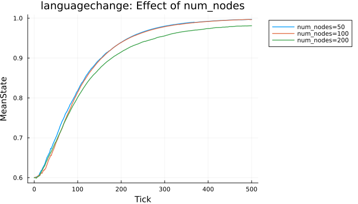

# Language Change


- [Overview](#overview)
  - [WHAT IS IT?](#what-is-it)
  - [HOW IT WORKS](#how-it-works)
  - [THINGS TO NOTICE](#things-to-notice)
  - [THINGS TO TRY](#things-to-try)
  - [EXTENDING THE MODEL](#extending-the-model)
  - [NETLOGO FEATURES](#netlogo-features)
  - [RELATED MODELS](#related-models)
  - [CREDITS AND REFERENCES](#credits-and-references)
  - [HOW TO CITE](#how-to-cite)
  - [COPYRIGHT AND LICENSE](#copyright-and-license)
- [Parameters](#parameters)
- [Source Code](#source-code)
- [Time Series](#time-series)
- [Ensemble Runs](#ensemble-runs)
- [Parameter Sensitivity](#parameter-sensitivity)
- [Appendix: Source Code](#appendix-source-code)
  - [Parameters (`parameters.jl`)](#parameters-parametersjl)
  - [Components (`components.jl`)](#components-componentsjl)
  - [Resources (`resources.jl`)](#resources-resourcesjl)
  - [Systems (`systems.jl`)](#systems-systemsjl)
  - [Model (`model.jl`)](#model-modeljl)

## Overview

### WHAT IS IT?

This model explores how the properties of language users and the
structure of their social networks can affect the course of language
change.

In this model, there are two linguistic variants in competition within
the social network – one variant generated by grammar 0 and the other
generated by grammar 1. Language users interact with each other based on
whom they are connected to in the network. At each iteration, each
individual speaks by passing an utterance using either grammar 0 or
grammar 1 to the neighbors in the network. Individuals then listen to
their neighbors and change their grammars based on what they heard.

### HOW IT WORKS

The networks in this model are constructed through the process of
“preferential attachment” in which individuals enter the network one by
one, and prefer to connect to those language users who already have many
connections. This leads to the emergence of a few “hubs”, or language
users who are very well connected; most other language users have very
few connections.

There are three different options to control how language users listen
and learn from their neighbors, listed in the UPDATE-ALGORITHM chooser.
For two of these options, INDIVIDUAL and THRESHOLD, language users can
only access one grammar at a time. Those that can only access grammar 1
are white in color, and those that can access only grammar 0 are black.
For the third option, REWARD, each grammar is associated with a weight,
which determines the language user’s probability of accessing that
grammar. Because there are only two grammars in competition here, the
weights are represented with a single value - the weight of grammar 1.
The color of the nodes reflect this probability; the larger the weight
of grammar 1, the lighter the node.

- INDIVIDUAL: Language users choose one of their neighbors randomly, and
  adopt that neighbor’s grammar.

- THRESHOLD: Language users adopt grammar 1 if some proportion of their
  neighbors is already using grammar 1. This proportion is set with the
  THRESHOLD-VAL slider. For example, if THRESHOLD-VAL is 0.30, then an
  individual will adopt grammar 1 if at least 30% of his neighbors have
  grammar 1.

- REWARD: Language users update their probability of using one grammar
  or the other. In this algorithm, if an individual hears an utterance
  from grammar 1, the individual’s weight of grammar 1 is increased, and
  they will be more likely to use that grammar in the next iteration.
  Similarly, hearing an utterance from grammar 0 increases the
  likelihood of using grammar 0 in the next iteration.

### THINGS TO NOTICE

Over time, language users tend to arrive at using just one grammar all
of the time. However, they may not all converge to the same grammar. It
is possible for sub-groups to emerge, which may be seen as the formation
of different dialects.

### THINGS TO TRY

Under what conditions is it possible to get one grammar to spread
through the entire network? Try manipulating PERCENT-GRAMMAR-1, the
updating algorithm, and the various other parameters. Does the number of
nodes matter?

### EXTENDING THE MODEL

Whether or not two language users interact with each other is determined
by the network structure. How would the model behave if language users
were connected by a small-world network rather than a preferential
attachment network?

In this model, only two grammars are in competition in the network. Try
extending the model to allow competition between three grammars.

The updating algorithm currently has agents updating asynchronously.
Currently, the grammar may spread one step or several within one tick,
depending on the links. Try implementing synchronous updating.

Regardless of the updating algorithm, language users always start out
using one grammar categorically (that is, with a weight of 0 or 1). Edit
the model to allow some language users to be initialized to an
intermediate weight (e.g., 0.5).

### NETLOGO FEATURES

Networks are represented using turtles (nodes) and links. In NetLogo,
both turtles and links are agents.

### RELATED MODELS

Preferential Attachment

### CREDITS AND REFERENCES

This model was also described in Troutman, Celina; Clark, Brady; and
Goldrick, Matthew (2008) “Social networks and intraspeaker variation
during periods of language change,” University of Pennsylvania Working
Papers in Linguistics: Vol. 14: Issue 1, Article 25.
https://repository.upenn.edu/pwpl/vol14/iss1/25/

### HOW TO CITE

If you mention this model or the NetLogo software in a publication, we
ask that you include the citations below.

For the model itself:

- Troutman, C. and Wilensky, U. (2007). NetLogo Language Change model.
  http://ccl.northwestern.edu/netlogo/models/LanguageChange. Center for
  Connected Learning and Computer-Based Modeling, Northwestern
  University, Evanston, IL.

Please cite the NetLogo software as:

- Wilensky, U. (1999). NetLogo. http://ccl.northwestern.edu/netlogo/.
  Center for Connected Learning and Computer-Based Modeling,
  Northwestern University, Evanston, IL.

### COPYRIGHT AND LICENSE

Copyright 2007 Uri Wilensky.


This model is licensed under the Creative Commons
Attribution-NonCommercial-ShareAlike 3.0 License. To view a copy of this
license, visit https://creativecommons.org/licenses/by-nc-sa/3.0/ or
send a letter to Creative Commons, 559 Nathan Abbott Way, Stanford,
California 94305, USA.

NetLogo itself is free software for non-commercial use under the terms
of the GNU General Public License ([see full license information
here](https://ccl.northwestern.edu/netlogo/docs/copyright.html)).

To inquire about commercial licenses for either NetLogo or specific
models from the models library, please contact
netlogo-commercial-admin@ccl.northwestern.edu.

<!-- 2007 Cite: Troutman, C. -->

## Parameters

| Parameter           | Type      | Default   | Description                         |
|---------------------|-----------|-----------|-------------------------------------|
| `num_nodes`         | `Int`     | `100`     | num nodes                           |
| `percent_grammar_1` | `Float64` | `60.0`    | percent starting with grammar 1     |
| `update_algorithm`  | `Symbol`  | `:reward` | :threshold, :individual, or :reward |
| `threshold_val`     | `Float64` | `0.3`     | threshold val                       |
| `alpha`             | `Float64` | `0.025`   | alpha                               |
| `logistic`          | `Bool`    | `true`    | logistic                            |
| `sink_state_1`      | `Bool`    | `false`   | sink state 1                        |
| `max_ticks`         | `Int`     | `500`     | max ticks                           |

## Source Code

The Julia code to run this model:

``` julia
using ArkModelZoo
_, trajectory = run_languagechange()
```

## Time Series



## Ensemble Runs

Ten replicates with different random seeds, showing mean ± standard
deviation.



## Parameter Sensitivity

Varying `num_nodes`.



## Appendix: Source Code

This model is implemented in the
[Ark.jl](https://github.com/sdwfrost/Ark.jl) Entity-Component-System
(ECS) framework. The code is split into five files, each with a distinct
role:

- **Parameters**: a mutable struct holding all configurable values.
- **Components**: lightweight data types attached to individual entities
  (agents).
- **Resources**: world-level shared state accessible to all systems.
- **Systems**: functions that operate on entities each tick, defining
  model behavior.
- **Model**: wiring that assembles the world, registers resources and
  systems, and provides the run entry point.

### Parameters (`parameters.jl`)

The parameter struct uses `@kwdef` so that every field has a default
value and can be overridden by keyword. These defaults match the
original NetLogo model’s slider settings.

``` julia
Base.@kwdef mutable struct LCParams
    num_nodes::Int = 100
    percent_grammar_1::Float64 = 60.0    # percent starting with grammar 1
    update_algorithm::Symbol = :reward   # :threshold, :individual, or :reward
    threshold_val::Float64 = 0.3
    alpha::Float64 = 0.025
    logistic::Bool = true
    sink_state_1::Bool = false
    max_ticks::Int = 500
    seed::Int = 42
end
```

### Components (`components.jl`)

Components are lightweight data types attached to individual entities
(agents). Mutable structs hold per-entity state, while empty tag structs
act as markers for the ECS query system to efficiently filter entities.

``` julia
mutable struct LCNode
    state::Float64          # 0.0 to 1.0, grammar state
    spoken_state::Float64   # 0 or 1 after speaking
    node_idx::Int           # index in network
end
LCNode() = LCNode(0.0, 0.0, 0)
```

### Resources (`resources.jl`)

Resources are world-level singletons shared across all systems, used for
global state and aggregate statistics.

``` julia
# Network stored as adjacency list
mutable struct LCNetwork
    neighbors::Vector{Vector{Int}}   # index -> list of neighbor indices
    node_entities::Vector{Entity}    # index -> entity
end
LCNetwork() = LCNetwork(Vector{Int}[], Entity[])

mutable struct LCStats
    mean_state::Float64
    num_grammar_0::Int
    num_grammar_1::Int
end
LCStats() = LCStats(0.0, 0, 0)
```

### Systems (`systems.jl`)

Systems contain the model logic and execute in a defined order each
tick. Each system struct implements either `initialize!` (run once at
setup) or `update!` (run every tick).

``` julia
# --- Initialization ---

struct InitLCSystem <: System end

function initialize!(::InitLCSystem, world::World)
    params = get_resource(world, LCParams)
    rng = get_resource(world, RNGResource).rng
    network = get_resource(world, LCNetwork)

    n = params.num_nodes
    network.neighbors = [Int[] for _ in 1:n]
    network.node_entities = Vector{Entity}(undef, n)

    # Create nodes
    for i in 1:n
        eid = new_entity!(world, (LCNode(0.0, 0.0, i),))
        network.node_entities[i] = eid
    end

    # Distribute grammars: percent_grammar_1% start with state=1.0
    num_g1 = round(Int, params.percent_grammar_1 / 100.0 * n)
    indices = collect(1:n)
    Random.shuffle!(rng, indices)
    for i in 1:num_g1
        node = get_components(world, network.node_entities[indices[i]], (LCNode,))[1]
        node.state = 1.0
        node.spoken_state = 1.0
    end

    # Create preferential attachment network
    # Start with edge between node 1 and 2
    if n >= 2
        _lc_add_edge!(network, 1, 2)
    end
    connected = Set{Int}([1, 2])
    unconnected = collect(3:n)
    Random.shuffle!(rng, unconnected)

    for new_node in unconnected
        # Find partner via preferential attachment
        partner = _lc_find_partner(rng, network, connected)
        _lc_add_edge!(network, new_node, partner)
        push!(connected, new_node)
    end

    _lc_update_stats!(world)
    return nothing
end

function _lc_add_edge!(network::LCNetwork, i::Int, j::Int)
    push!(network.neighbors[i], j)
    push!(network.neighbors[j], i)
end

function _lc_find_partner(rng, network::LCNetwork, connected::Set{Int})
    # Preferential attachment: probability proportional to degree
    nodes = collect(connected)
    degrees = [length(network.neighbors[n]) for n in nodes]
    total = sum(degrees)
    if total == 0
        return nodes[rand(rng, 1:length(nodes))]
    end
    pick = rand(rng) * total
    cumsum = 0.0
    for (idx, n) in enumerate(nodes)
        cumsum += degrees[idx]
        if cumsum >= pick
            return n
        end
    end
    return nodes[end]
end

function _lc_update_stats!(world::World)
    stats = get_resource(world, LCStats)
    total = 0.0
    n = 0
    ng0 = 0
    ng1 = 0
    for (_, nodes) in Query(world, (LCNode,))
        @inbounds for i in eachindex(nodes)
            total += nodes[i].state
            n += 1
            if nodes[i].state >= 0.5
                ng1 += 1
            else
                ng0 += 1
            end
        end
    end
    stats.mean_state = n > 0 ? total / n : 0.0
    stats.num_grammar_0 = ng0
    stats.num_grammar_1 = ng1
end

# --- Go ---

struct LCGoSystem <: System end

function update!(::LCGoSystem, world::World)
    params = get_resource(world, LCParams)
    rng = get_resource(world, RNGResource).rng
    network = get_resource(world, LCNetwork)

    # Collect nodes for shuffled ask
    node_indices = collect(1:length(network.node_entities))
    Random.shuffle!(rng, node_indices)

    if params.update_algorithm == :threshold
        for idx in node_indices
            node = get_components(world, network.node_entities[idx], (LCNode,))[1]
            nbrs = network.neighbors[idx]
            if isempty(nbrs)
                continue
            end
            grammar_one_sum = 0.0
            for nb in nbrs
                nb_node = get_components(world, network.node_entities[nb], (LCNode,))[1]
                grammar_one_sum += nb_node.state
            end
            if grammar_one_sum >= length(nbrs) * params.threshold_val
                node.state = 1.0
            else
                if !params.sink_state_1
                    node.state = 0.0
                end
            end
        end
    elseif params.update_algorithm == :individual
        for idx in node_indices
            node = get_components(world, network.node_entities[idx], (LCNode,))[1]
            nbrs = network.neighbors[idx]
            isempty(nbrs) && continue
            nb = nbrs[rand(rng, 1:length(nbrs))]
            nb_node = get_components(world, network.node_entities[nb], (LCNode,))[1]
            node.state = nb_node.state
        end
    elseif params.update_algorithm == :reward
        # Speak phase
        for idx in node_indices
            node = get_components(world, network.node_entities[idx], (LCNode,))[1]
            if params.logistic
                gain = (params.alpha + 0.1) * 20.0
                filter_val = 1.0 / (1.0 + exp(-(gain * node.state - 1.0) * 5.0))
                node.spoken_state = rand(rng) <= filter_val ? 1.0 : 0.0
            else
                biased_val = min(1.5 * node.state, 1.0)
                node.spoken_state = rand(rng) <= biased_val ? 1.0 : 0.0
            end
        end
        # Listen phase
        for idx in node_indices
            node = get_components(world, network.node_entities[idx], (LCNode,))[1]
            nbrs = network.neighbors[idx]
            for nb in nbrs
                nb_node = get_components(world, network.node_entities[nb], (LCNode,))[1]
                heard = nb_node.spoken_state
                gamma = 0.01
                if rand(rng) <= node.state
                    if heard == 1.0
                        node.state += gamma * (1.0 - node.state)
                    else
                        node.state = (1.0 - gamma) * node.state
                    end
                else
                    if heard == 0.0
                        node.state = node.state * (1.0 - gamma)
                    else
                        node.state = gamma + node.state * (1.0 - gamma)
                    end
                end
            end
        end
    end

    _lc_update_stats!(world)
    return nothing
end

# --- Termination ---

struct LCTerminationSystem <: System end

function update!(::LCTerminationSystem, world::World)
    params = get_resource(world, LCParams)
    tick = get_resource(world, Tick)
    if tick.tick + 1 >= params.max_ticks
        get_resource(world, Terminate).stop = true
    end
    return nothing
end
```

### Model (`model.jl`)

The model file assembles all pieces: it creates the ECS `World` with the
required component types, registers resources, builds the `Scheduler`
with systems in execution order, and exposes the public `run` entry
point. The observer pattern records the trajectory each tick.

``` julia
function languagechange_world(; initial_capacity::Int = 4096)
    return World(LCNode; initial_capacity = initial_capacity, allow_mutable = true)
end

function languagechange_systems()
    return (InitLCSystem(), LCGoSystem(), LCTerminationSystem())
end

function languagechange_model(params::LCParams = LCParams())
    world = languagechange_world()
    _add_standard_resources!(world, params)
    add_resource!(world, LCNetwork())
    add_resource!(world, LCStats())
    scheduler = Scheduler(world, languagechange_systems())
    initialize!(scheduler)
    return scheduler
end

struct LCObserver end

function languagechange_headers(::LCObserver)
    return ["MeanState", "NumGrammar0", "NumGrammar1"]
end

function languagechange_values(::LCObserver, world::World)
    stats = get_resource(world, LCStats)
    return Float64[stats.mean_state, Float64(stats.num_grammar_0), Float64(stats.num_grammar_1)]
end

function run_languagechange(; params::LCParams = LCParams(), observe::Bool = true)
    return _run_model(languagechange_model, LCObserver(), languagechange_values; params, observe)
end
```
