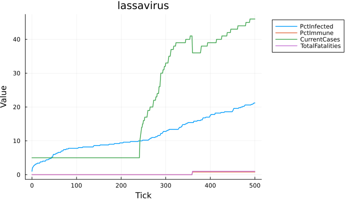
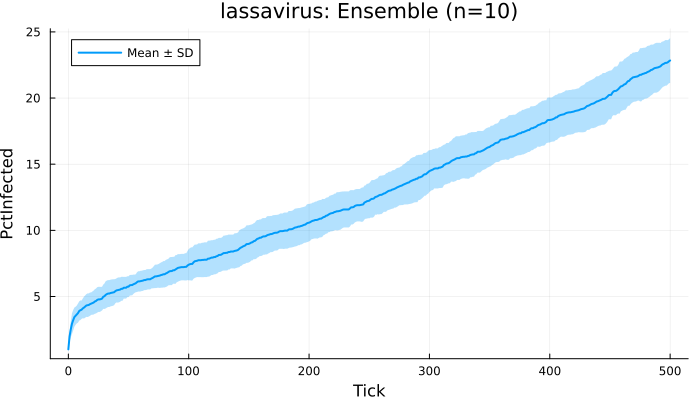
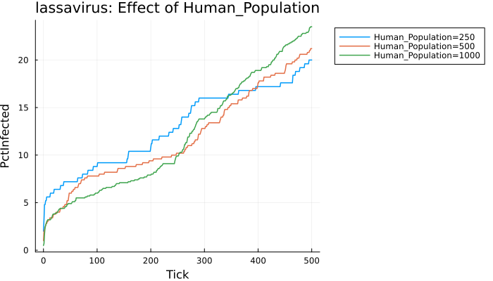

# LassaVirus


- [Overview](#overview)
  - [WHAT IS IT?](#what-is-it)
  - [HOW IT WORKS](#how-it-works)
  - [THINGS TO NOTICE](#things-to-notice)
  - [THINGS TO TRY](#things-to-try)
  - [EXTENDING THE MODEL](#extending-the-model)
  - [RELATED MODELS](#related-models)
  - [CREDITS AND REFERENCES](#credits-and-references)
  - [HOW TO CITE](#how-to-cite)
  - [COPYRIGHT AND LICENSE](#copyright-and-license)
- [Parameters](#parameters)
- [Source Code](#source-code)
- [Time Series](#time-series)
- [Ensemble Runs](#ensemble-runs)
- [Parameter Sensitivity](#parameter-sensitivity)
- [Appendix: Source Code](#appendix-source-code)
  - [Parameters (`parameters.jl`)](#parameters-parametersjl)
  - [Components (`components.jl`)](#components-componentsjl)
  - [Resources (`resources.jl`)](#resources-resourcesjl)
  - [Systems (`systems.jl`)](#systems-systemsjl)
  - [Model (`model.jl`)](#model-modeljl)

## Overview

### WHAT IS IT?

This model simulates the transmission and perpetuation of a virus in a
human population.

Ecological biologists have suggested a number of factors which may
influence the survival of a directly transmitted virus within a
population. (Yorke, et al. “Seasonality and the requirements for
perpetuation and eradication of viruses in populations.” Journal of
Epidemiology, volume 109, pages 103-123)

### HOW IT WORKS

The model is initialized with 150 people, of which 10 are infected.
People move randomly about the world in one of three states: healthy but
susceptible to infection (green), sick and infectious (red), and healthy
and immune (gray). People may die of infection or old age. When the
population dips below the environment’s “carrying capacity” (set at 300
in this model) healthy people may produce healthy (but susceptible)
offspring.

Some of these factors are summarized below with an explanation of how
each one is treated in this model.

### THINGS TO NOTICE

The factors controlled by the three sliders interact to influence how
likely the virus is to thrive in this population. Notice that in all
cases, these factors must create a balance in which an adequate number
of potential hosts remain available to the virus and in which the virus
can adequately access those hosts.

Often there will initially be an explosion of infection since no one in
the population is immune. This approximates the initial “outbreak” of a
viral infection in a population, one that often has devastating
consequences for the humans concerned. Soon, however, the virus becomes
less common as the population dynamics change. What ultimately happens
to the virus is determined by the factors controlled by the sliders.

Notice that viruses that are too successful at first (infecting almost
everyone) may not survive in the long term. Since everyone infected
generally dies or becomes immune as a result, the potential number of
hosts is often limited. The exception to the above is when the DURATION
slider is set so high that population turnover (reproduction) can keep
up and provide new hosts.

### THINGS TO TRY

Think about how different slider values might approximate the dynamics
of real-life viruses. The famous Ebola virus in central Africa has a
very short duration, a very high infectiousness value, and an extremely
low recovery rate. For all the fear this virus has raised, how
successful is it? Set the sliders appropriately and watch what happens.

The HIV virus, which causes AIDS, has an extremely long duration, an
extremely low recovery rate, but an extremely low infectiousness value.
How does a virus with these slider values fare in this model?

### EXTENDING THE MODEL

Add additional sliders controlling the carrying capacity of the world
(how many people can be in the world at one time), the average lifespan
of the people and their birth-rate.

Build a similar model simulating viral infection of a non-human host
with very different reproductive rates, lifespans, and population
densities.

Add a slider controlling how long immunity lasts. You could also make
immunity imperfect, so that immune turtles still have a small chance of
getting infected. This chance could get higher over time.

### RELATED MODELS

- HIV
- Virus on a Network

### CREDITS AND REFERENCES

This model can show an alternate visualization of the Virus model using
circles to represent the people. It uses visualization techniques as
recommended in the paper:

Kornhauser, D., Wilensky, U., & Rand, W. (2009). Design guidelines for
agent based model visualization. Journal of Artificial Societies and
Social Simulation, JASSS, 12(2), 1.

### HOW TO CITE

If you mention this model or the NetLogo software in a publication, we
ask that you include the citations below.

For the model itself:

- Wilensky, U. (1998). NetLogo Virus model.
  http://ccl.northwestern.edu/netlogo/models/Virus. Center for Connected
  Learning and Computer-Based Modeling, Northwestern University,
  Evanston, IL.

Please cite the NetLogo software as:

- Wilensky, U. (1999). NetLogo. http://ccl.northwestern.edu/netlogo/.
  Center for Connected Learning and Computer-Based Modeling,
  Northwestern University, Evanston, IL.

### COPYRIGHT AND LICENSE

Copyright 1998 Uri Wilensky.


This model is licensed under the Creative Commons
Attribution-NonCommercial-ShareAlike 3.0 License. To view a copy of this
license, visit https://creativecommons.org/licenses/by-nc-sa/3.0/ or
send a letter to Creative Commons, 559 Nathan Abbott Way, Stanford,
California 94305, USA.

NetLogo itself is free software for non-commercial use under the terms
of the GNU General Public License ([see full license information
here](https://ccl.northwestern.edu/netlogo/docs/copyright.html)).

To inquire about commercial licenses for either NetLogo or specific
models from the models library, please contact
netlogo-commercial-admin@ccl.northwestern.edu.

This model was created as part of the project: CONNECTED MATHEMATICS:
MAKING SENSE OF COMPLEX PHENOMENA THROUGH BUILDING OBJECT-BASED PARALLEL
MODELS (OBPML). The project gratefully acknowledges the support of the
National Science Foundation (Applications of Advanced Technologies
Program) – grant numbers RED \#9552950 and REC \#9632612.

This model was converted to NetLogo as part of the projects:
PARTICIPATORY SIMULATIONS: NETWORK-BASED DESIGN FOR SYSTEMS LEARNING IN
CLASSROOMS and/or INTEGRATED SIMULATION AND MODELING ENVIRONMENT. The
project gratefully acknowledges the support of the National Science
Foundation (REPP & ROLE programs) – grant numbers REC \#9814682 and
REC-0126227. Converted from StarLogoT to NetLogo, 2001.

<!-- 1998 2001 -->

## Parameters

| Parameter | Type | Default | Description |
|----|----|----|----|
| `Human_Population` | `Int` | `500` | Human Population |
| `Multimammate_Rat_Population` | `Int` | `25` | Multimammate Rat Population |
| `Initial_Number_Of_Cases` | `Int` | `5` | Initial Number Of Cases |
| `pct_Severe_Cases` | `Int` | `20` | pct Severe Cases |
| `pct_Infectiousness_H2H` | `Int` | `20` | pct Infectiousness H2H |
| `pct_Infectiousness_R2H` | `Int` | `40` | pct Infectiousness R2H |
| `Incubation_Period` | `Int` | `10` | Incubation Period |
| `Sick_Days` | `Int` | `15` | Sick Days |
| `CFR_Mild_Case` | `Int` | `1` | CFR Mild Case |
| `CFR_Severe_Case` | `Int` | `15` | CFR Severe Case |
| `Human_Behaviour_Factor` | `Float64` | `0.8` | Human Behaviour Factor |
| `Infectious_Days_After_Recovery` | `Int` | `90` | Infectious Days After Recovery |
| `world_min` | `Int` | `-16` | world min |
| `world_max` | `Int` | `16` | world max |
| `max_ticks` | `Int` | `500` | max ticks |

## Source Code

The Julia code to run this model:

``` julia
using ArkModelZoo
_, trajectory = run_lassavirus()
```

## Time Series



## Ensemble Runs

Ten replicates with different random seeds, showing mean ± standard
deviation.



## Parameter Sensitivity

Varying `Human_Population`.



## Appendix: Source Code

This model is implemented in the
[Ark.jl](https://github.com/sdwfrost/Ark.jl) Entity-Component-System
(ECS) framework. The code is split into five files, each with a distinct
role:

- **Parameters**: a mutable struct holding all configurable values.
- **Components**: lightweight data types attached to individual entities
  (agents).
- **Resources**: world-level shared state accessible to all systems.
- **Systems**: functions that operate on entities each tick, defining
  model behavior.
- **Model**: wiring that assembles the world, registers resources and
  systems, and provides the run entry point.

### Parameters (`parameters.jl`)

The parameter struct uses `@kwdef` so that every field has a default
value and can be overridden by keyword. These defaults match the
original NetLogo model’s slider settings.

``` julia
# Lassa Virus – parameters with defaults matching NetLogo reference

Base.@kwdef mutable struct LassaParams
    Human_Population::Int = 500
    Multimammate_Rat_Population::Int = 25
    Initial_Number_Of_Cases::Int = 5
    pct_Severe_Cases::Int = 20
    pct_Infectiousness_H2H::Int = 20
    pct_Infectiousness_R2H::Int = 40
    Incubation_Period::Int = 10
    Sick_Days::Int = 15
    CFR_Mild_Case::Int = 1
    CFR_Severe_Case::Int = 15
    Human_Behaviour_Factor::Float64 = 0.8
    Infectious_Days_After_Recovery::Int = 90
    world_min::Int = -16
    world_max::Int = 16
    max_ticks::Int = 500
    seed::Int = 42
end
```

### Components (`components.jl`)

Components are lightweight data types attached to individual entities
(agents). Mutable structs hold per-entity state, while empty tag structs
act as markers for the ECS query system to efficiently filter entities.

``` julia
# Lassa Virus – ECS components

# Disease states matching NetLogo color-based states
@enum LassaHealthStatus begin
    LassaSusceptible      = 1   # white
    LassaIncubating       = 2   # yellow
    LassaMild             = 3   # orange+2
    LassaSevere           = 4   # red
    LassaImmuneInfectious = 5   # cyan
    LassaImmune           = 6   # lime+1
    LassaDead             = 7   # gray
end

# Shared position component for both breeds
mutable struct LassaPosition
    x::Float64
    y::Float64
end
LassaPosition() = LassaPosition(0.0, 0.0)

mutable struct LassaHeading
    angle::Float64
end
LassaHeading() = LassaHeading(0.0)

# Human-specific components
mutable struct HumanState
    status::LassaHealthStatus
    hours::Int
    human_speed::Float64
end
HumanState() = HumanState(LassaSusceptible, 0, 1.0)

# Rat marker (tag component)
mutable struct RatTag
    _::Bool
end
RatTag() = RatTag(true)
```

### Resources (`resources.jl`)

Resources are world-level singletons shared across all systems, used for
global state and aggregate statistics.

``` julia
# Lassa Virus – model-specific resources

mutable struct LassaStats
    infected_not_infectious::Int
    mild_cases_count::Int
    severe_cases_count::Int
    immune_infectious::Int
    immune_not_infectious::Int
    total_immune::Int
    current_cases::Int
    mild_cases::Int        # running total of transitions to mild
    severe_cases::Int      # running total of transitions to severe
    total_mild_cases::Float64
    total_severe_cases::Float64
    total_cases::Float64
    total_infectious::Int
    total_infected::Float64
    total_fatalities::Int
    fatalities::Int        # running total of deaths
    pct_infected::Float64
    pct_uninfected::Float64
    pct_immune::Float64
    average_pct_CFR::Float64
end
LassaStats() = LassaStats(0, 0, 0, 0, 0, 0, 0, 0, 0, 0.0, 0.0, 0.0, 0, 0.0, 0, 0, 0.0, 0.0, 0.0, 0.0)

mutable struct LassaRegistry
    human_entities::Vector{Entity}
    rat_entities::Vector{Entity}
end
LassaRegistry() = LassaRegistry(Entity[], Entity[])
```

### Systems (`systems.jl`)

Systems contain the model logic and execute in a defined order each
tick. Each system struct implements either `initialize!` (run once at
setup) or `update!` (run every tick).

``` julia
# Lassa Virus – ECS systems matching the NetLogo reference.
# Execution order: init → movement → infection+progression → stats → termination
#
# NetLogo model uses color to track disease states. Two breeds: rats and humans.
# Rats just move and carry infection. Humans have full disease progression.

# --- Initialization ---

struct InitLassaSystem <: System end

function initialize!(::InitLassaSystem, world::World)
    params = get_resource(world, LassaParams)
    rng = get_resource(world, RNGResource).rng
    registry = get_resource(world, LassaRegistry)
    stats = get_resource(world, LassaStats)
    wspan = params.world_max - params.world_min + 1  # 33
    w = Float64(wspan)

    pct_Mild_Cases = 100 - params.pct_Severe_Cases
    initial_mild = (params.Initial_Number_Of_Cases * pct_Mild_Cases) / 100
    initial_severe = (params.Initial_Number_Of_Cases * params.pct_Severe_Cases) / 100

    # Create rats
    empty!(registry.rat_entities)
    for _ in 1:params.Multimammate_Rat_Population
        # random-xcor gives float in [-16.5, 16.5) → offset to [0, 33)
        x = rand(rng) * w
        y = rand(rng) * w
        e = new_entity!(world, (
            LassaPosition(x, y),
            LassaHeading(Float64(rand(rng, 0:359))),
            RatTag(true),
        ))
        push!(registry.rat_entities, e)
    end

    # Create humans
    empty!(registry.human_entities)
    for _ in 1:params.Human_Population
        x = rand(rng) * w
        y = rand(rng) * w
        e = new_entity!(world, (
            LassaPosition(x, y),
            LassaHeading(Float64(rand(rng, 0:359))),
            HumanState(LassaSusceptible, 0, Float64(1)),  # control_speed = 1
        ))
        push!(registry.human_entities, e)
    end

    # Initial cases: ask n-of initial_mild_cases Humans [set color orange+2]
    shuffled = copy(registry.human_entities)
    Random.shuffle!(rng, shuffled)
    mild_count = round(Int, initial_mild)
    severe_count = round(Int, initial_severe)
    for i in 1:mild_count
        hs = get_components(world, shuffled[i], (HumanState,))[1]
        hs.status = LassaMild
    end
    for i in (mild_count+1):(mild_count+severe_count)
        hs = get_components(world, shuffled[i], (HumanState,))[1]
        hs.status = LassaSevere
    end

    # Initialize stats running totals
    stats.mild_cases = 0
    stats.severe_cases = 0
    stats.fatalities = 0
    stats.infected_not_infectious = 0
    stats.mild_cases_count = mild_count
    stats.severe_cases_count = severe_count
    stats.immune_infectious = 0
    stats.immune_not_infectious = 0
    stats.total_immune = 0
    stats.current_cases = mild_count + severe_count
    stats.total_mild_cases = Float64(initial_mild)
    stats.total_severe_cases = Float64(initial_severe)
    stats.total_cases = initial_mild + initial_severe
    stats.total_infectious = mild_count + severe_count
    stats.total_fatalities = 0
    stats.total_infected = Float64(stats.infected_not_infectious + stats.total_infectious + stats.total_fatalities)
    stats.pct_infected = (stats.total_infected / params.Human_Population) * 100
    stats.pct_uninfected = 100.0 - stats.pct_infected
    stats.pct_immune = 0.0
    stats.average_pct_CFR = 0.0
    return nothing
end

# --- Movement ---
# NetLogo: rats fd control_speed * -1 * ((1/HBF)*0.01); rt random 100; lt random 100
#          humans fd human_speed * ((1/HBF)*0.01); rt random 45; lt random 45; hours += 1

struct LassaMovementSystem <: System end

function _lassa_wrap!(pos::LassaPosition, w::Float64)
    pos.x = mod(pos.x, w)
    pos.y = mod(pos.y, w)
    return nothing
end

function _lassa_fd!(pos::LassaPosition, heading::LassaHeading, dist::Float64, w::Float64)
    rad = heading.angle * π / 180.0
    pos.x += sin(rad) * dist
    pos.y += cos(rad) * dist
    _lassa_wrap!(pos, w)
    return nothing
end

function update!(::LassaMovementSystem, world::World)
    params = get_resource(world, LassaParams)
    rng = get_resource(world, RNGResource).rng
    registry = get_resource(world, LassaRegistry)
    wspan = params.world_max - params.world_min + 1
    w = Float64(wspan)
    control_speed = 1.0

    # ask rats [fd ...; rt random 100; lt random 100]
    rat_order = randperm(rng, length(registry.rat_entities))
    for ri in rat_order
        re = registry.rat_entities[ri]
        rpos, rhead = get_components(world, re, (LassaPosition, LassaHeading))
        dist = control_speed * -1.0 * ((1.0 / params.Human_Behaviour_Factor) * 0.01)
        _lassa_fd!(rpos, rhead, dist, w)
        rhead.angle += rand(rng, 0:99) - rand(rng, 0:99)
        rhead.angle = mod(rhead.angle, 360.0)
    end

    # ask humans [fd ...; rt random 45; lt random 45; set hours hours + 1]
    human_order = randperm(rng, length(registry.human_entities))
    for hi in human_order
        he = registry.human_entities[hi]
        hpos, hhead, hstate = get_components(world, he, (LassaPosition, LassaHeading, HumanState))
        dist = hstate.human_speed * ((1.0 / params.Human_Behaviour_Factor) * 0.01)
        _lassa_fd!(hpos, hhead, dist, w)
        hhead.angle += rand(rng, 0:44) - rand(rng, 0:44)
        hhead.angle = mod(hhead.angle, 360.0)
        hstate.hours += 1
    end
    return nothing
end

# --- Infection and Disease Progression ---
# This is the big combined system matching the NetLogo `ask humans [...]` block.
# Each human is processed in random order. Infection checks use "here" (same patch).

struct LassaInfectionSystem <: System end

# Check if two positions are on the same patch (same rounded coords)
function _lassa_same_patch(p1::LassaPosition, p2::LassaPosition, min_coord::Int)
    return round(Int, p1.x + min_coord) == round(Int, p2.x + min_coord) &&
           round(Int, p1.y + min_coord) == round(Int, p2.y + min_coord)
end

function update!(::LassaInfectionSystem, world::World)
    params = get_resource(world, LassaParams)
    rng = get_resource(world, RNGResource).rng
    registry = get_resource(world, LassaRegistry)
    stats = get_resource(world, LassaStats)
    immune_or_severe_pct = params.pct_Infectiousness_H2H * (1.0 - params.Human_Behaviour_Factor)

    n_humans = length(registry.human_entities)
    n_rats = length(registry.rat_entities)

    # ask humans (random order)
    human_order = randperm(rng, n_humans)

    for hi in human_order
        he = registry.human_entities[hi]
        hpos, hstate = get_components(world, he, (LassaPosition, HumanState))

        # --- Infection spreading ---
        # Mild cases infect other humans-here
        if hstate.status == LassaMild
            # ask other humans-here
            for hj in 1:n_humans
                hj == hi && continue
                he2 = registry.human_entities[hj]
                hpos2, hstate2 = get_components(world, he2, (LassaPosition, HumanState))
                if _lassa_same_patch(hpos, hpos2, params.world_min)
                    # random 100 < pct_Infectiousness_H2H  (integer random)
                    if rand(rng, 0:99) < params.pct_Infectiousness_H2H
                        if hstate2.status == LassaSusceptible
                            hstate2.status = LassaIncubating
                            hstate2.hours = 0
                        end
                    end
                end
            end
        else
            # Rats infect humans-here
            # NetLogo: ask rats [ask other humans-here [...]]
            for ri in 1:n_rats
                re = registry.rat_entities[ri]
                rpos = get_components(world, re, (LassaPosition,))[1]
                # Check if this human is at same patch as this rat
                if _lassa_same_patch(hpos, rpos, params.world_min)
                    # random-float 100 < pct_Infectiousness_R2H
                    if rand(rng) * 100.0 < params.pct_Infectiousness_R2H
                        if hstate.status == LassaSusceptible
                            hstate.status = LassaIncubating
                            hstate.hours = 0
                        end
                    end
                end
            end
        end

        # Immune-infectious or severe infect others
        if hstate.status == LassaImmuneInfectious || hstate.status == LassaSevere
            for hj in 1:n_humans
                hj == hi && continue
                he2 = registry.human_entities[hj]
                hpos2, hstate2 = get_components(world, he2, (LassaPosition, HumanState))
                if _lassa_same_patch(hpos, hpos2, params.world_min)
                    if rand(rng) * 100.0 < immune_or_severe_pct
                        if hstate2.status == LassaSusceptible
                            hstate2.status = LassaIncubating
                            hstate2.hours = 0
                        end
                    end
                end
            end
        end

        # --- Disease Progression ---
        # Incubating → Mild or Severe
        if hstate.status == LassaIncubating && hstate.hours > (params.Incubation_Period * 24)
            if rand(rng) * 100.0 < params.pct_Severe_Cases
                hstate.status = LassaSevere
                stats.severe_cases += 1
                hstate.hours = 0
                hstate.human_speed = 0.0
            else
                hstate.status = LassaMild
                stats.mild_cases += 1
                hstate.hours = 0
                hstate.human_speed = 0.5
            end
        end

        # Mild → Dead or Immune-Infectious
        if hstate.status == LassaMild && hstate.hours == (params.Sick_Days * 24)
            if rand(rng) * 100.0 < params.CFR_Mild_Case
                hstate.status = LassaDead
                stats.fatalities += 1
                hstate.hours = 0
                hstate.human_speed = 0.0
            else
                hstate.status = LassaImmuneInfectious
                hstate.hours = 0
                hstate.human_speed = 0.5
            end
        end

        # Severe → Dead or Immune-Infectious
        if hstate.status == LassaSevere && hstate.hours == (params.Sick_Days * 24)
            if rand(rng) * 100.0 < params.CFR_Severe_Case
                hstate.status = LassaDead
                stats.fatalities += 1
                hstate.hours = 0
                hstate.human_speed = 0.0
            else
                hstate.status = LassaImmuneInfectious
                hstate.hours = 0
                hstate.human_speed = 1.0  # control_speed
            end
        end

        # Immune-Infectious → Immune
        if hstate.status == LassaImmuneInfectious && hstate.hours == (params.Infectious_Days_After_Recovery * 24)
            hstate.status = LassaImmune
            hstate.hours = 0
            hstate.human_speed = 1.0  # control_speed
        end
    end
    return nothing
end

# --- Statistics ---
# Compute all tracked globals matching NetLogo

struct LassaStatsSystem <: System end

function update!(::LassaStatsSystem, world::World)
    params = get_resource(world, LassaParams)
    registry = get_resource(world, LassaRegistry)
    stats = get_resource(world, LassaStats)

    pct_Mild_Cases = 100 - params.pct_Severe_Cases
    initial_mild = (params.Initial_Number_Of_Cases * pct_Mild_Cases) / 100.0
    initial_severe = (params.Initial_Number_Of_Cases * params.pct_Severe_Cases) / 100.0

    n_incubating = 0
    n_mild = 0
    n_severe = 0
    n_immune_inf = 0
    n_immune = 0
    n_susceptible = 0
    n_dead = 0

    for he in registry.human_entities
        hs = get_components(world, he, (HumanState,))[1]
        s = hs.status
        if s == LassaSusceptible
            n_susceptible += 1
        elseif s == LassaIncubating
            n_incubating += 1
        elseif s == LassaMild
            n_mild += 1
        elseif s == LassaSevere
            n_severe += 1
        elseif s == LassaImmuneInfectious
            n_immune_inf += 1
        elseif s == LassaImmune
            n_immune += 1
        elseif s == LassaDead
            n_dead += 1
        end
    end

    stats.infected_not_infectious = n_incubating
    stats.mild_cases_count = n_mild
    stats.severe_cases_count = n_severe
    stats.immune_infectious = n_immune_inf
    stats.immune_not_infectious = n_immune
    stats.total_immune = n_immune_inf + n_immune
    stats.current_cases = n_mild + n_severe
    stats.total_mild_cases = stats.mild_cases + initial_mild
    stats.total_severe_cases = stats.severe_cases + initial_severe
    stats.total_cases = stats.total_mild_cases + stats.total_severe_cases
    stats.total_infectious = stats.current_cases + n_immune_inf
    stats.total_fatalities = n_dead  # count humans with [color = gray]
    stats.total_infected = Float64(stats.infected_not_infectious + stats.total_infectious + stats.total_fatalities)
    if stats.total_cases > 0
        stats.average_pct_CFR = (stats.fatalities / stats.total_cases) * 100.0
    else
        stats.average_pct_CFR = 0.0
    end
    stats.pct_infected = (stats.total_infected / params.Human_Population) * 100.0
    stats.pct_uninfected = (n_susceptible / params.Human_Population) * 100.0
    stats.pct_immune = (stats.total_immune / params.Human_Population) * 100.0
    return nothing
end

# --- Termination ---
# NetLogo: if infected_not_infectious + current_cases + count humans with [color = white] = 0 [stop]

struct LassaTerminationSystem <: System end

function update!(::LassaTerminationSystem, world::World)
    params = get_resource(world, LassaParams)
    tick = get_resource(world, Tick)
    stats = get_resource(world, LassaStats)

    # Count susceptible humans
    n_susceptible = 0
    registry = get_resource(world, LassaRegistry)
    for he in registry.human_entities
        hs = get_components(world, he, (HumanState,))[1]
        if hs.status == LassaSusceptible
            n_susceptible += 1
        end
    end

    if (stats.infected_not_infectious + stats.current_cases + n_susceptible == 0) ||
       tick.tick + 1 >= params.max_ticks
        get_resource(world, Terminate).stop = true
    end
    return nothing
end
```

### Model (`model.jl`)

The model file assembles all pieces: it creates the ECS `World` with the
required component types, registers resources, builds the `Scheduler`
with systems in execution order, and exposes the public `run` entry
point. The observer pattern records the trajectory each tick.

``` julia
function lassavirus_world(; initial_capacity::Int = 1024)
    return World(
        LassaPosition,
        LassaHeading,
        HumanState,
        RatTag;
        initial_capacity = initial_capacity,
        allow_mutable = true,
    )
end

function lassavirus_systems()
    return (
        InitLassaSystem(),
        LassaMovementSystem(),
        LassaInfectionSystem(),
        LassaStatsSystem(),
        LassaTerminationSystem(),
    )
end

function lassavirus_model(params::LassaParams = LassaParams())
    world = lassavirus_world()
    _add_standard_resources!(world, params)
    add_resource!(world, LassaStats())
    add_resource!(world, LassaRegistry())
    scheduler = Scheduler(world, lassavirus_systems())
    initialize!(scheduler)
    return scheduler
end

struct LassaVirusObserver end

function lassavirus_headers(::LassaVirusObserver)
    return ["PctInfected", "PctImmune", "CurrentCases", "TotalFatalities"]
end

function lassavirus_values(::LassaVirusObserver, world::World)
    stats = get_resource(world, LassaStats)
    return Float64[stats.pct_infected, stats.pct_immune, Float64(stats.current_cases), Float64(stats.total_fatalities)]
end

function run_lassavirus(; params::LassaParams = LassaParams(), observe::Bool = true)
    return _run_model(lassavirus_model, LassaVirusObserver(), lassavirus_values; params, observe)
end
```
