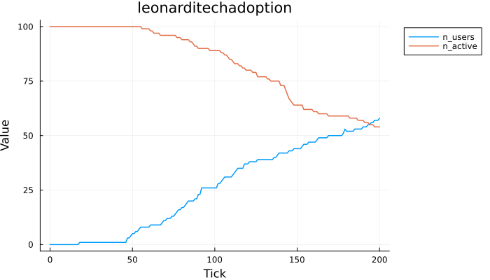
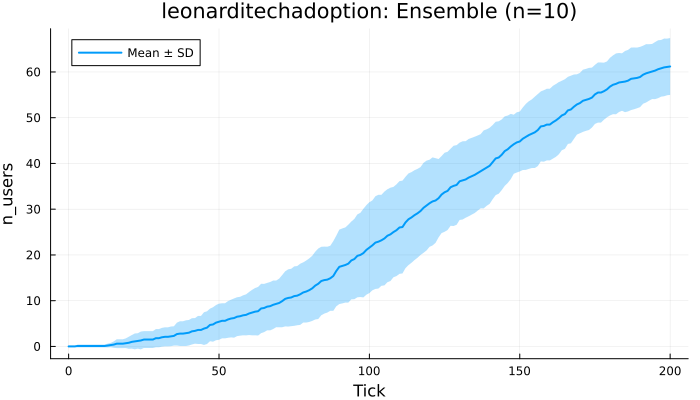
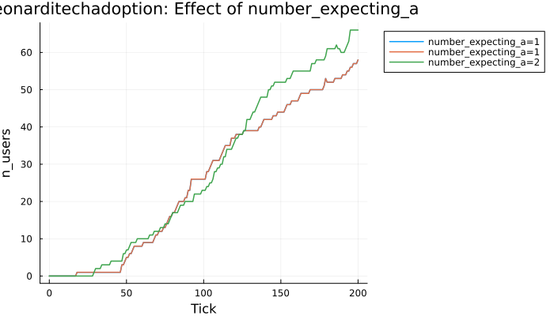

## Overview

This vignette demonstrates the **Leonardi Tech Adoption** model implemented in [ArkModelZoo.jl](https://github.com/sdwfrost/ArkModelZoo.jl) using the Ark.jl ECS framework.

## Parameters

| Parameter | Type | Default | Description |
|-----------|------|---------|-------------|
| `number_expecting_a` | `Int` | `1` | number expecting a |
| `number_expecting_b` | `Int` | `55` | number expecting b |
| `number_expecting_both` | `Int` | `0` | number expecting both |
| `number_no_expectations` | `Int` | `44` | number no expectations |
| `limited_persistence` | `Bool` | `true` | limited persistence |
| `tech_transparency` | `Float64` | `0.1` | tech transparency |
| `can_learn_unexpectedly` | `Bool` | `true` | can learn unexpectedly |
| `use_can_fail` | `Bool` | `true` | use can fail |
| `proportion_material_influence` | `Float64` | `0.05` | proportion material influence |
| `max_ticks` | `Int` | `200` | max ticks |

## Source Code

The Julia code to run this model:

```julia
using ArkModelZoo
_, trajectory = run_leonarditechadoption()
```

## Time Series

{width=100%}

## Ensemble Runs

Ten replicates with different random seeds, showing mean ± standard deviation.

{width=100%}

## Parameter Sensitivity

Varying `number_expecting_a`.

{width=100%}


## Appendix: Source Code

This model is implemented in the [Ark.jl](https://github.com/sdwfrost/Ark.jl) Entity-Component-System (ECS) framework. The code is split into five files, each with a distinct role:

- **Parameters**: a mutable struct holding all configurable values.
- **Components**: lightweight data types attached to individual entities (agents).
- **Resources**: world-level shared state accessible to all systems.
- **Systems**: functions that operate on entities each tick, defining model behavior.
- **Model**: wiring that assembles the world, registers resources and systems, and provides the run entry point.

### Parameters (`parameters.jl`)

The parameter struct uses `@kwdef` so that every field has a default value and can be overridden by keyword. These defaults match the original NetLogo model's slider settings.

```julia
Base.@kwdef mutable struct LTechParams
    number_expecting_a::Int = 1
    number_expecting_b::Int = 55
    number_expecting_both::Int = 0
    number_no_expectations::Int = 44
    technology_affordances::Vector{String} = ["a"]
    limited_persistence::Bool = true
    tech_transparency::Float64 = 0.1
    can_learn_unexpectedly::Bool = true
    use_can_fail::Bool = true
    proportion_material_influence::Float64 = 0.05
    max_ticks::Int = 200
    seed::Int = 42
end

function _ltech_total_num(params::LTechParams)
    return params.number_expecting_a + params.number_expecting_b +
           params.number_expecting_both + params.number_no_expectations
end
```

### Components (`components.jl`)

Components are lightweight data types attached to individual entities (agents). Mutable structs hold per-entity state, while empty tag structs act as markers for the ECS query system to efficiently filter entities.

```julia
struct LTechDummy end
```

### Resources (`resources.jl`)

Resources are world-level singletons shared across all systems, used for global state and aggregate statistics.

```julia
mutable struct LTechState
    n_agents::Int
    x::Vector{Float64}
    y::Vector{Float64}
    usage::Vector{Vector{String}}
    understanding::Vector{Dict{String,Float64}}
    persistence::Vector{Int}
    teams::Vector{Vector{Int}}
    adj::Vector{Set{Int}}
    influencer::Vector{Int}  # 0=nobody, -1=technology, >0=person ID
    affordances::Dict{String,Int}  # single technology resource
end

function LTechState()
    LTechState(
        0,
        Float64[], Float64[],
        Vector{String}[],
        Dict{String,Float64}[],
        Int[],
        Vector{Int}[],
        Set{Int}[],
        Int[],
        Dict{String,Int}()
    )
end

function _ltech_add_agent!(state::LTechState, x::Float64, y::Float64)
    state.n_agents += 1
    push!(state.x, x)
    push!(state.y, y)
    push!(state.usage, String[])
    push!(state.understanding, Dict{String,Float64}())
    push!(state.persistence, 0)
    push!(state.teams, Int[])
    push!(state.adj, Set{Int}())
    push!(state.influencer, 0)
    return state.n_agents
end

mutable struct LTechStats
    social_influence::Vector{Float64}
    material_influence::Vector{Float64}
    n_users::Int
    n_active::Int
end

LTechStats() = LTechStats(Float64[], Float64[], 0, 0)
```

### Systems (`systems.jl`)

Systems contain the model logic and execute in a defined order each tick. Each system struct implements either `initialize!` (run once at setup) or `update!` (run every tick).

```julia
# ─── Helpers ──────────────────────────────────────────────────────────────────

function _ltech_distance(state::LTechState, i::Int, j::Int)
    dx = state.x[i] - state.x[j]
    dy = state.y[i] - state.y[j]
    return sqrt(dx * dx + dy * dy)
end

function _ltech_set_team_radius(state::LTechState)
    r = 1
    while true
        all_ok = true
        for i in 1:state.n_agents
            cnt = 0
            for j in 1:state.n_agents
                if i != j && _ltech_distance(state, i, j) <= r
                    cnt += 1
                end
            end
            if cnt < 4
                all_ok = false
                break
            end
        end
        all_ok && return r
        r += 1
    end
end

function _ltech_build_teams!(rng, state::LTechState)
    n = state.n_agents
    team_radius = _ltech_set_team_radius(state)

    # Assign teams: while unassigned people exist
    while true
        unassigned = Int[]
        for i in 1:n
            if isempty(state.teams[i])
                push!(unassigned, i)
            end
        end
        isempty(unassigned) && break

        leader = unassigned[rand(rng, 1:length(unassigned))]
        state.teams[leader] = [leader]

        # Find candidates within radius with < 4 team memberships
        candidates = Int[]
        for j in 1:n
            if j != leader && _ltech_distance(state, leader, j) <= team_radius &&
               length(state.teams[j]) < 4
                push!(candidates, j)
            end
        end

        n_members = min(1 + rand(rng, 0:3), length(candidates))
        if n_members > 0
            shuffle!(rng, candidates)
            for k in 1:n_members
                c = candidates[k]
                push!(state.teams[c], leader)
                state.teams[c] = unique(vcat(state.teams[c]))
            end
        end
    end
end

function _ltech_build_connections!(state::LTechState)
    n = state.n_agents
    # For each agent id used as team label, connect all members sharing it
    for roll_call in 1:n
        members = Int[]
        for i in 1:n
            if roll_call in state.teams[i]
                push!(members, i)
            end
        end
        for a_idx in 1:length(members)
            for b_idx in (a_idx+1):length(members)
                a, b = members[a_idx], members[b_idx]
                push!(state.adj[a], b)
                push!(state.adj[b], a)
            end
        end
    end
end

function _ltech_find_components(state::LTechState)
    visited = falses(state.n_agents)
    components = Vector{Vector{Int}}()
    for i in 1:state.n_agents
        if !visited[i]
            comp = Int[]
            stack = Int[i]
            visited[i] = true
            while !isempty(stack)
                node = pop!(stack)
                push!(comp, node)
                for nb in state.adj[node]
                    if !visited[nb]
                        visited[nb] = true
                        push!(stack, nb)
                    end
                end
            end
            push!(components, comp)
        end
    end
    return components
end

function _ltech_fix_network!(rng, state::LTechState)
    while true
        comps = _ltech_find_components(state)
        length(comps) <= 1 && break
        a = comps[1][rand(rng, 1:length(comps[1]))]
        b = comps[2][rand(rng, 1:length(comps[2]))]
        push!(state.adj[a], b)
        push!(state.adj[b], a)
    end
end

function _ltech_make_small!(rng, state::LTechState)
    n_extra = ceil(Int, state.n_agents / 10)
    indices = collect(1:state.n_agents)
    shuffle!(rng, indices)
    for k in 1:min(n_extra, state.n_agents)
        i = indices[k]
        j = rand(rng, 1:state.n_agents)
        while j == i
            j = rand(rng, 1:state.n_agents)
        end
        push!(state.adj[i], j)
        push!(state.adj[j], i)
    end
end

function _ltech_build_network!(rng, state::LTechState)
    _ltech_build_teams!(rng, state)
    _ltech_build_connections!(state)
    _ltech_fix_network!(rng, state)
    _ltech_make_small!(rng, state)
end

# ─── Interaction helpers ──────────────────────────────────────────────────────

function _ltech_learn_from!(rng, understanding::Dict{String,Float64},
                            source::Dict, chance::Float64, influence::Float64)
    isempty(source) && return
    rand(rng) >= chance && return
    keys_src = collect(keys(source))
    insight = keys_src[rand(rng, 1:length(keys_src))]
    if !haskey(understanding, insight)
        understanding[insight] = 0.0
    end
    src_val = Float64(source[insight])
    direction = src_val >= 0 ? 1.0 : -1.0
    understanding[insight] = understanding[insight] + influence * direction
    if abs(understanding[insight]) > 1.0
        understanding[insight] = direction
    end
end

function _ltech_use_technology!(rng, state::LTechState, params::LTechParams, i::Int)
    # Unexpected learning
    if params.can_learn_unexpectedly && rand(rng) < 0.05
        aff_dict = Dict{String,Float64}(k => Float64(v) for (k, v) in state.affordances)
        _ltech_learn_from!(rng, state.understanding[i], aff_dict,
                           params.tech_transparency, 1.0)
    end

    # Find features with positive expectation (equivalent to out-hold-neighbors with strength > 0)
    positive_features = String[]
    for (feat, val) in state.understanding[i]
        if val > 0
            push!(positive_features, feat)
        end
    end
    isempty(positive_features) && return

    use_feat = positive_features[rand(rng, 1:length(positive_features))]
    chance_works = params.use_can_fail ? 0.95 : 1.0

    if haskey(state.affordances, use_feat) && rand(rng) < chance_works
        state.understanding[i][use_feat] = 1.0
        if !(use_feat in state.usage[i])
            push!(state.usage[i], use_feat)
        end
    else
        state.understanding[i][use_feat] = -1.0
        filter!(f -> f != use_feat, state.usage[i])
    end
end

function _ltech_interact!(rng, state::LTechState, params::LTechParams, i::Int)
    state.influencer[i] = 0

    if state.persistence[i] <= 0
        return
    end

    # 25% chance of determining influencer
    if rand(rng) < 0.25
        if rand(rng) < params.proportion_material_influence
            state.influencer[i] = -1  # technology
        else
            neighbors = collect(state.adj[i])
            if !isempty(neighbors)
                state.influencer[i] = neighbors[rand(rng, 1:length(neighbors))]
            end
        end
    end

    inf = state.influencer[i]

    if inf > 0
        # Social influence: learn from neighbor's understanding
        _ltech_learn_from!(rng, state.understanding[i],
                           state.understanding[inf], 1.0, 0.2)
    elseif inf == -1
        # Material influence: interact with technology
        if !isempty(state.understanding[i])
            _ltech_use_technology!(rng, state, params, i)
        else
            aff_dict = Dict{String,Float64}(k => Float64(v) for (k, v) in state.affordances)
            _ltech_learn_from!(rng, state.understanding[i], aff_dict,
                               params.tech_transparency, 1.0)
        end
        state.persistence[i] -= 1
    end
end

function _ltech_update_influences!(state::LTechState, stats::LTechStats)
    n_active = 0
    n_social = 0
    n_material = 0
    for i in 1:state.n_agents
        if state.persistence[i] > 0
            n_active += 1
            if state.influencer[i] > 0
                n_social += 1
            elseif state.influencer[i] == -1
                n_material += 1
            end
        end
    end
    if n_active > 0
        push!(stats.social_influence, n_social / n_active)
        push!(stats.material_influence, n_material / n_active)
    end
end

function _ltech_tally!(state::LTechState, stats::LTechStats)
    stats.n_users = count(i -> !isempty(state.usage[i]), 1:state.n_agents)
    stats.n_active = count(i -> state.persistence[i] > 0, 1:state.n_agents)
end

# ─── Systems ──────────────────────────────────────────────────────────────────

struct InitLTechSystem <: System end

function initialize!(::InitLTechSystem, world::World)
    params = get_resource(world, LTechParams)
    rng = get_resource(world, RNGResource).rng
    state = get_resource(world, LTechState)
    stats = get_resource(world, LTechStats)

    total = _ltech_total_num(params)

    # Create agents at random positions (NetLogo patch coords -16..16)
    for _ in 1:total
        x = Float64(rand(rng, -16:16))
        y = Float64(rand(rng, -16:16))
        _ltech_add_agent!(state, x, y)
    end

    # Assign initial understanding
    unassigned = collect(1:total)
    shuffle!(rng, unassigned)
    idx = 1
    for _ in 1:params.number_expecting_a
        state.understanding[unassigned[idx]]["a"] = 1.0
        idx += 1
    end
    for _ in 1:params.number_expecting_b
        state.understanding[unassigned[idx]]["b"] = 1.0
        idx += 1
    end
    for _ in 1:params.number_expecting_both
        state.understanding[unassigned[idx]]["a"] = 1.0
        state.understanding[unassigned[idx]]["b"] = 1.0
        idx += 1
    end
    # remaining have no expectations

    # Build network
    _ltech_build_network!(rng, state)

    # Set persistence
    pers = params.limited_persistence ? 3 : 1000
    for i in 1:total
        state.persistence[i] = pers
    end

    # Adopt technology: create affordances from params
    for feat in params.technology_affordances
        state.affordances[feat] = 1
    end

    _ltech_tally!(state, stats)
    return nothing
end

struct LTechGoSystem <: System end

function update!(::LTechGoSystem, world::World)
    params = get_resource(world, LTechParams)
    rng = get_resource(world, RNGResource).rng
    state = get_resource(world, LTechState)
    stats = get_resource(world, LTechStats)

    # Check stop: all persistence = 0
    if all(p -> p <= 0, state.persistence)
        get_resource(world, Terminate).stop = true
        return nothing
    end

    # Shuffle agent order (NetLogo ask randomizes)
    order = collect(1:state.n_agents)
    shuffle!(rng, order)
    for i in order
        _ltech_interact!(rng, state, params, i)
    end

    _ltech_update_influences!(state, stats)
    _ltech_tally!(state, stats)
    return nothing
end

struct LTechTerminationSystem <: System end

function update!(::LTechTerminationSystem, world::World)
    params = get_resource(world, LTechParams)
    tick = get_resource(world, Tick)
    if tick.tick + 1 >= params.max_ticks
        get_resource(world, Terminate).stop = true
    end
    return nothing
end
```

### Model (`model.jl`)

The model file assembles all pieces: it creates the ECS `World` with the required component types, registers resources, builds the `Scheduler` with systems in execution order, and exposes the public `run` entry point. The observer pattern records the trajectory each tick.

```julia
function leonarditechadoption_world(; initial_capacity::Int = 128)
    return World(LTechDummy; initial_capacity=initial_capacity, allow_mutable=true)
end

function leonarditechadoption_systems()
    return (
        InitLTechSystem(),
        LTechGoSystem(),
        LTechTerminationSystem(),
    )
end

function leonarditechadoption_model(params::LTechParams = LTechParams())
    world = leonarditechadoption_world()
    _add_standard_resources!(world, params)
    add_resource!(world, LTechState())
    add_resource!(world, LTechStats())
    scheduler = Scheduler(world, leonarditechadoption_systems())
    initialize!(scheduler)
    return scheduler
end

struct LTechObserver end

function leonarditechadoption_headers(::LTechObserver)
    return ["n_users", "n_active"]
end

function leonarditechadoption_values(::LTechObserver, world::World)
    stats = get_resource(world, LTechStats)
    return Float64[stats.n_users, stats.n_active]
end

function run_leonarditechadoption(; params::LTechParams = LTechParams(), observe::Bool = true)
    return _run_model(leonarditechadoption_model, LTechObserver(), leonarditechadoption_values; params, observe)
end
```
