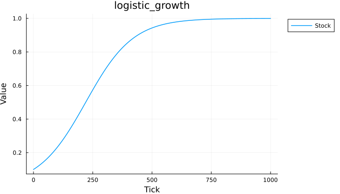
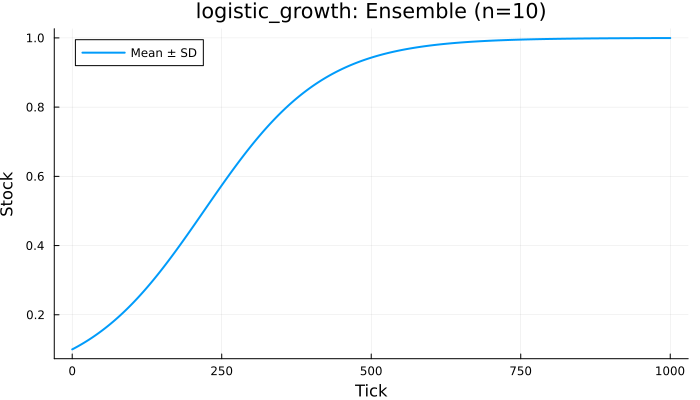
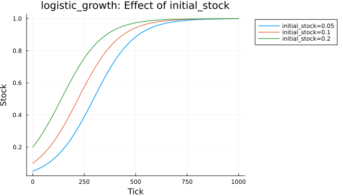

## Overview

### WHAT IS IT?

This is a model of a logistic growth curve using the System Dynamics Modeler.

### HOW IT WORKS

At each step the difference equations n * (1 - n) is calculated and added to the stock.

### THINGS TO NOTICE

View the STOCK monitor to see the current value of STOCK.

View the plot to observe the growth of STOCK over time.

### THINGS TO TRY

What do you think might happen if the initial value of stock is larger than 1? less than zero?

### NETLOGO FEATURES

This model uses the System Dynamics Modeler.

### RELATED MODELS

System Dynamics -> Exponential Growth

### HOW TO CITE

If you mention this model or the NetLogo software in a publication, we ask that you include the citations below.

For the model itself:

* Wilensky, U. (2005).  NetLogo Logistic Growth model.  http://ccl.northwestern.edu/netlogo/models/LogisticGrowth.  Center for Connected Learning and Computer-Based Modeling, Northwestern University, Evanston, IL.

Please cite the NetLogo software as:

* Wilensky, U. (1999). NetLogo. http://ccl.northwestern.edu/netlogo/. Center for Connected Learning and Computer-Based Modeling, Northwestern University, Evanston, IL.

### COPYRIGHT AND LICENSE

Copyright 2005 Uri Wilensky.


This model is licensed under the Creative Commons Attribution-NonCommercial-ShareAlike 3.0 License.  To view a copy of this license, visit https://creativecommons.org/licenses/by-nc-sa/3.0/ or send a letter to Creative Commons, 559 Nathan Abbott Way, Stanford, California 94305, USA.

NetLogo itself is free software for non-commercial use under the terms of the GNU General Public License ([see full license information here](https://ccl.northwestern.edu/netlogo/docs/copyright.html)).

To inquire about commercial licenses for either NetLogo or specific models from the models library, please contact netlogo-commercial-admin@ccl.northwestern.edu.

<!-- 2005 -->

## Parameters

| Parameter | Type | Default | Description |
|-----------|------|---------|-------------|
| `initial_stock` | `Float64` | `0.1` | initial stock |
| `dt` | `Float64` | `0.01` | System Dynamics Modeler default step |
| `max_ticks` | `Int` | `1000` | max ticks |

## Source Code

The Julia code to run this model:

```julia
using ArkModelZoo
_, trajectory = run_logistic_growth()
```

## Time Series

{width=100%}

## Ensemble Runs

Ten replicates with different random seeds, showing mean ± standard deviation.

{width=100%}

## Parameter Sensitivity

Varying `initial_stock`.

{width=100%}


## Appendix: Source Code

This model is implemented in the [Ark.jl](https://github.com/sdwfrost/Ark.jl) Entity-Component-System (ECS) framework. The code is split into five files, each with a distinct role:

- **Parameters**: a mutable struct holding all configurable values.
- **Components**: lightweight data types attached to individual entities (agents).
- **Resources**: world-level shared state accessible to all systems.
- **Systems**: functions that operate on entities each tick, defining model behavior.
- **Model**: wiring that assembles the world, registers resources and systems, and provides the run entry point.

### Parameters (`parameters.jl`)

The parameter struct uses `@kwdef` so that every field has a default value and can be overridden by keyword. These defaults match the original NetLogo model's slider settings.

```julia
Base.@kwdef mutable struct LGParams
    initial_stock::Float64 = 0.1
    dt::Float64 = 0.01           # System Dynamics Modeler default step
    max_ticks::Int = 1000
    seed::Int = 42
end
```

### Components (`components.jl`)

Components are lightweight data types attached to individual entities (agents). Mutable structs hold per-entity state, while empty tag structs act as markers for the ECS query system to efficiently filter entities.

```julia
# Logistic growth is a pure system-dynamics model; no ECS agent components needed.
```

### Resources (`resources.jl`)

Resources are world-level singletons shared across all systems, used for global state and aggregate statistics.

```julia
mutable struct LGState
    stock::Float64
end
LGState() = LGState(0.1)
```

### Systems (`systems.jl`)

Systems contain the model logic and execute in a defined order each tick. Each system struct implements either `initialize!` (run once at setup) or `update!` (run every tick).

```julia
# --- Initialization ---

struct InitLGSystem <: System end

function initialize!(::InitLGSystem, world::World)
    params = get_resource(world, LGParams)
    state = get_resource(world, LGState)
    state.stock = params.initial_stock
    return nothing
end

# --- Go: logistic growth step ---
# NetLogo SD: inflow = stock * (1 - stock), dt = 0.01

struct LGGoSystem <: System end

function update!(::LGGoSystem, world::World)
    params = get_resource(world, LGParams)
    state = get_resource(world, LGState)
    s = state.stock
    inflow = s * (1.0 - s)
    state.stock = s + params.dt * inflow
    return nothing
end

# --- Termination ---

struct LGTerminationSystem <: System end

function update!(::LGTerminationSystem, world::World)
    params = get_resource(world, LGParams)
    tick = get_resource(world, Tick)
    if tick.tick + 1 >= params.max_ticks
        get_resource(world, Terminate).stop = true
    end
    return nothing
end
```

### Model (`model.jl`)

The model file assembles all pieces: it creates the ECS `World` with the required component types, registers resources, builds the `Scheduler` with systems in execution order, and exposes the public `run` entry point. The observer pattern records the trajectory each tick.

```julia
function lg_world(; initial_capacity::Int = 64)
    return World(; initial_capacity = initial_capacity, allow_mutable = true)
end

function lg_systems()
    return (
        InitLGSystem(),
        LGGoSystem(),
        LGTerminationSystem(),
    )
end

function lg_model(params::LGParams = LGParams())
    world = lg_world()
    _add_standard_resources!(world, params)
    add_resource!(world, LGState())
    scheduler = Scheduler(world, lg_systems())
    initialize!(scheduler)
    return scheduler
end

struct LGObserver end

function lg_headers(::LGObserver)
    return ["Stock"]
end

function lg_values(::LGObserver, world::World)
    state = get_resource(world, LGState)
    return Float64[state.stock]
end

function run_logistic_growth(; params::LGParams = LGParams(), observe::Bool = true)
    return _run_model(lg_model, LGObserver(), lg_values; params, observe)
end
```
