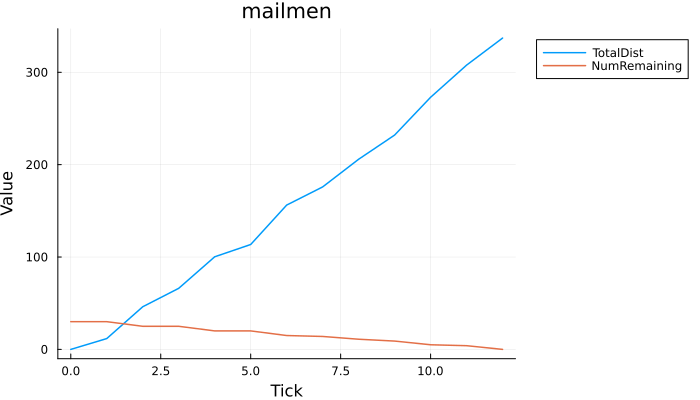
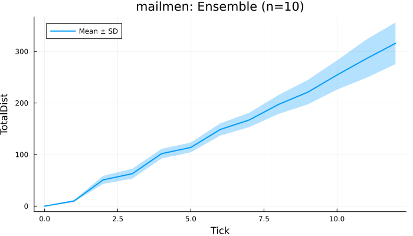
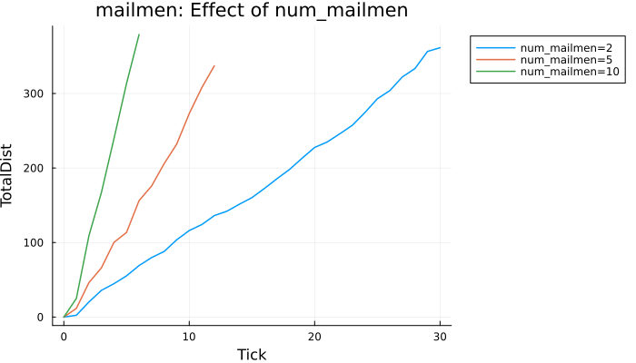

# Mailmen Delivery


- [Overview](#overview)
- [Parameters](#parameters)
- [Source Code](#source-code)
- [Time Series](#time-series)
- [Ensemble Runs](#ensemble-runs)
- [Parameter Sensitivity](#parameter-sensitivity)
- [Appendix: Source Code](#appendix-source-code)
  - [Parameters (`parameters.jl`)](#parameters-parametersjl)
  - [Components (`components.jl`)](#components-componentsjl)
  - [Resources (`resources.jl`)](#resources-resourcesjl)
  - [Systems (`systems.jl`)](#systems-systemsjl)
  - [Model (`model.jl`)](#model-modeljl)

## Overview

This vignette demonstrates the **Mailmen Delivery** model implemented in
[ArkModelZoo.jl](https://github.com/sdwfrost/ArkModelZoo.jl) using the
Ark.jl ECS framework.

## Parameters

| Parameter     | Type  | Default | Description |
|---------------|-------|---------|-------------|
| `num_mailmen` | `Int` | `5`     | num mailmen |
| `num_letters` | `Int` | `30`    | num letters |
| `min_coord`   | `Int` | `-10`   | min coord   |
| `max_coord`   | `Int` | `10`    | max coord   |
| `max_ticks`   | `Int` | `200`   | max ticks   |

## Source Code

The Julia code to run this model:

``` julia
using ArkModelZoo
_, trajectory = run_mailmen()
```

## Time Series



## Ensemble Runs

Ten replicates with different random seeds, showing mean ± standard
deviation.



## Parameter Sensitivity

Varying `num_mailmen`.



## Appendix: Source Code

This model is implemented in the
[Ark.jl](https://github.com/sdwfrost/Ark.jl) Entity-Component-System
(ECS) framework. The code is split into five files, each with a distinct
role:

- **Parameters**: a mutable struct holding all configurable values.
- **Components**: lightweight data types attached to individual entities
  (agents).
- **Resources**: world-level shared state accessible to all systems.
- **Systems**: functions that operate on entities each tick, defining
  model behavior.
- **Model**: wiring that assembles the world, registers resources and
  systems, and provides the run entry point.

### Parameters (`parameters.jl`)

The parameter struct uses `@kwdef` so that every field has a default
value and can be overridden by keyword. These defaults match the
original NetLogo model’s slider settings.

``` julia
# Mailmen – parameters with defaults matching NetLogo reference

Base.@kwdef mutable struct MailmenParams
    num_mailmen::Int = 5
    num_letters::Int = 30
    min_coord::Int = -10
    max_coord::Int = 10
    max_ticks::Int = 200
    seed::Int = 42
end
```

### Components (`components.jl`)

Components are lightweight data types attached to individual entities
(agents). Mutable structs hold per-entity state, while empty tag structs
act as markers for the ECS query system to efficiently filter entities.

``` julia
# Mailmen (Letter Delivery) – ECS components

# Mailman entity
mutable struct MailmanPosition
    x::Float64
    y::Float64
end
MailmanPosition() = MailmanPosition(0.0, 0.0)

mutable struct MailmanState
    distance_travelled::Float64
    heading::Float64  # current heading in degrees (NetLogo convention: 0=north)
end
MailmanState() = MailmanState(0.0, 0.0)

# Letter entity
mutable struct LetterPosition
    x::Float64
    y::Float64
end
LetterPosition() = LetterPosition(0.0, 0.0)

mutable struct LetterDest
    destination_x::Int
    destination_y::Int
end
LetterDest() = LetterDest(0, 0)

@enum LetterStatus LUncarried=1 LCarried=2 LDelivered=3

mutable struct LetterState
    status::LetterStatus
    carrier::Int  # mailman index (1-based), 0 = no carrier
end
LetterState() = LetterState(LUncarried, 0)
```

### Resources (`resources.jl`)

Resources are world-level singletons shared across all systems, used for
global state and aggregate statistics.

``` julia
# Mailmen – model-specific resources

mutable struct MailmenStats
    total_dist::Float64
    num_remaining::Int
end
MailmenStats() = MailmenStats(0.0, 0)

# Lookup tables linking entities to indices for carrier tracking
mutable struct MailmenRegistry
    mailman_entities::Vector{Entity}
    letter_entities::Vector{Entity}
end
MailmenRegistry() = MailmenRegistry(Entity[], Entity[])
```

### Systems (`systems.jl`)

Systems contain the model logic and execute in a defined order each
tick. Each system struct implements either `initialize!` (run once at
setup) or `update!` (run every tick).

``` julia
# Mailmen (Letter Delivery) – ECS systems matching the NetLogo reference.
# Execution order: init → deliver → stats → termination
#
# NetLogo semantics: each tick, mailmen deliver letters sequentially (ask mailmen).
# Each mailman either goes to nearest carried letter's destination and drops it,
# or goes to nearest uncarried letter and picks up all letters at that patch.
# Movement is instantaneous (goto-xy teleports).

# --- Helpers ---

# Toroidal wrapped Euclidean distance
function _mailmen_distancexy(x1::Float64, y1::Float64, x2::Float64, y2::Float64, w::Float64, h::Float64)
    dx = abs(x1 - x2)
    dx = min(dx, w - dx)
    dy = abs(y1 - y2)
    dy = min(dy, h - dy)
    return sqrt(dx * dx + dy * dy)
end

# Toroidal wrapped heading from (x1,y1) towards (x2,y2), in degrees (NetLogo convention)
function _mailmen_towardsxy(x1::Float64, y1::Float64, x2::Float64, y2::Float64, w::Float64, h::Float64)
    dx = x2 - x1
    if dx > w / 2
        dx -= w
    elseif dx < -w / 2
        dx += w
    end
    dy = y2 - y1
    if dy > h / 2
        dy -= h
    elseif dy < -h / 2
        dy += h
    end
    return atan(dx, dy) * 180.0 / π  # atan(dx,dy) gives angle from north
end

# Move forward by `steps` in direction `heading` (degrees), wrapping toroidally
function _mailmen_fd!(pos, heading_deg::Float64, steps::Float64, w::Float64, h::Float64)
    rad = heading_deg * π / 180.0
    pos.x = mod(pos.x + sin(rad) * steps, w)
    pos.y = mod(pos.y + cos(rad) * steps, h)
    return nothing
end

# --- Initialization ---
# NetLogo: create-mailmen 5 [setxy get-random-xcor get-random-ycor]
#          create-letters 30 [setxy ... ; set destination-x/y get-random-xcor/ycor; set carrier nobody]

struct InitMailmenSystem <: System end

function initialize!(::InitMailmenSystem, world::World)
    params = get_resource(world, MailmenParams)
    rng = get_resource(world, RNGResource).rng
    registry = get_resource(world, MailmenRegistry)
    stats = get_resource(world, MailmenStats)
    wspan = params.max_coord - params.min_coord + 1  # 21

    # Create mailmen
    empty!(registry.mailman_entities)
    for i in 1:params.num_mailmen
        x = Float64(rand(rng, 0:wspan-1) + params.min_coord)
        y = Float64(rand(rng, 0:wspan-1) + params.min_coord)
        e = new_entity!(world, (
            MailmanPosition(x - params.min_coord, y - params.min_coord),
            MailmanState(0.0, 0.0),
        ))
        push!(registry.mailman_entities, e)
    end

    # Create letters
    empty!(registry.letter_entities)
    for _ in 1:params.num_letters
        x = Float64(rand(rng, 0:wspan-1) + params.min_coord)
        y = Float64(rand(rng, 0:wspan-1) + params.min_coord)
        dx = rand(rng, 0:wspan-1) + params.min_coord
        dy = rand(rng, 0:wspan-1) + params.min_coord
        e = new_entity!(world, (
            LetterPosition(x - params.min_coord, y - params.min_coord),
            LetterDest(dx, dy),
            LetterState(LUncarried, 0),
        ))
        push!(registry.letter_entities, e)
    end

    stats.total_dist = 0.0
    stats.num_remaining = params.num_letters
    return nothing
end

# --- Deliver Letters ---
# NetLogo: ask mailmen [deliver-letters]
# Each mailman:
#   my-letters = letters with [carrier = who-of-myself]
#   if any? my-letters → goto nearest destination, drop
#   else → goto nearest uncarried letter, pick up all at patch

# NetLogo goto-xy: only update heading when steps >= 1, then fd steps from current heading.
# After drop-letter, heading is reset to 0.
function _mailmen_goto_xy!(mpos::MailmanPosition, mstate::MailmanState,
                            tx::Float64, ty::Float64, w::Float64, h::Float64)
    steps = _mailmen_distancexy(mpos.x, mpos.y, tx, ty, w, h)
    if steps >= 1.0
        mstate.heading = _mailmen_towardsxy(mpos.x, mpos.y, tx, ty, w, h)
    end
    _mailmen_fd!(mpos, mstate.heading, steps, w, h)
    mstate.distance_travelled += steps
    return steps
end

struct MailmenDeliverSystem <: System end

function update!(::MailmenDeliverSystem, world::World)
    params = get_resource(world, MailmenParams)
    rng = get_resource(world, RNGResource).rng
    registry = get_resource(world, MailmenRegistry)
    wspan = params.max_coord - params.min_coord + 1
    w = Float64(wspan)
    h = Float64(wspan)

    # NetLogo: ask mailmen (random order each tick)
    order = randperm(rng, params.num_mailmen)

    for idx in order
        me = registry.mailman_entities[idx]
        mpos, mstate = get_components(world, me, (MailmanPosition, MailmanState))

        # Find my carried letters
        my_letter_indices = Int[]
        for (li, le) in enumerate(registry.letter_entities)
            ls = get_components(world, le, (LetterState,))[1]
            if ls.status == LCarried && ls.carrier == idx
                push!(my_letter_indices, li)
            end
        end

        if !isempty(my_letter_indices)
            # Go to nearest carried letter's destination
            best_li = 0
            best_dist = Inf
            for li in my_letter_indices
                le = registry.letter_entities[li]
                ldest = get_components(world, le, (LetterDest,))[1]
                dx = Float64(ldest.destination_x - params.min_coord)
                dy = Float64(ldest.destination_y - params.min_coord)
                d = _mailmen_distancexy(mpos.x, mpos.y, dx, dy, w, h)
                if d < best_dist
                    best_dist = d
                    best_li = li
                end
            end

            le = registry.letter_entities[best_li]
            ldest = get_components(world, le, (LetterDest,))[1]
            tx = Float64(ldest.destination_x - params.min_coord)
            ty = Float64(ldest.destination_y - params.min_coord)

            # goto-xy: matches NetLogo fd-based movement
            _mailmen_goto_xy!(mpos, mstate, tx, ty, w, h)

            # Move carried letters to mailman's position
            for li in my_letter_indices
                le2 = registry.letter_entities[li]
                lpos = get_components(world, le2, (LetterPosition,))[1]
                lpos.x = mpos.x
                lpos.y = mpos.y
            end

            # drop-letter: uncarry, check delivery, reset heading
            le_state = get_components(world, le, (LetterState,))[1]
            le_state.carrier = 0
            le_state.status = LUncarried

            mx_nl = mpos.x + params.min_coord
            my_nl = mpos.y + params.min_coord
            if round(Int, mx_nl) == ldest.destination_x && round(Int, my_nl) == ldest.destination_y
                le_state.status = LDelivered
            end
            # NetLogo: drop-letter ends with "set heading 0"
            mstate.heading = 0.0
        else
            # Go to nearest uncarried letter
            best_li = 0
            best_dist = Inf
            for (li, le) in enumerate(registry.letter_entities)
                ls = get_components(world, le, (LetterState,))[1]
                if ls.status == LUncarried
                    lpos = get_components(world, le, (LetterPosition,))[1]
                    d = _mailmen_distancexy(mpos.x, mpos.y, lpos.x, lpos.y, w, h)
                    if d < best_dist
                        best_dist = d
                        best_li = li
                    end
                end
            end

            if best_li == 0
                continue  # no uncarried letters
            end

            le = registry.letter_entities[best_li]
            lpos = get_components(world, le, (LetterPosition,))[1]

            # goto-xy: matches NetLogo fd-based movement
            _mailmen_goto_xy!(mpos, mstate, lpos.x, lpos.y, w, h)

            # Pickup all uncarried letters at this patch (same rounded coords)
            mx_nl = mpos.x + params.min_coord
            my_nl = mpos.y + params.min_coord
            mx_r = round(Int, mx_nl)
            my_r = round(Int, my_nl)
            for (li2, le2) in enumerate(registry.letter_entities)
                ls2 = get_components(world, le2, (LetterState,))[1]
                if ls2.status == LUncarried
                    lpos2 = get_components(world, le2, (LetterPosition,))[1]
                    lx_nl = lpos2.x + params.min_coord
                    ly_nl = lpos2.y + params.min_coord
                    if round(Int, lx_nl) == mx_r && round(Int, ly_nl) == my_r
                        ls2.status = LCarried
                        ls2.carrier = idx
                    end
                end
            end
        end
    end
    return nothing
end

# --- Statistics ---
# NetLogo: set total-dist sum [distance-travelled] of mailmen
#          set num-remaining count letters

struct MailmenStatsSystem <: System end

function update!(::MailmenStatsSystem, world::World)
    stats = get_resource(world, MailmenStats)
    registry = get_resource(world, MailmenRegistry)

    total = 0.0
    for me in registry.mailman_entities
        mstate = get_components(world, me, (MailmanState,))[1]
        total += mstate.distance_travelled
    end
    stats.total_dist = total

    remaining = 0
    for le in registry.letter_entities
        ls = get_components(world, le, (LetterState,))[1]
        if ls.status != LDelivered
            remaining += 1
        end
    end
    stats.num_remaining = remaining
    return nothing
end

# --- Termination ---
# NetLogo: if (not any? letters) [stop]  — stops when all delivered
# Also stop at max_ticks

struct MailmenTerminationSystem <: System end

function update!(::MailmenTerminationSystem, world::World)
    params = get_resource(world, MailmenParams)
    tick = get_resource(world, Tick)
    stats = get_resource(world, MailmenStats)
    if stats.num_remaining == 0 || tick.tick + 1 >= params.max_ticks
        get_resource(world, Terminate).stop = true
    end
    return nothing
end
```

### Model (`model.jl`)

The model file assembles all pieces: it creates the ECS `World` with the
required component types, registers resources, builds the `Scheduler`
with systems in execution order, and exposes the public `run` entry
point. The observer pattern records the trajectory each tick.

``` julia
function mailmen_world(; initial_capacity::Int = 128)
    return World(
        MailmanPosition,
        MailmanState,
        LetterPosition,
        LetterDest,
        LetterState;
        initial_capacity = initial_capacity,
        allow_mutable = true,
    )
end

function mailmen_systems()
    return (
        InitMailmenSystem(),
        MailmenDeliverSystem(),
        MailmenStatsSystem(),
        MailmenTerminationSystem(),
    )
end

function mailmen_model(params::MailmenParams = MailmenParams())
    world = mailmen_world()
    _add_standard_resources!(world, params)
    add_resource!(world, MailmenStats())
    add_resource!(world, MailmenRegistry())
    scheduler = Scheduler(world, mailmen_systems())
    initialize!(scheduler)
    return scheduler
end

struct MailmenObserver end

function mailmen_headers(::MailmenObserver)
    return ["TotalDist", "NumRemaining"]
end

function mailmen_values(::MailmenObserver, world::World)
    stats = get_resource(world, MailmenStats)
    return Float64[stats.total_dist, Float64(stats.num_remaining)]
end

function run_mailmen(; params::MailmenParams = MailmenParams(), observe::Bool = true)
    return _run_model(mailmen_model, MailmenObserver(), mailmen_values; params, observe)
end
```
