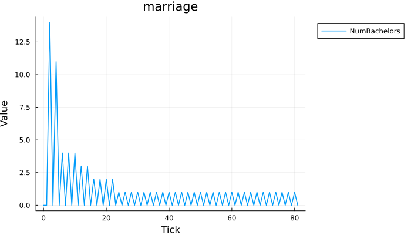
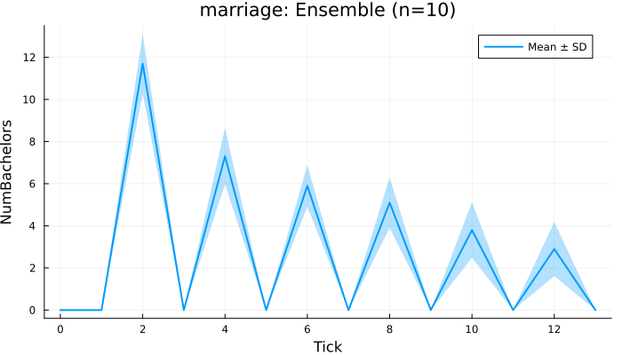
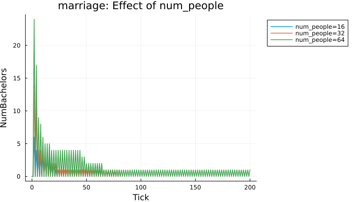

# Marriage Problem


- [Overview](#overview)
- [Parameters](#parameters)
- [Source Code](#source-code)
- [Time Series](#time-series)
- [Ensemble Runs](#ensemble-runs)
- [Parameter Sensitivity](#parameter-sensitivity)
- [Appendix: Source Code](#appendix-source-code)
  - [Parameters (`parameters.jl`)](#parameters-parametersjl)
  - [Components (`components.jl`)](#components-componentsjl)
  - [Resources (`resources.jl`)](#resources-resourcesjl)
  - [Systems (`systems.jl`)](#systems-systemsjl)
  - [Model (`model.jl`)](#model-modeljl)

## Overview

This vignette demonstrates the **Marriage Problem** model implemented in
[ArkModelZoo.jl](https://github.com/sdwfrost/ArkModelZoo.jl) using the
Ark.jl ECS framework.

## Parameters

| Parameter    | Type  | Default | Description |
|--------------|-------|---------|-------------|
| `num_people` | `Int` | `32`    | num people  |
| `max_ticks`  | `Int` | `200`   | max ticks   |

## Source Code

The Julia code to run this model:

``` julia
using ArkModelZoo
_, trajectory = run_marriage()
```

## Time Series



## Ensemble Runs

Ten replicates with different random seeds, showing mean ± standard
deviation.



## Parameter Sensitivity

Varying `num_people`.



## Appendix: Source Code

This model is implemented in the
[Ark.jl](https://github.com/sdwfrost/Ark.jl) Entity-Component-System
(ECS) framework. The code is split into five files, each with a distinct
role:

- **Parameters**: a mutable struct holding all configurable values.
- **Components**: lightweight data types attached to individual entities
  (agents).
- **Resources**: world-level shared state accessible to all systems.
- **Systems**: functions that operate on entities each tick, defining
  model behavior.
- **Model**: wiring that assembles the world, registers resources and
  systems, and provides the run entry point.

### Parameters (`parameters.jl`)

The parameter struct uses `@kwdef` so that every field has a default
value and can be overridden by keyword. These defaults match the
original NetLogo model’s slider settings.

``` julia
Base.@kwdef mutable struct MarriageParams
    num_people::Int = 32
    max_ticks::Int = 200
    seed::Int = 42
end
```

### Components (`components.jl`)

Components are lightweight data types attached to individual entities
(agents). Mutable structs hold per-entity state, while empty tag structs
act as markers for the ECS query system to efficiently filter entities.

``` julia
struct MarriageDummy end
```

### Resources (`resources.jl`)

Resources are world-level singletons shared across all systems, used for
global state and aggregate statistics.

``` julia
mutable struct MarriageState
    man_prefs::Vector{Vector{Int}}      # remaining preference list for each man
    woman_prefs::Vector{Vector{Int}}    # full preference list for each woman
    man_proposal::Vector{Int}           # current proposal target (0 = none)
    woman_accepted::Vector{Int}         # which man each woman accepted (0 = none)
end

function MarriageState(n::Int)
    MarriageState(
        [Int[] for _ in 1:n],
        [Int[] for _ in 1:n],
        zeros(Int, n),
        zeros(Int, n),
    )
end

mutable struct MarriageStats
    num_bachelors::Int
end
MarriageStats() = MarriageStats(0)
```

### Systems (`systems.jl`)

Systems contain the model logic and execute in a defined order each
tick. Each system struct implements either `initialize!` (run once at
setup) or `update!` (run every tick).

``` julia
# --- Initialization ---

struct InitMarriageSystem <: System end

function initialize!(::InitMarriageSystem, world::World)
    params = get_resource(world, MarriageParams)
    rng = get_resource(world, RNGResource).rng
    state = get_resource(world, MarriageState)
    stats = get_resource(world, MarriageStats)
    n = params.num_people

    # Each man gets a shuffled preference list of women (1..n)
    for i in 1:n
        state.man_prefs[i] = randperm(rng, n)
    end
    # Each woman gets a shuffled preference list of men (1..n)
    for i in 1:n
        state.woman_prefs[i] = randperm(rng, n)
    end

    # Initial proposals: all men propose to their first choice
    for i in 1:n
        if !isempty(state.man_prefs[i])
            w = state.man_prefs[i][1]
            state.man_proposal[i] = w
        end
    end

    stats.num_bachelors = count(==(0), state.man_proposal)
    return nothing
end

# --- Proposal Phase (even ticks) ---
# Unmatched men propose to top remaining woman

struct MarriageProposeSystem <: System end

function update!(::MarriageProposeSystem, world::World)
    tick = get_resource(world, Tick)
    # Even ticks: men propose
    tick.tick % 2 != 0 && return nothing

    state = get_resource(world, MarriageState)
    n = length(state.man_proposal)

    for i in 1:n
        if state.man_proposal[i] == 0 && !isempty(state.man_prefs[i])
            w = state.man_prefs[i][1]
            state.man_proposal[i] = w
        end
    end
    return nothing
end

# --- Rejection Phase (odd ticks) ---
# Each woman with multiple proposals keeps the best, rejects the rest

struct MarriageRejectSystem <: System end

function update!(::MarriageRejectSystem, world::World)
    tick = get_resource(world, Tick)
    # Odd ticks: women reject
    tick.tick % 2 != 1 && return nothing

    state = get_resource(world, MarriageState)
    n = length(state.woman_accepted)

    for w in 1:n
        # Find all men proposing to this woman
        suitors = Int[]
        for m in 1:n
            if state.man_proposal[m] == w
                push!(suitors, m)
            end
        end

        length(suitors) <= 1 && continue

        # Sort suitors by woman's preference (lower position = more preferred)
        w_prefs = state.woman_prefs[w]
        sort!(suitors, by = m -> findfirst(==(m), w_prefs))

        # Keep the best (first), reject the rest
        for i in 2:length(suitors)
            s = suitors[i]
            state.man_proposal[s] = 0
            # Remove current top from preferences
            if !isempty(state.man_prefs[s])
                popfirst!(state.man_prefs[s])
            end
        end
    end
    return nothing
end

# --- Stats ---

struct MarriageStatsSystem <: System end

function update!(::MarriageStatsSystem, world::World)
    state = get_resource(world, MarriageState)
    stats = get_resource(world, MarriageStats)
    stats.num_bachelors = count(==(0), state.man_proposal)
    return nothing
end

# --- Termination ---

struct MarriageTerminationSystem <: System end

function update!(::MarriageTerminationSystem, world::World)
    params = get_resource(world, MarriageParams)
    state = get_resource(world, MarriageState)
    tick = get_resource(world, Tick)
    n = params.num_people

    # Stop when all women have exactly 1 proposal
    all_matched = true
    for w in 1:n
        proposal_count = count(==(w), state.man_proposal)
        if proposal_count != 1
            all_matched = false
            break
        end
    end

    if all_matched || tick.tick + 1 >= params.max_ticks
        get_resource(world, Terminate).stop = true
    end
    return nothing
end
```

### Model (`model.jl`)

The model file assembles all pieces: it creates the ECS `World` with the
required component types, registers resources, builds the `Scheduler`
with systems in execution order, and exposes the public `run` entry
point. The observer pattern records the trajectory each tick.

``` julia
function marriage_world(; initial_capacity::Int = 128)
    return World(MarriageDummy; initial_capacity = initial_capacity, allow_mutable = true)
end

function marriage_systems()
    return (
        InitMarriageSystem(),
        MarriageProposeSystem(),
        MarriageRejectSystem(),
        MarriageStatsSystem(),
        MarriageTerminationSystem(),
    )
end

function marriage_model(params::MarriageParams = MarriageParams())
    world = marriage_world()
    _add_standard_resources!(world, params)
    add_resource!(world, MarriageState(params.num_people))
    add_resource!(world, MarriageStats())
    scheduler = Scheduler(world, marriage_systems())
    initialize!(scheduler)
    return scheduler
end

struct MarriageObserver end

function marriage_headers(::MarriageObserver)
    return ["NumBachelors"]
end

function marriage_values(::MarriageObserver, world::World)
    stats = get_resource(world, MarriageStats)
    return Float64[stats.num_bachelors]
end

function run_marriage(; params::MarriageParams = MarriageParams(), observe::Bool = true)
    return _run_model(marriage_model, MarriageObserver(), marriage_values; params, observe)
end
```
