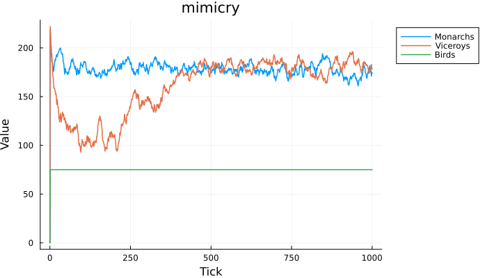
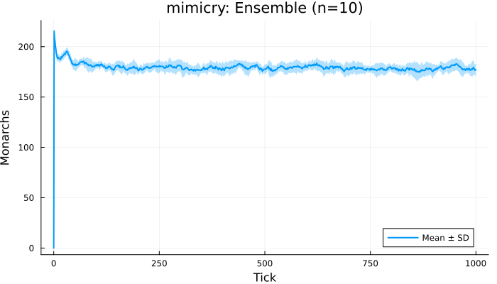
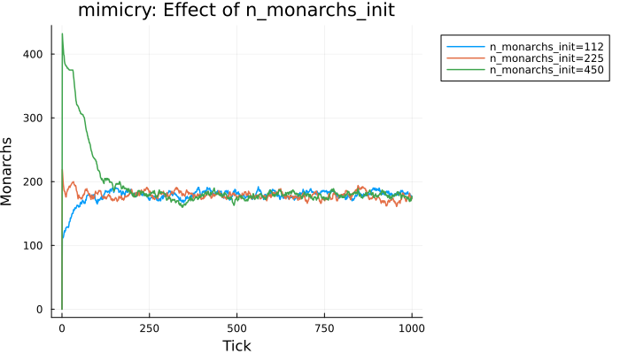

## Overview

### WHAT IS IT?

Batesian mimicry is an evolutionary relationship in which a harmless species (the mimic) has evolved so that it looks very similar to a completely different species that isn't harmless (the model).  A classic example of Batesian mimicry is the similar appearance of monarch butterflies and viceroy moths. Monarchs and viceroys are unrelated species that are both colored similarly --- bright orange with black patterns. Their colorations are so similar, in fact, that the two species are virtually indistinguishable from one another.

The classic explanation for this phenomenon is that monarchs taste yucky.  Because monarchs eat milkweed, a plant full of toxins, they become essentially inedible to birds.  Researchers have documented birds vomiting within minutes of eating monarch butterflies.  The birds then remember the experience and avoid brightly colored orange butterfly/moth species.  Viceroys, although perfectly edible, avoid predation if they are colored bright orange because birds can't tell the difference.

Recent research now suggests that viceroys might also be unpalatable to bird predators, confusing this elegant explanation.  However, we have modeled the relationship anyway.  Batesian mimicry occurs in enough other situations (snakes, for example) that the explanation's general truth is unquestionable.  The monarch-viceroy story is so accessible --- and historically relevant --- that we believe it to be instructive even if its accuracy is now questioned.

### HOW IT WORKS

This model simulates the evolution of monarchs and viceroys from distinguishable, differently colored species to indistinguishable mimics and models.  At the simulation's beginning there are 450 monarchs and viceroys distributed randomly across the world.  The monarchs are all colored red, while the viceroys are all colored blue.  They are also distinguishable (to the human observer only) by their shape:  the letter "x" represents monarchs while the letter "o" represents viceroys.  Seventy-five birds are also randomly distributed across the world.

When the model runs, the birds and butterflies (for the remainder of this description "butterfly" will be used as a general term for monarchs and viceroys, even though viceroys are technically moths) move randomly across the world.  When a bird encounters a butterfly it eats the butterfly, unless it has a memory that the butterfly's color is "yucky."  If a bird eats a monarch, it acquires a memory of the butterfly's color as yucky.

As butterflies are eaten, they regenerate through asexual reproduction. Each turn, every butterfly must pass two "tests" in order to reproduce.  The first test is based on how many butterflies of that species already exist in the world. The carrying capacity of the world for each species is 225.  The chances of reproducing are smaller the closer to 225 each population gets.  The second test is simply a random test to keep reproduction in check (set to a 4% chance in this model).  When a butterfly does reproduce it either creates an offspring identical to itself or it creates a mutant.  Mutant offspring are the same species but have a random color between blue and red, but ending in five (e.g. color equals 15, 25, 35, 45, 55, 65, 75, 85, 95, 105).  Both monarchs and Viceroys have equal opportunities to reproduce mutants.

Birds can remember up to MEMORY-SIZE yucky colors at a time.  The default value is three.  If a bird has memories of three yucky colors and it eats a monarch with a new yucky color, the bird "forgets" its oldest memory and replaces it with the new one.  Birds also forget yucky colors after a certain amount of time.

### THINGS TO NOTICE

Initially, the birds don't have any memory, so both monarchs and viceroys are eaten equally. However, soon the birds "learn" that red is a yucky color and this protects most of the monarchs.  As a result, the monarch population makes a comeback toward carrying capacity while the viceroy population continues to decline.  Notice also that as reproduction begins to replace eaten butterflies, some of the replacements are mutants and therefore randomly colored.

As the simulation progresses, birds continue to eat mostly butterflies that aren't red.  Occasionally, of course, a bird "forgets" that red is yucky, but a forgetful bird is immediately reminded when it eats another red monarch.  For the unlucky monarch that did the reminding, being red was no advantage, but every other red butterfly is safe from that bird for a while longer.  Monarch (non-red) mutants are therefore apt to be eaten.  Notice that throughout the simulation the average color of monarchs continues to be very close to its original value of 15.  A few mutant monarchs are always being born with random colors, but they never become dominant, as they and their offspring have a slim chance for survival.

Meanwhile, as the simulation continues, viceroys continue to be eaten, but as enough time passes, the chances are good that some viceroys will give birth to red mutants.  These butterflies and their offspring are likely to survive longer because they resemble the red monarchs.  With a mutation rate of 5%, it is likely that their offspring will be red too.  Soon most of the viceroy population is red.  With its protected coloration, the viceroy population will return to carrying capacity.

### THINGS TO TRY

If the MUTATION-RATE is high, advantageous color genes do not reproduce themselves.  Conversely, if MUTATION-RATE is too low, the chances of an advantageous mutant (red) viceroy being born are so slim that it may not happen enough, and the population may go extinct.  What is the most ideal setting for the MUTATION-RATE slider so that a stable state emerges most quickly in which there are red monarchs and viceroys co-existing in the world?  Why?

If the MEMORY-LENGTH slider is set too low, birds are unable to remember that certain colors are yucky.  How low can the MEMORY-LENGTH slider be set so that a stable state of co-existing red monarchs and viceroys emerges?

If you set MUTATION-RATE to 100 and MEMORY to 0, you will soon have two completely randomly colored populations.  Once the average color of both species is about 55, return the sliders to MUTATION-RATE equals 16 and MEMORY equals 30 without resetting the model.  Does a stable mimicry state emerge?  What is the "safe" color?

### EXTENDING THE MODEL

One very simple extension to this model is to add a RANDOM-COLOR button.  This button would give every butterfly in the world a random color.  The advantage of red would be gone, but some color (which could be red, or any other color) would eventually emerge as the advantageous color.  This models the evolutionary process from an earlier starting place, presumably when even monarchs had different colors.

It would be interesting to see what would happen if birds were made smarter than they are in this model.  A smart bird should probably continue to experiment with yucky colors a few times before being "convinced" that all butterflies of that color are indeed distasteful.

You could try to add variables that kept track of how many yucky individuals of the same color a bird ate.  Presumably if a bird has eaten several monarchs that are all the same color, it will be especially attentive to avoiding that color as compared to if it had just eaten one butterfly of that color.  Making changes of this nature would presumably make the proportion of models and mimics more in keeping with the predictions of theorists that there are generally more models than mimics.  In the current model, birds aren't smart enough to learn that most butterflies may be harmless in a given situation.

In a real world situation, the birds would also reproduce.  Young birds would not have the experiences necessary to know which colors to avoid.  Reproduction of birds, depending on how it happened and how often, might change the dynamics of this model considerably.

One could also refine the mutation-making procedures of the model so that a butterfly is more likely to reproduce a mutant that is only slightly differently colored than to reproduce a mutant that is completely differently colored.  In the current model, mutants' colors are simply random.

### HOW TO CITE

If you mention this model or the NetLogo software in a publication, we ask that you include the citations below.

For the model itself:

* Wilensky, U. (1997).  NetLogo Mimicry model.  http://ccl.northwestern.edu/netlogo/models/Mimicry.  Center for Connected Learning and Computer-Based Modeling, Northwestern University, Evanston, IL.

Please cite the NetLogo software as:

* Wilensky, U. (1999). NetLogo. http://ccl.northwestern.edu/netlogo/. Center for Connected Learning and Computer-Based Modeling, Northwestern University, Evanston, IL.

### COPYRIGHT AND LICENSE

Copyright 1997 Uri Wilensky.


This model is licensed under the Creative Commons Attribution-NonCommercial-ShareAlike 3.0 License.  To view a copy of this license, visit https://creativecommons.org/licenses/by-nc-sa/3.0/ or send a letter to Creative Commons, 559 Nathan Abbott Way, Stanford, California 94305, USA.

NetLogo itself is free software for non-commercial use under the terms of the GNU General Public License ([see full license information here](https://ccl.northwestern.edu/netlogo/docs/copyright.html)).

To inquire about commercial licenses for either NetLogo or specific models from the models library, please contact netlogo-commercial-admin@ccl.northwestern.edu.

This model was created as part of the project: CONNECTED MATHEMATICS: MAKING SENSE OF COMPLEX PHENOMENA THROUGH BUILDING OBJECT-BASED PARALLEL MODELS (OBPML).  The project gratefully acknowledges the support of the National Science Foundation (Applications of Advanced Technologies Program) -- grant numbers RED #9552950 and REC #9632612.

This model was converted to NetLogo as part of the projects: PARTICIPATORY SIMULATIONS: NETWORK-BASED DESIGN FOR SYSTEMS LEARNING IN CLASSROOMS and/or INTEGRATED SIMULATION AND MODELING ENVIRONMENT. The project gratefully acknowledges the support of the National Science Foundation (REPP & ROLE programs) -- grant numbers REC #9814682 and REC-0126227. Converted from StarLogoT to NetLogo, 2001.

<!-- 1997 2001 -->

## Parameters

| Parameter | Type | Default | Description |
|-----------|------|---------|-------------|
| `n_monarchs_init` | `Int` | `225` | n monarchs init |
| `n_viceroys_init` | `Int` | `225` | n viceroys init |
| `n_birds_init` | `Int` | `75` | n birds init |
| `carrying_capacity_monarchs` | `Int` | `225` | carrying capacity monarchs |
| `carrying_capacity_viceroys` | `Int` | `225` | carrying capacity viceroys |
| `memory_duration` | `Int` | `30` | memory duration |
| `mutation_rate` | `Float64` | `5.0` | percent |
| `memory_size` | `Int` | `3` | memory size |
| `reproduction_chance` | `Float64` | `4.0` | percent |
| `grid_width` | `Int` | `41` | -20..20 |
| `grid_height` | `Int` | `41` | grid height |
| `max_ticks` | `Int` | `1000` | max ticks |

## Source Code

The Julia code to run this model:

```julia
using ArkModelZoo
_, trajectory = run_mimicry()
```

## Time Series

{width=100%}

## Ensemble Runs

Ten replicates with different random seeds, showing mean ± standard deviation.

{width=100%}

## Parameter Sensitivity

Varying `n_monarchs_init`.

{width=100%}


## Appendix: Source Code

This model is implemented in the [Ark.jl](https://github.com/sdwfrost/Ark.jl) Entity-Component-System (ECS) framework. The code is split into five files, each with a distinct role:

- **Parameters**: a mutable struct holding all configurable values.
- **Components**: lightweight data types attached to individual entities (agents).
- **Resources**: world-level shared state accessible to all systems.
- **Systems**: functions that operate on entities each tick, defining model behavior.
- **Model**: wiring that assembles the world, registers resources and systems, and provides the run entry point.

### Parameters (`parameters.jl`)

The parameter struct uses `@kwdef` so that every field has a default value and can be overridden by keyword. These defaults match the original NetLogo model's slider settings.

```julia
Base.@kwdef mutable struct MimicryParams
    n_monarchs_init::Int = 225
    n_viceroys_init::Int = 225
    n_birds_init::Int = 75
    carrying_capacity_monarchs::Int = 225
    carrying_capacity_viceroys::Int = 225
    memory_duration::Int = 30
    mutation_rate::Float64 = 5.0        # percent
    memory_size::Int = 3
    reproduction_chance::Float64 = 4.0  # percent
    grid_width::Int = 41                # -20..20
    grid_height::Int = 41
    max_ticks::Int = 1000
    seed::Int = 42
end
```

### Components (`components.jl`)

Components are lightweight data types attached to individual entities (agents). Mutable structs hold per-entity state, while empty tag structs act as markers for the ECS query system to efficiently filter entities.

```julia
# Butterfly / bird position (continuous, toroidal wrapping)
mutable struct MimicryPosition
    x::Float64
    y::Float64
end

# Persistent heading (degrees, 0=north, clockwise)
mutable struct MimicryHeading
    angle::Float64
end

# NetLogo color value (used for mimicry matching)
mutable struct MimicryColor
    color::Float64
end

# Bird memory: list of (color, age) pairs
mutable struct BirdMemory
    memory::Vector{Tuple{Float64, Int}}
end
BirdMemory() = BirdMemory(Tuple{Float64, Int}[])

# Breed tags
struct MonarchTag end
struct ViceroyTag end
struct BirdTag end
```

### Resources (`resources.jl`)

Resources are world-level singletons shared across all systems, used for global state and aggregate statistics.

```julia
mutable struct MimicryStats
    n_monarchs::Int
    n_viceroys::Int
    n_birds::Int
end
MimicryStats() = MimicryStats(0, 0, 0)
```

### Systems (`systems.jl`)

Systems contain the model logic and execute in a defined order each tick. Each system struct implements either `initialize!` (run once at setup) or `update!` (run every tick).

```julia
# NetLogo base-colors sublist 1 10 = [15,25,35,45,55,65,75,85,95]
const MIMICRY_MUTATION_COLORS = Float64[15, 25, 35, 45, 55, 65, 75, 85, 95]

# --- Initialization ---

struct InitMimicrySystem <: System end

function initialize!(::InitMimicrySystem, world::World)
    params = get_resource(world, MimicryParams)
    rng = get_resource(world, RNGResource).rng
    stats = get_resource(world, MimicryStats)
    wf = Float64(params.grid_width)
    hf = Float64(params.grid_height)

    # Monarchs (red = 15.0 in NetLogo)
    for _ in 1:params.n_monarchs_init
        x = rand(rng) * wf
        y = rand(rng) * hf
        heading = Float64(rand(rng, 0:359))
        new_entity!(world, (MimicryPosition(x, y), MimicryHeading(heading),
                            MimicryColor(15.0), MonarchTag()))
    end

    # Viceroys (blue = 105.0 in NetLogo)
    for _ in 1:params.n_viceroys_init
        x = rand(rng) * wf
        y = rand(rng) * hf
        heading = Float64(rand(rng, 0:359))
        new_entity!(world, (MimicryPosition(x, y), MimicryHeading(heading),
                            MimicryColor(105.0), ViceroyTag()))
    end

    # Birds (black = 0.0)
    for _ in 1:params.n_birds_init
        x = rand(rng) * wf
        y = rand(rng) * hf
        heading = Float64(rand(rng, 0:359))
        new_entity!(world, (MimicryPosition(x, y), MimicryHeading(heading),
                            MimicryColor(0.0), BirdTag(), BirdMemory()))
    end

    # NetLogo doesn't set n-monarchs/n-viceroys/n-birds in setup;
    # they default to 0 until the first go sets them via count.
    stats.n_monarchs = 0
    stats.n_viceroys = 0
    stats.n_birds = 0
    return nothing
end

# --- Bird movement ---
# NetLogo: set heading 180 + random 180; fd 1

struct MimicryBirdMoveSystem <: System end

function update!(::MimicryBirdMoveSystem, world::World)
    rng = get_resource(world, RNGResource).rng
    params = get_resource(world, MimicryParams)
    wf = Float64(params.grid_width)
    hf = Float64(params.grid_height)

    for (_, positions, headings) in Query(world, (MimicryPosition, MimicryHeading); with=(BirdTag,))
        @inbounds for i in eachindex(positions)
            headings[i].angle = Float64(180 + rand(rng, 0:179))
            θ = deg2rad(headings[i].angle)
            positions[i].x = mod(positions[i].x + sin(θ), wf)
            positions[i].y = mod(positions[i].y + cos(θ), hf)
        end
    end
    return nothing
end

# --- Butterfly movement ---
# NetLogo: rt random 100; lt random 100; fd 1

struct MimicryButterflyMoveSystem <: System end

function update!(::MimicryButterflyMoveSystem, world::World)
    rng = get_resource(world, RNGResource).rng
    params = get_resource(world, MimicryParams)
    wf = Float64(params.grid_width)
    hf = Float64(params.grid_height)

    for (_, positions, headings) in Query(world, (MimicryPosition, MimicryHeading); without=(BirdTag,))
        @inbounds for i in eachindex(positions)
            headings[i].angle += Float64(rand(rng, 0:99) - rand(rng, 0:99))
            θ = deg2rad(headings[i].angle)
            positions[i].x = mod(positions[i].x + sin(θ), wf)
            positions[i].y = mod(positions[i].y + cos(θ), hf)
        end
    end
    return nothing
end

# --- Eating ---
# Butterflies check for bird on same patch. If bird doesn't remember color, butterfly dies.
# If butterfly is monarch, bird learns the color.

mutable struct MimicryEatingSystem <: System
    to_remove::Vector{Entity}
end
MimicryEatingSystem() = MimicryEatingSystem(Entity[])

function _mimicry_color_in_memory(mem::BirdMemory, c::Float64)
    for (mc, _) in mem.memory
        mc == c && return true
    end
    return false
end

function update!(system::MimicryEatingSystem, world::World)
    params = get_resource(world, MimicryParams)
    rng = get_resource(world, RNGResource).rng
    wf = Float64(params.grid_width)
    hf = Float64(params.grid_height)

    empty!(system.to_remove)

    # Build spatial index: patch → list of (bird_eid)
    bird_cells = Dict{Tuple{Int,Int}, Vector{Entity}}()
    for (eids, positions) in Query(world, (MimicryPosition,); with=(BirdTag,))
        @inbounds for i in eachindex(positions)
            px = mod(floor(Int, positions[i].x), params.grid_width) + 1
            py = mod(floor(Int, positions[i].y), params.grid_height) + 1
            key = (px, py)
            if !haskey(bird_cells, key)
                bird_cells[key] = Entity[]
            end
            push!(bird_cells[key], eids[i])
        end
    end

    # Collect all butterflies and shuffle (ask turtles with [breed != birds])
    butterflies = Tuple{Entity, Bool}[]  # (eid, is_monarch)
    for (eids, _) in Query(world, (MimicryPosition,); with=(MonarchTag,))
        @inbounds for i in eachindex(eids)
            push!(butterflies, (eids[i], true))
        end
    end
    for (eids, _) in Query(world, (MimicryPosition,); with=(ViceroyTag,))
        @inbounds for i in eachindex(eids)
            push!(butterflies, (eids[i], false))
        end
    end
    shuffle!(rng, butterflies)

    for (bfly_eid, is_monarch) in butterflies
        is_alive(world, bfly_eid) || continue

        pos = get_components(world, bfly_eid, (MimicryPosition,))[1]
        col = get_components(world, bfly_eid, (MimicryColor,))[1]
        px = mod(floor(Int, pos.x), params.grid_width) + 1
        py = mod(floor(Int, pos.y), params.grid_height) + 1
        key = (px, py)

        birds_here = get(bird_cells, key, nothing)
        birds_here === nothing && continue
        isempty(birds_here) && continue

        # one-of birds-here
        bird_eid = birds_here[rand(rng, 1:length(birds_here))]
        is_alive(world, bird_eid) || continue

        bird_mem = get_components(world, bird_eid, (BirdMemory,))[1]

        if !_mimicry_color_in_memory(bird_mem, col.color)
            # Monarch teaches bird the color
            if is_monarch
                if length(bird_mem.memory) >= params.memory_size
                    popfirst!(bird_mem.memory)
                end
                push!(bird_mem.memory, (col.color, 0))
            end
            # Butterfly dies
            push!(system.to_remove, bfly_eid)
        end
    end

    for e in system.to_remove
        is_alive(world, e) && remove_entity!(world, e)
    end
    return nothing
end

# --- Bird forgetting ---
# Age all memories +1, remove those > memory_duration

struct MimicryForgetSystem <: System end

function update!(::MimicryForgetSystem, world::World)
    params = get_resource(world, MimicryParams)

    for (_, mems) in Query(world, (BirdMemory,))
        @inbounds for i in eachindex(mems)
            mem = mems[i]
            # Age all memories
            for j in eachindex(mem.memory)
                c, a = mem.memory[j]
                mem.memory[j] = (c, a + 1)
            end
            # Remove expired
            filter!(x -> x[2] <= params.memory_duration, mem.memory)
        end
    end
    return nothing
end

# --- Butterfly reproduction ---
# Density-dependent: if random count_breed < cap - count_breed, attempt hatch.
# hatch-butterfly: 4% reproduction chance, 5% mutation.

mutable struct MimicryReproductionSystem <: System
    to_spawn::Vector{Tuple{Float64, Float64, Float64, Float64, Bool}}  # (x, y, heading, color, is_monarch)
end
MimicryReproductionSystem() = MimicryReproductionSystem(Tuple{Float64, Float64, Float64, Float64, Bool}[])

function update!(system::MimicryReproductionSystem, world::World)
    params = get_resource(world, MimicryParams)
    rng = get_resource(world, RNGResource).rng
    wf = Float64(params.grid_width)
    hf = Float64(params.grid_height)

    empty!(system.to_spawn)

    # Count current populations
    n_monarchs = 0
    for (eids, _) in Query(world, (MimicryPosition,); with=(MonarchTag,))
        n_monarchs += length(eids)
    end
    n_viceroys = 0
    for (eids, _) in Query(world, (MimicryPosition,); with=(ViceroyTag,))
        n_viceroys += length(eids)
    end

    # Collect butterflies and shuffle
    butterflies = Tuple{Entity, Bool}[]
    for (eids, _) in Query(world, (MimicryPosition,); with=(MonarchTag,))
        @inbounds for i in eachindex(eids)
            push!(butterflies, (eids[i], true))
        end
    end
    for (eids, _) in Query(world, (MimicryPosition,); with=(ViceroyTag,))
        @inbounds for i in eachindex(eids)
            push!(butterflies, (eids[i], false))
        end
    end
    shuffle!(rng, butterflies)

    for (bfly_eid, is_monarch) in butterflies
        is_alive(world, bfly_eid) || continue

        if is_monarch
            count_breed = n_monarchs
            cap = params.carrying_capacity_monarchs
        else
            count_breed = n_viceroys
            cap = params.carrying_capacity_viceroys
        end

        # Density check: random count_breed < cap - count_breed
        count_breed <= 0 && continue
        deficit = cap - count_breed
        deficit <= 0 && continue
        rand(rng, 0:count_breed-1) < deficit || continue

        # Reproduction chance (4%)
        rand(rng) * 100.0 >= params.reproduction_chance && continue

        pos = get_components(world, bfly_eid, (MimicryPosition,))[1]
        hdg = get_components(world, bfly_eid, (MimicryHeading,))[1]
        col = get_components(world, bfly_eid, (MimicryColor,))[1]

        # Hatch: inherit position/heading, fd 1
        θ = deg2rad(hdg.angle)
        nx = mod(pos.x + sin(θ), wf)
        ny = mod(pos.y + cos(θ), hf)

        # Mutation: 5% chance to change color
        new_color = col.color
        if rand(rng) * 100.0 < params.mutation_rate
            new_color = MIMICRY_MUTATION_COLORS[rand(rng, 1:length(MIMICRY_MUTATION_COLORS))]
        end

        push!(system.to_spawn, (nx, ny, hdg.angle, new_color, is_monarch))

        # Update running count for density check
        if is_monarch
            n_monarchs += 1
        else
            n_viceroys += 1
        end
    end

    for (x, y, heading, color, is_monarch) in system.to_spawn
        if is_monarch
            new_entity!(world, (MimicryPosition(x, y), MimicryHeading(heading),
                                MimicryColor(color), MonarchTag()))
        else
            new_entity!(world, (MimicryPosition(x, y), MimicryHeading(heading),
                                MimicryColor(color), ViceroyTag()))
        end
    end
    return nothing
end

# --- Stats ---

struct MimicryStatsSystem <: System end

function update!(::MimicryStatsSystem, world::World)
    stats = get_resource(world, MimicryStats)
    nm = 0
    for (eids, _) in Query(world, (MimicryPosition,); with=(MonarchTag,))
        nm += length(eids)
    end
    nv = 0
    for (eids, _) in Query(world, (MimicryPosition,); with=(ViceroyTag,))
        nv += length(eids)
    end
    nb = 0
    for (eids, _) in Query(world, (MimicryPosition,); with=(BirdTag,))
        nb += length(eids)
    end
    stats.n_monarchs = nm
    stats.n_viceroys = nv
    stats.n_birds = nb
    return nothing
end

# --- Termination ---

struct MimicryTerminationSystem <: System end

function update!(::MimicryTerminationSystem, world::World)
    params = get_resource(world, MimicryParams)
    tick = get_resource(world, Tick)
    if tick.tick + 1 >= params.max_ticks
        get_resource(world, Terminate).stop = true
    end
    return nothing
end
```

### Model (`model.jl`)

The model file assembles all pieces: it creates the ECS `World` with the required component types, registers resources, builds the `Scheduler` with systems in execution order, and exposes the public `run` entry point. The observer pattern records the trajectory each tick.

```julia
function mimicry_world(; initial_capacity::Int = 2048)
    return World(
        MimicryPosition,
        MimicryHeading,
        MimicryColor,
        BirdMemory,
        MonarchTag,
        ViceroyTag,
        BirdTag;
        initial_capacity = initial_capacity,
        allow_mutable = true,
    )
end

function mimicry_systems()
    return (
        InitMimicrySystem(),
        MimicryBirdMoveSystem(),
        MimicryButterflyMoveSystem(),
        MimicryEatingSystem(),
        MimicryForgetSystem(),
        MimicryReproductionSystem(),
        MimicryStatsSystem(),
        MimicryTerminationSystem(),
    )
end

function mimicry_model(params::MimicryParams = MimicryParams())
    world = mimicry_world()
    _add_standard_resources!(world, params)
    add_resource!(world, MimicryStats())
    scheduler = Scheduler(world, mimicry_systems())
    initialize!(scheduler)
    return scheduler
end

struct MimicryObserver end

function mimicry_headers(::MimicryObserver)
    return ["Monarchs", "Viceroys", "Birds"]
end

function mimicry_values(::MimicryObserver, world::World)
    stats = get_resource(world, MimicryStats)
    return Float64[stats.n_monarchs, stats.n_viceroys, stats.n_birds]
end

function run_mimicry(; params::MimicryParams = MimicryParams(), observe::Bool = true)
    return _run_model(mimicry_model, MimicryObserver(), mimicry_values; params, observe)
end
```
