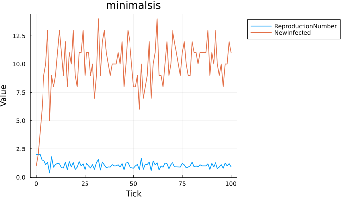
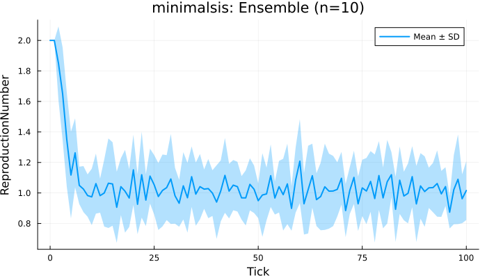
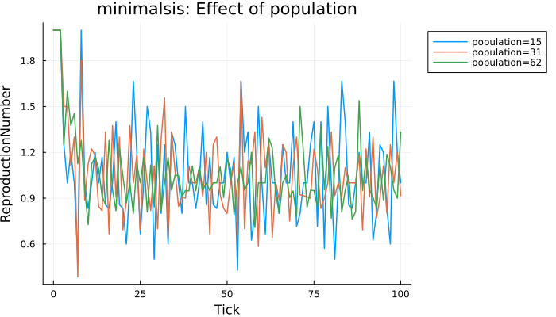

## Overview

### WHAT IS IT?

The Minimal SIS model is a discrete stochastic compartmental model of an epidemic that averages to the (ordinary differential equation) SIS model. Each individual within a population is in one of two states known, in epidemic modelling, as compartments: 

* S - Susceptible to infection.
* I - Infected and infectious.

### CREDITS AND REFERENCES

This software implementation was forked from

* Wilensky, U. (2003).  NetLogo Dining Philosophers model.  http://ccl.northwestern.edu/netlogo/models/DiningPhilosophers.  Center for Connected Learning and Computer-Based Modeling, Northwestern University, Evanston, IL.

Copyright 2003 Uri Wilensky.

### HOW TO CITE

If you mention this model or the NetLogo software in a publication, we ask that you include the citations below.

For the model itself:
* Mason, Z. W. T. (2025). The minimal SIR model, validated then extended to social networks and stochastic differential equations. https://osf.io/y6ckv/. Stoch Answers Ltd, Sheffield, UK.

Please cite the NetLogo software as:

* Wilensky, U. (1999). NetLogo. http://ccl.northwestern.edu/netlogo/. Center for Connected Learning and Computer-Based Modeling, Northwestern University, Evanston, IL.

### COPYRIGHT AND LICENSE

Copyright 2025 Zebedee Mason


This work is licensed under the Creative Commons Attribution-NonCommercial-ShareAlike 3.0 License.  To view a copy of this license, visit https://creativecommons.org/licenses/by-nc-sa/3.0/ or send a letter to Creative Commons, 559 Nathan Abbott Way, Stanford, California 94305, USA.

<!-- 2003 -->

## Parameters

| Parameter | Type | Default | Description |
|-----------|------|---------|-------------|
| `population` | `Int` | `31` | population |
| `basic_reproduction_number` | `Int` | `2` | basic reproduction number |
| `max_ticks` | `Int` | `100` | max ticks |

## Source Code

The Julia code to run this model:

```julia
using ArkModelZoo
_, trajectory = run_minimalsis()
```

## Time Series

{width=100%}

## Ensemble Runs

Ten replicates with different random seeds, showing mean ± standard deviation.

{width=100%}

## Parameter Sensitivity

Varying `population`.

{width=100%}


## Appendix: Source Code

This model is implemented in the [Ark.jl](https://github.com/sdwfrost/Ark.jl) Entity-Component-System (ECS) framework. The code is split into five files, each with a distinct role:

- **Parameters**: a mutable struct holding all configurable values.
- **Components**: lightweight data types attached to individual entities (agents).
- **Resources**: world-level shared state accessible to all systems.
- **Systems**: functions that operate on entities each tick, defining model behavior.
- **Model**: wiring that assembles the world, registers resources and systems, and provides the run entry point.

### Parameters (`parameters.jl`)

The parameter struct uses `@kwdef` so that every field has a default value and can be overridden by keyword. These defaults match the original NetLogo model's slider settings.

```julia
Base.@kwdef mutable struct MinimalSISParams
    population::Int = 31
    basic_reproduction_number::Int = 2
    max_ticks::Int = 100
    seed::Int = 42
end
```

### Components (`components.jl`)

Components are lightweight data types attached to individual entities (agents). Mutable structs hold per-entity state, while empty tag structs act as markers for the ECS query system to efficiently filter entities.

```julia
struct MSISDummy end
```

### Resources (`resources.jl`)

Resources are world-level singletons shared across all systems, used for global state and aggregate statistics.

```julia
mutable struct MSISState
    n::Int
    states::Vector{Int}     # 0=susceptible, 1=infected
    marked::Vector{Bool}
end
MSISState() = MSISState(0, Int[], Bool[])

mutable struct MSISStats
    reproduction_number::Float64
    new_infected::Int
end
MSISStats() = MSISStats(0.0, 0)
```

### Systems (`systems.jl`)

Systems contain the model logic and execute in a defined order each tick. Each system struct implements either `initialize!` (run once at setup) or `update!` (run every tick).

```julia
# Minimal SIS Model
# Ring of agents; infected contact R0 random others; SIS dynamics

struct InitMSISSystem <: System end

function initialize!(::InitMSISSystem, world::World)
    params = get_resource(world, MinimalSISParams)
    st = get_resource(world, MSISState)
    stats = get_resource(world, MSISStats)

    st.n = params.population
    st.states = zeros(Int, st.n)
    st.marked = falses(st.n)

    # NetLogo: individual 0 starts infected
    st.states[1] = 1

    stats.reproduction_number = Float64(params.basic_reproduction_number)
    stats.new_infected = 1
    return nothing
end

struct MSISGoSystem <: System end

function update!(::MSISGoSystem, world::World)
    params = get_resource(world, MinimalSISParams)
    rng = get_resource(world, RNGResource).rng
    st = get_resource(world, MSISState)
    stats = get_resource(world, MSISStats)

    # NetLogo: if new-infected > 0 [a-go]
    if stats.new_infected <= 0
        get_resource(world, Terminate).stop = true
        return nothing
    end

    old_infected = stats.new_infected
    n = st.n
    R0 = params.basic_reproduction_number

    # Clear marks
    fill!(st.marked, false)

    # NetLogo: ask individuals [infect]
    # Shuffle order (NetLogo ask shuffles)
    order = collect(1:n)
    Random.shuffle!(rng, order)

    for who in order
        st.states[who] == 1 || continue
        # Shuffle range (population-1), pick R0 contacts
        # let values array:from-list shuffle range (population - 1)
        values = collect(0:(n-2))
        Random.shuffle!(rng, values)
        for idx in 1:min(R0, length(values))
            i2 = values[idx]
            # i3 = ((i2 + 1 + who_index) mod population)
            # who is 1-indexed, NetLogo who is 0-indexed
            i3 = mod(i2 + 1 + (who - 1), n) + 1
            st.marked[i3] = true
        end
    end

    # NetLogo: ask individuals [update]
    Random.shuffle!(rng, order)
    new_inf = 0
    for who in order
        if st.marked[who] && st.states[who] == 0
            st.states[who] = 1
            new_inf += 1
        elseif st.states[who] == 1
            st.states[who] = 0
        end
        st.marked[who] = false
    end

    stats.new_infected = new_inf
    if old_infected == 0
        stats.reproduction_number = 0.0
    else
        stats.reproduction_number = new_inf / old_infected
    end
    return nothing
end

struct MSISTerminationSystem <: System end

function update!(::MSISTerminationSystem, world::World)
    params = get_resource(world, MinimalSISParams)
    tick = get_resource(world, Tick)
    if tick.tick + 1 >= params.max_ticks
        get_resource(world, Terminate).stop = true
    end
    return nothing
end
```

### Model (`model.jl`)

The model file assembles all pieces: it creates the ECS `World` with the required component types, registers resources, builds the `Scheduler` with systems in execution order, and exposes the public `run` entry point. The observer pattern records the trajectory each tick.

```julia
function minimalsis_world(; initial_capacity::Int = 64)
    return World(MSISDummy; initial_capacity = initial_capacity, allow_mutable = true)
end

function minimalsis_systems()
    return (InitMSISSystem(), MSISGoSystem(), MSISTerminationSystem())
end

function minimalsis_model(params::MinimalSISParams = MinimalSISParams())
    world = minimalsis_world()
    _add_standard_resources!(world, params)
    add_resource!(world, MSISState())
    add_resource!(world, MSISStats())
    scheduler = Scheduler(world, minimalsis_systems())
    initialize!(scheduler)
    return scheduler
end

struct MSISObserver end

function minimalsis_headers(::MSISObserver)
    return ["ReproductionNumber", "NewInfected"]
end

function minimalsis_values(::MSISObserver, world::World)
    stats = get_resource(world, MSISStats)
    return Float64[stats.reproduction_number, stats.new_infected]
end

function run_minimalsis(; params::MinimalSISParams = MinimalSISParams(), observe::Bool = true)
    return _run_model(minimalsis_model, MSISObserver(), minimalsis_values; params, observe)
end
```
