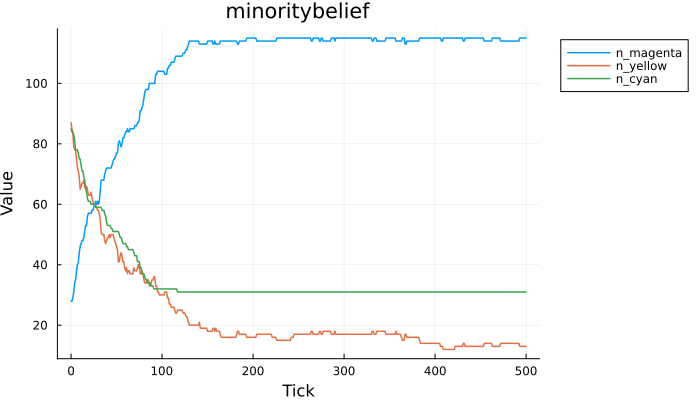
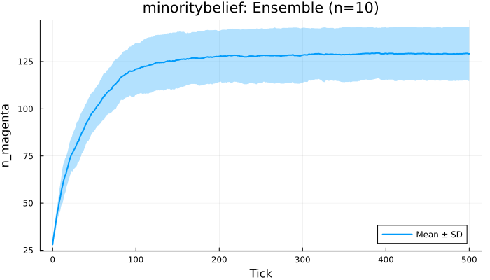
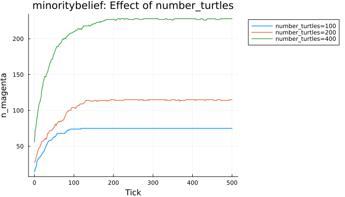

## Overview

### WHAT IS IT?

This model tries to explore the spread of a belief from a minority to the majority, through a social network. It is inspired by the article "Minority Rules: Scientists Discover Tipping Point for the Spread of Ideas" at https://news.rpi.edu/luwakkey/2902. 

Mainly, it tries to identify the tipping point reprensented by a critical percentage of initial believers, who are people with a new unshakable belief. This percentage have to be around 10% according to the article.

### HOW IT WORKS

Every agent holds a belief, some of them have a constant new belief and the others are open to change their opinion. Then each time step (tick), agents will SPEAK and LISTEN to their neighbors, trying to exchange their opinions.

For this, we have the turtles-own property BELIEF to represent their opinion. 

- BELIEF = 0 -> means old opinion -> color WHITE
-  BELIEF = 1 -> means both of the two points of view -> color YELLOW
-  BELIEF = 2 -> means new opinion -> color MAGENTA

Each time step, agents will randomely SPEAK and LISTEN to their neighbors.

There are two kinds of agents : 

-  CONSTANTS : are those who holds the minority fixed opinion
-  OPENS : are those who are able to change their opinion

Interactions are : 

- SPEAK : the current turtle will try to convince their neighbors (if they are OPENS), to to adopt its opinion, either by incrementing or by decrementing the value of BELIEF.

- LISTEN : the current turtle (if it is OPEN) will try the change its own opinion according to its neighbors belief.

The envirnment is a social network, and some of its parameters as the number of nodes and its type are set by the user.

### THINGS TO NOTICE

The model can show two types of behavior depending on the initial parameters : 

- the minority belief can spread to the majority within a reasonnable time 
- the minority will not reach the majority in limited period of time

Also the Small-world network illustrates a tipping point around 10%.

### THINGS TO TRY

Try to explore the model with a total number of turtles equal to 200, for percentage like 5% and 14%, using the small-world network.

### EXTENDING THE MODEL

The model can be extended to model the co-existence of two types of constant believers, who will try to convince the rest of the population.

### CREDITS AND REFERENCES

By Thouraya BCHIR / tbchir@gmail.com 

Main ideas are from the article @  https://news.rpi.edu/luwakkey/2902

## Parameters

| Parameter | Type | Default | Description |
|-----------|------|---------|-------------|
| `number_turtles` | `Int` | `200` | number turtles |
| `percentage_of_believers` | `Float64` | `0.14` | percentage of believers |
| `max_ticks` | `Int` | `500` | max ticks |

## Source Code

The Julia code to run this model:

```julia
using ArkModelZoo
_, trajectory = run_minoritybelief()
```

## Time Series

{width=100%}

## Ensemble Runs

Ten replicates with different random seeds, showing mean ± standard deviation.

{width=100%}

## Parameter Sensitivity

Varying `number_turtles`.

{width=100%}


## Appendix: Source Code

This model is implemented in the [Ark.jl](https://github.com/sdwfrost/Ark.jl) Entity-Component-System (ECS) framework. The code is split into five files, each with a distinct role:

- **Parameters**: a mutable struct holding all configurable values.
- **Components**: lightweight data types attached to individual entities (agents).
- **Resources**: world-level shared state accessible to all systems.
- **Systems**: functions that operate on entities each tick, defining model behavior.
- **Model**: wiring that assembles the world, registers resources and systems, and provides the run entry point.

### Parameters (`parameters.jl`)

The parameter struct uses `@kwdef` so that every field has a default value and can be overridden by keyword. These defaults match the original NetLogo model's slider settings.

```julia
Base.@kwdef mutable struct MBeliefParams
    number_turtles::Int = 200
    percentage_of_believers::Float64 = 0.14
    max_ticks::Int = 500
    seed::Int = 42
end
```

### Components (`components.jl`)

Components are lightweight data types attached to individual entities (agents). Mutable structs hold per-entity state, while empty tag structs act as markers for the ECS query system to efficiently filter entities.

```julia
struct MBeliefDummy end
```

### Resources (`resources.jl`)

Resources are world-level singletons shared across all systems, used for global state and aggregate statistics.

```julia
mutable struct MBeliefState
    n_agents::Int
    belief::Vector{Int}          # 0 (cyan/white), 1 (yellow), 2 (magenta/constant)
    is_constant::Vector{Bool}
    adj::Vector{Set{Int}}
    color::Vector{Int}           # 0=cyan, 1=yellow, 2=magenta, 3=white
end

function MBeliefState()
    MBeliefState(0, Int[], Bool[], Set{Int}[], Int[])
end

function _mbelief_add_agent!(state::MBeliefState)
    state.n_agents += 1
    push!(state.belief, 0)
    push!(state.is_constant, false)
    push!(state.adj, Set{Int}())
    push!(state.color, 0)  # cyan by default
    return state.n_agents
end

mutable struct MBeliefStats
    n_magenta::Int
    n_yellow::Int
    n_cyan::Int
end
MBeliefStats() = MBeliefStats(0, 0, 0)
```

### Systems (`systems.jl`)

Systems contain the model logic and execute in a defined order each tick. Each system struct implements either `initialize!` (run once at setup) or `update!` (run every tick).

```julia
# --- Helpers ---

# Barabási-Albert preferential attachment graph
function _mbelief_build_ba_network!(rng, state::MBeliefState)
    n = state.n_agents
    n < 2 && return
    # Start: nodes 1 and 2 connected
    push!(state.adj[1], 2)
    push!(state.adj[2], 1)
    degree = zeros(Int, n)
    degree[1] = 1
    degree[2] = 1
    total_degree = 2
    for i in 3:n
        # Each new node connects to 1 existing node with prob proportional to degree
        cumsum = 0
        r = rand(rng) * total_degree
        target = 1
        for j in 1:(i-1)
            cumsum += degree[j]
            if cumsum >= r
                target = j
                break
            end
        end
        push!(state.adj[i], target)
        push!(state.adj[target], i)
        degree[i] += 1
        degree[target] += 1
        total_degree += 2
    end
end

function _mbelief_update_counts!(state::MBeliefState, stats::MBeliefStats)
    stats.n_magenta = 0
    stats.n_yellow = 0
    stats.n_cyan = 0
    for i in 1:state.n_agents
        c = state.color[i]
        if c == 2      # magenta
            stats.n_magenta += 1
        elseif c == 1  # yellow
            stats.n_yellow += 1
        elseif c == 0  # cyan
            stats.n_cyan += 1
        end
        # white (3) is not counted by any tracked global
    end
end

# Speak behavior for a single agent
function _mbelief_speak!(rng, state::MBeliefState, i::Int)
    if state.is_constant[i]
        # Constants: ask in-link-neighbors with [breed = opens]
        # NetLogo `and` is non-short-circuit, so random-float 1.0 is always consumed
        for nb in state.adj[i]
            if !state.is_constant[nb]
                rval = rand(rng)
                if state.belief[nb] != 2 && rval < 0.10
                    state.belief[nb] += 1
                    if state.belief[nb] == 2
                        state.color[nb] = 2  # magenta
                    elseif state.belief[nb] == 1
                        state.color[nb] = 1  # yellow
                    end
                end
            end
        end
    else
        b = state.belief[i]
        if b == 2
            # NetLogo: `ask in-link-neighbors with [belief = 1 and belief = 0]`
            # belief = 1 AND belief = 0 is IMPOSSIBLE — this never selects anyone.
            # So opens with belief 2 do nothing when speaking.
            # (consume RNG to match NetLogo's random-float evaluation)
            if rand(rng) < 0.04
                # No neighbors match the impossible condition
            end
        elseif b == 0
            # NetLogo: `ask in-link-neighbors with [belief = 1 and belief = 2]`
            # belief = 1 AND belief = 2 is IMPOSSIBLE — this never selects anyone.
            if rand(rng) < 0.04
                # No neighbors match the impossible condition
            end
        end
    end
end

# Listen behavior for a single agent
# NetLogo iterates through each neighbor's belief sequentially,
# adjusting the listener's belief for each one.
function _mbelief_listen!(rng, state::MBeliefState, i::Int)
    state.is_constant[i] && return
    isempty(state.adj[i]) && return
    rand(rng) >= 0.04 && return
    # NetLogo: let belief_list (list 3)
    # Then prepends each neighbor's belief.
    # Then iterates: for each x, if x=0 and belief!=0 → belief-1; if x=2 and belief!=2 → belief+1
    # The initial 3 in the list never matches x=0 or x=2, so it's a no-op.
    # Build belief_list: start with [3], then prepend each neighbor's belief
    belief_list = Int[3]
    for nb in state.adj[i]
        pushfirst!(belief_list, state.belief[nb])
    end
    for x in belief_list
        if x == 0 && state.belief[i] != 0
            state.belief[i] -= 1
            if state.belief[i] == 0
                state.color[i] = 3  # white
            elseif state.belief[i] == 1
                state.color[i] = 1  # yellow
            end
        end
        if x == 2 && state.belief[i] != 2
            state.belief[i] += 1
            if state.belief[i] == 2
                state.color[i] = 2  # magenta
            elseif state.belief[i] == 1
                state.color[i] = 1  # yellow
            end
        end
    end
end

# --- Systems ---

struct InitMBeliefSystem <: System end

function initialize!(::InitMBeliefSystem, world::World)
    params = get_resource(world, MBeliefParams)
    rng = get_resource(world, RNGResource).rng
    state = get_resource(world, MBeliefState)
    stats = get_resource(world, MBeliefStats)

    # Create agents
    for _ in 1:params.number_turtles
        _mbelief_add_agent!(state)
    end

    # Build BA network
    _mbelief_build_ba_network!(rng, state)

    # Assign initial beliefs: random 0 or 1
    for i in 1:state.n_agents
        state.belief[i] = rand(rng, 0:1)
        # NetLogo: color starts cyan, then if belief=1 → yellow
        if state.belief[i] == 1
            state.color[i] = 1  # yellow
        else
            state.color[i] = 0  # cyan (belief=0)
        end
    end

    # Assign constants (percentage_of_believers fraction)
    n_constants = round(Int, params.percentage_of_believers * params.number_turtles)
    const_indices = randperm(rng, state.n_agents)[1:n_constants]
    for i in const_indices
        state.is_constant[i] = true
        state.belief[i] = 2
        state.color[i] = 2  # magenta
    end

    _mbelief_update_counts!(state, stats)
    return nothing
end

struct MBeliefGoSystem <: System end

function update!(::MBeliefGoSystem, world::World)
    state = get_resource(world, MBeliefState)
    stats = get_resource(world, MBeliefStats)
    rng = get_resource(world, RNGResource).rng

    # NetLogo: ask turtles [...] — shuffled order
    order = randperm(rng, state.n_agents)
    for i in order
        if rand(rng, 0:1) == 1
            _mbelief_speak!(rng, state, i)
            _mbelief_listen!(rng, state, i)
        else
            _mbelief_listen!(rng, state, i)
            _mbelief_speak!(rng, state, i)
        end
    end

    _mbelief_update_counts!(state, stats)

    # Stop if all turtles have color magenta
    all_magenta = all(i -> state.color[i] == 2, 1:state.n_agents)
    if all_magenta
        get_resource(world, Terminate).stop = true
    end

    return nothing
end

struct MBeliefTerminationSystem <: System end

function update!(::MBeliefTerminationSystem, world::World)
    params = get_resource(world, MBeliefParams)
    tick = get_resource(world, Tick)
    if tick.tick + 1 >= params.max_ticks
        get_resource(world, Terminate).stop = true
    end
    return nothing
end
```

### Model (`model.jl`)

The model file assembles all pieces: it creates the ECS `World` with the required component types, registers resources, builds the `Scheduler` with systems in execution order, and exposes the public `run` entry point. The observer pattern records the trajectory each tick.

```julia
function minoritybelief_world(; initial_capacity::Int = 128)
    return World(MBeliefDummy; initial_capacity=initial_capacity, allow_mutable=true)
end

function minoritybelief_systems()
    return (
        InitMBeliefSystem(),
        MBeliefGoSystem(),
        MBeliefTerminationSystem(),
    )
end

function minoritybelief_model(params::MBeliefParams = MBeliefParams())
    world = minoritybelief_world()
    _add_standard_resources!(world, params)
    add_resource!(world, MBeliefState())
    add_resource!(world, MBeliefStats())
    scheduler = Scheduler(world, minoritybelief_systems())
    initialize!(scheduler)
    return scheduler
end

struct MBeliefObserver end

function minoritybelief_headers(::MBeliefObserver)
    return ["n_magenta", "n_yellow", "n_cyan"]
end

function minoritybelief_values(::MBeliefObserver, world::World)
    stats = get_resource(world, MBeliefStats)
    return Float64[stats.n_magenta, stats.n_yellow, stats.n_cyan]
end

function run_minoritybelief(; params::MBeliefParams = MBeliefParams(), observe::Bool = true)
    return _run_model(minoritybelief_model, MBeliefObserver(), minoritybelief_values; params, observe)
end
```
