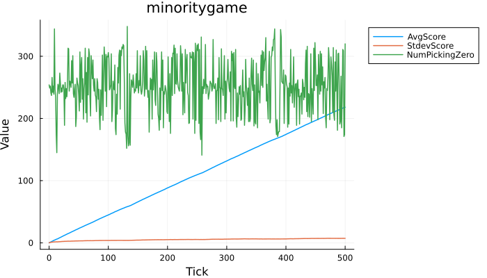
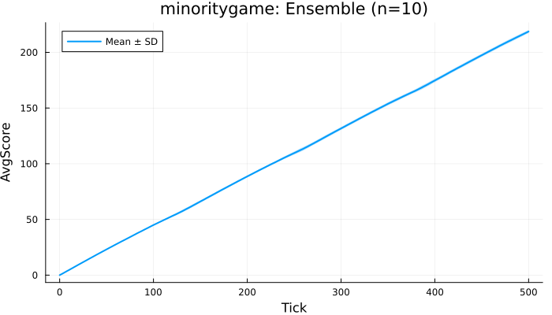
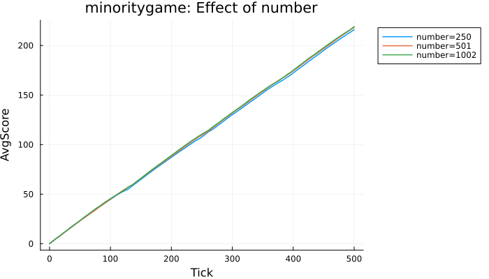

# Minority Game


- [Overview](#overview)
  - [WHAT IS IT?](#what-is-it)
  - [HOW IT WORKS](#how-it-works)
  - [THINGS TO NOTICE](#things-to-notice)
  - [THINGS TO TRY](#things-to-try)
  - [EXTENDING THE MODEL](#extending-the-model)
  - [NETLOGO FEATURES](#netlogo-features)
  - [RELATED MODELS](#related-models)
  - [CREDITS AND REFERENCES](#credits-and-references)
  - [HOW TO CITE](#how-to-cite)
  - [COPYRIGHT AND LICENSE](#copyright-and-license)
- [Parameters](#parameters)
- [Source Code](#source-code)
- [Time Series](#time-series)
- [Ensemble Runs](#ensemble-runs)
- [Parameter Sensitivity](#parameter-sensitivity)
- [Appendix: Source Code](#appendix-source-code)
  - [Parameters (`parameters.jl`)](#parameters-parametersjl)
  - [Components (`components.jl`)](#components-componentsjl)
  - [Resources (`resources.jl`)](#resources-resourcesjl)
  - [Systems (`systems.jl`)](#systems-systemsjl)
  - [Model (`model.jl`)](#model-modeljl)

## Overview

### WHAT IS IT?

This is a simplified model of an economic market. In each time step,
agents choose one of two sides, 0 or 1, and those on the minority side
win a point. This problem is inspired by the “El Farol” bar problem.
Each agent uses a finite set of strategies to make their decision based
upon past record; however, the record consists only of which side, 0 or
1, was in the minority, not the actual population count of how many
chose each side.

### HOW IT WORKS

Each agent begins with a score of 0 and STRATEGIES-PER-AGENT strategies.
Initially, they choose a random one of these strategies to use. The
initial historical record is generated randomly. If their current
strategy correctly predicted whether 0 or 1 would be the minority, they
add one point to their score. Each strategy also earns virtual points
according to if it would have been correct or not. From then on, the
agents will then use their strategy with the highest virtual point total
to predict whether they should select 0 or 1.

This strategy consist of a list of 1’s and 0’s that is
2<sup>MEMORY</sup> long. The choice the turtle then makes is based off
of the history of past choices. This history is also a list of 1’s and
0’s that is MEMORY long, but it is encoded into a binary number. The
binary number is then used as an index into the strategy list to
determine the choice.

This means that once the number of agents, the number of strategies, and
the length of the historical record are chosen, all parameters are fixed
and the behavior of the system is of interest.

### THINGS TO NOTICE

There are two extremes possible for each turn: the size of the minority
is 1 agent or (NUMBER-1)/2 agents (since NUMBER is always odd). The
former would represent a “wasting of resources”, while the latter
represents a situation which is more “for the common good.” However,
each agent acts in an inherently selfish manner, as they care only if
they and they alone are in the minority. Nevertheless, the latter
situation is prevalent. Does this represent unintended cooperation
between agents, or merely coordination and well developed powers of
prediction?

The agents move according to how successful they are relative to the
mean success rate. After running for about 100 time steps (at just about
any parameter setting), how do the fastest and slowest agents compare?
What does this imply?

### THINGS TO TRY

Notice how the population of agents choosing 0 stays close to NUMBER/2.
How do the deviations change as you change the value of MEMORY?

How do things change if you keep everything the same but change the
STRATEGIES-PER-AGENT?

### EXTENDING THE MODEL

There are a few evolutionary possibilities for this model which could be
coded.

1)  Maybe after some (long) amount of time, the least successful agent
    is replaced by a clone of the most successful agent, with zeroed
    scores and possibly mutated strategies. How would things change
    then?

2)  Similar to (1), you could start the agents with a very small memory
    value, and again replace the least successful agent with a clone of
    the most successful agent. But this time instead of just zeroing the
    scores and giving mutated strategies, you also add or subtract one
    unit of memory for the new agent. What would happen here? Would
    their brains continue to get bigger or find some happy value? Would
    people with small memory be altogether eliminated, or would they
    survive (maybe even still thrive)?

### NETLOGO FEATURES

The `n-values` primitive is used to set up strategies for each player.

The primitives `map` and `reduce` were also used to simplify code.

### RELATED MODELS

- any of the Prisoner’s Dilemma models
- Altruism
- Cooperation

### CREDITS AND REFERENCES

Original implementation: Daniel B. Stouffer, for the Center for
Connected Learning and Computer-Based Modeling.

This model was based upon studies by Dr. Damien Challet, et al.
Information can be found on the web at
https://web.archive.org/web/20141010122506/http://www3.unifr.ch/econophysics/minority/papers.html

Challet, D. and Zhang, Y.-C. Emergence of Cooperation and Organization
in an Evolutionary Game. Physica A 246, 407 (1997).

Zhang, Y.-C. Modeling Market Mechanism with Evolutionary Games.
Europhys. News 29, 51 (1998).

### HOW TO CITE

If you mention this model or the NetLogo software in a publication, we
ask that you include the citations below.

For the model itself:

- Wilensky, U. (2004). NetLogo Minority Game model.
  http://ccl.northwestern.edu/netlogo/models/MinorityGame. Center for
  Connected Learning and Computer-Based Modeling, Northwestern
  University, Evanston, IL.

Please cite the NetLogo software as:

- Wilensky, U. (1999). NetLogo. http://ccl.northwestern.edu/netlogo/.
  Center for Connected Learning and Computer-Based Modeling,
  Northwestern University, Evanston, IL.

### COPYRIGHT AND LICENSE

Copyright 2004 Uri Wilensky.


This model is licensed under the Creative Commons
Attribution-NonCommercial-ShareAlike 3.0 License. To view a copy of this
license, visit https://creativecommons.org/licenses/by-nc-sa/3.0/ or
send a letter to Creative Commons, 559 Nathan Abbott Way, Stanford,
California 94305, USA.

NetLogo itself is free software for non-commercial use under the terms
of the GNU General Public License ([see full license information
here](https://ccl.northwestern.edu/netlogo/docs/copyright.html)).

To inquire about commercial licenses for either NetLogo or specific
models from the models library, please contact
netlogo-commercial-admin@ccl.northwestern.edu.

This model was created as part of the projects: PARTICIPATORY
SIMULATIONS: NETWORK-BASED DESIGN FOR SYSTEMS LEARNING IN CLASSROOMS
and/or INTEGRATED SIMULATION AND MODELING ENVIRONMENT. The project
gratefully acknowledges the support of the National Science Foundation
(REPP & ROLE programs) – grant numbers REC \#9814682 and REC-0126227.

<!-- 2004 -->

## Parameters

| Parameter              | Type  | Default | Description            |
|------------------------|-------|---------|------------------------|
| `number`               | `Int` | `501`   | number of agents (odd) |
| `memory`               | `Int` | `6`     | history length         |
| `strategies_per_agent` | `Int` | `5`     | strategies per agent   |
| `max_ticks`            | `Int` | `500`   | max ticks              |

## Source Code

The Julia code to run this model:

``` julia
using ArkModelZoo
_, trajectory = run_minoritygame()
```

## Time Series



## Ensemble Runs

Ten replicates with different random seeds, showing mean ± standard
deviation.



## Parameter Sensitivity

Varying `number`.



## Appendix: Source Code

This model is implemented in the
[Ark.jl](https://github.com/sdwfrost/Ark.jl) Entity-Component-System
(ECS) framework. The code is split into five files, each with a distinct
role:

- **Parameters**: a mutable struct holding all configurable values.
- **Components**: lightweight data types attached to individual entities
  (agents).
- **Resources**: world-level shared state accessible to all systems.
- **Systems**: functions that operate on entities each tick, defining
  model behavior.
- **Model**: wiring that assembles the world, registers resources and
  systems, and provides the run entry point.

### Parameters (`parameters.jl`)

The parameter struct uses `@kwdef` so that every field has a default
value and can be overridden by keyword. These defaults match the
original NetLogo model’s slider settings.

``` julia
Base.@kwdef mutable struct MGParams
    number::Int = 501           # number of agents (odd)
    memory::Int = 6             # history length
    strategies_per_agent::Int = 5
    max_ticks::Int = 500
    seed::Int = 42
end
```

### Components (`components.jl`)

Components are lightweight data types attached to individual entities
(agents). Mutable structs hold per-entity state, while empty tag structs
act as markers for the ECS query system to efficiently filter entities.

``` julia
mutable struct MGAgent
    score::Int
    choice::Int                        # 0 or 1
    strategies::Vector{Vector{Int}}    # list of strategies (each is 2^memory long)
    current_strategy::Int              # index into strategies
    strategies_scores::Vector{Int}     # virtual scores per strategy
end
MGAgent() = MGAgent(0, 0, Vector{Int}[], 1, Int[])
```

### Resources (`resources.jl`)

Resources are world-level singletons shared across all systems, used for
global state and aggregate statistics.

``` julia
mutable struct MGState
    history::Int              # encoded binary history
    minority::Int             # 0 or 1
    avg_score::Float64
    stdev_score::Float64
    num_picking_zero::Int
end
MGState() = MGState(0, 0, 0.0, 0.0, 0)

mutable struct MGStats
    avg_score::Float64
    stdev_score::Float64
    num_picking_zero::Int
end
MGStats() = MGStats(0.0, 0.0, 0)
```

### Systems (`systems.jl`)

Systems contain the model logic and execute in a defined order each
tick. Each system struct implements either `initialize!` (run once at
setup) or `update!` (run every tick).

``` julia
# --- Initialization ---

struct InitMGSystem <: System end

function initialize!(::InitMGSystem, world::World)
    params = get_resource(world, MGParams)
    rng = get_resource(world, RNGResource).rng
    state = get_resource(world, MGState)
    mem = params.memory
    strat_len = 2^mem

    state.history = rand(rng, 0:(strat_len - 1))

    for _ in 1:params.number
        agent = MGAgent()
        agent.score = 0
        agent.strategies_scores = zeros(Int, params.strategies_per_agent)

        # Assign unique strategies
        strats = Set{Vector{Int}}()
        while length(strats) < params.strategies_per_agent
            s = [rand(rng, 0:1) for _ in 1:strat_len]
            push!(strats, s)
        end
        agent.strategies = collect(strats)
        agent.current_strategy = rand(rng, 1:params.strategies_per_agent)
        agent.choice = agent.strategies[agent.current_strategy][state.history + 1]
        new_entity!(world, (agent,))
    end

    # Update system state
    _mg_update_system!(world)
    return nothing
end

function _mg_update_system!(world::World)
    params = get_resource(world, MGParams)
    state = get_resource(world, MGState)
    stats = get_resource(world, MGStats)

    num_zero = 0
    scores = Float64[]
    for (_, agents) in Query(world, (MGAgent,))
        @inbounds for i in eachindex(agents)
            a = agents[i]
            if a.choice == 0
                num_zero += 1
            end
            push!(scores, Float64(a.score))
        end
    end

    state.num_picking_zero = num_zero
    state.minority = num_zero <= (params.number - 1) ÷ 2 ? 0 : 1
    state.avg_score = length(scores) > 0 ? Statistics.mean(scores) : 0.0
    state.stdev_score = length(scores) > 1 ? Statistics.std(scores) : 0.0

    stats.avg_score = state.avg_score
    stats.stdev_score = state.stdev_score
    stats.num_picking_zero = num_zero
end

# --- Go ---

struct MGGoSystem <: System end

function update!(::MGGoSystem, world::World)
    params = get_resource(world, MGParams)
    rng = get_resource(world, RNGResource).rng
    state = get_resource(world, MGState)
    mem = params.memory

    # Update scores and strategy for each agent
    for (_, agents) in Query(world, (MGAgent,))
        @inbounds for i in eachindex(agents)
            a = agents[i]
            # Increment virtual scores
            for s_idx in 1:length(a.strategies)
                if a.strategies[s_idx][state.history + 1] == state.minority
                    a.strategies_scores[s_idx] += 1
                end
            end
            # Pick best strategy
            max_score = maximum(a.strategies_scores)
            best = [j for j in 1:length(a.strategies_scores) if a.strategies_scores[j] == max_score]
            a.current_strategy = best[rand(rng, 1:length(best))]
            # Update own score
            if a.choice == state.minority
                a.score += 1
            end
        end
    end

    # Update history: shift left, append minority
    full_hist = _mg_full_history(state.history, mem)
    push!(full_hist, state.minority)
    popfirst!(full_hist)
    state.history = _mg_decimal(full_hist)

    # Update choices
    for (_, agents) in Query(world, (MGAgent,))
        @inbounds for i in eachindex(agents)
            a = agents[i]
            a.choice = a.strategies[a.current_strategy][state.history + 1]
        end
    end

    _mg_update_system!(world)
    return nothing
end

function _mg_full_history(hist::Int, mem::Int)
    bits = Int[]
    h = hist
    for _ in 1:mem
        pushfirst!(bits, h & 1)
        h >>= 1
    end
    return bits
end

function _mg_decimal(bits::Vector{Int})
    result = 0
    for b in bits
        result = 2 * result + b
    end
    return result
end

# --- Termination ---

struct MGTerminationSystem <: System end

function update!(::MGTerminationSystem, world::World)
    params = get_resource(world, MGParams)
    tick = get_resource(world, Tick)
    if tick.tick + 1 >= params.max_ticks
        get_resource(world, Terminate).stop = true
    end
    return nothing
end
```

### Model (`model.jl`)

The model file assembles all pieces: it creates the ECS `World` with the
required component types, registers resources, builds the `Scheduler`
with systems in execution order, and exposes the public `run` entry
point. The observer pattern records the trajectory each tick.

``` julia
function minoritygame_world(; initial_capacity::Int = 4096)
    return World(MGAgent; initial_capacity = initial_capacity, allow_mutable = true)
end

function minoritygame_systems()
    return (InitMGSystem(), MGGoSystem(), MGTerminationSystem())
end

function minoritygame_model(params::MGParams = MGParams())
    world = minoritygame_world()
    _add_standard_resources!(world, params)
    add_resource!(world, MGState())
    add_resource!(world, MGStats())
    scheduler = Scheduler(world, minoritygame_systems())
    initialize!(scheduler)
    return scheduler
end

struct MGObserver end

function minoritygame_headers(::MGObserver)
    return ["AvgScore", "StdevScore", "NumPickingZero"]
end

function minoritygame_values(::MGObserver, world::World)
    stats = get_resource(world, MGStats)
    return Float64[stats.avg_score, stats.stdev_score, Float64(stats.num_picking_zero)]
end

function run_minoritygame(; params::MGParams = MGParams(), observe::Bool = true)
    return _run_model(minoritygame_model, MGObserver(), minoritygame_values; params, observe)
end
```
