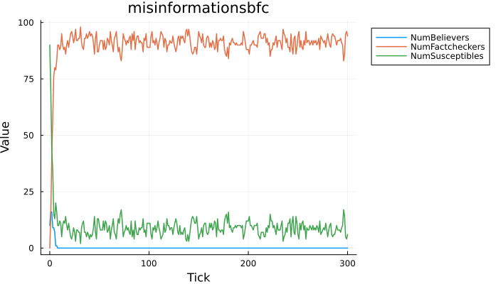
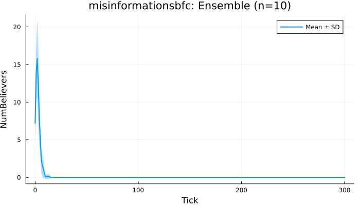
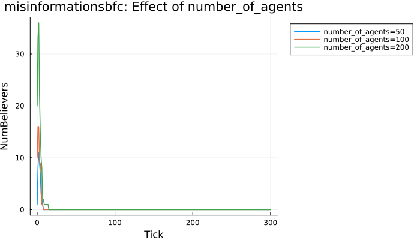

## Overview

This vignette demonstrates the **Misinformation SBFC** model implemented in [ArkModelZoo.jl](https://github.com/sdwfrost/ArkModelZoo.jl) using the Ark.jl ECS framework.

## Parameters

| Parameter | Type | Default | Description |
|-----------|------|---------|-------------|
| `number_of_agents` | `Int` | `100` | number of agents |
| `pForget` | `Float64` | `0.2` | pForget |
| `pVerify` | `Float64` | `0.4` | pVerify |
| `beta_spreading_rate` | `Float64` | `0.45` | beta spreading rate |
| `alpha_hoax_credibility` | `Float64` | `0.25` | alpha hoax credibility |
| `beta_fc_spread` | `Float64` | `0.55` | beta fc spread |
| `pForget_FC` | `Float64` | `0.05` | pForget FC |
| `max_ticks` | `Int` | `300` | max ticks |

## Source Code

The Julia code to run this model:

```julia
using ArkModelZoo
_, trajectory = run_misinformationsbfc()
```

## Time Series

{width=100%}

## Ensemble Runs

Ten replicates with different random seeds, showing mean ± standard deviation.

{width=100%}

## Parameter Sensitivity

Varying `number_of_agents`.

{width=100%}


## Appendix: Source Code

This model is implemented in the [Ark.jl](https://github.com/sdwfrost/Ark.jl) Entity-Component-System (ECS) framework. The code is split into five files, each with a distinct role:

- **Parameters**: a mutable struct holding all configurable values.
- **Components**: lightweight data types attached to individual entities (agents).
- **Resources**: world-level shared state accessible to all systems.
- **Systems**: functions that operate on entities each tick, defining model behavior.
- **Model**: wiring that assembles the world, registers resources and systems, and provides the run entry point.

### Parameters (`parameters.jl`)

The parameter struct uses `@kwdef` so that every field has a default value and can be overridden by keyword. These defaults match the original NetLogo model's slider settings.

```julia
Base.@kwdef mutable struct MisSBFCParams
    number_of_agents::Int = 100
    pForget::Float64 = 0.2
    pVerify::Float64 = 0.4
    beta_spreading_rate::Float64 = 0.45
    alpha_hoax_credibility::Float64 = 0.25
    beta_fc_spread::Float64 = 0.55
    pForget_FC::Float64 = 0.05
    max_ticks::Int = 300
    seed::Int = 42
end
```

### Components (`components.jl`)

Components are lightweight data types attached to individual entities (agents). Mutable structs hold per-entity state, while empty tag structs act as markers for the ECS query system to efficiently filter entities.

```julia
struct MisSBFCDummy end
```

### Resources (`resources.jl`)

Resources are world-level singletons shared across all systems, used for global state and aggregate statistics.

```julia
mutable struct MisSBFCNetwork
    n_agents::Int
    adj::Vector{Set{Int}}
    state::Vector{Char}  # 'S', 'B', or 'F'
end

function MisSBFCNetwork()
    MisSBFCNetwork(0, Set{Int}[], Char[])
end

function _msb_add_agent!(net::MisSBFCNetwork, state::Char = 'S')
    push!(net.adj, Set{Int}())
    push!(net.state, state)
    net.n_agents += 1
    return net.n_agents
end

function _msb_add_edge!(net::MisSBFCNetwork, i::Int, j::Int)
    if j ∉ net.adj[i]
        push!(net.adj[i], j)
        push!(net.adj[j], i)
    end
end

mutable struct MisSBFCStats
    num_believers::Int
    num_factcheckers::Int
    num_susceptibles::Int
end
MisSBFCStats() = MisSBFCStats(0, 0, 0)
```

### Systems (`systems.jl`)

Systems contain the model logic and execute in a defined order each tick. Each system struct implements either `initialize!` (run once at setup) or `update!` (run every tick).

```julia
# Misinformation SBFC — Susceptible-Believer-FactChecker dynamics on BA network

struct InitMisSBFCSystem <: System end

function initialize!(::InitMisSBFCSystem, world::World)
    params = get_resource(world, MisSBFCParams)
    rng    = get_resource(world, RNGResource).rng
    net    = get_resource(world, MisSBFCNetwork)
    stats  = get_resource(world, MisSBFCStats)

    # Build BA network using nw extension
    g = nw_generate_preferential_attachment(rng, params.number_of_agents, 3)
    for i in 1:g.n
        _msb_add_agent!(net)
    end
    net.adj = g.adj

    # Initialize states: 90% S, 10% B
    order = shuffle!(rng, collect(1:net.n_agents))
    for i in order
        if rand(rng, 0:99) <= 90
            net.state[i] = 'S'
        else
            net.state[i] = 'B'
        end
    end

    _msb_update_stats!(net, stats)
    return nothing
end

function _msb_update_stats!(net::MisSBFCNetwork, stats::MisSBFCStats)
    stats.num_believers = count(==('B'), net.state)
    stats.num_factcheckers = count(==('F'), net.state)
    stats.num_susceptibles = count(==('S'), net.state)
end

struct MisSBFCGoSystem <: System end

function update!(::MisSBFCGoSystem, world::World)
    params = get_resource(world, MisSBFCParams)
    rng    = get_resource(world, RNGResource).rng
    net    = get_resource(world, MisSBFCNetwork)
    stats  = get_resource(world, MisSBFCStats)

    # Spreading: ask turtles with [state = "S"]
    susceptibles = findall(==('S'), net.state)
    shuffle!(rng, susceptibles)
    for i in susceptibles
        nB = count(j -> net.state[j] == 'B', net.adj[i])
        nF = count(j -> net.state[j] == 'F', net.adj[i])
        a1 = 1.0 + params.alpha_hoax_credibility
        a0 = 1.0 - params.alpha_hoax_credibility
        den = nB * a1 + nF * a0
        f = 0.0
        g = 0.0
        if den != 0.0
            f = params.beta_spreading_rate * (nB * a1 / den)
            g = params.beta_fc_spread * (nF * a0 / den)
        end
        r = rand(rng)
        if r < f
            net.state[i] = 'B'
        elseif r < f + g
            net.state[i] = 'F'
        end
    end

    # Forgetting: believers forget
    believers = findall(==('B'), net.state)
    shuffle!(rng, believers)
    for i in believers
        if rand(rng) < params.pForget
            net.state[i] = 'S'
        end
    end

    # Forgetting: factcheckers forget
    factcheckers = findall(==('F'), net.state)
    shuffle!(rng, factcheckers)
    for i in factcheckers
        if rand(rng) < params.pForget_FC
            net.state[i] = 'S'
        end
    end

    # Verifying: believers become factcheckers
    believers2 = findall(==('B'), net.state)
    shuffle!(rng, believers2)
    for i in believers2
        if rand(rng) < params.pVerify
            net.state[i] = 'F'
        end
    end

    _msb_update_stats!(net, stats)
    return nothing
end

struct MisSBFCTerminationSystem <: System end

function update!(::MisSBFCTerminationSystem, world::World)
    params = get_resource(world, MisSBFCParams)
    tick   = get_resource(world, Tick)
    if tick.tick + 1 >= params.max_ticks
        get_resource(world, Terminate).stop = true
    end
    return nothing
end
```

### Model (`model.jl`)

The model file assembles all pieces: it creates the ECS `World` with the required component types, registers resources, builds the `Scheduler` with systems in execution order, and exposes the public `run` entry point. The observer pattern records the trajectory each tick.

```julia
function misinformationsbfc_world(; initial_capacity::Int = 128)
    return World(MisSBFCDummy; initial_capacity = initial_capacity, allow_mutable = true)
end

function misinformationsbfc_systems()
    return (InitMisSBFCSystem(), MisSBFCGoSystem(), MisSBFCTerminationSystem())
end

function misinformationsbfc_model(params::MisSBFCParams = MisSBFCParams())
    world = misinformationsbfc_world()
    _add_standard_resources!(world, params)
    add_resource!(world, MisSBFCNetwork())
    add_resource!(world, MisSBFCStats())
    scheduler = Scheduler(world, misinformationsbfc_systems())
    initialize!(scheduler)
    return scheduler
end

struct MisSBFCObserver end

function misinformationsbfc_headers(::MisSBFCObserver)
    return ["NumBelievers", "NumFactcheckers", "NumSusceptibles"]
end

function misinformationsbfc_values(::MisSBFCObserver, world::World)
    stats = get_resource(world, MisSBFCStats)
    return Float64[stats.num_believers, stats.num_factcheckers, stats.num_susceptibles]
end

function run_misinformationsbfc(; params::MisSBFCParams = MisSBFCParams(), observe::Bool = true)
    return _run_model(misinformationsbfc_model, MisSBFCObserver(), misinformationsbfc_values; params, observe)
end
```
