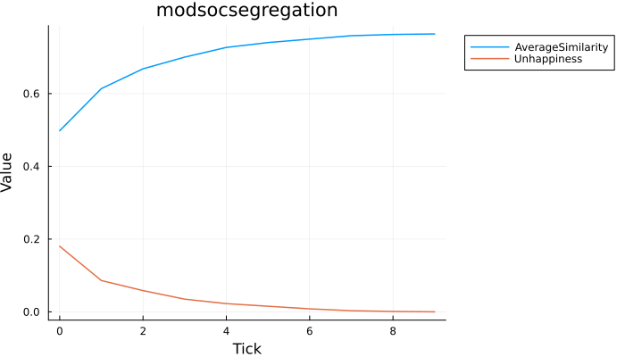
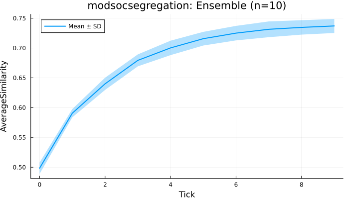
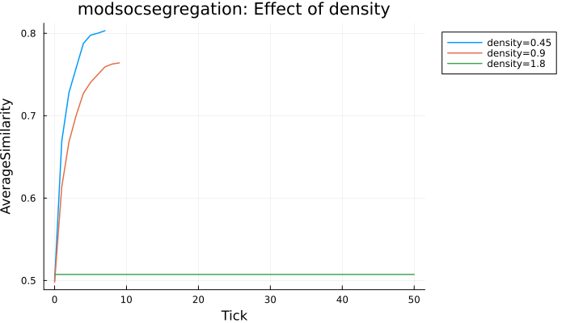

# Modsoc Segregation


- [Overview](#overview)
  - [WHAT IS IT?](#what-is-it)
  - [THINGS TO NOTICE](#things-to-notice)
  - [THINGS TO TRY](#things-to-try)
  - [EXTENDING THE MODEL](#extending-the-model)
  - [NETLOGO FEATURES](#netlogo-features)
  - [CREDITS AND REFERENCES](#credits-and-references)
  - [HOW TO CITE](#how-to-cite)
  - [COPYRIGHT AND LICENSE](#copyright-and-license)
- [Parameters](#parameters)
- [Source Code](#source-code)
- [Time Series](#time-series)
- [Ensemble Runs](#ensemble-runs)
- [Parameter Sensitivity](#parameter-sensitivity)
- [Appendix: Source Code](#appendix-source-code)
  - [Parameters (`parameters.jl`)](#parameters-parametersjl)
  - [Components (`components.jl`)](#components-componentsjl)
  - [Resources (`resources.jl`)](#resources-resourcesjl)
  - [Systems (`systems.jl`)](#systems-systemsjl)
  - [Model (`model.jl`)](#model-modeljl)

## Overview

### WHAT IS IT?

This project models the behavior of two types of agents in a
neighborhood. The orange agents and blue agents get along with one
another. But each agent wants to make sure that it lives near some of
“its own.” That is, each orange agent wants to live near at least some
orange agents, and each blue agent wants to live near at least some blue
agents. The simulation shows how these individual preferences ripple
through the neighborhood, leading to large-scale patterns.

This project was inspired by Thomas Schelling’s writings about social
systems (such as housing patterns in cities).

### THINGS TO NOTICE

When you execute SETUP, the orange and blue agents are randomly
distributed throughout the neighborhood. But many agents are “unhappy”
since they don’t have enough same-color neighbors. The unhappy agents
move to new locations in the vicinity. But in the new locations, they
might tip the balance of the local population, prompting other agents to
leave. If a few agents move into an area, the local blue agents might
leave. But when the blue agents move to a new area, they might prompt
orange agents to leave that area.

Over time, the number of unhappy agents decreases. But the neighborhood
becomes more segregated, with clusters of orange agents and clusters of
blue agents.

In the case where each agent wants at least 30% same-color neighbors,
the agents end up with (on average) 70% same-color neighbors. So
relatively small individual preferences can lead to significant overall
segregation.

### THINGS TO TRY

Try different values for %-SIMILAR-WANTED. How does the overall degree
of segregation change?

If each agent wants at least 40% same-color neighbors, what percentage
(on average) do they end up with?

Try different values of DENSITY. How does the initial occupancy density
affect the percentage of unhappy agents? How does it affect the time it
takes for the model to finish?

Can you set sliders so that the model never finishes running, and agents
keep looking for new locations?

### EXTENDING THE MODEL

The `find-new-spot` procedure has the agents move locally till they find
a spot. Can you rewrite this procedure so the agents move directly to an
appropriate new spot?

Incorporate social networks into this model. For instance, have unhappy
agents decide on a new location based on information about what a
neighborhood is like from other agents in their network.

Change the rules for agent happiness. One idea: suppose that the agents
need some minimum threshold of “good neighbors” to be happy with their
location. Suppose further that they don’t always know if someone makes a
good neighbor. When they do, they use that information. When they don’t,
they use color as a proxy – i.e., they assume that agents of the same
color make good neighbors.

The two different visualizations emphasize different aspects of the
model. The SQUARE-X visualization shows whether an agent is happy or
not. Can you design a different visualization that emphasizes different
aspects?

### NETLOGO FEATURES

`sprout` is used to create agents while ensuring no patch has more than
one agent on it.

When an agent moves, `move-to` is used to move the agent to the center
of the patch it eventually finds.

Note two different methods that can be used for find-new-spot, one of
them (the one we use) is recursive.

### CREDITS AND REFERENCES

Schelling, T. (1978). Micromotives and Macrobehavior. New York: Norton.

See also: Rauch, J. (2002). Seeing Around Corners; The Atlantic Monthly;
April 2002;Volume 289, No. 4; 35-48.
https://www.theatlantic.com/magazine/archive/2002/04/seeing-around-corners/302471/

### HOW TO CITE

If you mention this model or the NetLogo software in a publication, we
ask that you include the citations below.

For the model itself:

- Wilensky, U. (1997). NetLogo Segregation model.
  http://ccl.northwestern.edu/netlogo/models/Segregation. Center for
  Connected Learning and Computer-Based Modeling, Northwestern
  University, Evanston, IL.

Please cite the NetLogo software as:

- Wilensky, U. (1999). NetLogo. http://ccl.northwestern.edu/netlogo/.
  Center for Connected Learning and Computer-Based Modeling,
  Northwestern University, Evanston, IL.

### COPYRIGHT AND LICENSE

Copyright 1997 Uri Wilensky.


This model is licensed under the Creative Commons
Attribution-NonCommercial-ShareAlike 3.0 License. To view a copy of this
license, visit https://creativecommons.org/licenses/by-nc-sa/3.0/ or
send a letter to Creative Commons, 559 Nathan Abbott Way, Stanford,
California 94305, USA.

NetLogo itself is free software for non-commercial use under the terms
of the GNU General Public License ([see full license information
here](https://ccl.northwestern.edu/netlogo/docs/copyright.html)).

To inquire about commercial licenses for either NetLogo or specific
models from the models library, please contact
netlogo-commercial-admin@ccl.northwestern.edu.

This model was created as part of the project: CONNECTED MATHEMATICS:
MAKING SENSE OF COMPLEX PHENOMENA THROUGH BUILDING OBJECT-BASED PARALLEL
MODELS (OBPML). The project gratefully acknowledges the support of the
National Science Foundation (Applications of Advanced Technologies
Program) – grant numbers RED \#9552950 and REC \#9632612.

This model was converted to NetLogo as part of the projects:
PARTICIPATORY SIMULATIONS: NETWORK-BASED DESIGN FOR SYSTEMS LEARNING IN
CLASSROOMS and/or INTEGRATED SIMULATION AND MODELING ENVIRONMENT. The
project gratefully acknowledges the support of the National Science
Foundation (REPP & ROLE programs) – grant numbers REC \#9814682 and
REC-0126227. Converted from StarLogoT to NetLogo, 2001.

<!-- 1997 2001 -->

## Parameters

| Parameter              | Type      | Default | Description          |
|------------------------|-----------|---------|----------------------|
| `density`              | `Float64` | `0.9`   | density              |
| `similarity_threshold` | `Float64` | `0.3`   | similarity threshold |
| `grid_width`           | `Int`     | `33`    | grid width           |
| `grid_height`          | `Int`     | `33`    | grid height          |
| `max_ticks`            | `Int`     | `50`    | max ticks            |

## Source Code

The Julia code to run this model:

``` julia
using ArkModelZoo
_, trajectory = run_modsocsegregation()
```

## Time Series



## Ensemble Runs

Ten replicates with different random seeds, showing mean ± standard
deviation.



## Parameter Sensitivity

Varying `density`.



## Appendix: Source Code

This model is implemented in the
[Ark.jl](https://github.com/sdwfrost/Ark.jl) Entity-Component-System
(ECS) framework. The code is split into five files, each with a distinct
role:

- **Parameters**: a mutable struct holding all configurable values.
- **Components**: lightweight data types attached to individual entities
  (agents).
- **Resources**: world-level shared state accessible to all systems.
- **Systems**: functions that operate on entities each tick, defining
  model behavior.
- **Model**: wiring that assembles the world, registers resources and
  systems, and provides the run entry point.

### Parameters (`parameters.jl`)

The parameter struct uses `@kwdef` so that every field has a default
value and can be overridden by keyword. These defaults match the
original NetLogo model’s slider settings.

``` julia
Base.@kwdef mutable struct ModsocSegParams
    density::Float64 = 0.9
    similarity_threshold::Float64 = 0.3
    grid_width::Int = 33
    grid_height::Int = 33
    max_ticks::Int = 50
    seed::Int = 42
end
```

### Components (`components.jl`)

Components are lightweight data types attached to individual entities
(agents). Mutable structs hold per-entity state, while empty tag structs
act as markers for the ECS query system to efficiently filter entities.

``` julia
mutable struct ModsocPosition
    x::Int
    y::Int
end
ModsocPosition() = ModsocPosition(0, 0)

mutable struct ModsocColor
    yellow::Bool
end
ModsocColor() = ModsocColor(true)

mutable struct ModsocHappiness
    prop_similar::Float64
    happy::Bool
end
ModsocHappiness() = ModsocHappiness(1.0, true)
```

### Resources (`resources.jl`)

Resources are world-level singletons shared across all systems, used for
global state and aggregate statistics.

``` julia
mutable struct ModsocGrid
    width::Int
    height::Int
    cells::Matrix{Entity}
end

function ModsocGrid(w::Int, h::Int)
    ModsocGrid(w, h, fill(zero_entity, w, h))
end

mutable struct ModsocStats
    average_similarity::Float64
    unhappiness::Float64
end
ModsocStats() = ModsocStats(0.0, 0.0)
```

### Systems (`systems.jl`)

Systems contain the model logic and execute in a defined order each
tick. Each system struct implements either `initialize!` (run once at
setup) or `update!` (run every tick).

``` julia
struct InitModsocSystem <: System end

function initialize!(::InitModsocSystem, world::World)
    params = get_resource(world, ModsocSegParams)
    rng = get_resource(world, RNGResource).rng
    grid = get_resource(world, ModsocGrid)

    for x in 1:grid.width, y in 1:grid.height
        if rand(rng) < params.density
            is_yellow = rand(rng, Bool)
            eid = new_entity!(world, (
                ModsocPosition(x, y),
                ModsocColor(is_yellow),
                ModsocHappiness(),
            ))
            grid.cells[x, y] = eid
        end
    end
    _modsoc_update_happiness!(world)
    _modsoc_update_globals!(world)
    return nothing
end

function _modsoc_update_happiness!(world::World)
    params = get_resource(world, ModsocSegParams)
    grid = get_resource(world, ModsocGrid)

    for (_, positions, colors, happinesses) in Query(world, (ModsocPosition, ModsocColor, ModsocHappiness))
        @inbounds for i in eachindex(positions)
            pos = positions[i]
            col = colors[i]
            similar = 0
            total = 0
            for dx in -1:1, dy in -1:1
                (dx == 0 && dy == 0) && continue
                nx = mod1(pos.x + dx, grid.width)
                ny = mod1(pos.y + dy, grid.height)
                neid = grid.cells[nx, ny]
                is_zero(neid) && continue
                nc = get_components(world, neid, (ModsocColor,))[1]
                if nc.yellow == col.yellow
                    similar += 1
                end
                total += 1
            end
            prop = total == 0 ? 1.0 : similar / total
            happinesses[i].prop_similar = prop
            happinesses[i].happy = prop >= params.similarity_threshold
        end
    end
end

function _modsoc_update_globals!(world::World)
    stats = get_resource(world, ModsocStats)
    total_prop = 0.0
    n_agents = 0
    n_unhappy = 0
    for (_, _, _, happinesses) in Query(world, (ModsocPosition, ModsocColor, ModsocHappiness))
        @inbounds for i in eachindex(happinesses)
            total_prop += happinesses[i].prop_similar
            n_agents += 1
            if !happinesses[i].happy
                n_unhappy += 1
            end
        end
    end
    stats.average_similarity = n_agents > 0 ? total_prop / n_agents : 0.0
    stats.unhappiness = n_agents > 0 ? n_unhappy / n_agents : 0.0
end

struct ModsocMoveSystem <: System end

function update!(::ModsocMoveSystem, world::World)
    rng = get_resource(world, RNGResource).rng
    grid = get_resource(world, ModsocGrid)

    # Collect unhappy agents
    unhappy = Tuple{Entity, Int, Int}[]
    for (eids, positions, _, happinesses) in Query(world, (ModsocPosition, ModsocColor, ModsocHappiness))
        @inbounds for i in eachindex(happinesses)
            if !happinesses[i].happy
                push!(unhappy, (eids[i], positions[i].x, positions[i].y))
            end
        end
    end
    Random.shuffle!(rng, unhappy)

    # Collect empty cells
    empty_cells = Tuple{Int,Int}[]
    for x in 1:grid.width, y in 1:grid.height
        if is_zero(grid.cells[x, y])
            push!(empty_cells, (x, y))
        end
    end

    for (eid, ox, oy) in unhappy
        isempty(empty_cells) && break
        idx = rand(rng, 1:length(empty_cells))
        nx, ny = empty_cells[idx]
        # Move
        grid.cells[ox, oy] = zero_entity
        grid.cells[nx, ny] = eid
        pos = get_components(world, eid, (ModsocPosition,))[1]
        pos.x = nx
        pos.y = ny
        # Old spot is now empty, new spot is taken
        empty_cells[idx] = (ox, oy)
    end

    _modsoc_update_happiness!(world)
    _modsoc_update_globals!(world)
    return nothing
end

struct ModsocTerminationSystem <: System end

function update!(::ModsocTerminationSystem, world::World)
    stats = get_resource(world, ModsocStats)
    params = get_resource(world, ModsocSegParams)
    tick = get_resource(world, Tick)

    if stats.unhappiness == 0.0 || tick.tick + 1 >= params.max_ticks
        get_resource(world, Terminate).stop = true
    end
    return nothing
end
```

### Model (`model.jl`)

The model file assembles all pieces: it creates the ECS `World` with the
required component types, registers resources, builds the `Scheduler`
with systems in execution order, and exposes the public `run` entry
point. The observer pattern records the trajectory each tick.

``` julia
function modsocsegregation_world(; initial_capacity::Int = 4096)
    return World(
        ModsocPosition, ModsocColor, ModsocHappiness;
        initial_capacity = initial_capacity, allow_mutable = true,
    )
end

function modsocsegregation_systems()
    return (InitModsocSystem(), ModsocMoveSystem(), ModsocTerminationSystem())
end

function modsocsegregation_model(params::ModsocSegParams = ModsocSegParams())
    world = modsocsegregation_world()
    _add_standard_resources!(world, params)
    add_resource!(world, ModsocGrid(params.grid_width, params.grid_height))
    add_resource!(world, ModsocStats())
    scheduler = Scheduler(world, modsocsegregation_systems())
    initialize!(scheduler)
    return scheduler
end

struct ModsocSegObserver end

function modsocsegregation_headers(::ModsocSegObserver)
    return ["AverageSimilarity", "Unhappiness"]
end

function modsocsegregation_values(::ModsocSegObserver, world::World)
    stats = get_resource(world, ModsocStats)
    return Float64[stats.average_similarity, stats.unhappiness]
end

function run_modsocsegregation(; params::ModsocSegParams = ModsocSegParams(), observe::Bool = true)
    return _run_model(modsocsegregation_model, ModsocSegObserver(), modsocsegregation_values; params, observe)
end
```
