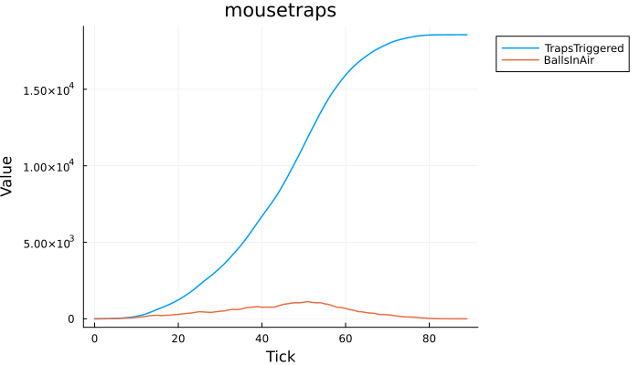
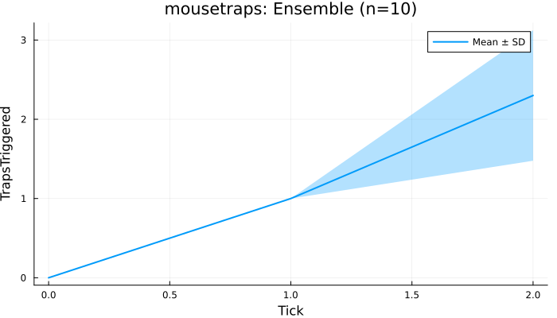
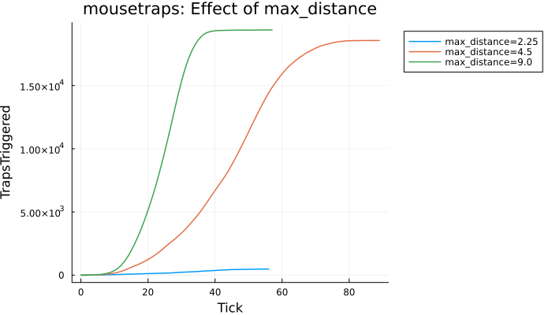

## Overview

### WHAT IS IT?

Imagine a gymnasium full of mousetraps.  On each mousetrap is a ping pong ball.  Now throw a single ping pong ball into the middle of the room. The ball lands on a trap, the trap triggers, and a second ball flies into the air.  The first ball also bounces into the air again, so now there are two balls in the air.  Each of those two balls triggers another trap, so there's four balls in the air. And so on...

This experiment is a well-known metaphor for nuclear fission.  In nuclear fission, atoms of fissionable material such as uranium are the "mousetraps", and neutrons are the ping pong balls.

### HOW IT WORKS

Light blue squares represent untriggered mousetraps.  Red squares represent triggered mousetraps.

When a ball lands on a light blue square, the square turns red, a new ball appears, and both balls travel a random distance in a random direction.

### THINGS TO NOTICE

Sometimes the reaction fizzles out almost immediately.  Why do you think that happens?

Even if a sustained chain reaction occurs, not every mousetrap gets triggered.  Why?

What shape is the "Traps triggered" plot?  Why do you think it's shaped that way?

What shape is the "Balls in the air" plot?  Why do you think it's shaped that way?

Suppose the gymnasium was infinitely large.  What would the two plots look like?  What kind of equation would produce such plots?

### THINGS TO TRY

Play around with varying the MAX-DISTANCE slider.  How big does MAX-DISTANCE need to be in order to get a chain reaction every time?  Most of the time?

### EXTENDING THE MODEL

There are various ways in which this model could be more physically realistic.  For example:

- Currently both a released ball and a bouncing ball travel the same maximum distance, but in reality the mousetrap would likely send the released ball much farther.  Change the model so these different distances are controlled by two different sliders.

- Currently the balls travel to their new positions instantly --- in reality it would take time proportional to the distance traveled.  (Does it make a difference if you take into account that the balls move in a parabola through the air, not a straight line?)  Change the model to take this into account.

### NETLOGO FEATURES

Note the use of `hatch` to cause the ping pong balls to "multiply".

When a turtle tries to move off the edge of the world it cannot, it hits the wall, and lands on the same mousetrap it triggered in the last step, it dies.

### RELATED MODELS

Rumor Mill is very similar to this model in mechanism and results, even though the domain is completely different (people and rumors instead of mousetraps and ping pong balls).  (What other processes in nature or society does this model resemble...?)

Reactor X-Section and Reactor Top Down are two different views of nuclear fission happening inside a nuclear reactor.  They both include ways of limiting the rate of fission so the "mousetraps" don't all start triggering uncontrollably.

### CREDITS AND REFERENCES

This model is based on the "Mousetrap" demo included with the Swarm agent-based modeling toolkit ([http://www.swarm.org](http://www.swarm.org/wiki/Main_Page)). See https://web.archive.org/web/20020719084215/http://acoma.santafe.edu/projects/swarm/examples/mousetrap/.  Note that this model and that demo differ in various details.

### HOW TO CITE

If you mention this model or the NetLogo software in a publication, we ask that you include the citations below.

For the model itself:

* Wilensky, U. (2002).  NetLogo Mousetraps model.  http://ccl.northwestern.edu/netlogo/models/Mousetraps.  Center for Connected Learning and Computer-Based Modeling, Northwestern University, Evanston, IL.

Please cite the NetLogo software as:

* Wilensky, U. (1999). NetLogo. http://ccl.northwestern.edu/netlogo/. Center for Connected Learning and Computer-Based Modeling, Northwestern University, Evanston, IL.

### COPYRIGHT AND LICENSE

Copyright 2002 Uri Wilensky.


This model is licensed under the Creative Commons Attribution-NonCommercial-ShareAlike 3.0 License.  To view a copy of this license, visit https://creativecommons.org/licenses/by-nc-sa/3.0/ or send a letter to Creative Commons, 559 Nathan Abbott Way, Stanford, California 94305, USA.

NetLogo itself is free software for non-commercial use under the terms of the GNU General Public License ([see full license information here](https://ccl.northwestern.edu/netlogo/docs/copyright.html)).

To inquire about commercial licenses for either NetLogo or specific models from the models library, please contact netlogo-commercial-admin@ccl.northwestern.edu.

This model was created as part of the projects: PARTICIPATORY SIMULATIONS: NETWORK-BASED DESIGN FOR SYSTEMS LEARNING IN CLASSROOMS and/or INTEGRATED SIMULATION AND MODELING ENVIRONMENT. The project gratefully acknowledges the support of the National Science Foundation (REPP & ROLE programs) -- grant numbers REC #9814682 and REC-0126227.

<!-- 2002 -->

## Parameters

| Parameter | Type | Default | Description |
|-----------|------|---------|-------------|
| `max_distance` | `Float64` | `4.5` | random-float max-distance |
| `half_width` | `Int` | `80` | world from -80 to 80 → 161×161 patches |
| `max_ticks` | `Int` | `150` | max ticks |

## Source Code

The Julia code to run this model:

```julia
using ArkModelZoo
_, trajectory = run_mousetraps()
```

## Time Series

{width=100%}

## Ensemble Runs

Ten replicates with different random seeds, showing mean ± standard deviation.

{width=100%}

## Parameter Sensitivity

Varying `max_distance`.

{width=100%}


## Appendix: Source Code

This model is implemented in the [Ark.jl](https://github.com/sdwfrost/Ark.jl) Entity-Component-System (ECS) framework. The code is split into five files, each with a distinct role:

- **Parameters**: a mutable struct holding all configurable values.
- **Components**: lightweight data types attached to individual entities (agents).
- **Resources**: world-level shared state accessible to all systems.
- **Systems**: functions that operate on entities each tick, defining model behavior.
- **Model**: wiring that assembles the world, registers resources and systems, and provides the run entry point.

### Parameters (`parameters.jl`)

The parameter struct uses `@kwdef` so that every field has a default value and can be overridden by keyword. These defaults match the original NetLogo model's slider settings.

```julia
Base.@kwdef mutable struct MousetrapParams
    max_distance::Float64 = 4.5   # random-float max-distance
    half_width::Int = 80          # world from -80 to 80 → 161×161 patches
    max_ticks::Int = 150
    seed::Int = 42
end
```

### Components (`components.jl`)

Components are lightweight data types attached to individual entities (agents). Mutable structs hold per-entity state, while empty tag structs act as markers for the ECS query system to efficiently filter entities.

```julia
# Continuous position of a ball on the grid
mutable struct BallPosition
    x::Float64
    y::Float64
end
BallPosition() = BallPosition(0.0, 0.0)
```

### Resources (`resources.jl`)

Resources are world-level singletons shared across all systems, used for global state and aggregate statistics.

```julia
# Grid tracking triggered patches (true = triggered/red)
mutable struct MousetrapGrid
    half_width::Int
    triggered::Matrix{Bool}
end
function MousetrapGrid(half_width::Int)
    dim = 2 * half_width + 1
    return MousetrapGrid(half_width, falses(dim, dim))
end

# Tracked globals: traps-triggered, balls-in-air
mutable struct MousetrapStats
    traps_triggered::Int
    balls_in_air::Int
end
MousetrapStats() = MousetrapStats(0, 0)
```

### Systems (`systems.jl`)

Systems contain the model logic and execute in a defined order each tick. Each system struct implements either `initialize!` (run once at setup) or `update!` (run every tick).

```julia
# Mousetraps chain-reaction model systems
# Execution order: init → process balls → count stats → terminate

# --- Helper: random movement matching NetLogo non-wrapping forward ---
# NetLogo's `fd d` takes incremental steps of at most 1 unit each.
# At each step, if the destination is outside the world (Box topology:
# x >= max_pxcor+0.5 or x < min_pxcor-0.5), that step is abandoned
# and the turtle keeps the position from the last successful step.
# See _fdinternal.scala and Box.scala in the NetLogo source.

function _mousetraps_move(x::Float64, y::Float64, rng, max_dist::Float64, half_w::Int)
    θ = rand(rng) * 2π
    d = rand(rng) * max_dist
    dx = cos(θ)
    dy = sin(θ)
    bound = Float64(half_w) + 0.5
    remaining = d
    while remaining > 3.2e-15   # NetLogo Numbers.Infinitesimal
        step = min(1.0, remaining)
        new_x = x + dx * step
        new_y = y + dy * step
        if new_x >= bound || new_x < -bound || new_y >= bound || new_y < -bound
            break
        end
        x = new_x
        y = new_y
        remaining -= step
    end
    return x, y
end

# --- Initialization ---
# NetLogo: crt 1 at center (0,0)

struct InitMousetrapSystem <: System end

function initialize!(::InitMousetrapSystem, world::World)
    stats = get_resource(world, MousetrapStats)
    new_entity!(world, (BallPosition(0.0, 0.0),))
    stats.traps_triggered = 0
    stats.balls_in_air = 1
    return nothing
end

# --- Main system: process balls on patches ---
# NetLogo ask turtles: shuffled, sequential, grid updates visible within tick.
# Newly hatched turtles are NOT processed in the same tick.

struct MousetrapSystem <: System
    order::Vector{Int}
    to_spawn::Vector{Tuple{Float64,Float64}}
    to_kill::Vector{Entity}
end
MousetrapSystem() = MousetrapSystem(Int[], Tuple{Float64,Float64}[], Entity[])

function update!(system::MousetrapSystem, world::World)
    params = get_resource(world, MousetrapParams)
    rng = get_resource(world, RNGResource).rng
    grid = get_resource(world, MousetrapGrid)
    stats = get_resource(world, MousetrapStats)
    hw = params.half_width
    dim = 2 * hw + 1

    empty!(system.to_spawn)
    empty!(system.to_kill)

    # Collect all current balls into flat arrays
    n = 0
    for (eids, _) in Query(world, (BallPosition,))
        n += length(eids)
    end
    n == 0 && return nothing

    entities = Vector{Entity}(undef, n)
    xs = Vector{Float64}(undef, n)
    ys = Vector{Float64}(undef, n)
    idx = 0
    for (eids, positions) in Query(world, (BallPosition,))
        @inbounds for i in eachindex(eids)
            idx += 1
            entities[idx] = eids[i]
            xs[idx] = positions[i].x
            ys[idx] = positions[i].y
        end
    end

    # Shuffle processing order (Fisher-Yates)
    resize!(system.order, n)
    for i in 1:n
        system.order[i] = i
    end
    for i in n:-1:2
        j = rand(rng, 1:i)
        system.order[i], system.order[j] = system.order[j], system.order[i]
    end

    # Process each ball sequentially; grid changes are visible immediately
    new_xs = Vector{Float64}(undef, n)
    new_ys = Vector{Float64}(undef, n)
    alive = falses(n)

    for ord_idx in 1:n
        ti = system.order[ord_idx]
        x = xs[ti]
        y = ys[ti]

        # Patch coordinates → 1-based grid indices
        # NetLogo patch-here uses round-half-up (Java Math.round),
        # not Julia's default banker's rounding.
        px = floor(Int, x + 0.5) + hw + 1
        py = floor(Int, y + 0.5) + hw + 1

        if px < 1 || px > dim || py < 1 || py > dim
            push!(system.to_kill, entities[ti])
            continue
        end

        if grid.triggered[px, py]
            # Patch already triggered → ball dies
            push!(system.to_kill, entities[ti])
        else
            # Trigger the patch
            grid.triggered[px, py] = true
            stats.traps_triggered += 1

            # hatch 1 [move]: offspring at current pos, then moves
            ox, oy = _mousetraps_move(x, y, rng, params.max_distance, hw)
            push!(system.to_spawn, (ox, oy))

            # Parent also calls move
            nx, ny = _mousetraps_move(x, y, rng, params.max_distance, hw)
            new_xs[ti] = nx
            new_ys[ti] = ny
            alive[ti] = true
        end
    end

    # Write back positions for surviving parents (before structural changes)
    idx = 0
    for (_, positions) in Query(world, (BallPosition,))
        @inbounds for i in eachindex(positions)
            idx += 1
            if alive[idx]
                positions[i].x = new_xs[idx]
                positions[i].y = new_ys[idx]
            end
        end
    end

    # Remove killed balls
    for eid in system.to_kill
        is_alive(world, eid) && remove_entity!(world, eid)
    end

    # Spawn offspring
    for (sx, sy) in system.to_spawn
        new_entity!(world, (BallPosition(sx, sy),))
    end

    return nothing
end

# --- Stats: update balls-in-air count ---

struct MousetrapStatsSystem <: System end

function update!(::MousetrapStatsSystem, world::World)
    stats = get_resource(world, MousetrapStats)
    count = 0
    for (eids, _) in Query(world, (BallPosition,))
        count += length(eids)
    end
    stats.balls_in_air = count
    return nothing
end

# --- Termination ---
# NetLogo: if not any? turtles [ stop ]

struct MousetrapTerminationSystem <: System end

function update!(::MousetrapTerminationSystem, world::World)
    params = get_resource(world, MousetrapParams)
    tick = get_resource(world, Tick)
    stats = get_resource(world, MousetrapStats)

    if stats.balls_in_air == 0 || tick.tick + 1 >= params.max_ticks
        get_resource(world, Terminate).stop = true
    end
    return nothing
end
```

### Model (`model.jl`)

The model file assembles all pieces: it creates the ECS `World` with the required component types, registers resources, builds the `Scheduler` with systems in execution order, and exposes the public `run` entry point. The observer pattern records the trajectory each tick.

```julia
function mousetraps_world(; initial_capacity::Int = 4096)
    return World(
        BallPosition;
        initial_capacity = initial_capacity,
        allow_mutable = true,
    )
end

function mousetraps_systems()
    return (
        InitMousetrapSystem(),
        MousetrapSystem(),
        MousetrapStatsSystem(),
        MousetrapTerminationSystem(),
    )
end

function mousetraps_model(params::MousetrapParams = MousetrapParams())
    world = mousetraps_world()
    _add_standard_resources!(world, params)
    add_resource!(world, MousetrapGrid(params.half_width))
    add_resource!(world, MousetrapStats())
    scheduler = Scheduler(world, mousetraps_systems())
    initialize!(scheduler)
    return scheduler
end

struct MousetrapObserver end

function mousetraps_headers(::MousetrapObserver)
    return ["TrapsTriggered", "BallsInAir"]
end

function mousetraps_values(::MousetrapObserver, world::World)
    stats = get_resource(world, MousetrapStats)
    return Float64[stats.traps_triggered, stats.balls_in_air]
end

function run_mousetraps(; params::MousetrapParams = MousetrapParams(), observe::Bool = true)
    return _run_model(mousetraps_model, MousetrapObserver(), mousetraps_values; params, observe)
end
```
