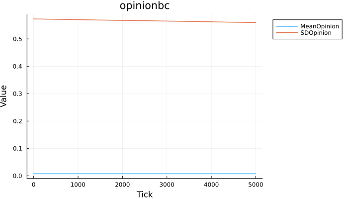
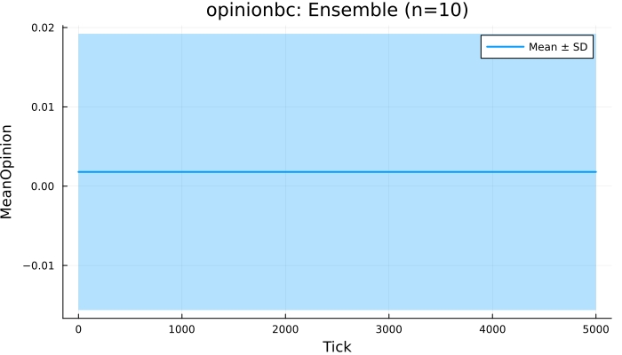
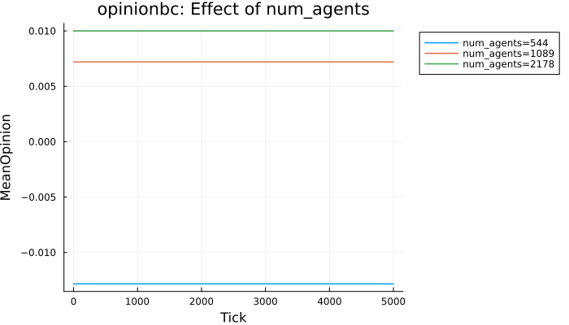

# Opinion Dynamics BC


- [Overview](#overview)
- [Parameters](#parameters)
- [Source Code](#source-code)
- [Time Series](#time-series)
- [Ensemble Runs](#ensemble-runs)
- [Parameter Sensitivity](#parameter-sensitivity)
- [Appendix: Source Code](#appendix-source-code)
  - [Parameters (`parameters.jl`)](#parameters-parametersjl)
  - [Components (`components.jl`)](#components-componentsjl)
  - [Resources (`resources.jl`)](#resources-resourcesjl)
  - [Systems (`systems.jl`)](#systems-systemsjl)
  - [Model (`model.jl`)](#model-modeljl)

## Overview

This vignette demonstrates the **Opinion Dynamics BC** model implemented
in [ArkModelZoo.jl](https://github.com/sdwfrost/ArkModelZoo.jl) using
the Ark.jl ECS framework.

## Parameters

| Parameter              | Type      | Default | Description          |
|------------------------|-----------|---------|----------------------|
| `num_agents`           | `Int`     | `1089`  | 33x33 patches        |
| `learning_rate`        | `Float64` | `0.3`   | learning rate        |
| `confidence_threshold` | `Float64` | `0.3`   | confidence threshold |
| `max_ticks`            | `Int`     | `5000`  | max ticks            |

## Source Code

The Julia code to run this model:

``` julia
using ArkModelZoo
_, trajectory = run_opinionbc()
```

## Time Series



## Ensemble Runs

Ten replicates with different random seeds, showing mean ± standard
deviation.



## Parameter Sensitivity

Varying `num_agents`.



## Appendix: Source Code

This model is implemented in the
[Ark.jl](https://github.com/sdwfrost/Ark.jl) Entity-Component-System
(ECS) framework. The code is split into five files, each with a distinct
role:

- **Parameters**: a mutable struct holding all configurable values.
- **Components**: lightweight data types attached to individual entities
  (agents).
- **Resources**: world-level shared state accessible to all systems.
- **Systems**: functions that operate on entities each tick, defining
  model behavior.
- **Model**: wiring that assembles the world, registers resources and
  systems, and provides the run entry point.

### Parameters (`parameters.jl`)

The parameter struct uses `@kwdef` so that every field has a default
value and can be overridden by keyword. These defaults match the
original NetLogo model’s slider settings.

``` julia
Base.@kwdef mutable struct OpinionBCParams
    num_agents::Int = 1089          # 33x33 patches
    learning_rate::Float64 = 0.3
    confidence_threshold::Float64 = 0.3
    max_ticks::Int = 5000
    seed::Int = 42
end
```

### Components (`components.jl`)

Components are lightweight data types attached to individual entities
(agents). Mutable structs hold per-entity state, while empty tag structs
act as markers for the ECS query system to efficiently filter entities.

``` julia
# Opinion Dynamics BC has no entities — opinions stored as resource vector
struct OpinionBCDummy end
```

### Resources (`resources.jl`)

Resources are world-level singletons shared across all systems, used for
global state and aggregate statistics.

``` julia
mutable struct OpinionBCPopulation
    opinions::Vector{Float64}
end
OpinionBCPopulation(n::Int) = OpinionBCPopulation(zeros(Float64, n))

mutable struct OpinionBCStats
    mean_opinion::Float64
    sd_opinion::Float64
end
OpinionBCStats() = OpinionBCStats(0.0, 0.0)
```

### Systems (`systems.jl`)

Systems contain the model logic and execute in a defined order each
tick. Each system struct implements either `initialize!` (run once at
setup) or `update!` (run every tick).

``` julia
# --- Initialization ---

struct InitOpinionBCSystem <: System end

function initialize!(::InitOpinionBCSystem, world::World)
    params = get_resource(world, OpinionBCParams)
    rng = get_resource(world, RNGResource).rng
    pop = get_resource(world, OpinionBCPopulation)
    stats = get_resource(world, OpinionBCStats)

    # Each turtle gets opinion = (random-float 2) - 1 → uniform [-1, 1)
    for i in 1:params.num_agents
        pop.opinions[i] = rand(rng) * 2.0 - 1.0
    end

    # Initial stats
    stats.mean_opinion = Statistics.mean(pop.opinions)
    stats.sd_opinion = Statistics.std(pop.opinions; corrected=true)
    return nothing
end

# --- Opinion Update ---
# NetLogo: ask one-of turtles [ pick another, if within threshold, move toward each other ]
# ONE interaction per tick

struct OpinionBCUpdateSystem <: System end

function update!(::OpinionBCUpdateSystem, world::World)
    params = get_resource(world, OpinionBCParams)
    rng = get_resource(world, RNGResource).rng
    pop = get_resource(world, OpinionBCPopulation)
    n = params.num_agents

    # Pick one random turtle
    i = rand(rng, 1:n)
    # Pick another random turtle (not self)
    j = rand(rng, 1:n-1)
    if j >= i
        j += 1
    end

    x1 = pop.opinions[i]
    x2 = pop.opinions[j]

    if abs(x1 - x2) < params.confidence_threshold
        lr = params.learning_rate
        pop.opinions[i] = x1 + lr * (x2 - x1)
        pop.opinions[j] = x2 + lr * (x1 - x2)
    end
    return nothing
end

# --- Stats ---

struct OpinionBCStatsSystem <: System end

function update!(::OpinionBCStatsSystem, world::World)
    pop = get_resource(world, OpinionBCPopulation)
    stats = get_resource(world, OpinionBCStats)
    stats.mean_opinion = Statistics.mean(pop.opinions)
    stats.sd_opinion = Statistics.std(pop.opinions; corrected=true)
    return nothing
end

# --- Termination ---

struct OpinionBCTerminationSystem <: System end

function update!(::OpinionBCTerminationSystem, world::World)
    params = get_resource(world, OpinionBCParams)
    tick = get_resource(world, Tick)
    if tick.tick + 1 >= params.max_ticks
        get_resource(world, Terminate).stop = true
    end
    return nothing
end
```

### Model (`model.jl`)

The model file assembles all pieces: it creates the ECS `World` with the
required component types, registers resources, builds the `Scheduler`
with systems in execution order, and exposes the public `run` entry
point. The observer pattern records the trajectory each tick.

``` julia
function opinionbc_world(; initial_capacity::Int = 128)
    return World(
        OpinionBCDummy;
        initial_capacity = initial_capacity,
        allow_mutable = true,
    )
end

function opinionbc_systems()
    return (
        InitOpinionBCSystem(),
        OpinionBCUpdateSystem(),
        OpinionBCStatsSystem(),
        OpinionBCTerminationSystem(),
    )
end

function opinionbc_model(params::OpinionBCParams = OpinionBCParams())
    world = opinionbc_world()
    _add_standard_resources!(world, params)
    add_resource!(world, OpinionBCPopulation(params.num_agents))
    add_resource!(world, OpinionBCStats())
    scheduler = Scheduler(world, opinionbc_systems())
    initialize!(scheduler)
    return scheduler
end

struct OpinionBCObserver end

function opinionbc_headers(::OpinionBCObserver)
    return ["MeanOpinion", "SDOpinion"]
end

function opinionbc_values(::OpinionBCObserver, world::World)
    stats = get_resource(world, OpinionBCStats)
    return Float64[stats.mean_opinion, stats.sd_opinion]
end

function run_opinionbc(; params::OpinionBCParams = OpinionBCParams(), observe::Bool = true)
    return _run_model(opinionbc_model, OpinionBCObserver(), opinionbc_values; params, observe)
end
```
