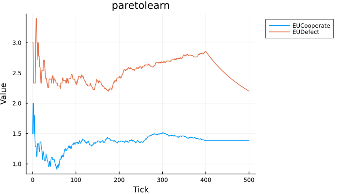
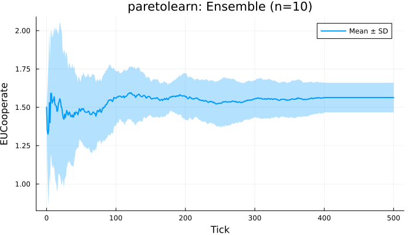
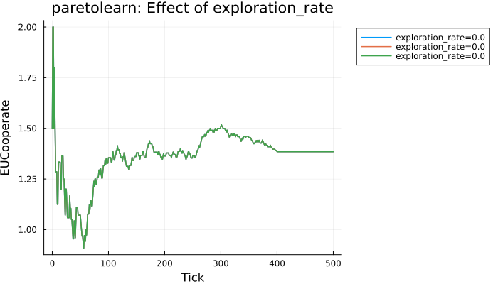

## Overview

This vignette demonstrates the **Pareto Learning** model implemented in [ArkModelZoo.jl](https://github.com/sdwfrost/ArkModelZoo.jl) using the Ark.jl ECS framework.

## Parameters

| Parameter | Type | Default | Description |
|-----------|------|---------|-------------|
| `exploration_rate` | `Float64` | `0.0` | exploration rate |
| `random_ticks` | `Int` | `400` | random ticks |
| `max_ticks` | `Int` | `500` | max ticks |

## Source Code

The Julia code to run this model:

```julia
using ArkModelZoo
_, trajectory = run_paretolearn()
```

## Time Series

{width=100%}

## Ensemble Runs

Ten replicates with different random seeds, showing mean ± standard deviation.

{width=100%}

## Parameter Sensitivity

Varying `exploration_rate`.

{width=100%}


## Appendix: Source Code

This model is implemented in the [Ark.jl](https://github.com/sdwfrost/Ark.jl) Entity-Component-System (ECS) framework. The code is split into five files, each with a distinct role:

- **Parameters**: a mutable struct holding all configurable values.
- **Components**: lightweight data types attached to individual entities (agents).
- **Resources**: world-level shared state accessible to all systems.
- **Systems**: functions that operate on entities each tick, defining model behavior.
- **Model**: wiring that assembles the world, registers resources and systems, and provides the run entry point.

### Parameters (`parameters.jl`)

The parameter struct uses `@kwdef` so that every field has a default value and can be overridden by keyword. These defaults match the original NetLogo model's slider settings.

```julia
Base.@kwdef mutable struct ParetoLearnParams
    payoff::Matrix{Int} = [3 0; 5 1]
    exploration_rate::Float64 = 0.0
    random_ticks::Int = 400
    max_ticks::Int = 500
    seed::Int = 42
end
```

### Components (`components.jl`)

Components are lightweight data types attached to individual entities (agents). Mutable structs hold per-entity state, while empty tag structs act as markers for the ECS query system to efficiently filter entities.

```julia
struct ParetoLearnDummy end
```

### Resources (`resources.jl`)

Resources are world-level singletons shared across all systems, used for global state and aggregate statistics.

```julia
mutable struct ParetoLearnerState
    n::Vector{Matrix{Int}}   # n[learner][my_action, his_action], 1-indexed actions
    actions::Vector{Int}     # current action per learner (1=cooperate, 2=defect)
    epsilon::Float64         # exploration rate
end

function ParetoLearnerState(epsilon::Float64)
    ParetoLearnerState(
        [ones(Int, 2, 2), ones(Int, 2, 2)],
        [0, 0],
        epsilon,
    )
end

mutable struct ParetoStats
    eu_cooperate::Float64
    eu_defect::Float64
end
ParetoStats() = ParetoStats(0.0, 0.0)
```

### Systems (`systems.jl`)

Systems contain the model logic and execute in a defined order each tick. Each system struct implements either `initialize!` (run once at setup) or `update!` (run every tick).

```julia
# --- Helpers ---

function _pareto_expected_utility(n::Matrix{Int}, payoff::Matrix{Int}, my_action::Int)
    ni = n[my_action, 1] + n[my_action, 2]
    eu = 0.0
    for a in 1:2
        eu += payoff[my_action, a] * n[my_action, a] / ni
    end
    return eu
end

function _pareto_take_action(n::Matrix{Int}, payoff::Matrix{Int},
                             epsilon::Float64, tick::Int,
                             random_ticks::Int, rng)
    if tick < random_ticks
        return rand(rng, 1:2)
    else
        eu1 = _pareto_expected_utility(n, payoff, 1)
        eu2 = _pareto_expected_utility(n, payoff, 2)
        best = eu1 >= eu2 ? 1 : 2
        if rand(rng) < 1.0 - epsilon
            return best
        else
            return 3 - best
        end
    end
end

# --- Initialization ---

struct InitParetoLearnSystem <: System end

function initialize!(::InitParetoLearnSystem, world::World)
    params = get_resource(world, ParetoLearnParams)
    state = get_resource(world, ParetoLearnerState)
    stats = get_resource(world, ParetoStats)

    state.epsilon = params.exploration_rate
    for i in 1:2
        state.n[i] .= 1
        state.actions[i] = 0
    end

    # Initial EU from learner 1's perspective
    stats.eu_cooperate = _pareto_expected_utility(state.n[1], params.payoff, 1)
    stats.eu_defect = _pareto_expected_utility(state.n[1], params.payoff, 2)
    return nothing
end

# --- Update ---

struct ParetoLearnUpdateSystem <: System end

function update!(::ParetoLearnUpdateSystem, world::World)
    params = get_resource(world, ParetoLearnParams)
    rng = get_resource(world, RNGResource).rng
    state = get_resource(world, ParetoLearnerState)
    stats = get_resource(world, ParetoStats)
    tick_val = get_resource(world, Tick).tick

    # ask learners [take-action] — random order
    order = randperm(rng, 2)
    for i in order
        state.actions[i] = _pareto_take_action(
            state.n[i], params.payoff, state.epsilon,
            tick_val, params.random_ticks, rng,
        )
    end

    # ask learners [adapt] — random order
    order = randperm(rng, 2)
    for i in order
        other = 3 - i
        my_action = state.actions[i]
        his_action = state.actions[other]
        state.n[i][my_action, his_action] += 1
    end

    # ask learner 0 [set eu-cooperate ...; set eu-defect ...]
    stats.eu_cooperate = _pareto_expected_utility(state.n[1], params.payoff, 1)
    stats.eu_defect = _pareto_expected_utility(state.n[1], params.payoff, 2)
    return nothing
end

# --- Termination ---

struct ParetoLearnTerminationSystem <: System end

function update!(::ParetoLearnTerminationSystem, world::World)
    params = get_resource(world, ParetoLearnParams)
    tick = get_resource(world, Tick)
    if tick.tick + 1 >= params.max_ticks
        get_resource(world, Terminate).stop = true
    end
    return nothing
end
```

### Model (`model.jl`)

The model file assembles all pieces: it creates the ECS `World` with the required component types, registers resources, builds the `Scheduler` with systems in execution order, and exposes the public `run` entry point. The observer pattern records the trajectory each tick.

```julia
function paretolearn_world(; initial_capacity::Int = 128)
    return World(
        ParetoLearnDummy;
        initial_capacity = initial_capacity,
        allow_mutable = true,
    )
end

function paretolearn_systems()
    return (
        InitParetoLearnSystem(),
        ParetoLearnUpdateSystem(),
        ParetoLearnTerminationSystem(),
    )
end

function paretolearn_model(params::ParetoLearnParams = ParetoLearnParams())
    world = paretolearn_world()
    _add_standard_resources!(world, params)
    add_resource!(world, ParetoLearnerState(params.exploration_rate))
    add_resource!(world, ParetoStats())
    scheduler = Scheduler(world, paretolearn_systems())
    initialize!(scheduler)
    return scheduler
end

struct ParetoLearnObserver end

function paretolearn_headers(::ParetoLearnObserver)
    return ["EUCooperate", "EUDefect"]
end

function paretolearn_values(::ParetoLearnObserver, world::World)
    stats = get_resource(world, ParetoStats)
    return Float64[stats.eu_cooperate, stats.eu_defect]
end

function run_paretolearn(; params::ParetoLearnParams = ParetoLearnParams(), observe::Bool = true)
    return _run_model(paretolearn_model, ParetoLearnObserver(), paretolearn_values; params, observe)
end
```
