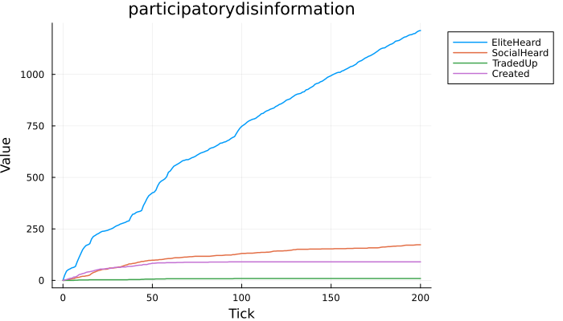
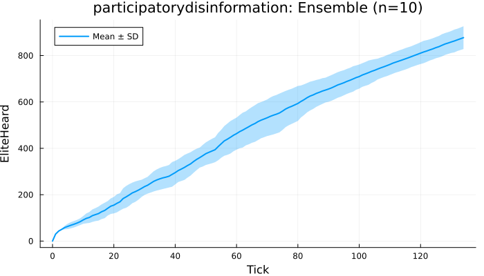
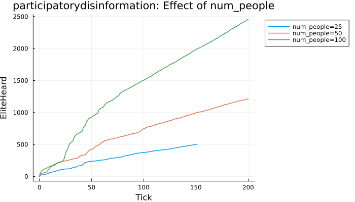

# Participatory Disinformation


- [Overview](#overview)
  - [WHAT IS IT?](#what-is-it)
  - [THINGS TO NOTICE](#things-to-notice)
  - [THINGS TO TRY](#things-to-try)
  - [EXTENDING THE MODEL](#extending-the-model)
  - [NETLOGO FEATURES](#netlogo-features)
  - [RELATED MODELS](#related-models)
  - [CREDITS AND REFERENCES](#credits-and-references)
  - [COPYRIGHT AND LICENSE](#copyright-and-license)
- [Parameters](#parameters)
- [Source Code](#source-code)
- [Time Series](#time-series)
- [Ensemble Runs](#ensemble-runs)
- [Parameter Sensitivity](#parameter-sensitivity)
- [Appendix: Source Code](#appendix-source-code)
  - [Parameters (`parameters.jl`)](#parameters-parametersjl)
  - [Components (`components.jl`)](#components-componentsjl)
  - [Resources (`resources.jl`)](#resources-resourcesjl)
  - [Systems (`systems.jl`)](#systems-systemsjl)
  - [Model (`model.jl`)](#model-modeljl)

## Overview

### WHAT IS IT?

The purpose of this model is to simulate the top-down/bottom-up dynamics
of what has come to be known as “participatory disinformation.”

See the article [“What is participatory
disinformation?”](https://www.cip.uw.edu/2021/05/26/participatory-disinformation-kate-starbird/)
for a description of the real-world phenomenon. This is based on the
work of researchers at the University of Washington Center for an
Informed Public, et al, in the context of disinformation about the 2020
United States presidential election.

In short, participatory disinformation describes the feedback loop by
which disinformation about a particular topic or “frame” is dissimenated
in a top-down fashion by political elites to their audiences, who then
produce their own false/misleading rumors about the topic in a bottom-up
participatory manner. These new rumors are then “traded-up” the media
chain by connected social media influencers in an attempt to reach the
ear of the political elites. Finally the political elites echo these new
rumors back to the audiences who originally created them, reinforcing
the frame of the disinformation story.

### THINGS TO NOTICE

It is easier to see some of the interesting behavior when you slow the
model down.

As elites adopt traded-up rumors and echo them back to the audiences,
you can see staggered “regimes” of mass rumor adoption that quickly
spread across the entire network. A newly generated rumor might be
slowly passed around the social network, but as soon as it is picked up
and echoed back by the elites it gets disperesed quickly and totally to
all of the elite-exposed agents. You can visually see this occur in the
world, and by looking at the “Rumors heard” line chart.

When rumor dissipation is turned on, rumors in the social network
fluctuate without settling into a pattern of total rumor adoption.
However for audience agents who have exposure to elite influence, the
repeated broadcasting of new and old rumors constantly reinforces the
“frame” of rumors and counteracts the ongoing dissipation of rumors. You
can visually see this in the world by comparing the color of agents with
and without elite exposure.

Sometimes specific rumors don’t catch on. Either they fail to get
randomly generated, or they aren’t traded up, or they are forgotten. It
is possible that in a given execution, only a handful of the total
rumors catch on and reach full information disperal, while other times
all of the rumors will eventually get fully adopted. Note: It is not yet
clear why this happens. It is possible that this is an artifact of the
rumor creation procedure instead of being a meaningful model dyname.
More testing and instrumentation is needed to better understand the
behavior.

Without rumor dissipation, the model is essentially a runaway
reinforcing feedback loop. It still demonstrates interesting patterns
like staggered regimes, but having a countervailing stabilizing feedback
loops makes the overall system dynamics more interesting.

### THINGS TO TRY

Try setting up the model with different variants of elite exposure
distribution and noting the effect this has on rumor adoption.

Try changing the relative balances of `elite-influence`,
`social-influence`, `trade-up-influence`, and `rumor-generation` and
seeing what effect this has on adoption and dispersal through the whole
network.

Try turning rumor `dissipation-rate` down to zero or up really high. How
much adoption influence is necessary for the amplifying feedback loop of
accumulating influence to continue dominating the stabilizing loop of
rumor dissipation?

### EXTENDING THE MODEL

This model could be extended in a number of ways:

We could expliclitly model the process by which newly generated rumors
are “traded up” to elite agents instead of this occurring automatically
outside of the social network. We could also include the elies as part
of the network itself instead of leaving them solely as a disconnected
media influence.

Influencers themselves could be modeled in a manner that more closely
resembles real-world patterns of social network influence. For example
the set of agents that are selected to be influencers could be weighted
to be drawn from the top end of the set of agents with a higher degree
of connectivity within the network. Additionally we don’t model
influencers as having any particular influence within the context of
social network adoption, but real-world influencers would certainly have
more peer-to-peer influence.

The rumor generation process itself is pretty naive and not informed by
any real world understanding of participatory rumors and conspiracy
theories (e.g. Mike Caulfield’s concept of “trope-field fit”). We could
more explicitly model how rumors are created relative to events and
ongoing narratives.

### NETLOGO FEATURES

This model makes use of the NetLogo network extension to simulate the
social network connection between audience agents.

The model also makes significant use of the third-party NetLogo
bitstring extension in order to model rumor adoption. See the
[netlogo-bitstring
documentation](https://github.com/garypolhill/netlogo-bitstring/tree/nl6)
for more details on how this extension works.

### RELATED MODELS

This model draws from and builds on foundational mechanics for
simulating information dispersal in a network from two other models from
the Modeling Commons:

- [The Spread of a Meme Across a Social
  Network](http://modelingcommons.org/browse/one_model/4424) by Kristen
  Amaddio

- [Correcting Information - delay and media
  effects](http://modelingcommons.org/browse/one_model/5125) by Kjirste
  Morrell

### CREDITS AND REFERENCES

Rand, W. Introduction to Agent-Based Modeling (Summer 2017) Unit 4,
Model.
https://s3.amazonaws.com/complexityexplorer/ABMwithNetLogo/model-7.nlogo
7:Influentials.

Starbird, K., et al. (2021) [“What is participatory
disinformation?”](https://www.cip.uw.edu/2021/05/26/participatory-disinformation-kate-starbird/).
Center for an Informed Public, University of Washington, Seattle, WA.

Wilensky, U. (2005). NetLogo Preferential Attachment model.
http://ccl.northwestern.edu/netlogo/models/PreferentialAttachment.
Center for Connected Learning and Computer-Based Modeling, Northwestern
University, Evanston, IL.

Wilensky, U. (1999). NetLogo. http://ccl.northwestern.edu/netlogo/.
Center for Connected Learning and Computer-Based Modeling, Northwestern
Institute on Complex Systems, Northwestern University, Evanston, IL.

### COPYRIGHT AND LICENSE

Copyright 2021 Scott Johnson.

This work is licensed under the Creative Commons
Attribution-NonCommercial-ShareAlike 3.0 License. To view a copy of this
license, visit http://creativecommons.org/licenses/by-nc-sa/3.0/ or send
a letter to Creative Commons, 559 Nathan Abbott Way, Stanford,
California 94305, USA.

This model was submitted as a student project for the Intro to
Agent-Based Modeling class, summer 2021, offered by Santa Fe Institute
and taught by William Rand.

## Parameters

| Parameter            | Type      | Default | Description        |
|----------------------|-----------|---------|--------------------|
| `num_people`         | `Int`     | `50`    | num people         |
| `frac_influencers`   | `Float64` | `0.1`   | frac influencers   |
| `max_rumors`         | `Int`     | `10`    | max rumors         |
| `elite_influence`    | `Float64` | `0.6`   | elite influence    |
| `social_influence`   | `Float64` | `0.1`   | social influence   |
| `trade_up_influence` | `Float64` | `0.25`  | trade up influence |
| `rumor_generation`   | `Float64` | `0.05`  | rumor generation   |
| `dissipation_rate`   | `Float64` | `0.1`   | dissipation rate   |
| `max_ticks`          | `Int`     | `200`   | max ticks          |

## Source Code

The Julia code to run this model:

``` julia
using ArkModelZoo
_, trajectory = run_participatorydisinformation()
```

## Time Series



## Ensemble Runs

Ten replicates with different random seeds, showing mean ± standard
deviation.



## Parameter Sensitivity

Varying `num_people`.



## Appendix: Source Code

This model is implemented in the
[Ark.jl](https://github.com/sdwfrost/Ark.jl) Entity-Component-System
(ECS) framework. The code is split into five files, each with a distinct
role:

- **Parameters**: a mutable struct holding all configurable values.
- **Components**: lightweight data types attached to individual entities
  (agents).
- **Resources**: world-level shared state accessible to all systems.
- **Systems**: functions that operate on entities each tick, defining
  model behavior.
- **Model**: wiring that assembles the world, registers resources and
  systems, and provides the run entry point.

### Parameters (`parameters.jl`)

The parameter struct uses `@kwdef` so that every field has a default
value and can be overridden by keyword. These defaults match the
original NetLogo model’s slider settings.

``` julia
Base.@kwdef mutable struct PDisinfoParams
    num_people::Int = 50
    frac_influencers::Float64 = 0.1
    max_rumors::Int = 10
    elite_influence::Float64 = 0.6
    social_influence::Float64 = 0.1
    trade_up_influence::Float64 = 0.25
    rumor_generation::Float64 = 0.05
    dissipation_rate::Float64 = 0.1
    max_ticks::Int = 200
    seed::Int = 42
end
```

### Components (`components.jl`)

Components are lightweight data types attached to individual entities
(agents). Mutable structs hold per-entity state, while empty tag structs
act as markers for the ECS query system to efficiently filter entities.

``` julia
struct PDisinfoDummy end
```

### Resources (`resources.jl`)

Resources are world-level singletons shared across all systems, used for
global state and aggregate statistics.

``` julia
mutable struct PDisinfoNetwork
    n_total::Int                    # num_people + 1 (elite)
    adj::Vector{Set{Int}}
    degree::Vector{Int}
    agent_type::Vector{Int}         # 0=regular, 1=influencer, 2=elite
    rumors::Vector{BitVector}       # BitVector of length max_rumors per agent
end

function PDisinfoNetwork()
    PDisinfoNetwork(0, Set{Int}[], Int[], Int[], BitVector[])
end

function _pdisinfo_add_agent!(net::PDisinfoNetwork, max_rumors::Int)
    push!(net.adj, Set{Int}())
    push!(net.degree, 0)
    push!(net.agent_type, 0)
    push!(net.rumors, falses(max_rumors))
    net.n_total += 1
    return net.n_total
end

function _pdisinfo_add_edge!(net::PDisinfoNetwork, i::Int, j::Int)
    if j ∉ net.adj[i]
        push!(net.adj[i], j)
        push!(net.adj[j], i)
        net.degree[i] += 1
        net.degree[j] += 1
    end
end

mutable struct PDisinfoStats
    times_heard_from_elites::Int
    times_heard_from_social::Int
    times_traded_up::Int
    times_created_rumor::Int
end
PDisinfoStats() = PDisinfoStats(0, 0, 0, 0)
```

### Systems (`systems.jl`)

Systems contain the model logic and execute in a defined order each
tick. Each system struct implements either `initialize!` (run once at
setup) or `update!` (run every tick).

``` julia
# Participatory Disinformation – ECS systems
# Rumor spreading on network with elite exposure and bitstring-based rumor tracking

struct InitPDisinfoSystem <: System end

function _pdisinfo_build_ba!(net::PDisinfoNetwork, rng, n::Int, max_rumors::Int)
    # Start with 2 connected nodes
    _pdisinfo_add_agent!(net, max_rumors)
    _pdisinfo_add_agent!(net, max_rumors)
    _pdisinfo_add_edge!(net, 1, 2)
    # Each new node connects to 1 existing (preferential attachment)
    for _ in 3:n
        new_id = _pdisinfo_add_agent!(net, max_rumors)
        total_degree = sum(net.degree[k] for k in 1:(new_id - 1))
        if total_degree == 0
            target = rand(rng, 1:(new_id - 1))
        else
            r = rand(rng) * total_degree
            cumulative = 0.0
            target = 1
            for j in 1:(new_id - 1)
                cumulative += net.degree[j]
                if cumulative >= r
                    target = j
                    break
                end
            end
        end
        _pdisinfo_add_edge!(net, new_id, target)
    end
end

function initialize!(::InitPDisinfoSystem, world::World)
    params = get_resource(world, PDisinfoParams)
    rng    = get_resource(world, RNGResource).rng
    net    = get_resource(world, PDisinfoNetwork)

    n_total = params.num_people + 1   # last agent is the elite
    _pdisinfo_build_ba!(net, rng, n_total, params.max_rumors)

    elite_id = n_total
    net.agent_type[elite_id] = 2

    # Assign influencers among non-elite agents
    n_influencers = max(1, round(Int, params.num_people * params.frac_influencers))
    indices = Random.shuffle(rng, collect(1:params.num_people))
    for k in 1:n_influencers
        net.agent_type[indices[k]] = 1
    end

    # Elite starts with 1 random rumor
    rumor_idx = rand(rng, 1:params.max_rumors)
    net.rumors[elite_id][rumor_idx] = true
    return nothing
end

# --- Main go procedure ---

struct PDisinfoGoSystem <: System end

function update!(::PDisinfoGoSystem, world::World)
    params   = get_resource(world, PDisinfoParams)
    rng      = get_resource(world, RNGResource).rng
    net      = get_resource(world, PDisinfoNetwork)
    stats    = get_resource(world, PDisinfoStats)
    elite_id = params.num_people + 1

    # Process each non-elite agent in random order
    order = Random.shuffle(rng, collect(1:params.num_people))
    for i in order
        # 1. Adopt from elite
        if rand(rng) < params.elite_influence
            novel = net.rumors[elite_id] .& .!net.rumors[i]
            if any(novel)
                novel_idx = findall(novel)
                chosen = novel_idx[rand(rng, 1:length(novel_idx))]
                net.rumors[i][chosen] = true
                stats.times_heard_from_elites += 1
            end
        end

        # 2. Adopt from network neighbours
        neighbors = net.adj[i]
        total_neighbors = length(neighbors)
        if total_neighbors > 0
            adopted_nbrs = Int[]
            for j in neighbors
                if any(net.rumors[j])
                    push!(adopted_nbrs, j)
                end
            end
            frac = length(adopted_nbrs) / total_neighbors
            if frac > 0.0 && rand(rng) < params.social_influence * frac
                source = adopted_nbrs[rand(rng, 1:length(adopted_nbrs))]
                novel = net.rumors[source] .& .!net.rumors[i]
                if any(novel)
                    novel_idx = findall(novel)
                    chosen = novel_idx[rand(rng, 1:length(novel_idx))]
                    net.rumors[i][chosen] = true
                    stats.times_heard_from_social += 1
                end
            end
        end

        # 3. Generate rumor
        if rand(rng) < params.rumor_generation
            idx = rand(rng, 1:params.max_rumors)
            if !net.rumors[i][idx]
                net.rumors[i][idx] = true
                stats.times_created_rumor += 1
            end
        end

        # 4. Forget rumor
        if rand(rng) < params.dissipation_rate
            my_true = findall(net.rumors[i])
            if !isempty(my_true)
                idx = my_true[rand(rng, 1:length(my_true))]
                net.rumors[i][idx] = false
            end
        end
    end

    # 5. Trade-up: influencer → elite
    if rand(rng) < params.trade_up_influence
        influencer_ids = findall(==(1), net.agent_type)
        if !isempty(influencer_ids)
            source = influencer_ids[rand(rng, 1:length(influencer_ids))]
            novel = net.rumors[source] .& .!net.rumors[elite_id]
            if any(novel)
                novel_idx = findall(novel)
                chosen = novel_idx[rand(rng, 1:length(novel_idx))]
                net.rumors[elite_id][chosen] = true
                stats.times_traded_up += 1
            end
        end
    end
    return nothing
end

# --- Termination ---

struct PDisinfoTerminationSystem <: System end

function update!(::PDisinfoTerminationSystem, world::World)
    params = get_resource(world, PDisinfoParams)
    tick   = get_resource(world, Tick)
    net    = get_resource(world, PDisinfoNetwork)

    # All non-elite agents heard all rumors?
    all_heard = true
    for i in 1:params.num_people
        if !all(net.rumors[i])
            all_heard = false
            break
        end
    end

    if all_heard || tick.tick + 1 >= params.max_ticks
        get_resource(world, Terminate).stop = true
    end
    return nothing
end
```

### Model (`model.jl`)

The model file assembles all pieces: it creates the ECS `World` with the
required component types, registers resources, builds the `Scheduler`
with systems in execution order, and exposes the public `run` entry
point. The observer pattern records the trajectory each tick.

``` julia
function participatorydisinformation_world(; initial_capacity::Int = 128)
    return World(PDisinfoDummy; initial_capacity = initial_capacity, allow_mutable = true)
end

function participatorydisinformation_systems()
    return (InitPDisinfoSystem(), PDisinfoGoSystem(), PDisinfoTerminationSystem())
end

function participatorydisinformation_model(params::PDisinfoParams = PDisinfoParams())
    world = participatorydisinformation_world()
    _add_standard_resources!(world, params)
    add_resource!(world, PDisinfoNetwork())
    add_resource!(world, PDisinfoStats())
    scheduler = Scheduler(world, participatorydisinformation_systems())
    initialize!(scheduler)
    return scheduler
end

struct PDisinfoObserver end

function participatorydisinformation_headers(::PDisinfoObserver)
    return ["EliteHeard", "SocialHeard", "TradedUp", "Created"]
end

function participatorydisinformation_values(::PDisinfoObserver, world::World)
    stats = get_resource(world, PDisinfoStats)
    return Float64[stats.times_heard_from_elites, stats.times_heard_from_social,
                    stats.times_traded_up, stats.times_created_rumor]
end

function run_participatorydisinformation(; params::PDisinfoParams = PDisinfoParams(), observe::Bool = true)
    return _run_model(participatorydisinformation_model, PDisinfoObserver(), participatorydisinformation_values; params, observe)
end
```
