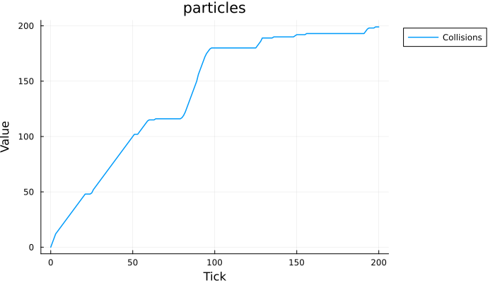
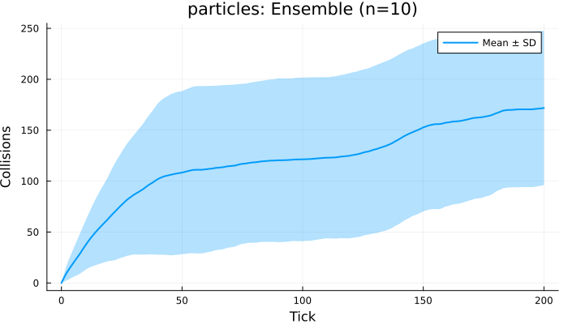
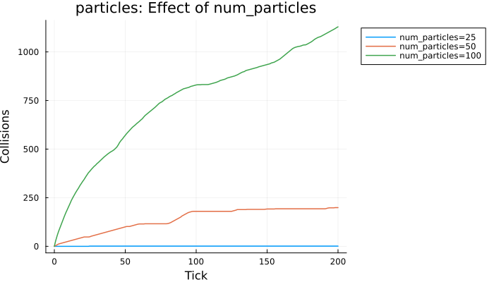

# Particles


- [Overview](#overview)
  - [WHAT IS IT?](#what-is-it)
  - [HOW IT WORKS](#how-it-works)
  - [THINGS TO NOTICE](#things-to-notice)
  - [THINGS TO TRY](#things-to-try)
  - [EXTENDING THE MODEL](#extending-the-model)
  - [NETLOGO FEATURES](#netlogo-features)
  - [RELATED MODELS](#related-models)
  - [CREDITS AND REFERENCES](#credits-and-references)
  - [HOW TO CITE](#how-to-cite)
  - [COPYRIGHT AND LICENSE](#copyright-and-license)
- [Parameters](#parameters)
- [Source Code](#source-code)
- [Time Series](#time-series)
- [Ensemble Runs](#ensemble-runs)
- [Parameter Sensitivity](#parameter-sensitivity)
- [Appendix: Source Code](#appendix-source-code)
  - [Parameters (`parameters.jl`)](#parameters-parametersjl)
  - [Components (`components.jl`)](#components-componentsjl)
  - [Resources (`resources.jl`)](#resources-resourcesjl)
  - [Systems (`systems.jl`)](#systems-systemsjl)
  - [Model (`model.jl`)](#model-modeljl)

## Overview

### WHAT IS IT?

This model is one in a series of GasLab models. They use the same basic
rules for simulating the behavior of gases. Each model integrates
different features in order to highlight different aspects of gas
behavior. This model is different from the other GasLab models in that
the collision calculations take the circular shape and size of the
particles into account, instead of modeling the particles as
dimensionless points.

### HOW IT WORKS

The model determines the resulting motion of particles that collide,
with no loss in their total momentum or total kinetic energy (an elastic
collision).

To calculate the outcome of collision, it is necessary to calculate the
exact time at which the edge of one particle (represented as a circle),
would touch the edge of another particle (or the walls of a container)
if the particles were allowed to continue with their current headings
and speeds.

By performing such a calculation, one can determine when the next
collision anywhere in the system would occur in time. From this
determination, the model then advances the motion of all the particles
using their current headings and speeds that far in time until this next
collision point is reached. Exchange of kinetic energy and momentum
between the two particles, according to conservation of kinetic energy
and conservation of momentum along the collision axis (a line drawn
between the centers of the two particles), is then calculated, and the
particles are given new headings and speeds based on this outcome.

### THINGS TO NOTICE

Run the model with different masses, by setting the MAX-PARTICLE-SIZE
larger than the MIN-PARTICLE-SIZE. Mass is scaled linearly to the area
of the particle, so that a particle that is twice the radius of another
particle, has four the area and therefore four times the mass.

With many different mass particles colliding over time, different sized
particles start to move at different speed ranges (in general). The
smallest mass particles will be usually moving faster (red) than the
average particle speed and the largest mass particles will be usually
slower (blue) than the average particle speed. This emergent result is
what happens in a gas that is a mixture of particles of different
masses. At any given temperature, the higher mass particles are moving
slower (such as Nitrogen gas: N<sub>2</sub>) then the lower mass
particles (such as water vapor: H<sub>2</sub>O).

The particle histograms quickly converge on the classic
Maxwell-Boltzmann distribution. What’s special about these curves? Why
is the shape of the energy curve not the same as the speed curve?

Look at the other GasLab models to compare the particle histograms. In
those models, the particles are modeled as “point” particles, with an
area of “zero”. The results of those models should match this model,
even with that simplification.

With particles of different sizes, you may notice some fast moving
particles have lower energy than medium speed particles. How can the
difference in the mass of the particles account for this?

### THINGS TO TRY

Setting all the particles to have a very slow speed (e.g. 0.001) and one
particle to have a very fast speed helps show how kinetic energy is
eventually transferred to all the particles through a series of
collisions and would serve as a good model for energy exchange through
conduction between hot and cold gases.

To see what the approximate mass of each particle is, type this in the
command center:

    ask particles [ set label precision mass 0 ]

### EXTENDING THE MODEL

Collisions between boxes and circles could also be explored. Variations
in size between particles could investigated or variations in the mass
of some of the particle could be made to explore other factors that
affect the outcome of collisions.

### NETLOGO FEATURES

Instead of advancing one tick at a time as in most models, the tick
counter takes on fractional values, using the `tick-advance` primitive.
(In the Interface tab, it is displayed as an integer, but if you make a
monitor for `ticks` you’ll see the exact value.)

### RELATED MODELS

Look at the other GasLab models to see collisions of “point” particles,
that is, the particles are assumed to have an area or volume of zero.

### CREDITS AND REFERENCES

This model was developed as part of the GasLab curriculum
(http://ccl.northwestern.edu/curriculum/gaslab/) and has also been
incorporated into the Connected Chemistry curriculum
(http://ccl.northwestern.edu/curriculum/ConnectedChemistry/)

### HOW TO CITE

If you mention this model or the NetLogo software in a publication, we
ask that you include the citations below.

For the model itself:

- Wilensky, U. (2005). NetLogo GasLab Circular Particles model.
  http://ccl.northwestern.edu/netlogo/models/GasLabCircularParticles.
  Center for Connected Learning and Computer-Based Modeling,
  Northwestern University, Evanston, IL.

Please cite the NetLogo software as:

- Wilensky, U. (1999). NetLogo. http://ccl.northwestern.edu/netlogo/.
  Center for Connected Learning and Computer-Based Modeling,
  Northwestern University, Evanston, IL.

### COPYRIGHT AND LICENSE

Copyright 2005 Uri Wilensky.


This model is licensed under the Creative Commons
Attribution-NonCommercial-ShareAlike 3.0 License. To view a copy of this
license, visit https://creativecommons.org/licenses/by-nc-sa/3.0/ or
send a letter to Creative Commons, 559 Nathan Abbott Way, Stanford,
California 94305, USA.

NetLogo itself is free software for non-commercial use under the terms
of the GNU General Public License ([see full license information
here](https://ccl.northwestern.edu/netlogo/docs/copyright.html)).

To inquire about commercial licenses for either NetLogo or specific
models from the models library, please contact
netlogo-commercial-admin@ccl.northwestern.edu.

This model and associated activities and materials were created as part
of the project: MODELING ACROSS THE CURRICULUM. The project gratefully
acknowledges the support of the National Science Foundation, the
National Institute of Health, and the Department of Education (IERI
program) – grant number REC \#0115699.

<!-- 2005 MAC -->

## Parameters

| Parameter          | Type      | Default | Description      |
|--------------------|-----------|---------|------------------|
| `num_particles`    | `Int`     | `50`    | num particles    |
| `speed`            | `Float64` | `0.02`  | speed            |
| `collision_radius` | `Float64` | `1.0`   | collision radius |
| `collision_speed`  | `Float64` | `0.1`   | collision speed  |
| `grid_width`       | `Int`     | `33`    | grid width       |
| `grid_height`      | `Int`     | `33`    | grid height      |
| `max_ticks`        | `Int`     | `200`   | max ticks        |

## Source Code

The Julia code to run this model:

``` julia
using ArkModelZoo
_, trajectory = run_particles()
```

## Time Series



## Ensemble Runs

Ten replicates with different random seeds, showing mean ± standard
deviation.



## Parameter Sensitivity

Varying `num_particles`.



## Appendix: Source Code

This model is implemented in the
[Ark.jl](https://github.com/sdwfrost/Ark.jl) Entity-Component-System
(ECS) framework. The code is split into five files, each with a distinct
role:

- **Parameters**: a mutable struct holding all configurable values.
- **Components**: lightweight data types attached to individual entities
  (agents).
- **Resources**: world-level shared state accessible to all systems.
- **Systems**: functions that operate on entities each tick, defining
  model behavior.
- **Model**: wiring that assembles the world, registers resources and
  systems, and provides the run entry point.

### Parameters (`parameters.jl`)

The parameter struct uses `@kwdef` so that every field has a default
value and can be overridden by keyword. These defaults match the
original NetLogo model’s slider settings.

``` julia
Base.@kwdef mutable struct ParticlesParams
    num_particles::Int = 50
    speed::Float64 = 0.02
    collision_radius::Float64 = 1.0
    collision_speed::Float64 = 0.1
    grid_width::Int = 33
    grid_height::Int = 33
    max_ticks::Int = 200
    seed::Int = 42
end
```

### Components (`components.jl`)

Components are lightweight data types attached to individual entities
(agents). Mutable structs hold per-entity state, while empty tag structs
act as markers for the ECS query system to efficiently filter entities.

``` julia
mutable struct ParticlePosition
    x::Float64
    y::Float64
end

mutable struct ParticleHeading
    angle::Float64
end
```

### Resources (`resources.jl`)

Resources are world-level singletons shared across all systems, used for
global state and aggregate statistics.

``` julia
mutable struct ParticleStats
    collisions::Int
end
ParticleStats() = ParticleStats(0)
```

### Systems (`systems.jl`)

Systems contain the model logic and execute in a defined order each
tick. Each system struct implements either `initialize!` (run once at
setup) or `update!` (run every tick).

``` julia
# ── Helper: NetLogo heading math and toroidal distance ──

function _particles_heading_to_rad(h::Float64)
    return h * π / 180.0
end

function _particles_torus_dist(x1::Float64, y1::Float64, x2::Float64, y2::Float64, w::Float64, h::Float64)
    dx = abs(x1 - x2)
    dy = abs(y1 - y2)
    dx = min(dx, w - dx)
    dy = min(dy, h - dy)
    return sqrt(dx * dx + dy * dy)
end

# ── Initialization ──

struct InitParticlesSystem <: System end

function initialize!(::InitParticlesSystem, world::World)
    params = get_resource(world, ParticlesParams)
    rng = get_resource(world, RNGResource).rng
    w = Float64(params.grid_width)
    h = Float64(params.grid_height)
    half_w = w / 2.0
    half_h = h / 2.0

    for _ in 1:params.num_particles
        # random-xcor/ycor: float in [-half_w, half_w)
        x = rand(rng) * w - half_w
        y = rand(rng) * h - half_h
        # heading random 360: integer [0, 359]
        heading = Float64(rand(rng, 0:359))
        new_entity!(world, (
            ParticlePosition(x, y),
            ParticleHeading(heading),
        ))
    end
    return nothing
end

# ── Particle Movement + Collision System ──
# NetLogo: ask turtles [ fd speed; if count in-radius 1 > 1 [
#   ask turtles in-radius 1 [ set heading random 360; fd 0.1 ]
#   set collisions collisions + 1 ] ]
# Sequential (shuffled) processing; mutations visible to later iterations.

struct ParticleSystem <: System
    order::Vector{Int}
    nearby::Vector{Int}
end
ParticleSystem() = ParticleSystem(Int[], Int[])

function update!(system::ParticleSystem, world::World)
    params = get_resource(world, ParticlesParams)
    stats = get_resource(world, ParticleStats)
    rng = get_resource(world, RNGResource).rng
    w = Float64(params.grid_width)
    h = Float64(params.grid_height)
    half_w = w / 2.0
    half_h = h / 2.0
    speed = params.speed
    coll_radius = params.collision_radius
    coll_speed = params.collision_speed

    # Collect entities into flat arrays
    n = 0
    for (eids, _, _) in Query(world, (ParticlePosition, ParticleHeading))
        n += length(eids)
    end
    n == 0 && return nothing

    pos_x = Vector{Float64}(undef, n)
    pos_y = Vector{Float64}(undef, n)
    headings = Vector{Float64}(undef, n)

    idx = 0
    for (_, positions, heads) in Query(world, (ParticlePosition, ParticleHeading))
        @inbounds for i in eachindex(positions)
            idx += 1
            pos_x[idx] = positions[i].x
            pos_y[idx] = positions[i].y
            headings[idx] = heads[i].angle
        end
    end

    # Shuffle order (NetLogo ask turtles shuffles)
    resize!(system.order, n)
    for i in 1:n
        system.order[i] = i
    end
    for i in n:-1:2
        j = rand(rng, 1:i)
        system.order[i], system.order[j] = system.order[j], system.order[i]
    end

    for ord_idx in 1:n
        ti = system.order[ord_idx]

        # forward speed
        θ = _particles_heading_to_rad(headings[ti])
        pos_x[ti] += sin(θ) * speed
        pos_y[ti] += cos(θ) * speed
        pos_x[ti] = mod(pos_x[ti] + half_w, w) - half_w
        pos_y[ti] = mod(pos_y[ti] + half_h, h) - half_h

        # count turtles in-radius 1 (includes self)
        empty!(system.nearby)
        for j in 1:n
            d = _particles_torus_dist(pos_x[ti], pos_y[ti], pos_x[j], pos_y[j], w, h)
            if d <= coll_radius
                push!(system.nearby, j)
            end
        end

        # if count > 1, at least one other turtle nearby
        if length(system.nearby) > 1
            # Inner ask shuffles too
            for i in length(system.nearby):-1:2
                j = rand(rng, 1:i)
                system.nearby[i], system.nearby[j] = system.nearby[j], system.nearby[i]
            end
            for nj in system.nearby
                headings[nj] = Float64(rand(rng, 0:359))
                θ2 = _particles_heading_to_rad(headings[nj])
                pos_x[nj] += sin(θ2) * coll_speed
                pos_y[nj] += cos(θ2) * coll_speed
                pos_x[nj] = mod(pos_x[nj] + half_w, w) - half_w
                pos_y[nj] = mod(pos_y[nj] + half_h, h) - half_h
            end
            stats.collisions += 1
        end
    end

    # Write positions and headings back to world
    idx = 0
    for (_, positions, heads) in Query(world, (ParticlePosition, ParticleHeading))
        @inbounds for i in eachindex(positions)
            idx += 1
            positions[i].x = pos_x[idx]
            positions[i].y = pos_y[idx]
            heads[i].angle = headings[idx]
        end
    end
    return nothing
end

# ── Termination System ──

struct ParticlesTerminationSystem <: System end

function update!(::ParticlesTerminationSystem, world::World)
    params = get_resource(world, ParticlesParams)
    tick = get_resource(world, Tick)
    if tick.tick + 1 >= params.max_ticks
        get_resource(world, Terminate).stop = true
    end
    return nothing
end
```

### Model (`model.jl`)

The model file assembles all pieces: it creates the ECS `World` with the
required component types, registers resources, builds the `Scheduler`
with systems in execution order, and exposes the public `run` entry
point. The observer pattern records the trajectory each tick.

``` julia
function particles_world(; initial_capacity::Int = 2048)
    return World(
        ParticlePosition,
        ParticleHeading;
        initial_capacity = initial_capacity,
        allow_mutable = true,
    )
end

function particles_systems()
    return (
        InitParticlesSystem(),
        ParticleSystem(),
        ParticlesTerminationSystem(),
    )
end

function particles_model(params::ParticlesParams = ParticlesParams())
    world = particles_world()
    _add_standard_resources!(world, params)
    add_resource!(world, ParticleStats())
    scheduler = Scheduler(world, particles_systems())
    initialize!(scheduler)
    return scheduler
end

struct ParticlesObserver end

function particles_headers(::ParticlesObserver)
    return ["Collisions"]
end

function particles_values(::ParticlesObserver, world::World)
    stats = get_resource(world, ParticleStats)
    return Float64[stats.collisions]
end

function run_particles(; params::ParticlesParams = ParticlesParams(), observe::Bool = true)
    return _run_model(particles_model, ParticlesObserver(), particles_values; params, observe)
end
```
