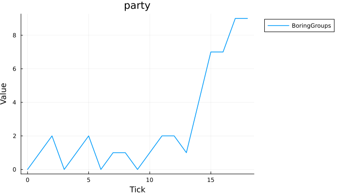
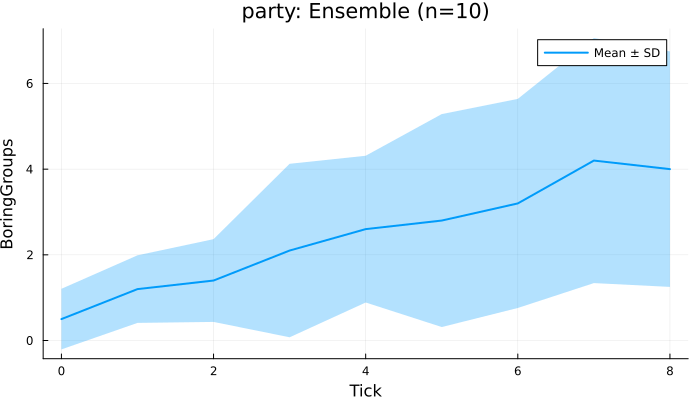
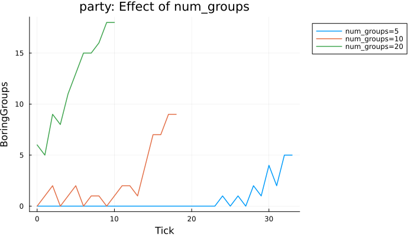

# Party


- [Overview](#overview)
  - [WHAT IS IT?](#what-is-it)
  - [HOW IT WORKS](#how-it-works)
  - [THINGS TO NOTICE](#things-to-notice)
  - [THINGS TO TRY](#things-to-try)
  - [EXTENDING THE MODEL](#extending-the-model)
  - [NETLOGO FEATURES](#netlogo-features)
  - [RELATED MODELS](#related-models)
  - [CREDITS AND REFERENCES](#credits-and-references)
  - [HOW TO CITE](#how-to-cite)
  - [COPYRIGHT AND LICENSE](#copyright-and-license)
- [Parameters](#parameters)
- [Source Code](#source-code)
- [Time Series](#time-series)
- [Ensemble Runs](#ensemble-runs)
- [Parameter Sensitivity](#parameter-sensitivity)
- [Appendix: Source Code](#appendix-source-code)
  - [Parameters (`parameters.jl`)](#parameters-parametersjl)
  - [Components (`components.jl`)](#components-componentsjl)
  - [Resources (`resources.jl`)](#resources-resourcesjl)
  - [Systems (`systems.jl`)](#systems-systemsjl)
  - [Model (`model.jl`)](#model-modeljl)

## Overview

### WHAT IS IT?

This is a model of a cocktail party. The men and women at the party form
groups. A party-goer becomes uncomfortable and switches groups if their
current group has too many members of the opposite sex. What types of
group result?

### HOW IT WORKS

The party-goers have a TOLERANCE that defines their comfort level with a
group that has members of the opposite sex. If they are in a group that
has a higher percentage of people of the opposite sex than their
TOLERANCE allows, then they are considered “uncomfortable”, and they
leave that group to find another group. Movement continues until
everyone at the party is “comfortable” with their group.

### THINGS TO NOTICE

At the end of the simulation (when everyone is happy), notice the number
of single-sex groups. Are there more than at the start?

### THINGS TO TRY

Try varying TOLERANCE. Is there a critical tolerance at which each all
groups end up being single-sex? At different tolerance levels, does it
take longer or shorter for everyone to become comfortable?

See how many mixed groups (not a single-sex group) you can get.

Using the GO ONCE button, experiment with different tolerances. Watch
how one unhappy person can disrupt the stability of other groups.

Is it possible to have an initial grouping such that the party never
reaches a stable state? (i.e. the model never stops running)

Observe real parties. Is this model descriptive of real social settings?
What tolerance level do real people typically have?

### EXTENDING THE MODEL

Add more attributes to the model. Instead of male/female, try a trait
that has more than two types, like race or religion. (You might use
NetLogo’s breeds feature to implement that.)

Allow each breed of person to have their own tolerance.

Complicate the tolerance rules: For example, the tolerance could go up
as long as there are at least two of one breed.

Allow groups to subdivide, instead of finding new groups.

Set a maximum group size, so that if there are too many people in the
group, they become unhappy.

### NETLOGO FEATURES

Most NetLogo models put the origin (0,0) in the center of the world, but
here, we have placed the origin near the right edge of the world and
most of the patches have negative X coordinates. This simplifies the
math for situating the groups.

Horizontal wrapping is enabled, but vertical wrapping is disabled. Thus,
the world topology is a “vertical cylinder”.

Notice the use of the `mod` primitive to space out the groups evenly.
Setting up the groups in this manner allows for easy movement from group
to group.

### RELATED MODELS

Segregation

### CREDITS AND REFERENCES

This model is based on the work of the pioneering economist Thomas
Schelling: Schelling, T. (1978). Micro-motives and Macro-Behavior. New
York: Norton.

See also: Resnick, M. & Wilensky, U. (1998). Diving into Complexity:
Developing Probabilistic Decentralized Thinking through Role-Playing
Activities. Journal of Learning Sciences, Vol. 7, No. 2.
http://ccl.northwestern.edu/papers/starpeople/

### HOW TO CITE

If you mention this model or the NetLogo software in a publication, we
ask that you include the citations below.

For the model itself:

- Wilensky, U. (1997). NetLogo Party model.
  http://ccl.northwestern.edu/netlogo/models/Party. Center for Connected
  Learning and Computer-Based Modeling, Northwestern University,
  Evanston, IL.

Please cite the NetLogo software as:

- Wilensky, U. (1999). NetLogo. http://ccl.northwestern.edu/netlogo/.
  Center for Connected Learning and Computer-Based Modeling,
  Northwestern University, Evanston, IL.

### COPYRIGHT AND LICENSE

Copyright 1997 Uri Wilensky.


This model is licensed under the Creative Commons
Attribution-NonCommercial-ShareAlike 3.0 License. To view a copy of this
license, visit https://creativecommons.org/licenses/by-nc-sa/3.0/ or
send a letter to Creative Commons, 559 Nathan Abbott Way, Stanford,
California 94305, USA.

NetLogo itself is free software for non-commercial use under the terms
of the GNU General Public License ([see full license information
here](https://ccl.northwestern.edu/netlogo/docs/copyright.html)).

To inquire about commercial licenses for either NetLogo or specific
models from the models library, please contact
netlogo-commercial-admin@ccl.northwestern.edu.

This model was created as part of the project: CONNECTED MATHEMATICS:
MAKING SENSE OF COMPLEX PHENOMENA THROUGH BUILDING OBJECT-BASED PARALLEL
MODELS (OBPML). The project gratefully acknowledges the support of the
National Science Foundation (Applications of Advanced Technologies
Program) – grant numbers RED \#9552950 and REC \#9632612.

This model was converted to NetLogo as part of the projects:
PARTICIPATORY SIMULATIONS: NETWORK-BASED DESIGN FOR SYSTEMS LEARNING IN
CLASSROOMS and/or INTEGRATED SIMULATION AND MODELING ENVIRONMENT. The
project gratefully acknowledges the support of the National Science
Foundation (REPP & ROLE programs) – grant numbers REC \#9814682 and
REC-0126227. Converted from StarLogoT to NetLogo, 2001.

<!-- 1997 2001 -->

## Parameters

| Parameter      | Type      | Default | Description           |
|----------------|-----------|---------|-----------------------|
| `num_groups`   | `Int`     | `10`    | num groups            |
| `number`       | `Int`     | `70`    | number of turtles     |
| `tolerance`    | `Float64` | `25.0`  | percent tolerance     |
| `world_width`  | `Int`     | `82`    | -80..1 → 82 patches   |
| `world_height` | `Int`     | `111`   | -55..55 → 111 patches |
| `max_ticks`    | `Int`     | `1000`  | max ticks             |

## Source Code

The Julia code to run this model:

``` julia
using ArkModelZoo
_, trajectory = run_party()
```

## Time Series



## Ensemble Runs

Ten replicates with different random seeds, showing mean ± standard
deviation.



## Parameter Sensitivity

Varying `num_groups`.



## Appendix: Source Code

This model is implemented in the
[Ark.jl](https://github.com/sdwfrost/Ark.jl) Entity-Component-System
(ECS) framework. The code is split into five files, each with a distinct
role:

- **Parameters**: a mutable struct holding all configurable values.
- **Components**: lightweight data types attached to individual entities
  (agents).
- **Resources**: world-level shared state accessible to all systems.
- **Systems**: functions that operate on entities each tick, defining
  model behavior.
- **Model**: wiring that assembles the world, registers resources and
  systems, and provides the run entry point.

### Parameters (`parameters.jl`)

The parameter struct uses `@kwdef` so that every field has a default
value and can be overridden by keyword. These defaults match the
original NetLogo model’s slider settings.

``` julia
Base.@kwdef mutable struct PartyParams
    num_groups::Int = 10
    number::Int = 70               # number of turtles
    tolerance::Float64 = 25.0      # percent tolerance
    world_width::Int = 82          # -80..1 → 82 patches
    world_height::Int = 111        # -55..55 → 111 patches
    max_ticks::Int = 1000
    seed::Int = 42
end
```

### Components (`components.jl`)

Components are lightweight data types attached to individual entities
(agents). Mutable structs hold per-entity state, while empty tag structs
act as markers for the ECS query system to efficiently filter entities.

``` julia
# Turtle sex: 0 = pink (female), 1 = blue (male)
mutable struct PartySex
    sex::Int
end
PartySex() = PartySex(0)

mutable struct PartyState
    happy::Bool
    my_group_site::Int  # index into group_sites vector (1-based)
end
PartyState() = PartyState(true, 1)

struct PartyTag end
```

### Resources (`resources.jl`)

Resources are world-level singletons shared across all systems, used for
global state and aggregate statistics.

``` julia
mutable struct PartyGroupSites
    sites::Vector{Int}          # x-coordinates of group sites (1-based grid coords)
    group_interval::Int
    world_width::Int
end

function PartyGroupSites(world_width::Int, num_groups::Int)
    group_interval = div(world_width, num_groups)
    # NetLogo: pxcor <= 0, pxcor mod group_interval == 0, floor(-pxcor / group_interval) < num_groups
    # In NetLogo coords: x = 0, -interval, -2*interval, ...
    # Map to 1-based: NetLogo x=-80..1, so 1-based offset = x + 81
    # x=0 → col 81, x=-8 → col 73, ... x=-72 → col 9
    sites = Int[]
    for i in 0:(num_groups - 1)
        nl_x = -i * group_interval  # NetLogo x-coordinate
        col = nl_x + world_width    # 1-based column (world_width = 82, so x=0 → col=82)
        push!(sites, col)
    end
    PartyGroupSites(sites, group_interval, world_width)
end

mutable struct PartyStats
    boring_groups::Int
end
PartyStats() = PartyStats(0)
```

### Systems (`systems.jl`)

Systems contain the model logic and execute in a defined order each
tick. Each system struct implements either `initialize!` (run once at
setup) or `update!` (run every tick).

``` julia
# --- Initialization ---

struct InitPartySystem <: System end

function initialize!(::InitPartySystem, world::World)
    params = get_resource(world, PartyParams)
    rng = get_resource(world, RNGResource).rng
    gs = get_resource(world, PartyGroupSites)
    stats = get_resource(world, PartyStats)

    # Create turtles: random sex, random group site
    for _ in 1:params.number
        sex = rand(rng, 0:1)  # 0=pink(female), 1=blue(male)
        site_idx = rand(rng, 1:length(gs.sites))
        new_entity!(world, (
            PartySex(sex),
            PartyState(true, site_idx),
            PartyTag(),
        ))
    end

    # Initial happiness
    _party_update_happiness!(world)
    _party_count_boring!(world)
    return nothing
end

# --- Update Happiness ---
# For each turtle, count same-sex and opposite-sex at its group site.
# happy if opposite/total <= tolerance/100

function _party_update_happiness!(world::World)
    params = get_resource(world, PartyParams)
    gs = get_resource(world, PartyGroupSites)
    n_sites = length(gs.sites)

    # Count pink and blue at each site
    pink_count = zeros(Int, n_sites)
    blue_count = zeros(Int, n_sites)

    for (_, sexes, states) in Query(world, (PartySex, PartyState); with=(PartyTag,))
        @inbounds for i in eachindex(sexes)
            si = states[i].my_group_site
            if sexes[i].sex == 0
                pink_count[si] += 1
            else
                blue_count[si] += 1
            end
        end
    end

    # Update happiness
    for (_, sexes, states) in Query(world, (PartySex, PartyState); with=(PartyTag,))
        @inbounds for i in eachindex(sexes)
            si = states[i].my_group_site
            total = pink_count[si] + blue_count[si]
            if total == 0
                states[i].happy = true
            else
                if sexes[i].sex == 0  # pink
                    same = pink_count[si]
                else
                    same = blue_count[si]
                end
                opposite = total - same
                states[i].happy = (opposite / total) <= (params.tolerance / 100.0)
            end
        end
    end
end

# --- Count Boring Groups ---
# A group is boring if all turtles there are the same color (length of unique colors == 1)
# Empty groups are NOT boring

function _party_count_boring!(world::World)
    gs = get_resource(world, PartyGroupSites)
    stats = get_resource(world, PartyStats)
    n_sites = length(gs.sites)

    has_pink = falses(n_sites)
    has_blue = falses(n_sites)

    for (_, sexes, states) in Query(world, (PartySex, PartyState); with=(PartyTag,))
        @inbounds for i in eachindex(sexes)
            si = states[i].my_group_site
            if sexes[i].sex == 0
                has_pink[si] = true
            else
                has_blue[si] = true
            end
        end
    end

    boring = 0
    for si in 1:n_sites
        occupied = has_pink[si] || has_blue[si]
        mixed = has_pink[si] && has_blue[si]
        if occupied && !mixed
            boring += 1
        end
    end
    stats.boring_groups = boring
end

# --- Party Update System ---
# go: move-to my-group-site; update-happiness; leave-if-unhappy; find-new-groups; count-boring

struct PartyUpdateSystem <: System end

function update!(::PartyUpdateSystem, world::World)
    params = get_resource(world, PartyParams)
    rng = get_resource(world, RNGResource).rng
    gs = get_resource(world, PartyGroupSites)
    n_sites = length(gs.sites)

    # Turtles are already at their group sites (my_group_site tracks assignment).
    # Update happiness (uses current group assignments)
    _party_update_happiness!(world)

    # leave-if-unhappy: unhappy turtles pick heading 90 or 270, move to adjacent group site
    # find-new-groups is recursive: keeps moving displaced turtles until at a group site.
    # Since turtles only track group site indices, we compute the next group directly.
    # Heading 90 (east) → site with higher x → lower site index (sites are ordered 0, -8, -16, ...)
    #   Actually sites[1] = x=0 (col 82), sites[2] = x=-8 (col 74), etc.
    #   East from sites[1] wraps to sites[10] (since wrapping world).
    #   West from sites[1] goes to sites[2].
    # heading 270 (west) → next site to west → higher index
    # heading 90 (east) → next site to east → lower index (wrapping)

    for (eids, sexes, states) in Query(world, (PartySex, PartyState); with=(PartyTag,))
        indices = collect(eachindex(states))
        Random.shuffle!(rng, indices)
        @inbounds for i in indices
            if !states[i].happy
                dir = rand(rng, 0:1)  # 0 = east (heading 90), 1 = west (heading 270)
                si = states[i].my_group_site
                if dir == 0
                    # East: decrease site index (wrap around)
                    new_si = si == 1 ? n_sites : si - 1
                else
                    # West: increase site index (wrap around)
                    new_si = si == n_sites ? 1 : si + 1
                end
                states[i].my_group_site = new_si
            end
        end
    end

    _party_count_boring!(world)
    return nothing
end

# --- Stats System ---

struct PartyStatsSystem <: System end

function update!(::PartyStatsSystem, world::World)
    # Stats are already updated in PartyUpdateSystem
    return nothing
end

# --- Termination ---

struct PartyTerminationSystem <: System end

function update!(::PartyTerminationSystem, world::World)
    params = get_resource(world, PartyParams)
    tick = get_resource(world, Tick)

    # Check if all turtles are happy
    all_happy = true
    for (_, _, states) in Query(world, (PartySex, PartyState); with=(PartyTag,))
        @inbounds for i in eachindex(states)
            if !states[i].happy
                all_happy = false
                break
            end
        end
        !all_happy && break
    end

    if all_happy || tick.tick + 1 >= params.max_ticks
        get_resource(world, Terminate).stop = true
    end
    return nothing
end
```

### Model (`model.jl`)

The model file assembles all pieces: it creates the ECS `World` with the
required component types, registers resources, builds the `Scheduler`
with systems in execution order, and exposes the public `run` entry
point. The observer pattern records the trajectory each tick.

``` julia
function party_world(; initial_capacity::Int = 256)
    return World(
        PartySex,
        PartyState,
        PartyTag;
        initial_capacity = initial_capacity,
        allow_mutable = true,
    )
end

function party_systems()
    return (
        InitPartySystem(),
        PartyUpdateSystem(),
        PartyStatsSystem(),
        PartyTerminationSystem(),
    )
end

function party_model(params::PartyParams = PartyParams())
    world = party_world()
    _add_standard_resources!(world, params)
    add_resource!(world, PartyGroupSites(params.world_width, params.num_groups))
    add_resource!(world, PartyStats())
    scheduler = Scheduler(world, party_systems())
    initialize!(scheduler)
    return scheduler
end

struct PartyObserver end

function party_headers(::PartyObserver)
    return ["BoringGroups"]
end

function party_values(::PartyObserver, world::World)
    stats = get_resource(world, PartyStats)
    return Float64[stats.boring_groups]
end

function run_party(; params::PartyParams = PartyParams(), observe::Bool = true)
    return _run_model(party_model, PartyObserver(), party_values; params, observe)
end
```
