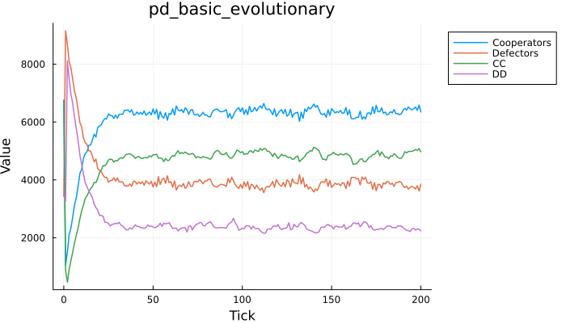
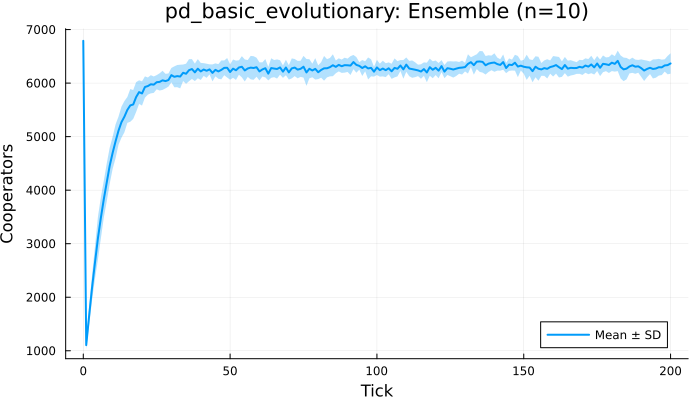
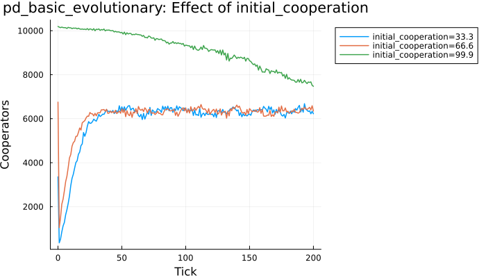

## Overview

### WHAT IS IT?

One of the most prominently studied phenomena in Game Theory is the "Prisoner's Dilemma."  The Prisoner's Dilemma, which was formulated by Melvin Drescher and Merrill Flood and named by Albert W. Tucker, is an example of a class of games called non-zero-sum games.

In zero-sum games, total benefit to all players add up to zero, or in other words, each player can only benefit at the expense of other players (e.g. chess, football, poker --- one person can only win when the opponent loses).  On the other hand, in non-zero-games, each person's benefit does not necessarily come at the expense of someone else.  In many non-zero-sum situations, a person can benefit only when others benefit as well.  Non-zero-sum situations exist where the supply of a resource is not fixed or limited in any way (e.g. knowledge, artwork, and trade).  Prisoner's Dilemma, as a non-zero-sum game, demonstrates a conflict between rational individual behavior and the benefits of cooperation in certain situations.  The classical prisoner's dilemma is as follows:

Two suspects are apprehended by the police.  The police do have enough evidence to convict these two suspects.  As a result, they separate the two, visit each of them, and offer both the same deal:  "If you confess, and your accomplice remains silent, he goes to jail for 10 years and you can go free.  If you both remain silent, only minor charges can be brought upon both of you and you guys get 6 months each.  If you both confess, then each of you two gets 5 years."

Each suspect may reason as follows: "Either my partner confesses or not.  If he does confess and I remain silent, I get 10 years while if I confess, I get 5 years.  So, if my partner confesses, it is best that I confess and get only 5 years than 10 years in prison.  If he didn't, then by confessing, I go free, whereby remaining silent, I get 6 months.  Thus, if he didn't confess, it is best to confess, so that I can go free.   Whether or not my partner confesses or not, it is best that I confess."

In a non-iterated prisoner's dilemma, the two partners will never have to work together again.  Both partners are thinking in the above manner and decide to confess.  Consequently, they both receive 5 years in prison.  If neither would have confessed, they would have only gotten 6 months each.  The rational behavior paradoxically leads to a socially unbeneficial outcome.


                                 Payoff Matrix

### HOW IT WORKS

Each patch will either cooperate (blue) or defect (red) in the initial start of the model.  At each cycle, each patch will interact with all of its 8 neighbors to determine the score for the interaction.  Should a patch have cooperated, its score will be the number of neighbors that also cooperated.  Should a patch defect, then the score for this patch will be the product of the Defection-Award multiple and the number of neighbors that cooperated (i.e. the patch has taken advantage of the patches that cooperated).

In the subsequent round, the patch will set its old-cooperate? to be the strategy it used in the previous round.  For the upcoming round, the patch will adopt the strategy of one of its neighbors that scored the highest in the previous round.

If a patch is blue, then the patch cooperated in the previous and current round.  
If a patch is red, then the patch defected in the previous iteration as well as the current round.  
If a patch is green, then the patch cooperated in the previous round but defected in the current round.  
If a patch is yellow, then the patch defected in the previous round but cooperated in the current round.

### THINGS TO NOTICE

Notice the effect the Defection-Award multiple plays in determining the number of patches that will completely cooperate (red) or completely defect (blue). At what Defection-Award multiple value will a patch be indifferent to defecting or cooperating?  At what Defection-Award multiple value will there be a dynamic change between red, blue, green, and yellow - where in the end of the model no particular color dominates all of the patches (i.e. view is not all red or all blue)?

Note the Initial-Cooperation percentage.  Given that Defection-Award multiple is low (below 1), if the initial percentage of cooperating patches is high, will there be more defecting or cooperating patches eventually?  How about when the Defection-Award multiple is high?  Does the initial percentage of cooperation effect the outcome of the model, and, if so, how?

### THINGS TO TRY

Increase the Defection-Award multiple by moving the "Defection-Award" slider (just increase the "Defection-Award" slider while model is running), and observe how the histogram for each color of patch changes. In particular, pay attention to the red and blue bars.  Does the number of pure cooperation or defection decrease or increase with the increase of the Defection-Award multiple?  How about with a decrease of the Defection-Award multiple? (Just increase the "Defection-Award" slider while model is running.)

At each start of the model, either set the initial-cooperation percentage to be very high or very low (move the slider for "initial-cooperation"), and proportionally value the Defection-Award multiple (move the slider for "Defection-Award" in the same direction) with regards to the initial-cooperation percentage.  Which color dominates the world, when the initial-cooperation is high and the Defection-Award is high?  Which color dominates the world when initial-cooperation is low and the Defection-Award multiple is also low?

### EXTENDING THE MODEL

Alter the code so that the patches have a strategy to implement.  For example, instead of adopting to cooperated or defect based on the neighboring patch with the maximum score.  Instead, let each patch consider the history of cooperation or defection of it neighboring patches, and allow it to decide whether to cooperate or defect as a result.

Implement these four strategies:

1. Cooperate-all-the-time: regardless of neighboring patches' history, cooperate.  
2. Tit-for-Tat:  only cooperate with neighboring patches, if they have never defected.  Otherwise, defect.  
3. Tit-for-Tat-with-forgiveness: cooperate if on the previous round, the patch cooperated.  Otherwise, defect.  
4. Defect-all-the-time: regardless of neighboring patches' history, defect.

How are the cooperating and defecting patches distributed?  Which strategy results with the highest score on average?  On what conditions will this strategy be a poor strategy to use?

### HOW TO CITE

If you mention this model in a publication, we ask that you include these citations for the model itself and for the NetLogo software:

* Wilensky, U. (2002).  NetLogo PD Basic Evolutionary model.  http://ccl.northwestern.edu/netlogo/models/PDBasicEvolutionary.  Center for Connected Learning and Computer-Based Modeling, Northwestern Institute on Complex Systems, Northwestern University, Evanston, IL.
* Wilensky, U. (1999). NetLogo. http://ccl.northwestern.edu/netlogo/. Center for Connected Learning and Computer-Based Modeling, Northwestern Institute on Complex Systems, Northwestern University, Evanston, IL.

### COPYRIGHT AND LICENSE

Copyright 2002 Uri Wilensky.


This work is licensed under the Creative Commons Attribution-NonCommercial-ShareAlike 3.0 License.  To view a copy of this license, visit http://creativecommons.org/licenses/by-nc-sa/3.0/ or send a letter to Creative Commons, 559 Nathan Abbott Way, Stanford, California 94305, USA.

Commercial licenses are also available. To inquire about commercial licenses, please contact Uri Wilensky at uri@northwestern.edu.

This model was created as part of the projects: PARTICIPATORY SIMULATIONS: NETWORK-BASED DESIGN FOR SYSTEMS LEARNING IN CLASSROOMS and/or INTEGRATED SIMULATION AND MODELING ENVIRONMENT. The project gratefully acknowledges the support of the National Science Foundation (REPP & ROLE programs) -- grant numbers REC #9814682 and REC-0126227.

## Parameters

| Parameter | Type | Default | Description |
|-----------|------|---------|-------------|
| `initial_cooperation` | `Float64` | `66.6` | percent of patches that cooperate initially |
| `defection_award` | `Float64` | `1.59` | multiplier for defectors |
| `grid_width` | `Int` | `101` | -50..50 = 101 patches |
| `grid_height` | `Int` | `101` | grid height |
| `max_ticks` | `Int` | `200` | max ticks |

## Source Code

The Julia code to run this model:

```julia
using ArkModelZoo
_, trajectory = run_pd_basic_evolutionary()
```

## Time Series

{width=100%}

## Ensemble Runs

Ten replicates with different random seeds, showing mean ± standard deviation.

{width=100%}

## Parameter Sensitivity

Varying `initial_cooperation`.

{width=100%}


## Appendix: Source Code

This model is implemented in the [Ark.jl](https://github.com/sdwfrost/Ark.jl) Entity-Component-System (ECS) framework. The code is split into five files, each with a distinct role:

- **Parameters**: a mutable struct holding all configurable values.
- **Components**: lightweight data types attached to individual entities (agents).
- **Resources**: world-level shared state accessible to all systems.
- **Systems**: functions that operate on entities each tick, defining model behavior.
- **Model**: wiring that assembles the world, registers resources and systems, and provides the run entry point.

### Parameters (`parameters.jl`)

The parameter struct uses `@kwdef` so that every field has a default value and can be overridden by keyword. These defaults match the original NetLogo model's slider settings.

```julia
Base.@kwdef mutable struct PDEParams
    initial_cooperation::Float64 = 66.6   # percent of patches that cooperate initially
    defection_award::Float64 = 1.59       # multiplier for defectors
    grid_width::Int = 101                 # -50..50 = 101 patches
    grid_height::Int = 101
    max_ticks::Int = 200
    seed::Int = 42
end
```

### Components (`components.jl`)

Components are lightweight data types attached to individual entities (agents). Mutable structs hold per-entity state, while empty tag structs act as markers for the ECS query system to efficiently filter entities.

```julia
# PD Basic Evolutionary is purely patch-based; no ECS agent components needed.
```

### Resources (`resources.jl`)

Resources are world-level singletons shared across all systems, used for global state and aggregate statistics.

```julia
mutable struct PDEGrid
    width::Int
    height::Int
    cooperate::Matrix{Bool}
    old_cooperate::Matrix{Bool}
    score::Matrix{Float64}
end

function PDEGrid(w::Int, h::Int)
    PDEGrid(w, h, falses(w, h), falses(w, h), zeros(w, h))
end

mutable struct PDEStats
    num_cooperators::Int
    num_defectors::Int
    num_cc::Int   # was C, still C (blue)
    num_dd::Int   # was D, still D (red)
    num_cd::Int   # was C, now D (green)
    num_dc::Int   # was D, now C (yellow)
end
PDEStats() = PDEStats(0, 0, 0, 0, 0, 0)
```

### Systems (`systems.jl`)

Systems contain the model logic and execute in a defined order each tick. Each system struct implements either `initialize!` (run once at setup) or `update!` (run every tick).

```julia
# --- Initialization ---

struct InitPDESystem <: System end

function initialize!(::InitPDESystem, world::World)
    params = get_resource(world, PDEParams)
    rng = get_resource(world, RNGResource).rng
    grid = get_resource(world, PDEGrid)
    w, h = grid.width, grid.height

    for x in 1:w, y in 1:h
        c = rand(rng) < (params.initial_cooperation / 100.0)
        grid.cooperate[x, y] = c
        grid.old_cooperate[x, y] = c
    end

    _pde_update_stats!(world)
    return nothing
end

# --- Go: interact + select-strategy ---

struct PDEGoSystem <: System end

function update!(::PDEGoSystem, world::World)
    params = get_resource(world, PDEParams)
    rng = get_resource(world, RNGResource).rng
    grid = get_resource(world, PDEGrid)
    w, h = grid.width, grid.height

    # interact: compute scores
    for x in 1:w, y in 1:h
        total_cooperators = moore_neighbor_count(identity, grid.cooperate, x, y, w, h)
        if grid.cooperate[x, y]
            grid.score[x, y] = Float64(total_cooperators)
        else
            grid.score[x, y] = params.defection_award * total_cooperators
        end
    end

    # select-strategy: save old, then adopt neighbor's strategy with max score
    # NetLogo processes patches in random order with immediate updates
    copyto!(grid.old_cooperate, grid.cooperate)

    # Random processing order (matching NetLogo's ask patches)
    positions = [(x, y) for x in 1:w for y in 1:h]
    Random.shuffle!(rng, positions)

    for (x, y) in positions
        best_score = -Inf
        best_candidates = Tuple{Int,Int}[]
        for dx in -1:1, dy in -1:1
            (dx == 0 && dy == 0) && continue
            nx = mod1(x + dx, w)
            ny = mod1(y + dy, h)
            s = grid.score[nx, ny]
            if s > best_score
                best_score = s
                empty!(best_candidates)
                push!(best_candidates, (nx, ny))
            elseif s == best_score
                push!(best_candidates, (nx, ny))
            end
        end
        # Random tie-breaking (matching NetLogo's max-one-of)
        if !isempty(best_candidates)
            chosen = best_candidates[rand(rng, 1:length(best_candidates))]
            grid.cooperate[x, y] = grid.cooperate[chosen[1], chosen[2]]
        end
    end

    _pde_update_stats!(world)
    return nothing
end

function _pde_update_stats!(world::World)
    grid = get_resource(world, PDEGrid)
    stats = get_resource(world, PDEStats)
    w, h = grid.width, grid.height

    nc = 0; nd = 0; cc = 0; dd = 0; cd = 0; dc = 0
    for x in 1:w, y in 1:h
        old_c = grid.old_cooperate[x, y]
        new_c = grid.cooperate[x, y]
        if new_c
            nc += 1
        else
            nd += 1
        end
        if old_c && new_c
            cc += 1
        elseif !old_c && !new_c
            dd += 1
        elseif old_c && !new_c
            cd += 1
        else
            dc += 1
        end
    end
    stats.num_cooperators = nc
    stats.num_defectors = nd
    stats.num_cc = cc
    stats.num_dd = dd
    stats.num_cd = cd
    stats.num_dc = dc
    return nothing
end

# --- Termination ---

struct PDETerminationSystem <: System end

function update!(::PDETerminationSystem, world::World)
    params = get_resource(world, PDEParams)
    tick = get_resource(world, Tick)
    if tick.tick + 1 >= params.max_ticks
        get_resource(world, Terminate).stop = true
    end
    return nothing
end
```

### Model (`model.jl`)

The model file assembles all pieces: it creates the ECS `World` with the required component types, registers resources, builds the `Scheduler` with systems in execution order, and exposes the public `run` entry point. The observer pattern records the trajectory each tick.

```julia
function pde_world(; initial_capacity::Int = 64)
    return World(; initial_capacity = initial_capacity, allow_mutable = true)
end

function pde_systems()
    return (
        InitPDESystem(),
        PDEGoSystem(),
        PDETerminationSystem(),
    )
end

function pde_model(params::PDEParams = PDEParams())
    world = pde_world()
    _add_standard_resources!(world, params)
    add_resource!(world, PDEGrid(params.grid_width, params.grid_height))
    add_resource!(world, PDEStats())
    scheduler = Scheduler(world, pde_systems())
    initialize!(scheduler)
    return scheduler
end

struct PDEObserver end

function pde_headers(::PDEObserver)
    return ["Cooperators", "Defectors", "CC", "DD"]
end

function pde_values(::PDEObserver, world::World)
    stats = get_resource(world, PDEStats)
    return Float64[stats.num_cooperators, stats.num_defectors,
                    stats.num_cc, stats.num_dd]
end

function run_pd_basic_evolutionary(; params::PDEParams = PDEParams(), observe::Bool = true)
    return _run_model(pde_model, PDEObserver(), pde_values; params, observe)
end
```
