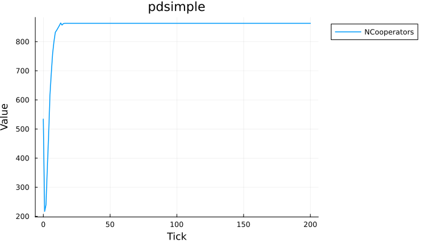
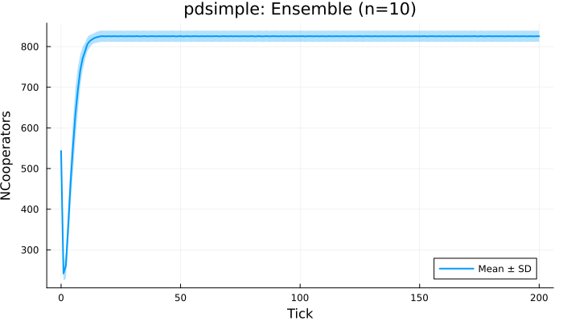
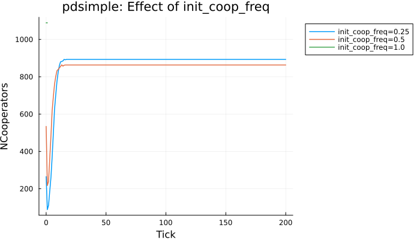

# PD Simple


- [Overview](#overview)
- [Parameters](#parameters)
- [Source Code](#source-code)
- [Time Series](#time-series)
- [Ensemble Runs](#ensemble-runs)
- [Parameter Sensitivity](#parameter-sensitivity)
- [Appendix: Source Code](#appendix-source-code)
  - [Parameters (`parameters.jl`)](#parameters-parametersjl)
  - [Components (`components.jl`)](#components-componentsjl)
  - [Resources (`resources.jl`)](#resources-resourcesjl)
  - [Systems (`systems.jl`)](#systems-systemsjl)
  - [Model (`model.jl`)](#model-modeljl)

## Overview

This vignette demonstrates the **PD Simple** model implemented in
[ArkModelZoo.jl](https://github.com/sdwfrost/ArkModelZoo.jl) using the
Ark.jl ECS framework.

## Parameters

| Parameter        | Type      | Default | Description                |
|------------------|-----------|---------|----------------------------|
| `init_coop_freq` | `Float64` | `0.5`   | init coop freq             |
| `payoff_benefit` | `Float64` | `1.0`   | payoff benefit             |
| `payoff_cost`    | `Float64` | `0.1`   | payoff cost                |
| `grid_size`      | `Int`     | `33`    | 33x33 grid (-16,16,-16,16) |
| `max_ticks`      | `Int`     | `200`   | max ticks                  |

## Source Code

The Julia code to run this model:

``` julia
using ArkModelZoo
_, trajectory = run_pdsimple()
```

## Time Series



## Ensemble Runs

Ten replicates with different random seeds, showing mean ± standard
deviation.



## Parameter Sensitivity

Varying `init_coop_freq`.



## Appendix: Source Code

This model is implemented in the
[Ark.jl](https://github.com/sdwfrost/Ark.jl) Entity-Component-System
(ECS) framework. The code is split into five files, each with a distinct
role:

- **Parameters**: a mutable struct holding all configurable values.
- **Components**: lightweight data types attached to individual entities
  (agents).
- **Resources**: world-level shared state accessible to all systems.
- **Systems**: functions that operate on entities each tick, defining
  model behavior.
- **Model**: wiring that assembles the world, registers resources and
  systems, and provides the run entry point.

### Parameters (`parameters.jl`)

The parameter struct uses `@kwdef` so that every field has a default
value and can be overridden by keyword. These defaults match the
original NetLogo model’s slider settings.

``` julia
Base.@kwdef mutable struct PDSimpleParams
    init_coop_freq::Float64 = 0.5
    payoff_benefit::Float64 = 1.0
    payoff_cost::Float64 = 0.1
    grid_size::Int = 33   # 33x33 grid (-16,16,-16,16)
    max_ticks::Int = 200
    seed::Int = 42
end
```

### Components (`components.jl`)

Components are lightweight data types attached to individual entities
(agents). Mutable structs hold per-entity state, while empty tag structs
act as markers for the ECS query system to efficiently filter entities.

``` julia
struct PDSDummy end
```

### Resources (`resources.jl`)

Resources are world-level singletons shared across all systems, used for
global state and aggregate statistics.

``` julia
mutable struct PDSGrid
    width::Int
    height::Int
    strategy::Matrix{Int}     # 0=defect, 1=cooperate
    payoff::Matrix{Float64}
end

function PDSGrid(w::Int, h::Int)
    PDSGrid(w, h, zeros(Int, w, h), zeros(Float64, w, h))
end

mutable struct PDSStats
    n_cooperators::Int
end
PDSStats() = PDSStats(0)
```

### Systems (`systems.jl`)

Systems contain the model logic and execute in a defined order each
tick. Each system struct implements either `initialize!` (run once at
setup) or `update!` (run every tick).

``` julia
struct InitPDSSystem <: System end

function initialize!(::InitPDSSystem, world::World)
    params = get_resource(world, PDSimpleParams)
    rng = get_resource(world, RNGResource).rng
    grid = get_resource(world, PDSGrid)
    stats = get_resource(world, PDSStats)
    w, h = grid.width, grid.height

    n_coop = 0
    for x in 1:w, y in 1:h
        if rand(rng) < params.init_coop_freq
            grid.strategy[x, y] = 1
            n_coop += 1
        else
            grid.strategy[x, y] = 0
        end
        grid.payoff[x, y] = 0.0
    end
    stats.n_cooperators = n_coop
    return nothing
end

# --- Play Game ---

struct PDSPlayGameSystem <: System end

function update!(::PDSPlayGameSystem, world::World)
    params = get_resource(world, PDSimpleParams)
    grid = get_resource(world, PDSGrid)
    stats = get_resource(world, PDSStats)
    w, h = grid.width, grid.height
    strategy = grid.strategy
    payoff = grid.payoff

    # Early termination check: all same strategy
    n_coop = stats.n_cooperators
    total = w * h
    if n_coop == 0 || n_coop == total
        get_resource(world, Terminate).stop = true
        return nothing
    end

    b = params.payoff_benefit
    c = params.payoff_cost

    for x in 1:w, y in 1:h
        # Count cooperating and defecting neighbors (Von Neumann, toroidal)
        n_C = 0
        n_D = 0
        for (dx, dy) in ((0, 1), (1, 0), (0, -1), (-1, 0))
            nx = mod1(x + dx, w)
            ny = mod1(y + dy, h)
            if strategy[nx, ny] == 1
                n_C += 1
            else
                n_D += 1
            end
        end

        if strategy[x, y] == 1
            payoff[x, y] = n_C * (b - c) - n_D * c
        else
            payoff[x, y] = n_C * b
        end
    end
    return nothing
end

# --- Evolve ---

struct PDSEvolveSystem <: System end

function update!(::PDSEvolveSystem, world::World)
    rng = get_resource(world, RNGResource).rng
    grid = get_resource(world, PDSGrid)
    stats = get_resource(world, PDSStats)
    w, h = grid.width, grid.height
    strategy = grid.strategy
    payoff = grid.payoff

    # Check if terminated (all same strategy)
    term = get_resource(world, Terminate)
    term.stop && return nothing

    # Random order iteration
    perm = randperm(rng, w * h)
    for idx in perm
        y = (idx - 1) ÷ w + 1
        x = (idx - 1) % w + 1

        my_payoff = payoff[x, y]

        # Find best neighbor (Von Neumann, toroidal)
        best_payoff = -Inf
        best_x, best_y = x, y
        for (dx, dy) in ((0, 1), (1, 0), (0, -1), (-1, 0))
            nx = mod1(x + dx, w)
            ny = mod1(y + dy, h)
            if payoff[nx, ny] > best_payoff
                best_payoff = payoff[nx, ny]
                best_x, best_y = nx, ny
            end
        end

        # Copy strategy if neighbor is better
        if best_payoff > my_payoff
            strategy[x, y] = strategy[best_x, best_y]
        end
    end

    # Update cooperator count
    n_coop = 0
    for i in eachindex(strategy)
        if strategy[i] == 1
            n_coop += 1
        end
    end
    stats.n_cooperators = n_coop

    return nothing
end

# --- Termination ---

struct PDSTerminationSystem <: System end

function update!(::PDSTerminationSystem, world::World)
    params = get_resource(world, PDSimpleParams)
    tick = get_resource(world, Tick)
    if tick.tick + 1 >= params.max_ticks
        get_resource(world, Terminate).stop = true
    end
    return nothing
end
```

### Model (`model.jl`)

The model file assembles all pieces: it creates the ECS `World` with the
required component types, registers resources, builds the `Scheduler`
with systems in execution order, and exposes the public `run` entry
point. The observer pattern records the trajectory each tick.

``` julia
function pdsimple_world(; initial_capacity::Int = 128)
    return World(PDSDummy; initial_capacity=initial_capacity, allow_mutable=true)
end

function pdsimple_systems()
    return (
        InitPDSSystem(),
        PDSPlayGameSystem(),
        PDSEvolveSystem(),
        PDSTerminationSystem(),
    )
end

function pdsimple_model(params::PDSimpleParams = PDSimpleParams())
    world = pdsimple_world()
    _add_standard_resources!(world, params)
    add_resource!(world, PDSGrid(params.grid_size, params.grid_size))
    add_resource!(world, PDSStats())
    scheduler = Scheduler(world, pdsimple_systems())
    initialize!(scheduler)
    return scheduler
end

struct PDSimpleObserver end

function pdsimple_headers(::PDSimpleObserver)
    return ["NCooperators"]
end

function pdsimple_values(::PDSimpleObserver, world::World)
    stats = get_resource(world, PDSStats)
    return Float64[stats.n_cooperators]
end

function run_pdsimple(; params::PDSimpleParams = PDSimpleParams(), observe::Bool = true)
    return _run_model(pdsimple_model, PDSimpleObserver(), pdsimple_values; params, observe)
end
```
