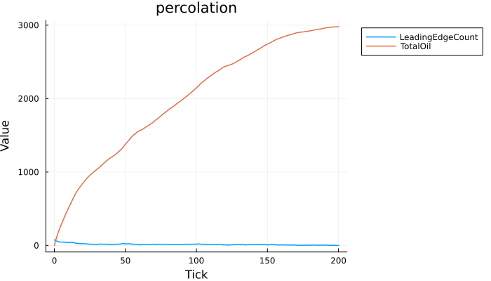
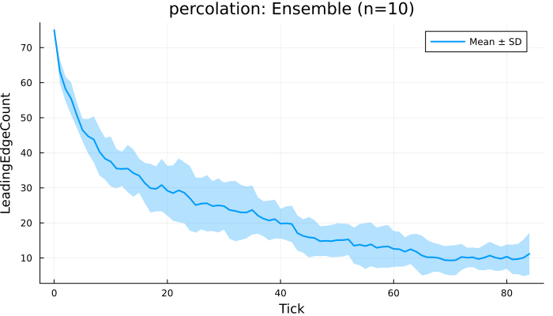
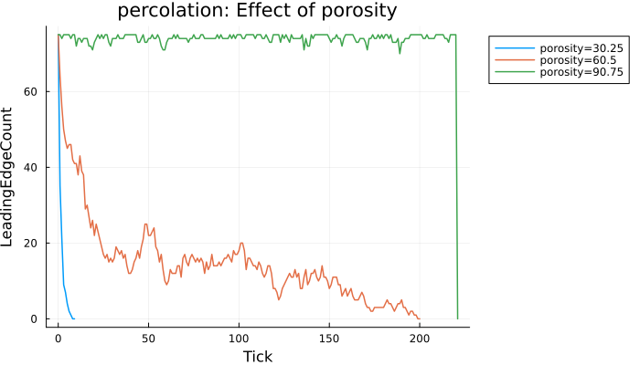

## Overview

### WHAT IS IT?

This model shows how an oil spill can percolate down through permeable soil.  It was inspired by a similar model meant to be done by hand on paper (see "Forest Fires, Oil Spills, and Fractal Geometry", Mathematics Teacher, Nov. 1998, p. 684-5).

### HOW IT WORKS

The soil is modeled as a checkerboard of hard particles (gray squares) and semi-permeable spaces in between these hard particles (brown squares).  (You may need to zoom in to see the individual squares.)

Oil cannot enter the solid gray squares, but it may pass through the brown squares.

Some soils are more porous ("holey") than other soils.  In this model the porosity value of the soil determines the probability that the oil will be able to enter any given brown soil square.

The model represents an oil spill as a finite number of oil "particles", or simply oil drops.

The oil spill starts at the top of the view, and percolates downward.

The leading edge of the oil spill is represented by red squares, and every square that oil has passed through (or "saturated") is shown as black.

The oil drops sink downward through the soil by moving diagonally to the right or left, slipping between the hard gray particles.

### THINGS TO NOTICE

Try different settings for the porosity.  What do you notice about the pattern of affected soil?  Can you find a setting where the oil just keeps sinking, and a setting where it just stops?

If percolation stops at a certain porosity, it's still possible that it would percolate further at that porosity given a wider view.

Note the plot of the size of the leading edge of oil.  Does the value settle down roughly to a constant?  How does this value depend on the porosity?

### EXTENDING THE MODEL

Give the soil different porosity at different depths.  How does it affect the flow?  In a real situation, if you took soil samples, Could you reliably predict how deep an oil spill would go or be likely to go?

Currently, the model is set so that the user has no control over how much oil will spill.  Try adding a feature that will allow the user to specify precisely, when s/he presses SETUP, the amount of oil that will spill on that go.  For instance, a slider may be useful here, but you'd have to modify the code to accommodate this new slider.  Such control over the to-be-spilled amount of oil gives the user a basis to predict how deep the oil will eventually percolate (i.e. how many empty spaces it will fill up).  But then again, the depth of the spill is related to the soil's porosity.  Can you predict the depth of the spill before you press GO?

### NETLOGO FEATURES

This is a good example of a cellular automaton, because it uses only patches.  It also uses a simple random-number generator to give a probability, which in turn determines the average large-scale behavior.

This is also a simple example of how plots can be used to reveal, graphically, the average behavior of a model as it unfolds.

In the pen-and-paper activity the soil was represented by rectangles arranged in a brickwork pattern, where each rectangular cell had two neighboring rectangular cells below it.  Since NetLogo's patches are always squares in an aligned grid, our replica of the model uses a checkerboard pattern instead.  Can you see how the two models would have the same behavior, despite having different ways of visualizing them?

### RELATED MODELS

"Fire" is a similar model.  In both cases, there is a rather sharp cutoff between halting and spreading forever.

This model qualifies as a "stochastic" or "probabilistic" one-dimension cellular automaton.  For more information, see the "CA Stochastic" model.

### HOW TO CITE

If you mention this model or the NetLogo software in a publication, we ask that you include the citations below.

For the model itself:

* Wilensky, U. (1998).  NetLogo Percolation model.  http://ccl.northwestern.edu/netlogo/models/Percolation.  Center for Connected Learning and Computer-Based Modeling, Northwestern University, Evanston, IL.

Please cite the NetLogo software as:

* Wilensky, U. (1999). NetLogo. http://ccl.northwestern.edu/netlogo/. Center for Connected Learning and Computer-Based Modeling, Northwestern University, Evanston, IL.

### COPYRIGHT AND LICENSE

Copyright 1998 Uri Wilensky.


This model is licensed under the Creative Commons Attribution-NonCommercial-ShareAlike 3.0 License.  To view a copy of this license, visit https://creativecommons.org/licenses/by-nc-sa/3.0/ or send a letter to Creative Commons, 559 Nathan Abbott Way, Stanford, California 94305, USA.

NetLogo itself is free software for non-commercial use under the terms of the GNU General Public License ([see full license information here](https://ccl.northwestern.edu/netlogo/docs/copyright.html)).

To inquire about commercial licenses for either NetLogo or specific models from the models library, please contact netlogo-commercial-admin@ccl.northwestern.edu.

This model was created as part of the project: CONNECTED MATHEMATICS: MAKING SENSE OF COMPLEX PHENOMENA THROUGH BUILDING OBJECT-BASED PARALLEL MODELS (OBPML).  The project gratefully acknowledges the support of the National Science Foundation (Applications of Advanced Technologies Program) -- grant numbers RED #9552950 and REC #9632612.

This model was converted to NetLogo as part of the projects: PARTICIPATORY SIMULATIONS: NETWORK-BASED DESIGN FOR SYSTEMS LEARNING IN CLASSROOMS and/or INTEGRATED SIMULATION AND MODELING ENVIRONMENT. The project gratefully acknowledges the support of the National Science Foundation (REPP & ROLE programs) -- grant numbers REC #9814682 and REC-0126227. Converted from StarLogoT to NetLogo, 2001.

<!-- 1998 2001 -->

## Parameters

| Parameter | Type | Default | Description |
|-----------|------|---------|-------------|
| `porosity` | `Float64` | `60.5` | percent chance oil enters a brown cell |
| `grid_width` | `Int` | `150` | 0..149 |
| `grid_height` | `Int` | `221` | 0..220 |
| `max_ticks` | `Int` | `2000` | max ticks |

## Source Code

The Julia code to run this model:

```julia
using ArkModelZoo
_, trajectory = run_percolation()
```

## Time Series

{width=100%}

## Ensemble Runs

Ten replicates with different random seeds, showing mean ± standard deviation.

{width=100%}

## Parameter Sensitivity

Varying `porosity`.

{width=100%}


## Appendix: Source Code

This model is implemented in the [Ark.jl](https://github.com/sdwfrost/Ark.jl) Entity-Component-System (ECS) framework. The code is split into five files, each with a distinct role:

- **Parameters**: a mutable struct holding all configurable values.
- **Components**: lightweight data types attached to individual entities (agents).
- **Resources**: world-level shared state accessible to all systems.
- **Systems**: functions that operate on entities each tick, defining model behavior.
- **Model**: wiring that assembles the world, registers resources and systems, and provides the run entry point.

### Parameters (`parameters.jl`)

The parameter struct uses `@kwdef` so that every field has a default value and can be overridden by keyword. These defaults match the original NetLogo model's slider settings.

```julia
Base.@kwdef mutable struct PERCParams
    porosity::Float64 = 60.5    # percent chance oil enters a brown cell
    grid_width::Int = 150       # 0..149
    grid_height::Int = 221      # 0..220
    max_ticks::Int = 2000
    seed::Int = 42
end
```

### Components (`components.jl`)

Components are lightweight data types attached to individual entities (agents). Mutable structs hold per-entity state, while empty tag structs act as markers for the ECS query system to efficiently filter entities.

```julia
# Percolation is a patch-only model; use a dummy component for ECS world
mutable struct PERCDummy
    val::Int
end
PERCDummy() = PERCDummy(0)
```

### Resources (`resources.jl`)

Resources are world-level singletons shared across all systems, used for global state and aggregate statistics.

```julia
# Percolation uses a pure grid model (no turtle entities)
# cell states: 0=hard(gray), 1=permeable(brown), 2=leading_edge(red), 3=saturated(black)
const PERC_HARD = 0
const PERC_PERM = 1
const PERC_EDGE = 2
const PERC_SAT  = 3

mutable struct PERCGrid
    width::Int
    height::Int
    cells::Matrix{Int}
    current_row::Int     # which row is the current leading edge (1=top)
    total_oil::Int
end

function PERCGrid(w::Int, h::Int)
    cells = Matrix{Int}(undef, w, h)
    # Checkerboard: (x+y) odd -> permeable(brown), even -> hard(gray)
    for x in 1:w, y in 1:h
        cells[x, y] = (x + y) % 2 == 0 ? PERC_HARD : PERC_PERM
    end
    PERCGrid(w, h, cells, 1, 0)
end

mutable struct PERCStats
    leading_edge_count::Int
    total_oil::Int
end
PERCStats() = PERCStats(0, 0)
```

### Systems (`systems.jl`)

Systems contain the model logic and execute in a defined order each tick. Each system struct implements either `initialize!` (run once at setup) or `update!` (run every tick).

```julia
# --- Initialization ---

struct InitPERCSystem <: System end

function initialize!(::InitPERCSystem, world::World)
    grid = get_resource(world, PERCGrid)
    # Set up top row: odd x-positions in row 1 become leading edge (red)
    grid.current_row = 1
    for x in 1:grid.width
        if x % 2 == 0  # NetLogo: pxcor mod 2 = 1 (0-indexed), our 1-indexed: x%2==0
            if grid.cells[x, 1] == PERC_PERM
                grid.cells[x, 1] = PERC_EDGE
            end
        end
    end
    _perc_update_stats!(world)
    return nothing
end

function _perc_update_stats!(world::World)
    grid = get_resource(world, PERCGrid)
    stats = get_resource(world, PERCStats)
    edge_count = 0
    for x in 1:grid.width
        if grid.current_row >= 1 && grid.current_row <= grid.height
            if grid.cells[x, grid.current_row] == PERC_EDGE
                edge_count += 1
            end
        end
    end
    stats.leading_edge_count = edge_count
    stats.total_oil = grid.total_oil
end

# --- Go ---

struct PERCGoSystem <: System end

function update!(::PERCGoSystem, world::World)
    params = get_resource(world, PERCParams)
    rng = get_resource(world, RNGResource).rng
    grid = get_resource(world, PERCGrid)
    w, h = grid.width, grid.height
    row = grid.current_row

    # Check if any red cells in current row
    has_edge = false
    for x in 1:w
        if row >= 1 && row <= h && grid.cells[x, row] == PERC_EDGE
            has_edge = true
            break
        end
    end

    if !has_edge
        get_resource(world, Terminate).stop = true
        _perc_update_stats!(world)
        return nothing
    end

    # Percolate: each red cell tries to spread to two cells below (diagonally)
    next_row = row + 1
    if next_row <= h
        for x in 1:w
            if grid.cells[x, row] == PERC_EDGE
                # Try southwest (-1, +1) and southeast (+1, +1)
                for dx in [-1, 1]
                    nx = x + dx
                    if nx >= 1 && nx <= w
                        if grid.cells[nx, next_row] == PERC_PERM
                            if rand(rng) * 100.0 < params.porosity
                                grid.cells[nx, next_row] = PERC_EDGE
                            end
                        end
                    end
                end
                grid.cells[x, row] = PERC_SAT
                grid.total_oil += 1
            end
        end
        grid.current_row = next_row
    else
        # Wrap: move bottom to top (camera pan)
        for x in 1:w
            if grid.cells[x, row] == PERC_EDGE
                grid.cells[x, row] = PERC_SAT
                grid.total_oil += 1
            end
        end
        # Copy the state of the row that would be "below" to the top
        # Reset grid and continue from top
        new_top = Matrix{Int}(undef, w, h)
        for x in 1:w, y in 1:h
            new_top[x, y] = (x + y) % 2 == 0 ? PERC_HARD : PERC_PERM
        end
        # Keep current_row's edge info at top
        for x in 1:w
            if row <= h && grid.cells[x, row] == PERC_SAT
                # The row below (wrapped) keeps its state
            end
        end
        grid.cells = new_top
        grid.current_row = 1
        # Check if anything to continue
        has_new_edge = false
        for x in 1:w
            if grid.cells[x, 1] == PERC_EDGE
                has_new_edge = true
                break
            end
        end
        if !has_new_edge
            get_resource(world, Terminate).stop = true
        end
    end

    _perc_update_stats!(world)
    return nothing
end

# --- Termination ---

struct PERCTerminationSystem <: System end

function update!(::PERCTerminationSystem, world::World)
    params = get_resource(world, PERCParams)
    tick = get_resource(world, Tick)
    if tick.tick + 1 >= params.max_ticks
        get_resource(world, Terminate).stop = true
    end
    return nothing
end
```

### Model (`model.jl`)

The model file assembles all pieces: it creates the ECS `World` with the required component types, registers resources, builds the `Scheduler` with systems in execution order, and exposes the public `run` entry point. The observer pattern records the trajectory each tick.

```julia
function percolation_world(; initial_capacity::Int = 64)
    return World(PERCDummy; initial_capacity = initial_capacity, allow_mutable = true)
end

function percolation_systems()
    return (InitPERCSystem(), PERCGoSystem(), PERCTerminationSystem())
end

function percolation_model(params::PERCParams = PERCParams())
    world = percolation_world()
    _add_standard_resources!(world, params)
    add_resource!(world, PERCGrid(params.grid_width, params.grid_height))
    add_resource!(world, PERCStats())
    scheduler = Scheduler(world, percolation_systems())
    initialize!(scheduler)
    return scheduler
end

struct PERCObserver end

function percolation_headers(::PERCObserver)
    return ["LeadingEdgeCount", "TotalOil"]
end

function percolation_values(::PERCObserver, world::World)
    stats = get_resource(world, PERCStats)
    return Float64[Float64(stats.leading_edge_count), Float64(stats.total_oil)]
end

function run_percolation(; params::PERCParams = PERCParams(), observe::Bool = true)
    return _run_model(percolation_model, PERCObserver(), percolation_values; params, observe)
end
```
