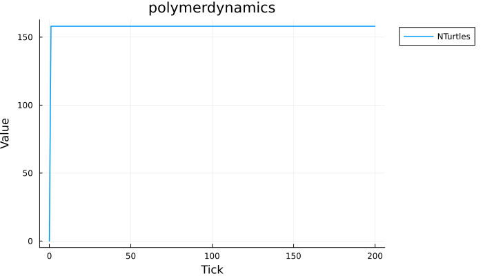
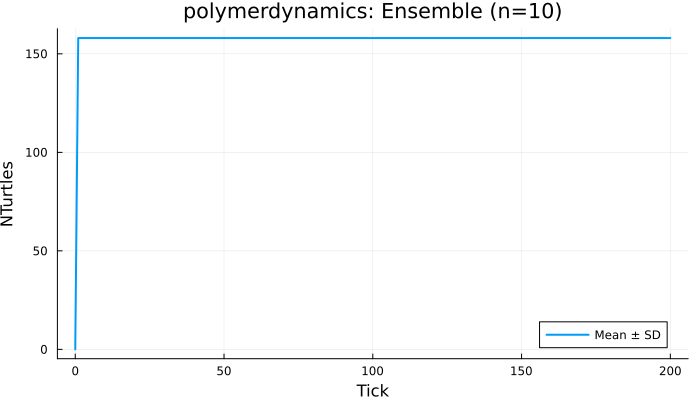

# Polymer Dynamics


- [Overview](#overview)
  - [WHAT IS IT?](#what-is-it)
  - [HOW IT WORKS](#how-it-works)
  - [THINGS TO NOTICE](#things-to-notice)
  - [THINGS TO TRY](#things-to-try)
  - [EXTENDING THE MODEL](#extending-the-model)
  - [NETLOGO FEATURES](#netlogo-features)
  - [RELATED MODELS](#related-models)
  - [CREDITS AND REFERENCES](#credits-and-references)
  - [HOW TO CITE](#how-to-cite)
  - [COPYRIGHT AND LICENSE](#copyright-and-license)
- [Parameters](#parameters)
- [Source Code](#source-code)
- [Time Series](#time-series)
- [Ensemble Runs](#ensemble-runs)
- [Appendix: Source Code](#appendix-source-code)
  - [Parameters (`parameters.jl`)](#parameters-parametersjl)
  - [Components (`components.jl`)](#components-componentsjl)
  - [Resources (`resources.jl`)](#resources-resourcesjl)
  - [Systems (`systems.jl`)](#systems-systemsjl)
  - [Model (`model.jl`)](#model-modeljl)

## Overview

### WHAT IS IT?

This model simulates the motion of a simple polymer. Polymers are simply
long chains of identical, smaller molecules called monomers, which often
have some mobility, causing many polymers to be flexible. Many common
materials and chemical substances are polymers, for example plastics and
proteins.

### HOW IT WORKS

The polymer is modeled using an approach involving only local
interactions.

Initially the monomers are colored alternating orange and blue. Blue
monomers interact only with their two neighboring orange monomers, and
vice versa.

Movement occurs in two alternating phases, one for the orange monomers,
one for the blue. For each monomer (of the appropriate color) a random
direction to move in is chosen. Before making the actual move we check
if the move would cause the chain to either break or cross itself. If
not, the monomer moves one step in that direction.

To check if a move will break the chain, we see if the moving monomer
will leave a blank patch behind it. To check if it will cross the chain,
we see if the movement will cause the monomer to be next to another
piece of the chain in front of it.

### THINGS TO NOTICE

One interesting thing to notice is that, despite all the interactions
being local, the polymer has a very realistic macroscopic movement.

### THINGS TO TRY

Try a much longer polymer. This is done by making the world size bigger.
(You’ll probably want to reduce the patch size.)

Slow down the simulation, and observe the local interaction closely.

Activate the 3D view, and try to follow a turtle.

### EXTENDING THE MODEL

Measure the distance between the two ends of the polymer and plot how it
changes over time.

Are other movement rules possible, without causing the chain to break or
cross?

Try having different mobility for different kinds of monomers.

Make a preferential direction for movement, determined by a slider.

Allow monomers to break apart from the polymer, in some particular
situations. Why might this happen?

### NETLOGO FEATURES

In order for the model to operate correctly on a torus, the dimensions
of the world must be even, so we put the world origin in the corner.

### RELATED MODELS

Although this model is not strictly a cellular automata because it uses
both patches and turtles, it is similar to them:

- CA 1D Elementary - an introduction to cellular automata
- Life Turtle-Based - a cellular automaton implemented using turtles

Radical Polymerization - another model about polymers

### CREDITS AND REFERENCES

For a detailed treatment of this model, see Yaneer Bar-Yam, Dynamics of
Complex Systems (2003), pages 496-502. Westview Press, Boulder, CO. The
book is available online at
https://necsi.edu/dynamics-of-complex-systems.

See also Y. Bar-Yam, Y. Rabin, M. A. Smith, Macromolecules Rep. 25
(1992) 2985.

### HOW TO CITE

If you mention this model or the NetLogo software in a publication, we
ask that you include the citations below.

For the model itself:

- Wilensky, U. (2005). NetLogo Polymer Dynamics model.
  http://ccl.northwestern.edu/netlogo/models/PolymerDynamics. Center for
  Connected Learning and Computer-Based Modeling, Northwestern
  University, Evanston, IL.

Please cite the NetLogo software as:

- Wilensky, U. (1999). NetLogo. http://ccl.northwestern.edu/netlogo/.
  Center for Connected Learning and Computer-Based Modeling,
  Northwestern University, Evanston, IL.

### COPYRIGHT AND LICENSE

Copyright 2005 Uri Wilensky.


This model is licensed under the Creative Commons
Attribution-NonCommercial-ShareAlike 3.0 License. To view a copy of this
license, visit https://creativecommons.org/licenses/by-nc-sa/3.0/ or
send a letter to Creative Commons, 559 Nathan Abbott Way, Stanford,
California 94305, USA.

NetLogo itself is free software for non-commercial use under the terms
of the GNU General Public License ([see full license information
here](https://ccl.northwestern.edu/netlogo/docs/copyright.html)).

To inquire about commercial licenses for either NetLogo or specific
models from the models library, please contact
netlogo-commercial-admin@ccl.northwestern.edu.

<!-- 2005 -->

## Parameters

| Parameter     | Type  | Default | Description |
|---------------|-------|---------|-------------|
| `grid_width`  | `Int` | `160`   | grid width  |
| `grid_height` | `Int` | `80`    | grid height |
| `max_ticks`   | `Int` | `200`   | max ticks   |

## Source Code

The Julia code to run this model:

``` julia
using ArkModelZoo
_, trajectory = run_polymerdynamics()
```

## Time Series



## Ensemble Runs

Ten replicates with different random seeds, showing mean ± standard
deviation.



## Appendix: Source Code

This model is implemented in the
[Ark.jl](https://github.com/sdwfrost/Ark.jl) Entity-Component-System
(ECS) framework. The code is split into five files, each with a distinct
role:

- **Parameters**: a mutable struct holding all configurable values.
- **Components**: lightweight data types attached to individual entities
  (agents).
- **Resources**: world-level shared state accessible to all systems.
- **Systems**: functions that operate on entities each tick, defining
  model behavior.
- **Model**: wiring that assembles the world, registers resources and
  systems, and provides the run entry point.

### Parameters (`parameters.jl`)

The parameter struct uses `@kwdef` so that every field has a default
value and can be overridden by keyword. These defaults match the
original NetLogo model’s slider settings.

``` julia
Base.@kwdef mutable struct PolymerDynamicsParams
    grid_width::Int = 160
    grid_height::Int = 80
    max_ticks::Int = 200
    seed::Int = 42
end
```

### Components (`components.jl`)

Components are lightweight data types attached to individual entities
(agents). Mutable structs hold per-entity state, while empty tag structs
act as markers for the ECS query system to efficiently filter entities.

``` julia
struct PolymerDummy end
```

### Resources (`resources.jl`)

Resources are world-level singletons shared across all systems, used for
global state and aggregate statistics.

``` julia
mutable struct PolymerGrid
    width::Int
    height::Int
    occupancy::Matrix{Int}  # count of turtles per cell
    blue_positions::Vector{Tuple{Int,Int}}
    orange_positions::Vector{Tuple{Int,Int}}
end

function PolymerGrid(w::Int, h::Int)
    PolymerGrid(w, h, zeros(Int, w, h), Tuple{Int,Int}[], Tuple{Int,Int}[])
end

mutable struct PolymerStats
    n_turtles::Int
end
PolymerStats() = PolymerStats(0)
```

### Systems (`systems.jl`)

Systems contain the model logic and execute in a defined order each
tick. Each system struct implements either `initialize!` (run once at
setup) or `update!` (run every tick).

``` julia
# --- Initialization ---

struct InitPolymerSystem <: System end

function initialize!(::InitPolymerSystem, world::World)
    params = get_resource(world, PolymerDynamicsParams)
    pgrid = get_resource(world, PolymerGrid)
    stats = get_resource(world, PolymerStats)

    # NetLogo coords: x=0..159, y=0..79; Julia 1-indexed: x=1..160, y=1..80
    # Turtles at pycor = round(79/2) = 40, pxcor in 1..158
    turtle_y = 41  # pycor 40 → Julia y 41

    for pxcor in 1:158
        jx = pxcor + 1  # NetLogo pxcor 1..158 → Julia 1-indexed (pxcor 0 → x=1)
        # item (pxcor mod 2) [blue orange]: 0→blue, 1→orange
        if pxcor % 2 == 0
            push!(pgrid.blue_positions, (jx, turtle_y))
        else
            push!(pgrid.orange_positions, (jx, turtle_y))
        end
        pgrid.occupancy[jx, turtle_y] = 1
    end

    # NetLogo doesn't set n-turtles in setup; it defaults to 0 until first go.
    stats.n_turtles = 0
    return nothing
end

# --- Movement helpers ---

# Direction indices: 1=N(heading 0), 2=E(heading 90), 3=S(heading 180), 4=W(heading 270)
const _POLY_DX = (0, 1, 0, -1)
const _POLY_DY = (1, 0, -1, 0)

# Breaking-chain: positions behind the turtle that would become disconnected
const _BREAK_OFFSETS = (
    ((-1, -1), (0, -1), (1, -1)),  # N: check south row
    ((-1, -1), (-1, 0), (-1, 1)),  # E: check west column
    ((-1,  1), (0,  1), (1,  1)),  # S: check north row
    ((1,  -1), (1,  0), (1,  1)),  # W: check east column
)

# Crossing-chain: positions 2 ahead that would be crossed over
const _CROSS_OFFSETS = (
    ((-1, 2), (0, 2), (1, 2)),     # N
    ((2, -1), (2, 0), (2, 1)),     # E
    ((-1, -2), (0, -2), (1, -2)),  # S
    ((-2, -1), (-2, 0), (-2, 1)),  # W
)

@inline function _poly_occupied(occ::Matrix{Int}, w::Int, h::Int, x::Int, y::Int)
    return occ[mod1(x, w), mod1(y, h)] > 0
end

function _breaking_chain(occ::Matrix{Int}, w::Int, h::Int, x::Int, y::Int, dir::Int)
    for (dx, dy) in _BREAK_OFFSETS[dir]
        if _poly_occupied(occ, w, h, x + dx, y + dy)
            return true
        end
    end
    return false
end

function _crossing_chain(occ::Matrix{Int}, w::Int, h::Int, x::Int, y::Int, dir::Int)
    for (dx, dy) in _CROSS_OFFSETS[dir]
        if _poly_occupied(occ, w, h, x + dx, y + dy)
            return true
        end
    end
    return false
end

function _move_group!(positions::Vector{Tuple{Int,Int}}, pgrid::PolymerGrid,
                      rng, order::Vector{Int})
    occ = pgrid.occupancy
    w = pgrid.width
    h = pgrid.height

    for idx in order
        x, y = positions[idx]
        dir = rand(rng, 1:4)

        if !_breaking_chain(occ, w, h, x, y, dir) &&
           !_crossing_chain(occ, w, h, x, y, dir)
            nx = mod1(x + _POLY_DX[dir], w)
            ny = mod1(y + _POLY_DY[dir], h)
            occ[x, y] -= 1
            occ[nx, ny] += 1
            positions[idx] = (nx, ny)
        end
    end
end

# --- Update ---

struct PolymerUpdateSystem <: System end

function update!(::PolymerUpdateSystem, world::World)
    rng = get_resource(world, RNGResource).rng
    pgrid = get_resource(world, PolymerGrid)
    stats = get_resource(world, PolymerStats)

    # ask blues [move] — random order within group
    nb = length(pgrid.blue_positions)
    _move_group!(pgrid.blue_positions, pgrid, rng, randperm(rng, nb))

    # ask oranges [move] — random order within group
    no = length(pgrid.orange_positions)
    _move_group!(pgrid.orange_positions, pgrid, rng, randperm(rng, no))

    stats.n_turtles = nb + no
    return nothing
end

# --- Termination ---

struct PolymerTerminationSystem <: System end

function update!(::PolymerTerminationSystem, world::World)
    params = get_resource(world, PolymerDynamicsParams)
    tick = get_resource(world, Tick)
    if tick.tick + 1 >= params.max_ticks
        get_resource(world, Terminate).stop = true
    end
    return nothing
end
```

### Model (`model.jl`)

The model file assembles all pieces: it creates the ECS `World` with the
required component types, registers resources, builds the `Scheduler`
with systems in execution order, and exposes the public `run` entry
point. The observer pattern records the trajectory each tick.

``` julia
function polymerdynamics_world(; initial_capacity::Int = 128)
    return World(
        PolymerDummy;
        initial_capacity = initial_capacity,
        allow_mutable = true,
    )
end

function polymerdynamics_systems()
    return (
        InitPolymerSystem(),
        PolymerUpdateSystem(),
        PolymerTerminationSystem(),
    )
end

function polymerdynamics_model(params::PolymerDynamicsParams = PolymerDynamicsParams())
    world = polymerdynamics_world()
    _add_standard_resources!(world, params)
    add_resource!(world, PolymerGrid(params.grid_width, params.grid_height))
    add_resource!(world, PolymerStats())
    scheduler = Scheduler(world, polymerdynamics_systems())
    initialize!(scheduler)
    return scheduler
end

struct PolymerDynamicsObserver end

function polymerdynamics_headers(::PolymerDynamicsObserver)
    return ["NTurtles"]
end

function polymerdynamics_values(::PolymerDynamicsObserver, world::World)
    stats = get_resource(world, PolymerStats)
    return Float64[stats.n_turtles]
end

function run_polymerdynamics(; params::PolymerDynamicsParams = PolymerDynamicsParams(), observe::Bool = true)
    return _run_model(polymerdynamics_model, PolymerDynamicsObserver(), polymerdynamics_values; params, observe)
end
```
