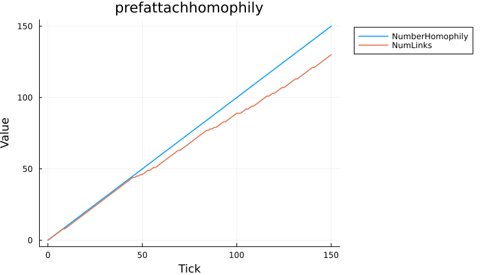
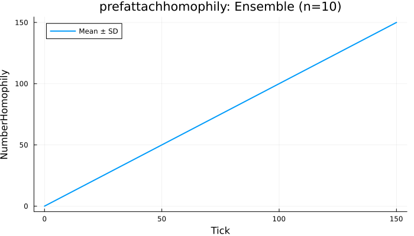
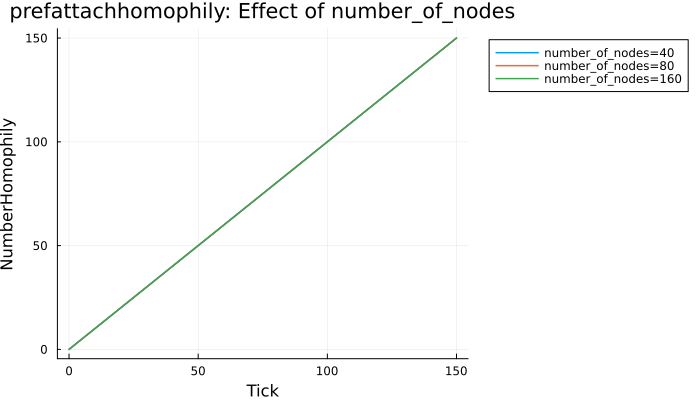

## Overview

This vignette demonstrates the **Pref Attach Homophily** model implemented in [ArkModelZoo.jl](https://github.com/sdwfrost/ArkModelZoo.jl) using the Ark.jl ECS framework.

## Parameters

| Parameter | Type | Default | Description |
|-----------|------|---------|-------------|
| `number_of_nodes` | `Int` | `80` | number of nodes |
| `number_of_links` | `Int` | `150` | number of links |
| `probability_of_homophily` | `Int` | `95` | probability of homophily |
| `max_ticks` | `Int` | `150` | max ticks |

## Source Code

The Julia code to run this model:

```julia
using ArkModelZoo
_, trajectory = run_prefattachhomophily()
```

## Time Series

{width=100%}

## Ensemble Runs

Ten replicates with different random seeds, showing mean ± standard deviation.

{width=100%}

## Parameter Sensitivity

Varying `number_of_nodes`.

{width=100%}


## Appendix: Source Code

This model is implemented in the [Ark.jl](https://github.com/sdwfrost/Ark.jl) Entity-Component-System (ECS) framework. The code is split into five files, each with a distinct role:

- **Parameters**: a mutable struct holding all configurable values.
- **Components**: lightweight data types attached to individual entities (agents).
- **Resources**: world-level shared state accessible to all systems.
- **Systems**: functions that operate on entities each tick, defining model behavior.
- **Model**: wiring that assembles the world, registers resources and systems, and provides the run entry point.

### Parameters (`parameters.jl`)

The parameter struct uses `@kwdef` so that every field has a default value and can be overridden by keyword. These defaults match the original NetLogo model's slider settings.

```julia
Base.@kwdef mutable struct PrefAttachHomophilyParams
    number_of_nodes::Int = 80
    number_of_links::Int = 150
    probability_of_homophily::Int = 95
    max_ticks::Int = 150
    seed::Int = 42
end
```

### Components (`components.jl`)

Components are lightweight data types attached to individual entities (agents). Mutable structs hold per-entity state, while empty tag structs act as markers for the ECS query system to efficiently filter entities.

```julia
struct PAHDummy end
```

### Resources (`resources.jl`)

Resources are world-level singletons shared across all systems, used for global state and aggregate statistics.

```julia
mutable struct PAHNetwork
    n::Int
    adj::Vector{Set{Int}}
    wealth::Vector{Int}
    my_prob_homophily::Vector{Int}
end
PAHNetwork() = PAHNetwork(0, Set{Int}[], Int[], Int[])

function _pah_add_node!(net::PAHNetwork, wealth::Int, prob_h::Int)
    net.n += 1
    push!(net.adj, Set{Int}())
    push!(net.wealth, wealth)
    push!(net.my_prob_homophily, prob_h)
    return net.n
end

function _pah_add_edge!(net::PAHNetwork, i::Int, j::Int)
    i == j && return
    push!(net.adj[i], j)
    push!(net.adj[j], i)
end

function _pah_num_links(net::PAHNetwork)
    s = 0
    for a in net.adj
        s += length(a)
    end
    return div(s, 2)
end

mutable struct PAHStats
    number_homophily::Int
    num_links::Int
end
PAHStats() = PAHStats(0, 0)
```

### Systems (`systems.jl`)

Systems contain the model logic and execute in a defined order each tick. Each system struct implements either `initialize!` (run once at setup) or `update!` (run every tick).

```julia
# Preferential Attachment with Homophily Networks
# Agents link to similar-wealth (homophily) or wealthier (resource dependence) nodes

struct InitPAHSystem <: System end

function initialize!(::InitPAHSystem, world::World)
    params = get_resource(world, PrefAttachHomophilyParams)
    rng = get_resource(world, RNGResource).rng
    net = get_resource(world, PAHNetwork)
    stats = get_resource(world, PAHStats)

    for _ in 1:params.number_of_nodes
        w = rand(rng, 0:19)
        ph = rand(rng, 0:max(params.probability_of_homophily - 1, 0))
        _pah_add_node!(net, w, ph)
    end

    stats.number_homophily = 0
    stats.num_links = 0
    return nothing
end

struct PAHGoSystem <: System end

function update!(::PAHGoSystem, world::World)
    params = get_resource(world, PrefAttachHomophilyParams)
    rng = get_resource(world, RNGResource).rng
    net = get_resource(world, PAHNetwork)
    stats = get_resource(world, PAHStats)

    net.n == 0 && return nothing

    # NetLogo: ask one-of turtles [find-partner, make-node-homophily]
    focal = rand(rng, 1:net.n)
    w = net.wealth[focal]
    prob_h = net.my_prob_homophily[focal]

    partner = 0
    if rand(rng, 0:99) < prob_h
        # Homophily: pick one-of other turtles with similar wealth (w-1, w, w+1)
        candidates = Int[]
        for j in 1:net.n
            j == focal && continue
            wj = net.wealth[j]
            if wj == w || wj == w - 1 || wj == w + 1
                push!(candidates, j)
            end
        end
        if !isempty(candidates)
            partner = candidates[rand(rng, 1:length(candidates))]
        end
    else
        # Resource dependence: pick one-of other turtles with wealth > w
        candidates = Int[]
        for j in 1:net.n
            j == focal && continue
            if net.wealth[j] > w
                push!(candidates, j)
            end
        end
        if !isempty(candidates)
            partner = candidates[rand(rng, 1:length(candidates))]
        end
    end

    if partner != 0
        _pah_add_edge!(net, focal, partner)
    end

    # Check stop: number-homophily >= number-of-links
    stats.number_homophily += 1
    stats.num_links = _pah_num_links(net)

    if stats.number_homophily >= params.number_of_links
        get_resource(world, Terminate).stop = true
    end
    return nothing
end

struct PAHTerminationSystem <: System end

function update!(::PAHTerminationSystem, world::World)
    params = get_resource(world, PrefAttachHomophilyParams)
    tick = get_resource(world, Tick)
    if tick.tick + 1 >= params.max_ticks
        get_resource(world, Terminate).stop = true
    end
    return nothing
end
```

### Model (`model.jl`)

The model file assembles all pieces: it creates the ECS `World` with the required component types, registers resources, builds the `Scheduler` with systems in execution order, and exposes the public `run` entry point. The observer pattern records the trajectory each tick.

```julia
function prefattachhomophily_world(; initial_capacity::Int = 128)
    return World(PAHDummy; initial_capacity = initial_capacity, allow_mutable = true)
end

function prefattachhomophily_systems()
    return (InitPAHSystem(), PAHGoSystem(), PAHTerminationSystem())
end

function prefattachhomophily_model(params::PrefAttachHomophilyParams = PrefAttachHomophilyParams())
    world = prefattachhomophily_world()
    _add_standard_resources!(world, params)
    add_resource!(world, PAHNetwork())
    add_resource!(world, PAHStats())
    scheduler = Scheduler(world, prefattachhomophily_systems())
    initialize!(scheduler)
    return scheduler
end

struct PAHObserver end

function prefattachhomophily_headers(::PAHObserver)
    return ["NumberHomophily", "NumLinks"]
end

function prefattachhomophily_values(::PAHObserver, world::World)
    stats = get_resource(world, PAHStats)
    return Float64[stats.number_homophily, stats.num_links]
end

function run_prefattachhomophily(; params::PrefAttachHomophilyParams = PrefAttachHomophilyParams(), observe::Bool = true)
    return _run_model(prefattachhomophily_model, PAHObserver(), prefattachhomophily_values; params, observe)
end
```
