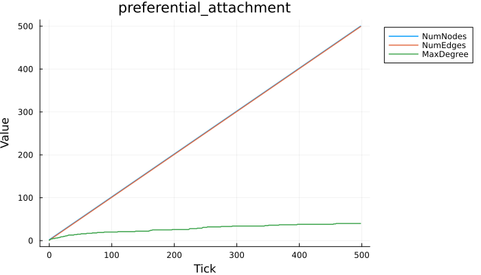
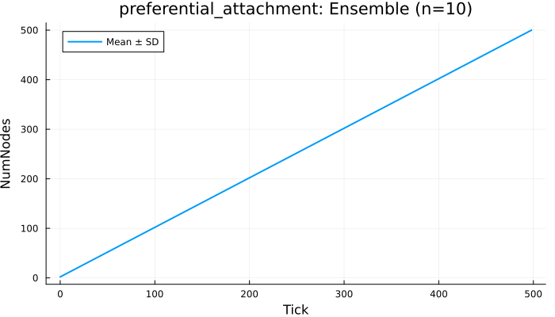
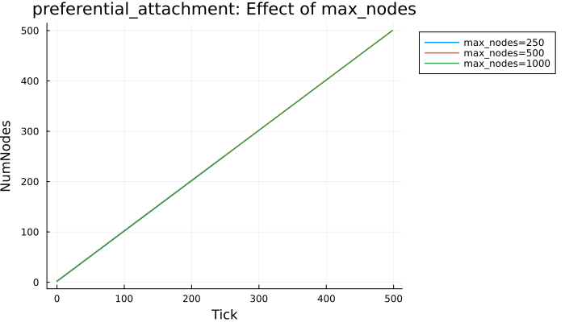

## Overview

### WHAT IS IT?

In some networks, a few "hubs" have lots of connections, while everybody else only has a few.  This model shows one way such networks can arise.

Such networks can be found in a surprisingly large range of real world situations, ranging from the connections between websites to the collaborations between actors.

This model generates these networks by a process of "preferential attachment", in which new network members prefer to make a connection to the more popular existing members.

### HOW IT WORKS

The model starts with two nodes connected by an edge.

At each step, a new node is added.  A new node picks an existing node to connect to randomly, but with some bias.  More specifically, a node's chance of being selected is directly proportional to the number of connections it already has, or its "degree." This is the mechanism which is called "preferential attachment."

### THINGS TO NOTICE

The networks that result from running this model are often called "scale-free" or "power law" networks. These are networks in which the distribution of the number of connections of each node is not a normal distribution --- instead it follows what is a called a power law distribution.  Power law distributions are different from normal distributions in that they do not have a peak at the average, and they are more likely to contain extreme values (see Albert & Barabási 2002 for a further description of the frequency and significance of scale-free networks).  Barabási and Albert originally described this mechanism for creating networks, but there are other mechanisms of creating scale-free networks and so the networks created by the mechanism implemented in this model are referred to as Barabási scale-free networks.

You can see the degree distribution of the network in this model by looking at the plots. The top plot is a histogram of the degree of each node.  The bottom plot shows the same data, but both axes are on a logarithmic scale.  When degree distribution follows a power law, it appears as a straight line on the log-log plot.  One simple way to think about power laws is that if there is one node with a degree distribution of 1000, then there will be ten nodes with a degree distribution of 100, and 100 nodes with a degree distribution of 10.

### THINGS TO TRY

Let the model run a little while.  How many nodes are "hubs", that is, have many connections?  How many have only a few?  Does some low degree node ever become a hub?  How often?

Turn off the LAYOUT? switch and freeze the view to speed up the model, then allow a large network to form.  What is the shape of the histogram in the top plot?  What do you see in log-log plot? Notice that the log-log plot is only a straight line for a limited range of values.  Why is this?  Does the degree to which the log-log plot resembles a straight line grow as you add more nodes to the network?

### EXTENDING THE MODEL

Assign an additional attribute to each node.  Make the probability of attachment depend on this new attribute as well as on degree.  (A bias slider could control how much the attribute influences the decision.)

Can the layout algorithm be improved?  Perhaps nodes from different hubs could repel each other more strongly than nodes from the same hub, in order to encourage the hubs to be physically separate in the layout.

### NETLOGO FEATURES

Nodes are turtle agents and edges are link agents. The model uses the ONE-OF primitive to chose a random link and the BOTH-ENDS primitive to select the two nodes attached to that link.

The `layout-spring` primitive places the nodes, as if the edges are springs and the nodes are repelling each other.

Though it is not used in this model, there exists a network extension for NetLogo that comes bundled with NetLogo, that has many more network primitives.

### RELATED MODELS

See other models in the Networks section of the Models Library, such as Giant Component.

See also Network Example, in the Code Examples section.

### CREDITS AND REFERENCES

This model is based on:
Albert-László Barabási. Linked: The New Science of Networks, Perseus Publishing, Cambridge, Massachusetts, pages 79-92.

For a more technical treatment, see:
Albert-László Barabási & Reka Albert. Emergence of Scaling in Random Networks, Science, Vol 286, Issue 5439, 15 October 1999, pages 509-512.

The layout algorithm is based on the Fruchterman-Reingold layout algorithm.  More information about this algorithm can be obtained at: http://cs.brown.edu/people/rtamassi/gdhandbook/chapters/force-directed.pdf.

For a model similar to the one described in the first suggested extension, please consult:
W. Brian Arthur, "Urban Systems and Historical Path-Dependence", Chapt. 4 in Urban systems and Infrastructure, J. Ausubel and R. Herman (eds.), National Academy of Sciences, Washington, D.C., 1988.

### HOW TO CITE

If you mention this model or the NetLogo software in a publication, we ask that you include the citations below.

For the model itself:

* Wilensky, U. (2005).  NetLogo Preferential Attachment model.  http://ccl.northwestern.edu/netlogo/models/PreferentialAttachment.  Center for Connected Learning and Computer-Based Modeling, Northwestern University, Evanston, IL.

Please cite the NetLogo software as:

* Wilensky, U. (1999). NetLogo. http://ccl.northwestern.edu/netlogo/. Center for Connected Learning and Computer-Based Modeling, Northwestern University, Evanston, IL.

### COPYRIGHT AND LICENSE

Copyright 2005 Uri Wilensky.


This model is licensed under the Creative Commons Attribution-NonCommercial-ShareAlike 3.0 License.  To view a copy of this license, visit https://creativecommons.org/licenses/by-nc-sa/3.0/ or send a letter to Creative Commons, 559 Nathan Abbott Way, Stanford, California 94305, USA.

NetLogo itself is free software for non-commercial use under the terms of the GNU General Public License ([see full license information here](https://ccl.northwestern.edu/netlogo/docs/copyright.html)).

To inquire about commercial licenses for either NetLogo or specific models from the models library, please contact netlogo-commercial-admin@ccl.northwestern.edu.

<!-- 2005 -->

## Parameters

| Parameter | Type | Default | Description |
|-----------|------|---------|-------------|
| `max_nodes` | `Int` | `500` | stop after this many nodes |
| `max_ticks` | `Int` | `498` | start with 2 nodes, add 1 per tick |

## Source Code

The Julia code to run this model:

```julia
using ArkModelZoo
_, trajectory = run_preferential_attachment()
```

## Time Series

{width=100%}

## Ensemble Runs

Ten replicates with different random seeds, showing mean ± standard deviation.

{width=100%}

## Parameter Sensitivity

Varying `max_nodes`.

{width=100%}


## Appendix: Source Code

This model is implemented in the [Ark.jl](https://github.com/sdwfrost/Ark.jl) Entity-Component-System (ECS) framework. The code is split into five files, each with a distinct role:

- **Parameters**: a mutable struct holding all configurable values.
- **Components**: lightweight data types attached to individual entities (agents).
- **Resources**: world-level shared state accessible to all systems.
- **Systems**: functions that operate on entities each tick, defining model behavior.
- **Model**: wiring that assembles the world, registers resources and systems, and provides the run entry point.

### Parameters (`parameters.jl`)

The parameter struct uses `@kwdef` so that every field has a default value and can be overridden by keyword. These defaults match the original NetLogo model's slider settings.

```julia
Base.@kwdef mutable struct PAParams
    max_nodes::Int = 500       # stop after this many nodes
    max_ticks::Int = 498       # start with 2 nodes, add 1 per tick
    seed::Int = 42
end
```

### Components (`components.jl`)

Components are lightweight data types attached to individual entities (agents). Mutable structs hold per-entity state, while empty tag structs act as markers for the ECS query system to efficiently filter entities.

```julia
mutable struct PANode
    node_id::Int
    degree::Int
end
PANode() = PANode(0, 0)
```

### Resources (`resources.jl`)

Resources are world-level singletons shared across all systems, used for global state and aggregate statistics.

```julia
mutable struct PANetwork
    graph::NwGraph
    node_to_entity::Vector{Entity}
end
PANetwork() = PANetwork(NwGraph(), Entity[])

mutable struct PAStats
    num_nodes::Int
    num_edges::Int
    max_degree::Int
end
PAStats() = PAStats(0, 0, 0)
```

### Systems (`systems.jl`)

Systems contain the model logic and execute in a defined order each tick. Each system struct implements either `initialize!` (run once at setup) or `update!` (run every tick).

```julia
struct InitPASystem <: System end

function initialize!(::InitPASystem, world::World)
    net = get_resource(world, PANetwork)
    net.graph = NwGraph(2)
    nw_add_edge!(net.graph, 1, 2)
    net.node_to_entity = Vector{Entity}(undef, 2)
    for i in 1:2
        eid = new_entity!(world, (PANode(i, 1),))
        net.node_to_entity[i] = eid
    end
    _pa_update_stats!(world)
    return nothing
end

struct PAGoSystem <: System end

function update!(::PAGoSystem, world::World)
    params = get_resource(world, PAParams)
    rng = get_resource(world, RNGResource).rng
    net = get_resource(world, PANetwork)
    g = net.graph

    g.n >= params.max_nodes && return nothing

    # Find partner via preferential attachment (proportional to degree)
    total_degree = sum(nw_degree(g, k) for k in 1:g.n)
    r = rand(rng) * total_degree
    partner = g.n  # fallback
    cumul = 0.0
    for k in 1:g.n
        cumul += nw_degree(g, k)
        if cumul >= r
            partner = k
            break
        end
    end

    # Add new node
    new_id = nw_add_node!(g)
    nw_add_edge!(g, new_id, partner)
    eid = new_entity!(world, (PANode(new_id, 1),))
    push!(net.node_to_entity, eid)

    # Update partner degree component
    pst = get_components(world, net.node_to_entity[partner], (PANode,))[1]
    pst.degree = nw_degree(g, partner)

    _pa_update_stats!(world)
    return nothing
end

function _pa_update_stats!(world::World)
    net = get_resource(world, PANetwork)
    stats = get_resource(world, PAStats)
    g = net.graph
    stats.num_nodes = g.n
    stats.num_edges = sum(nw_degree(g, i) for i in 1:g.n; init=0) ÷ 2
    stats.max_degree = g.n > 0 ? maximum(nw_degree(g, i) for i in 1:g.n) : 0
end

struct PATerminationSystem <: System end

function update!(::PATerminationSystem, world::World)
    params = get_resource(world, PAParams)
    net = get_resource(world, PANetwork)
    tick = get_resource(world, Tick)
    if net.graph.n >= params.max_nodes || tick.tick + 1 >= params.max_ticks
        get_resource(world, Terminate).stop = true
    end
    return nothing
end
```

### Model (`model.jl`)

The model file assembles all pieces: it creates the ECS `World` with the required component types, registers resources, builds the `Scheduler` with systems in execution order, and exposes the public `run` entry point. The observer pattern records the trajectory each tick.

```julia
function pa_world(; initial_capacity::Int = 1024)
    return World(PANode; initial_capacity = initial_capacity, allow_mutable = true)
end

function pa_systems()
    return (InitPASystem(), PAGoSystem(), PATerminationSystem())
end

function pa_model(params::PAParams = PAParams())
    world = pa_world()
    _add_standard_resources!(world, params)
    add_resource!(world, PANetwork())
    add_resource!(world, PAStats())
    scheduler = Scheduler(world, pa_systems())
    initialize!(scheduler)
    return scheduler
end

struct PAObserver end

function pa_headers(::PAObserver)
    return ["NumNodes", "NumEdges", "MaxDegree"]
end

function pa_values(::PAObserver, world::World)
    stats = get_resource(world, PAStats)
    return Float64[stats.num_nodes, stats.num_edges, stats.max_degree]
end

function run_preferential_attachment(; params::PAParams = PAParams(), observe::Bool = true)
    return _run_model(pa_model, PAObserver(), pa_values; params, observe)
end
```
