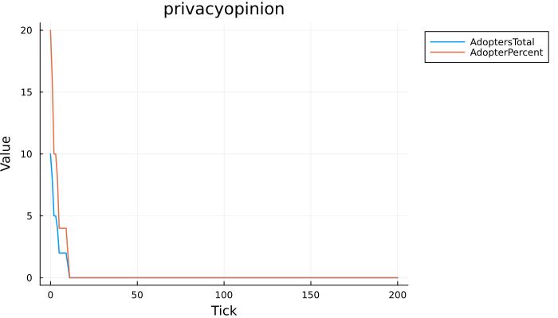
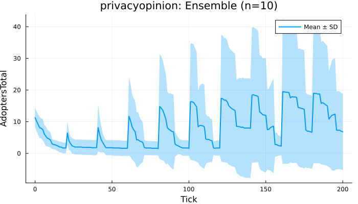
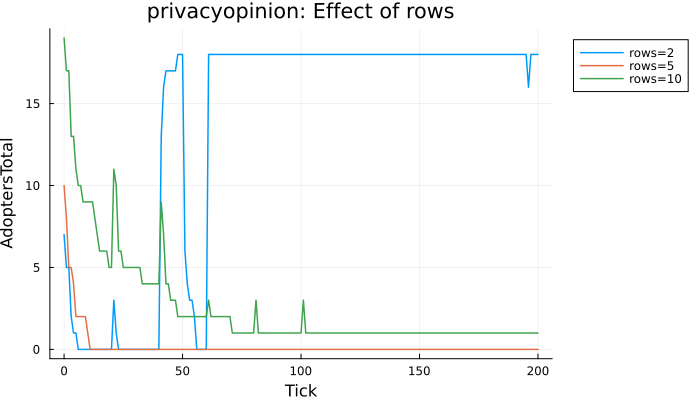

## Overview

This vignette demonstrates the **Privacy Opinion** model implemented in [ArkModelZoo.jl](https://github.com/sdwfrost/ArkModelZoo.jl) using the Ark.jl ECS framework.

## Parameters

| Parameter | Type | Default | Description |
|-----------|------|---------|-------------|
| `rows` | `Int` | `5` | rows |
| `cols` | `Int` | `10` | cols |
| `rewire_prob` | `Float64` | `1.0` | rewire prob |
| `k_neighbors` | `Int` | `2` | k neighbors |
| `adoption_threshold` | `Float64` | `0.75` | adoption threshold |
| `bounded_confidence_threshold` | `Float64` | `0.35` | bounded confidence threshold |
| `hr_minimum_tick_interval` | `Int` | `20` | hr minimum tick interval |
| `hr_bounded_confidence_threshold` | `Float64` | `0.5` | hr bounded confidence threshold |
| `privacy_minimum_tick_interval` | `Int` | `5` | privacy minimum tick interval |
| `pv_bounded_confidence_threshold` | `Float64` | `1.0` | pv bounded confidence threshold |
| `enable_hr` | `Bool` | `true` | enable hr |
| `enable_pv` | `Bool` | `true` | enable pv |
| `max_ticks` | `Int` | `200` | max ticks |

## Source Code

The Julia code to run this model:

```julia
using ArkModelZoo
_, trajectory = run_privacyopinion()
```

## Time Series

{width=100%}

## Ensemble Runs

Ten replicates with different random seeds, showing mean ± standard deviation.

{width=100%}

## Parameter Sensitivity

Varying `rows`.

{width=100%}


## Appendix: Source Code

This model is implemented in the [Ark.jl](https://github.com/sdwfrost/Ark.jl) Entity-Component-System (ECS) framework. The code is split into five files, each with a distinct role:

- **Parameters**: a mutable struct holding all configurable values.
- **Components**: lightweight data types attached to individual entities (agents).
- **Resources**: world-level shared state accessible to all systems.
- **Systems**: functions that operate on entities each tick, defining model behavior.
- **Model**: wiring that assembles the world, registers resources and systems, and provides the run entry point.

### Parameters (`parameters.jl`)

The parameter struct uses `@kwdef` so that every field has a default value and can be overridden by keyword. These defaults match the original NetLogo model's slider settings.

```julia
Base.@kwdef mutable struct PrvParams
    rows::Int = 5
    cols::Int = 10
    rewire_prob::Float64 = 1.0
    k_neighbors::Int = 2
    adoption_threshold::Float64 = 0.75
    bounded_confidence_threshold::Float64 = 0.35
    hr_minimum_tick_interval::Int = 20
    hr_bounded_confidence_threshold::Float64 = 0.5
    privacy_minimum_tick_interval::Int = 5
    pv_bounded_confidence_threshold::Float64 = 1.0
    enable_hr::Bool = true
    enable_pv::Bool = true
    max_ticks::Int = 200
    seed::Int = 42
end
```

### Components (`components.jl`)

Components are lightweight data types attached to individual entities (agents). Mutable structs hold per-entity state, while empty tag structs act as markers for the ECS query system to efficiently filter entities.

```julia
struct PrvDummy end
```

### Resources (`resources.jl`)

Resources are world-level singletons shared across all systems, used for global state and aggregate statistics.

```julia
mutable struct PrvNetwork
    n::Int
    adjacency::Vector{Set{Int}}
    attitudes::Vector{Float64}
    updated_attitudes::Vector{Float64}
    willingness::Vector{Float64}
    adopted::Vector{Bool}
end

function PrvNetwork(n::Int)
    PrvNetwork(
        n,
        [Set{Int}() for _ in 1:n],
        zeros(Float64, n),
        zeros(Float64, n),
        zeros(Float64, n),
        fill(false, n),
    )
end

mutable struct PrvCounters
    hr_tick_counter::Int
    hr_tick_interval::Int
    pv_tick_counter::Int
    pv_tick_interval::Int
end
PrvCounters(hr_int::Int, pv_int::Int) = PrvCounters(0, hr_int, 0, pv_int)

mutable struct PrvStats
    adopters_total::Int
    adopter_percent::Float64
end
PrvStats() = PrvStats(0, 0.0)
```

### Systems (`systems.jl`)

Systems contain the model logic and execute in a defined order each tick. Each system struct implements either `initialize!` (run once at setup) or `update!` (run every tick).

```julia
# --- Small-world graph generation (Watts–Strogatz) ---

function _prv_build_small_world!(net::PrvNetwork, rng, k::Int, p::Float64)
    n = net.n
    # Ring lattice: connect each node to k neighbors on each side
    for i in 1:n
        for j in 1:k
            nb = mod1(i + j, n)
            push!(net.adjacency[i], nb)
            push!(net.adjacency[nb], i)
        end
    end
    # Rewire edges with probability p
    for i in 1:n
        for j in 1:k
            nb = mod1(i + j, n)
            if rand(rng) < p
                # Pick random new target (not self, not already neighbor)
                attempts = 0
                while attempts < 100
                    new_nb = rand(rng, 1:n)
                    if new_nb != i && !(new_nb in net.adjacency[i])
                        delete!(net.adjacency[i], nb)
                        delete!(net.adjacency[nb], i)
                        push!(net.adjacency[i], new_nb)
                        push!(net.adjacency[new_nb], i)
                        break
                    end
                    attempts += 1
                end
            end
        end
    end
end

# --- Initialization ---

struct InitPrvSystem <: System end

function initialize!(::InitPrvSystem, world::World)
    params = get_resource(world, PrvParams)
    rng = get_resource(world, RNGResource).rng
    net = get_resource(world, PrvNetwork)
    counters = get_resource(world, PrvCounters)
    stats = get_resource(world, PrvStats)

    _prv_build_small_world!(net, rng, params.k_neighbors, params.rewire_prob)

    adopters = 0
    for i in 1:net.n
        net.attitudes[i] = rand(rng)
        net.willingness[i] = rand(rng)
        net.updated_attitudes[i] = net.attitudes[i]
        net.adopted[i] = net.attitudes[i] >= params.adoption_threshold
        if net.adopted[i]
            adopters += 1
        end
    end

    counters.hr_tick_counter = 0
    counters.pv_tick_counter = 0

    stats.adopters_total = adopters
    stats.adopter_percent = 100.0 * adopters / net.n
    return nothing
end

# --- Propagate privacy thresholds (bounded-confidence averaging) ---

struct PrvPropagateSystem <: System end

function update!(::PrvPropagateSystem, world::World)
    params = get_resource(world, PrvParams)
    net = get_resource(world, PrvNetwork)
    threshold = params.bounded_confidence_threshold

    for i in 1:net.n
        my_att = net.attitudes[i]
        delta_sum = 0.0
        eligible_count = 0
        for nb in net.adjacency[i]
            diff = net.attitudes[nb] - my_att
            if abs(diff) <= threshold
                delta_sum += diff
                eligible_count += 1
            end
        end
        if eligible_count > 0
            att_delta = delta_sum / (1 + eligible_count)
            net.updated_attitudes[i] = my_att + net.willingness[i] * att_delta
        else
            net.updated_attitudes[i] = my_att
        end
    end
    return nothing
end

# --- Block update: copy updated attitudes ---

struct PrvBlockUpdateSystem <: System end

function update!(::PrvBlockUpdateSystem, world::World)
    net = get_resource(world, PrvNetwork)
    for i in 1:net.n
        net.attitudes[i] = clamp(net.updated_attitudes[i], 0.0, 1.0)
    end
    return nothing
end

# --- Check adopters ---

struct PrvCheckAdoptersSystem <: System end

function update!(::PrvCheckAdoptersSystem, world::World)
    params = get_resource(world, PrvParams)
    net = get_resource(world, PrvNetwork)
    stats = get_resource(world, PrvStats)
    adopters = 0
    for i in 1:net.n
        net.adopted[i] = net.attitudes[i] >= params.adoption_threshold
        if net.adopted[i]
            adopters += 1
        end
    end
    stats.adopters_total = adopters
    stats.adopter_percent = 100.0 * adopters / net.n
    return nothing
end

# --- HR material distribution ---

struct PrvHRSystem <: System end

function update!(::PrvHRSystem, world::World)
    params = get_resource(world, PrvParams)
    net = get_resource(world, PrvNetwork)
    counters = get_resource(world, PrvCounters)
    rng = get_resource(world, RNGResource).rng

    counters.hr_tick_counter += 1
    if !params.enable_hr
        return nothing
    end
    if counters.hr_tick_counter < counters.hr_tick_interval
        return nothing
    end
    counters.hr_tick_counter = 0
    # Push attitudes toward 1.0 for agents within HR bounded confidence threshold
    hr_threshold = params.hr_bounded_confidence_threshold
    for i in 1:net.n
        if abs(1.0 - net.attitudes[i]) <= hr_threshold
            delta = (1.0 - net.attitudes[i])
            net.attitudes[i] = clamp(net.attitudes[i] + net.willingness[i] * delta, 0.0, 1.0)
        end
    end
    return nothing
end

# --- Privacy violation ---

struct PrvPVSystem <: System end

function update!(::PrvPVSystem, world::World)
    params = get_resource(world, PrvParams)
    net = get_resource(world, PrvNetwork)
    counters = get_resource(world, PrvCounters)
    rng = get_resource(world, RNGResource).rng

    counters.pv_tick_counter += 1
    if !params.enable_pv
        return nothing
    end
    if counters.pv_tick_counter < counters.pv_tick_interval
        return nothing
    end
    counters.pv_tick_counter = 0

    # Power-law random shock: draw PL value, push attitudes down proportionally
    # NetLogo PLRandomValue: power-law distributed magnitude of privacy incident
    u = rand(rng)
    pl_value = u^2  # power-law concentrated near 0, max 1.0

    pv_threshold = params.pv_bounded_confidence_threshold
    for i in 1:net.n
        if net.attitudes[i] <= pv_threshold
            shock = pl_value * net.willingness[i] * net.attitudes[i] * 0.15
            net.attitudes[i] = clamp(net.attitudes[i] - shock, 0.0, 1.0)
        end
    end
    return nothing
end

# --- Termination ---

struct PrvTerminationSystem <: System end

function update!(::PrvTerminationSystem, world::World)
    params = get_resource(world, PrvParams)
    tick = get_resource(world, Tick)
    if tick.tick + 1 >= params.max_ticks
        get_resource(world, Terminate).stop = true
    end
    return nothing
end
```

### Model (`model.jl`)

The model file assembles all pieces: it creates the ECS `World` with the required component types, registers resources, builds the `Scheduler` with systems in execution order, and exposes the public `run` entry point. The observer pattern records the trajectory each tick.

```julia
function privacyopinion_world(; initial_capacity::Int = 128)
    return World(PrvDummy; initial_capacity=initial_capacity, allow_mutable=true)
end

function privacyopinion_systems()
    return (
        InitPrvSystem(),
        PrvPropagateSystem(),
        PrvBlockUpdateSystem(),
        PrvCheckAdoptersSystem(),
        PrvHRSystem(),
        PrvPVSystem(),
        PrvTerminationSystem(),
    )
end

function privacyopinion_model(params::PrvParams = PrvParams())
    world = privacyopinion_world()
    n = params.rows * params.cols
    _add_standard_resources!(world, params)
    add_resource!(world, PrvNetwork(n))
    add_resource!(world, PrvCounters(params.hr_minimum_tick_interval, params.privacy_minimum_tick_interval))
    add_resource!(world, PrvStats())
    scheduler = Scheduler(world, privacyopinion_systems())
    initialize!(scheduler)
    return scheduler
end

struct PrvObserver end

function privacyopinion_headers(::PrvObserver)
    return ["AdoptersTotal", "AdopterPercent"]
end

function privacyopinion_values(::PrvObserver, world::World)
    stats = get_resource(world, PrvStats)
    return Float64[Float64(stats.adopters_total), stats.adopter_percent]
end

function run_privacyopinion(; params::PrvParams = PrvParams(), observe::Bool = true)
    return _run_model(privacyopinion_model, PrvObserver(), privacyopinion_values; params, observe)
end
```
