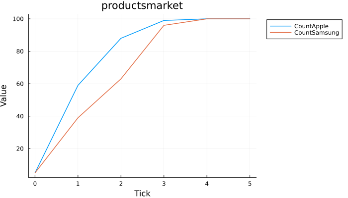
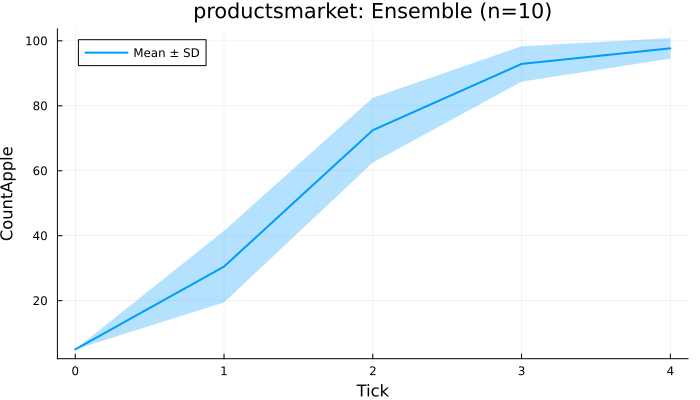
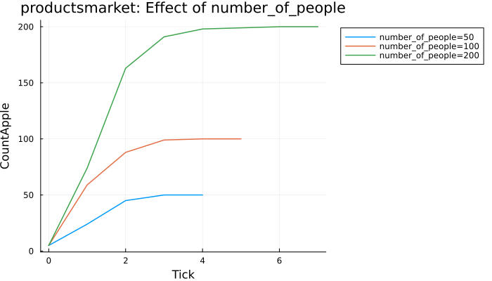

## Overview

This vignette demonstrates the **Products Market** model implemented in [ArkModelZoo.jl](https://github.com/sdwfrost/ArkModelZoo.jl) using the Ark.jl ECS framework.

## Parameters

| Parameter | Type | Default | Description |
|-----------|------|---------|-------------|
| `number_of_people` | `Int` | `100` | number of people |
| `sponsor_apple` | `Int` | `5` | sponsor apple |
| `sponsor_samsung` | `Int` | `5` | sponsor samsung |
| `popularity_apple` | `Float64` | `50.0` | popularity apple |
| `popularity_samsung` | `Float64` | `50.0` | popularity samsung |
| `max_ticks` | `Int` | `200` | max ticks |

## Source Code

The Julia code to run this model:

```julia
using ArkModelZoo
_, trajectory = run_productsmarket()
```

## Time Series

{width=100%}

## Ensemble Runs

Ten replicates with different random seeds, showing mean ± standard deviation.

{width=100%}

## Parameter Sensitivity

Varying `number_of_people`.

{width=100%}


## Appendix: Source Code

This model is implemented in the [Ark.jl](https://github.com/sdwfrost/Ark.jl) Entity-Component-System (ECS) framework. The code is split into five files, each with a distinct role:

- **Parameters**: a mutable struct holding all configurable values.
- **Components**: lightweight data types attached to individual entities (agents).
- **Resources**: world-level shared state accessible to all systems.
- **Systems**: functions that operate on entities each tick, defining model behavior.
- **Model**: wiring that assembles the world, registers resources and systems, and provides the run entry point.

### Parameters (`parameters.jl`)

The parameter struct uses `@kwdef` so that every field has a default value and can be overridden by keyword. These defaults match the original NetLogo model's slider settings.

```julia
Base.@kwdef mutable struct PMktParams
    number_of_people::Int = 100
    sponsor_apple::Int = 5
    sponsor_samsung::Int = 5
    popularity_apple::Float64 = 50.0
    popularity_samsung::Float64 = 50.0
    max_ticks::Int = 200
    seed::Int = 42
end
```

### Components (`components.jl`)

Components are lightweight data types attached to individual entities (agents). Mutable structs hold per-entity state, while empty tag structs act as markers for the ECS query system to efficiently filter entities.

```julia
struct PMktDummy end
```

### Resources (`resources.jl`)

Resources are world-level singletons shared across all systems, used for global state and aggregate statistics.

```julia
mutable struct PMktNetwork
    n_agents::Int
    adj::Vector{Set{Int}}
    degree::Vector{Int}
    buy_apple::Vector{Bool}
    buy_samsung::Vector{Bool}
end

function PMktNetwork()
    PMktNetwork(0, Set{Int}[], Int[], Bool[], Bool[])
end

function _pmkt_add_agent!(net::PMktNetwork)
    push!(net.adj, Set{Int}())
    push!(net.degree, 0)
    push!(net.buy_apple, false)
    push!(net.buy_samsung, false)
    net.n_agents += 1
    return net.n_agents
end

function _pmkt_add_edge!(net::PMktNetwork, i::Int, j::Int)
    if j ∉ net.adj[i]
        push!(net.adj[i], j)
        push!(net.adj[j], i)
        net.degree[i] += 1
        net.degree[j] += 1
    end
end

mutable struct PMktStats
    count_apple::Int
    count_samsung::Int
end
PMktStats() = PMktStats(0, 0)
```

### Systems (`systems.jl`)

Systems contain the model logic and execute in a defined order each tick. Each system struct implements either `initialize!` (run once at setup) or `update!` (run every tick).

```julia
# Products Market – ECS systems
# Bass-model product adoption on BA network with two competing products

struct InitPMktSystem <: System end

function _pmkt_build_ba!(net::PMktNetwork, rng, n::Int)
    # Start with 2 connected nodes
    _pmkt_add_agent!(net)
    _pmkt_add_agent!(net)
    _pmkt_add_edge!(net, 1, 2)
    # Each new node connects to 1 existing (preferential attachment, m=1)
    for _ in 3:n
        new_id = _pmkt_add_agent!(net)
        total_degree = sum(net.degree[k] for k in 1:(new_id - 1))
        if total_degree == 0
            target = rand(rng, 1:(new_id - 1))
        else
            r = rand(rng) * total_degree
            cumulative = 0.0
            target = 1
            for j in 1:(new_id - 1)
                cumulative += net.degree[j]
                if cumulative >= r
                    target = j
                    break
                end
            end
        end
        _pmkt_add_edge!(net, new_id, target)
    end
end

function initialize!(::InitPMktSystem, world::World)
    params = get_resource(world, PMktParams)
    rng    = get_resource(world, RNGResource).rng
    net    = get_resource(world, PMktNetwork)
    stats  = get_resource(world, PMktStats)

    _pmkt_build_ba!(net, rng, params.number_of_people)

    # Random seeding: pick sponsors without overlap
    indices = Random.shuffle(rng, collect(1:params.number_of_people))
    for i in 1:params.sponsor_apple
        net.buy_apple[indices[i]] = true
    end
    offset = params.sponsor_apple
    for i in 1:params.sponsor_samsung
        net.buy_samsung[indices[offset + i]] = true
    end

    stats.count_apple   = count(net.buy_apple)
    stats.count_samsung = count(net.buy_samsung)
    return nothing
end

# --- Adoption helper ---
# NetLogo random-float(N): N<0 → uniform in (N,0); N>0 → uniform in [0,N)
function _pmkt_try_adopt!(rng, net::PMktNetwork, i::Int,
                          frac::Float64, valore::Float64, is_apple::Bool)
    frac <= 0.0 && return
    prob = frac * 0.5
    rn = rand(rng) * valore          # negative when valore < 0
    if rn < prob
        if is_apple
            net.buy_apple[i] = true
        else
            net.buy_samsung[i] = true
        end
    end
end

# --- Main go procedure ---

struct PMktGoSystem <: System end

function update!(::PMktGoSystem, world::World)
    params = get_resource(world, PMktParams)
    rng    = get_resource(world, RNGResource).rng
    net    = get_resource(world, PMktNetwork)
    stats  = get_resource(world, PMktStats)

    # Termination: all bought one product
    if stats.count_apple == net.n_agents || stats.count_samsung == net.n_agents
        get_resource(world, Terminate).stop = true
        return nothing
    end

    valore_apple   = 5.0 - params.popularity_apple
    valore_samsung = 5.0 - params.popularity_samsung

    order = Random.shuffle(rng, collect(1:net.n_agents))
    for i in order
        r = rand(rng)
        if r < 0.02
            # Random adoption (2 %): coin-flip product
            if rand(rng) < 0.5
                net.buy_apple[i] = true
            else
                net.buy_samsung[i] = true
            end
            continue
        end

        # Neighbour influence (98 %)
        neighbors = net.adj[i]
        total_neighbors = length(neighbors)
        total_neighbors == 0 && continue

        apple_nbrs   = count(j -> net.buy_apple[j],   neighbors)
        samsung_nbrs = count(j -> net.buy_samsung[j],  neighbors)

        apple_frac   = apple_nbrs   / total_neighbors
        samsung_frac = samsung_nbrs / total_neighbors

        if apple_frac > samsung_frac
            _pmkt_try_adopt!(rng, net, i, apple_frac,   valore_apple,   true)
            _pmkt_try_adopt!(rng, net, i, samsung_frac,  valore_samsung, false)
        elseif samsung_frac > apple_frac
            _pmkt_try_adopt!(rng, net, i, samsung_frac,  valore_samsung, false)
            _pmkt_try_adopt!(rng, net, i, apple_frac,    valore_apple,   true)
        else
            if rand(rng) < 0.5
                _pmkt_try_adopt!(rng, net, i, apple_frac,   valore_apple,   true)
                _pmkt_try_adopt!(rng, net, i, samsung_frac,  valore_samsung, false)
            else
                _pmkt_try_adopt!(rng, net, i, samsung_frac,  valore_samsung, false)
                _pmkt_try_adopt!(rng, net, i, apple_frac,    valore_apple,   true)
            end
        end
    end

    stats.count_apple   = count(net.buy_apple)
    stats.count_samsung = count(net.buy_samsung)
    return nothing
end

# --- Tick-limit termination ---

struct PMktTerminationSystem <: System end

function update!(::PMktTerminationSystem, world::World)
    params = get_resource(world, PMktParams)
    tick   = get_resource(world, Tick)
    if tick.tick + 1 >= params.max_ticks
        get_resource(world, Terminate).stop = true
    end
    return nothing
end
```

### Model (`model.jl`)

The model file assembles all pieces: it creates the ECS `World` with the required component types, registers resources, builds the `Scheduler` with systems in execution order, and exposes the public `run` entry point. The observer pattern records the trajectory each tick.

```julia
function productsmarket_world(; initial_capacity::Int = 128)
    return World(PMktDummy; initial_capacity = initial_capacity, allow_mutable = true)
end

function productsmarket_systems()
    return (InitPMktSystem(), PMktGoSystem(), PMktTerminationSystem())
end

function productsmarket_model(params::PMktParams = PMktParams())
    world = productsmarket_world()
    _add_standard_resources!(world, params)
    add_resource!(world, PMktNetwork())
    add_resource!(world, PMktStats())
    scheduler = Scheduler(world, productsmarket_systems())
    initialize!(scheduler)
    return scheduler
end

struct PMktObserver end

function productsmarket_headers(::PMktObserver)
    return ["CountApple", "CountSamsung"]
end

function productsmarket_values(::PMktObserver, world::World)
    stats = get_resource(world, PMktStats)
    return Float64[stats.count_apple, stats.count_samsung]
end

function run_productsmarket(; params::PMktParams = PMktParams(), observe::Bool = true)
    return _run_model(productsmarket_model, PMktObserver(), productsmarket_values; params, observe)
end
```
