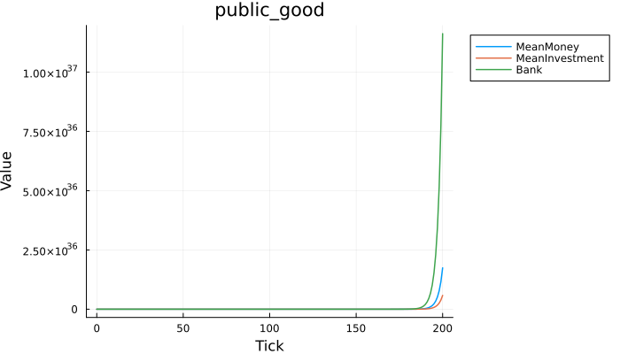
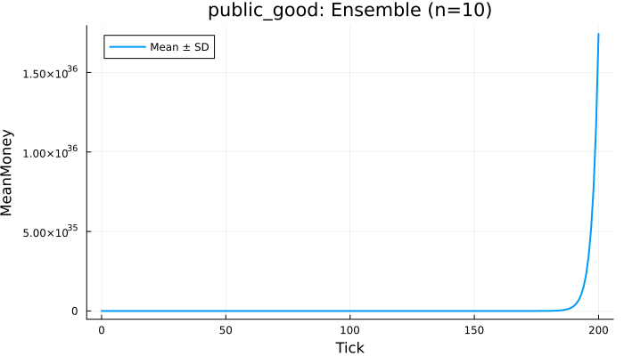
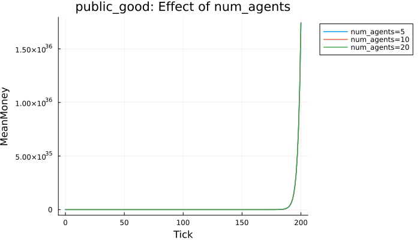

# Public Good


- [Overview](#overview)
  - [WHAT IS IT?](#what-is-it)
  - [HOW IT WORKS](#how-it-works)
  - [THINGS TO NOTICE](#things-to-notice)
  - [THINGS TO TRY](#things-to-try)
  - [CREDITS AND REFERENCES](#credits-and-references)
  - [HOW TO CITE](#how-to-cite)
  - [COPYRIGHT AND LICENSE](#copyright-and-license)
- [Parameters](#parameters)
- [Source Code](#source-code)
- [Time Series](#time-series)
- [Ensemble Runs](#ensemble-runs)
- [Parameter Sensitivity](#parameter-sensitivity)
- [Appendix: Source Code](#appendix-source-code)
  - [Parameters (`parameters.jl`)](#parameters-parametersjl)
  - [Components (`components.jl`)](#components-componentsjl)
  - [Resources (`resources.jl`)](#resources-resourcesjl)
  - [Systems (`systems.jl`)](#systems-systemsjl)
  - [Model (`model.jl`)](#model-modeljl)

## Overview

### WHAT IS IT?

Public Good is a game that asks each of the players to contribute to a
common pool that will then be multiplied by the game leader and
redistributed to all players.

The standard economic prediction based on ‘rational’ behavior is that
all individuals will contribute nothing. However, in practice, players
show a wide diversity of strategies. This game also allows players to
pay to remove money from players who are ‘doing too well.’

The game can be used to demonstrate basic multiplication, cooperative
behavior, and the evolution of altruism as players negotiate fair play.

### HOW IT WORKS

At the beginning of the game, all players are given the same amount of
money. Each turn begins with players anonymously deciding how much money
to contribute to a common pool held by the game leader. Then the game
leader collects the money and multiplies it by a number greater than
one, and then redistributes this money to all the players. At any point
during the game a player may press the “punish the rich” button which
takes away one dollar from the presser and one dollar from the richest
player. The game continues like this until the game leader decides it is
an appropriate time to stop.

### THINGS TO NOTICE

Discussion on the following topics may be appropriate for different
levels of players:

- How does the fraction slider affect how much money is given to the
  bank?
- How does the participation of other players affect the outcome for
  each individual?
- Can predictions be made about how much money will be returned for
  specific investments? Are the predictions correct? Why or why not?
- How do different individuals play? What is the best way to play? Would
  this change if individuals were put into small teams who competed
  against one another?
- What role does punishment play in this game? How can it be used
  effectively?
- How is this game like or not like real life situations where
  cooperation is necessary?
- How might situations like this in real life lead to altruistic
  behavior on the part of the participants?

### THINGS TO TRY

Try playing the game once with labels “Off” then once with labels “On.”
Does this change the game play?

Try changing the multiplier that the bank uses to increase the money
before it is redistributed.

### CREDITS AND REFERENCES

Here are some references to increase your understanding and appreciation
of this game and others like it

Henrich, J. and R. Boyd and S.Bowles and C. Camerer and E.Fehr and H.
Gintis and R. McElreath (2001) Cooperation, Reciprocity and Punishment
in Fifteen Small-scale Societies,” Working Papers 01-01-007, Santa Fe
Institute.

Sanfey, A. et al. (2003) The Neural basis of economic decision-making in
the ultimatum game. Science 300: 1755-1758.

### HOW TO CITE

If you mention this model in a publication, we ask that you include
these citations for the model itself and for the NetLogo software:

- Wilensky, U. (2003). NetLogo HubNet Public Good model.
  http://ccl.northwestern.edu/netlogo/models/HubNetPublicGood. Center
  for Connected Learning and Computer-Based Modeling, Northwestern
  Institute on Complex Systems, Northwestern University, Evanston, IL.
- Wilensky, U. (1999). NetLogo. http://ccl.northwestern.edu/netlogo/.
  Center for Connected Learning and Computer-Based Modeling,
  Northwestern Institute on Complex Systems, Northwestern University,
  Evanston, IL.

### COPYRIGHT AND LICENSE

Copyright 2003 Uri Wilensky.


This work is licensed under the Creative Commons
Attribution-NonCommercial-ShareAlike 3.0 License. To view a copy of this
license, visit http://creativecommons.org/licenses/by-nc-sa/3.0/ or send
a letter to Creative Commons, 559 Nathan Abbott Way, Stanford,
California 94305, USA.

Commercial licenses are also available. To inquire about commercial
licenses, please contact Uri Wilensky at uri@northwestern.edu.

This activity and associated models and materials were created as part
of the projects: PARTICIPATORY SIMULATIONS: NETWORK-BASED DESIGN FOR
SYSTEMS LEARNING IN CLASSROOMS and/or INTEGRATED SIMULATION AND MODELING
ENVIRONMENT. The project gratefully acknowledges the support of the
National Science Foundation (REPP & ROLE programs) – grant numbers REC
\#9814682 and REC-0126227.

## Parameters

| Parameter | Type | Default | Description |
|----|----|----|----|
| `num_agents` | `Int` | `10` | num agents |
| `initial_money` | `Float64` | `10.0` | initial money |
| `multiplier` | `Float64` | `2.0` | bank is multiplied by this before redistribution |
| `fraction_put_in` | `Float64` | `0.5` | fraction of money each agent invests |
| `punishment_cost` | `Float64` | `1.0` | cost to punisher and punished |
| `punish` | `Bool` | `false` | whether punishment mechanism is active |
| `max_ticks` | `Int` | `200` | max ticks |

## Source Code

The Julia code to run this model:

``` julia
using ArkModelZoo
_, trajectory = run_public_good()
```

## Time Series



## Ensemble Runs

Ten replicates with different random seeds, showing mean ± standard
deviation.



## Parameter Sensitivity

Varying `num_agents`.



## Appendix: Source Code

This model is implemented in the
[Ark.jl](https://github.com/sdwfrost/Ark.jl) Entity-Component-System
(ECS) framework. The code is split into five files, each with a distinct
role:

- **Parameters**: a mutable struct holding all configurable values.
- **Components**: lightweight data types attached to individual entities
  (agents).
- **Resources**: world-level shared state accessible to all systems.
- **Systems**: functions that operate on entities each tick, defining
  model behavior.
- **Model**: wiring that assembles the world, registers resources and
  systems, and provides the run entry point.

### Parameters (`parameters.jl`)

The parameter struct uses `@kwdef` so that every field has a default
value and can be overridden by keyword. These defaults match the
original NetLogo model’s slider settings.

``` julia
Base.@kwdef mutable struct PGParams
    num_agents::Int = 10
    initial_money::Float64 = 10.0
    multiplier::Float64 = 2.0        # bank is multiplied by this before redistribution
    fraction_put_in::Float64 = 0.5   # fraction of money each agent invests
    punishment_cost::Float64 = 1.0   # cost to punisher and punished
    punish::Bool = false              # whether punishment mechanism is active
    max_ticks::Int = 200
    seed::Int = 42
end
```

### Components (`components.jl`)

Components are lightweight data types attached to individual entities
(agents). Mutable structs hold per-entity state, while empty tag structs
act as markers for the ECS query system to efficiently filter entities.

``` julia
mutable struct PGStudent
    id::Int
    money::Float64
    investment::Float64
    fraction_put_in::Float64
end
PGStudent() = PGStudent(0, 0.0, 0.0, 0.5)
```

### Resources (`resources.jl`)

Resources are world-level singletons shared across all systems, used for
global state and aggregate statistics.

``` julia
mutable struct PGStats
    mean_money::Float64
    mean_investment::Float64
    bank::Float64
    turn::Int
end
PGStats() = PGStats(0.0, 0.0, 0.0, 0)
```

### Systems (`systems.jl`)

Systems contain the model logic and execute in a defined order each
tick. Each system struct implements either `initialize!` (run once at
setup) or `update!` (run every tick).

``` julia
# NetLogo-compatible rounding (round half up, not banker's rounding)
# Use Float64 to avoid Int64 overflow with exponentially growing values
_nl_round(x) = floor(x + 0.5)

# --- Initialization ---

struct InitPGSystem <: System end

function initialize!(::InitPGSystem, world::World)
    params = get_resource(world, PGParams)

    for i in 1:params.num_agents
        ag = PGStudent()
        ag.id = i
        ag.money = params.initial_money
        ag.fraction_put_in = params.fraction_put_in
        ag.investment = 0.0
        new_entity!(world, (ag,))
    end

    _pg_update_stats!(world)
    return nothing
end

# --- Go: take money, multiply, distribute ---
# Each round: agents invest fraction of their money, pool is multiplied,
# then divided equally among all agents.

struct PGGoSystem <: System end

function update!(::PGGoSystem, world::World)
    params = get_resource(world, PGParams)
    rng = get_resource(world, RNGResource).rng
    stats = get_resource(world, PGStats)

    # Collect agents
    agents = PGStudent[]
    eids = Entity[]
    for (e_arr, ag_arr) in Query(world, (PGStudent,))
        for i in eachindex(e_arr)
            push!(eids, e_arr[i])
            push!(agents, ag_arr[i])
        end
    end
    Random.shuffle!(rng, agents)

    n = length(agents)
    n == 0 && return nothing

    # Take money: each agent invests
    bank = 0.0
    for ag in agents
        ag.investment = Float64(_nl_round(ag.fraction_put_in * ag.money))
        bank += ag.investment
        ag.money -= ag.investment
    end

    # Multiply the bank
    bank *= params.multiplier

    # Distribute equally
    share = bank / n
    for ag in agents
        ag.money += share
    end

    # Optional punishment: all agents pay, then richest pays again
    if params.punish
        for ag in agents
            ag.money -= params.punishment_cost
        end
        richest = agents[1]
        for ag in agents
            if ag.money > richest.money
                richest = ag
            end
        end
        richest.money -= params.punishment_cost
    end

    stats.turn += 1
    stats.bank = bank
    _pg_update_stats!(world)
    return nothing
end

function _pg_update_stats!(world::World)
    stats = get_resource(world, PGStats)
    money_total = 0.0
    invest_total = 0.0
    n = 0
    for (_, ag_arr) in Query(world, (PGStudent,))
        for ag in ag_arr
            money_total += ag.money
            invest_total += ag.investment
            n += 1
        end
    end
    if n > 0
        stats.mean_money = money_total / n
        stats.mean_investment = invest_total / n
    end
end

# --- Termination ---

struct PGTerminationSystem <: System end

function update!(::PGTerminationSystem, world::World)
    params = get_resource(world, PGParams)
    tick = get_resource(world, Tick)
    if tick.tick + 1 >= params.max_ticks
        get_resource(world, Terminate).stop = true
    end
    return nothing
end
```

### Model (`model.jl`)

The model file assembles all pieces: it creates the ECS `World` with the
required component types, registers resources, builds the `Scheduler`
with systems in execution order, and exposes the public `run` entry
point. The observer pattern records the trajectory each tick.

``` julia
function pg_world(; initial_capacity::Int = 64)
    return World(PGStudent; initial_capacity = initial_capacity, allow_mutable = true)
end

function pg_systems()
    return (
        InitPGSystem(),
        PGGoSystem(),
        PGTerminationSystem(),
    )
end

function pg_model(params::PGParams = PGParams())
    world = pg_world()
    _add_standard_resources!(world, params)
    add_resource!(world, PGStats())
    scheduler = Scheduler(world, pg_systems())
    initialize!(scheduler)
    return scheduler
end

struct PGObserver end

function pg_headers(::PGObserver)
    return ["MeanMoney", "MeanInvestment", "Bank"]
end

function pg_values(::PGObserver, world::World)
    stats = get_resource(world, PGStats)
    return Float64[stats.mean_money, stats.mean_investment, stats.bank]
end

function run_public_good(; params::PGParams = PGParams(), observe::Bool = true)
    return _run_model(pg_model, PGObserver(), pg_values; params, observe)
end
```
