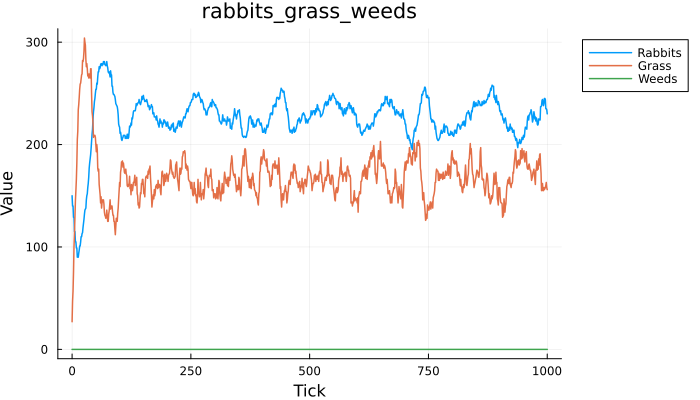
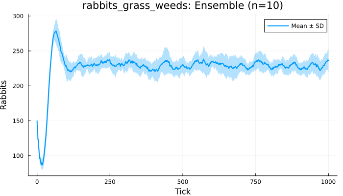
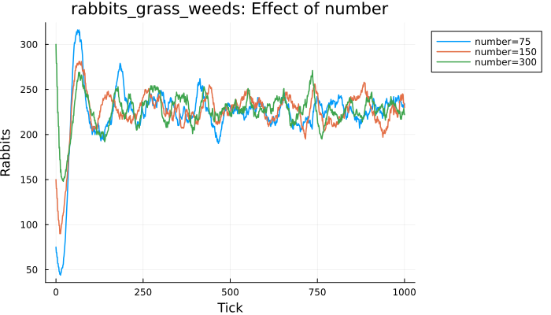

## Overview

### WHAT IS IT?

This project explores a simple ecosystem made up of rabbits, grass, and weeds. The rabbits wander around randomly, and the grass and weeds grow randomly.   When a rabbit bumps into some grass or weeds, it eats the grass and gains energy. If the rabbit gains enough energy, it reproduces. If it doesn't gain enough energy, it dies.

The grass and weeds can be adjusted to grow at different rates and give the rabbits differing amounts of energy.  The model can be used to explore the competitive advantages of these variables.

### THINGS TO NOTICE

Watch the COUNT RABBITS monitor and the POPULATIONS plot to see how the rabbit population changes over time. At first, there is not enough grass for the rabbits, and many rabbits die. But that allows the grass to grow more freely, providing an abundance of food for the remaining rabbits. The rabbits gain energy and reproduce. The abundance of rabbits leads to a shortage of grass, and the cycle begins again.

The rabbit population goes through a damped oscillation, eventually stabilizing in a narrow range. The total amount of grass also oscillates, out of phase with the rabbit population.

These dual oscillations are characteristic of predator-prey systems. Such systems are usually described by a set of differential equations known as the Lotka-Volterra equations. NetLogo provides a new way of studying predatory-prey systems and other ecosystems.

### THINGS TO TRY

Leaving other parameters alone, change the grass-grow-rate and let the system stabilize again.  Would you expect that there would now be more grass?  More rabbits?

Change only the birth-threshold of the rabbits.  How does this affect the steady-state levels of rabbits and grass?

With the current settings, the rabbit population goes through a damped oscillation. By changing the parameters, can you create an undamped oscillation? Or an unstable oscillation?

In the current version, each rabbit has the same birth-threshold. What would happen if each rabbit had a different birth-threshold? What if the birth-threshold of each new rabbit was slightly different from the birth-threshold of its parent? How would the values for birth-threshold evolve over time?

Now add weeds by making the sliders WEEDS-GROW-RATE the same as GRASS-GROW-RATE and WEEDS-ENERGY the same as GRASS-ENERGY.  Notice that the amount of grass and weeds is about the same.

Now make grass and weeds grow at different rates.  What happens?

What if the weeds grow at the same rate as grass, but they give less energy to the rabbits when eaten (WEEDS-ENERGY is less than GRASS-ENERGY)?

Think of other ways that two plant species might differ and try them out to see what happens to their relative populations.  For example, what if a weed could grow where there was already grass, but grass couldn't grow where there was a weed?  What if the rabbits preferred the plant that gave them the most energy?

Run the model for a bit, then suddenly change the birth threshold to zero.  What happens?

### NETLOGO FEATURES

Notice that every black patch has a random chance of growing grass or
weeds each turn, using the rule:

    if random-float 1000 < weeds-grow-rate
      [ set pcolor violet ]
    if random-float 1000 < grass-grow-rate
      [ set pcolor green ]

### RELATED MODELS

Wolf Sheep Predation is another interacting ecosystem with different rules.

### HOW TO CITE

If you mention this model or the NetLogo software in a publication, we ask that you include the citations below.

For the model itself:

* Wilensky, U. (2001).  NetLogo Rabbits Grass Weeds model.  http://ccl.northwestern.edu/netlogo/models/RabbitsGrassWeeds.  Center for Connected Learning and Computer-Based Modeling, Northwestern University, Evanston, IL.

Please cite the NetLogo software as:

* Wilensky, U. (1999). NetLogo. http://ccl.northwestern.edu/netlogo/. Center for Connected Learning and Computer-Based Modeling, Northwestern University, Evanston, IL.

### COPYRIGHT AND LICENSE

Copyright 2001 Uri Wilensky.


This model is licensed under the Creative Commons Attribution-NonCommercial-ShareAlike 3.0 License.  To view a copy of this license, visit https://creativecommons.org/licenses/by-nc-sa/3.0/ or send a letter to Creative Commons, 559 Nathan Abbott Way, Stanford, California 94305, USA.

NetLogo itself is free software for non-commercial use under the terms of the GNU General Public License ([see full license information here](https://ccl.northwestern.edu/netlogo/docs/copyright.html)).

To inquire about commercial licenses for either NetLogo or specific models from the models library, please contact netlogo-commercial-admin@ccl.northwestern.edu.

This model was created as part of the projects: PARTICIPATORY SIMULATIONS: NETWORK-BASED DESIGN FOR SYSTEMS LEARNING IN CLASSROOMS and/or INTEGRATED SIMULATION AND MODELING ENVIRONMENT. The project gratefully acknowledges the support of the National Science Foundation (REPP & ROLE programs) -- grant numbers REC #9814682 and REC-0126227.

<!-- 2001 -->

## Parameters

| Parameter | Type | Default | Description |
|-----------|------|---------|-------------|
| `number` | `Int` | `150` | number |
| `birth_threshold` | `Float64` | `15.0` | birth threshold |
| `grass_grow_rate` | `Float64` | `15.0` | grass grow rate |
| `weeds_grow_rate` | `Float64` | `0.0` | weeds grow rate |
| `grass_energy` | `Float64` | `5.0` | grass energy |
| `weed_energy` | `Float64` | `0.0` | weed energy |
| `grid_width` | `Int` | `41` | grid width |
| `grid_height` | `Int` | `41` | grid height |
| `max_ticks` | `Int` | `1000` | max ticks |

## Source Code

The Julia code to run this model:

```julia
using ArkModelZoo
_, trajectory = run_rgw()
```

## Time Series

{width=100%}

## Ensemble Runs

Ten replicates with different random seeds, showing mean ± standard deviation.

{width=100%}

## Parameter Sensitivity

Varying `number`.

{width=100%}


## Appendix: Source Code

This model is implemented in the [Ark.jl](https://github.com/sdwfrost/Ark.jl) Entity-Component-System (ECS) framework. The code is split into five files, each with a distinct role:

- **Parameters**: a mutable struct holding all configurable values.
- **Components**: lightweight data types attached to individual entities (agents).
- **Resources**: world-level shared state accessible to all systems.
- **Systems**: functions that operate on entities each tick, defining model behavior.
- **Model**: wiring that assembles the world, registers resources and systems, and provides the run entry point.

### Parameters (`parameters.jl`)

The parameter struct uses `@kwdef` so that every field has a default value and can be overridden by keyword. These defaults match the original NetLogo model's slider settings.

```julia
Base.@kwdef mutable struct RGWParams
    number::Int = 150
    birth_threshold::Float64 = 15.0
    grass_grow_rate::Float64 = 15.0
    weeds_grow_rate::Float64 = 0.0
    grass_energy::Float64 = 5.0
    weed_energy::Float64 = 0.0
    grid_width::Int = 41
    grid_height::Int = 41
    max_ticks::Int = 1000
    seed::Int = 42
end
```

### Components (`components.jl`)

Components are lightweight data types attached to individual entities (agents). Mutable structs hold per-entity state, while empty tag structs act as markers for the ECS query system to efficiently filter entities.

```julia
mutable struct RGWPosition
    x::Float64
    y::Float64
end

mutable struct RGWHeading
    heading::Float64
end

mutable struct RGWEnergy
    energy::Float64
end
```

### Resources (`resources.jl`)

Resources are world-level singletons shared across all systems, used for global state and aggregate statistics.

```julia
# Patch states: 0=empty(black), 1=grass(green), 2=weeds(violet)
const RGW_EMPTY = Int8(0)
const RGW_GRASS = Int8(1)
const RGW_WEEDS = Int8(2)

mutable struct RGWPatchGrid
    width::Int
    height::Int
    patches::Matrix{Int8}
end
function RGWPatchGrid(w::Int, h::Int)
    RGWPatchGrid(w, h, zeros(Int8, w, h))
end

mutable struct RGWStats
    num_rabbits::Int
    num_grass::Int
    num_weeds::Int
end
RGWStats() = RGWStats(0, 0, 0)
```

### Systems (`systems.jl`)

Systems contain the model logic and execute in a defined order each tick. Each system struct implements either `initialize!` (run once at setup) or `update!` (run every tick).

```julia
# Rabbits Grass Weeds systems
# Matches NetLogo execution order:
#   grow-grass-and-weeds
#   ask rabbits [ move; eat-grass; eat-weeds; reproduce; death ]

# --- Initialization ---

struct InitRGWSystem <: System end

function initialize!(::InitRGWSystem, world::World)
    params = get_resource(world, RGWParams)
    rng = get_resource(world, RNGResource).rng
    grid = get_resource(world, RGWPatchGrid)
    w, h = grid.width, grid.height

    # Grow initial grass and weeds on all patches
    for x in 1:w, y in 1:h
        if rand(rng) * 1000.0 < params.weeds_grow_rate
            grid.patches[x, y] = RGW_WEEDS
        end
        if rand(rng) * 1000.0 < params.grass_grow_rate
            grid.patches[x, y] = RGW_GRASS
        end
    end

    # Create rabbits with random positions and energy 0..9
    for _ in 1:params.number
        x = rand(rng) * w
        y = rand(rng) * h
        e = Float64(rand(rng, 0:9))
        heading = Float64(rand(rng, 0:359))
        new_entity!(world, (RGWPosition(x, y), RGWHeading(heading), RGWEnergy(e)))
    end

    # Compute initial stats
    stats = get_resource(world, RGWStats)
    stats.num_rabbits = params.number
    _rgw_count_patches!(stats, grid)
    return nothing
end

# --- Main Go System ---

mutable struct RGWGoSystem <: System
    new_rabbits::Vector{Tuple{Float64, Float64, Float64, Float64}}  # x, y, energy, heading
end
RGWGoSystem() = RGWGoSystem(Tuple{Float64,Float64,Float64,Float64}[])

function update!(system::RGWGoSystem, world::World)
    params = get_resource(world, RGWParams)
    rng = get_resource(world, RNGResource).rng
    grid = get_resource(world, RGWPatchGrid)
    stats = get_resource(world, RGWStats)
    w, h = grid.width, grid.height

    # Check if any rabbits exist; if not, stop
    rabbit_count = 0
    for (eids, _) in Query(world, (RGWPosition,))
        rabbit_count += length(eids)
    end
    if rabbit_count == 0
        get_resource(world, Terminate).stop = true
        stats.num_rabbits = 0
        _rgw_count_patches!(stats, grid)
        return nothing
    end

    # Grow grass and weeds on empty patches
    for x in 1:w, y in 1:h
        if grid.patches[x, y] == RGW_EMPTY
            if rand(rng) * 1000.0 < params.weeds_grow_rate
                grid.patches[x, y] = RGW_WEEDS
            end
            if rand(rng) * 1000.0 < params.grass_grow_rate
                grid.patches[x, y] = RGW_GRASS
            end
        end
    end

    # Ask rabbits (shuffled): move, eat-grass, eat-weeds, reproduce, death
    empty!(system.new_rabbits)
    to_remove = Entity[]

    for (eids, positions, headings, energies) in Query(world, (RGWPosition, RGWHeading, RGWEnergy))
        indices = collect(eachindex(positions))
        Random.shuffle!(rng, indices)
        @inbounds for i in indices
            pos = positions[i]
            hdg = headings[i]
            eng = energies[i]

            # Move: rt random 50; lt random 50; fd 1; energy -= 0.5
            hdg.heading += Float64(rand(rng, 0:49))
            hdg.heading -= Float64(rand(rng, 0:49))
            θ = deg2rad(hdg.heading)
            pos.x = mod(pos.x + sin(θ), Float64(w))
            pos.y = mod(pos.y + cos(θ), Float64(h))
            eng.energy -= 0.5

            # Patch lookup: round to nearest grid cell (1-indexed)
            gx = clamp(floor(Int, pos.x) + 1, 1, w)
            gy = clamp(floor(Int, pos.y) + 1, 1, h)

            # Eat grass
            if grid.patches[gx, gy] == RGW_GRASS
                grid.patches[gx, gy] = RGW_EMPTY
                eng.energy += params.grass_energy
            end

            # Eat weeds
            if grid.patches[gx, gy] == RGW_WEEDS
                grid.patches[gx, gy] = RGW_EMPTY
                eng.energy += params.weed_energy
            end

            # Reproduce: if energy > threshold, energy /= 2, hatch 1 [fd 1]
            if eng.energy > params.birth_threshold
                eng.energy /= 2.0
                push!(system.new_rabbits, (pos.x, pos.y, eng.energy, hdg.heading))
            end

            # Death: if energy < 0, die
            if eng.energy < 0.0
                push!(to_remove, eids[i])
            end
        end
    end

    # Remove dead rabbits
    for e in to_remove
        is_alive(world, e) && remove_entity!(world, e)
    end

    # Spawn offspring — NetLogo: hatch 1 [fd 1]
    for (x, y, e, h_angle) in system.new_rabbits
        θ = deg2rad(h_angle)
        nx = mod(x + sin(θ), Float64(w))
        ny = mod(y + cos(θ), Float64(h))
        new_entity!(world, (RGWPosition(nx, ny), RGWHeading(h_angle), RGWEnergy(e)))
    end

    # Update stats
    new_count = 0
    for (eids, _) in Query(world, (RGWPosition,))
        new_count += length(eids)
    end
    stats.num_rabbits = new_count
    _rgw_count_patches!(stats, grid)
    return nothing
end

function _rgw_count_patches!(stats::RGWStats, grid::RGWPatchGrid)
    grass = 0
    weeds = 0
    for x in 1:grid.width, y in 1:grid.height
        p = grid.patches[x, y]
        if p == RGW_GRASS
            grass += 1
        elseif p == RGW_WEEDS
            weeds += 1
        end
    end
    stats.num_grass = grass
    stats.num_weeds = weeds
    return nothing
end

# --- Termination ---

struct RGWTerminationSystem <: System end

function update!(::RGWTerminationSystem, world::World)
    tick = get_resource(world, Tick)
    params = get_resource(world, RGWParams)
    stats = get_resource(world, RGWStats)

    if stats.num_rabbits == 0 || tick.tick + 1 >= params.max_ticks
        get_resource(world, Terminate).stop = true
    end
    return nothing
end
```

### Model (`model.jl`)

The model file assembles all pieces: it creates the ECS `World` with the required component types, registers resources, builds the `Scheduler` with systems in execution order, and exposes the public `run` entry point. The observer pattern records the trajectory each tick.

```julia
function rgw_world(; initial_capacity::Int = 4096)
    return World(
        RGWPosition,
        RGWHeading,
        RGWEnergy;
        initial_capacity = initial_capacity,
        allow_mutable = true,
    )
end

function rgw_systems()
    return (
        InitRGWSystem(),
        RGWGoSystem(),
        RGWTerminationSystem(),
    )
end

function rgw_model(params::RGWParams = RGWParams())
    world = rgw_world()
    _add_standard_resources!(world, params)
    add_resource!(world, RGWPatchGrid(params.grid_width, params.grid_height))
    add_resource!(world, RGWStats())
    scheduler = Scheduler(world, rgw_systems())
    initialize!(scheduler)
    return scheduler
end

struct RGWObserver end

function rgw_headers(::RGWObserver)
    return ["Rabbits", "Grass", "Weeds"]
end

function rgw_values(::RGWObserver, world::World)
    stats = get_resource(world, RGWStats)
    return Float64[stats.num_rabbits, stats.num_grass, stats.num_weeds]
end

function run_rgw(; params::RGWParams = RGWParams(), observe::Bool = true)
    return _run_model(rgw_model, RGWObserver(), rgw_values; params, observe)
end
```
