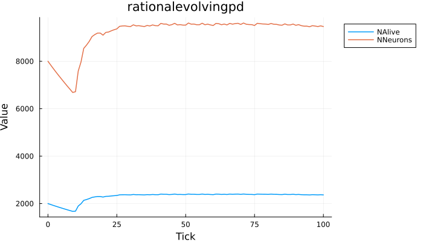
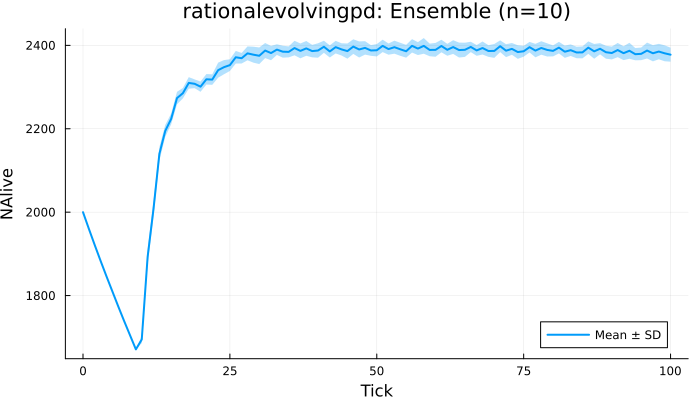
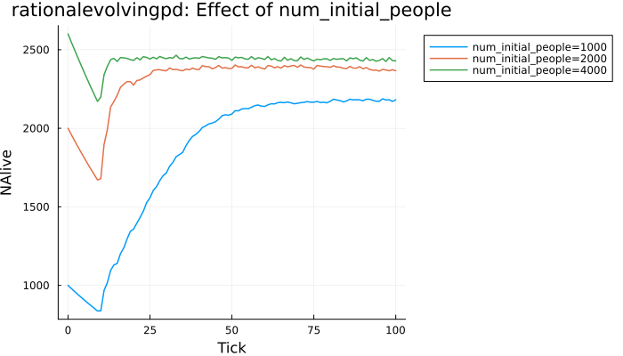

## Overview

This vignette demonstrates the **Rational Evolving PD** model implemented in [ArkModelZoo.jl](https://github.com/sdwfrost/ArkModelZoo.jl) using the Ark.jl ECS framework.

## Parameters

| Parameter | Type | Default | Description |
|-----------|------|---------|-------------|
| `grid_size` | `Int` | `51` | grid size |
| `num_initial_people` | `Int` | `2000` | num initial people |
| `people_birth_energy` | `Float64` | `12.0` | people birth energy |
| `energy_cost_per_person` | `Float64` | `0.6` | energy cost per person |
| `people_birth_threshold` | `Float64` | `36.0` | people birth threshold |
| `relative_genetic_variation` | `Float64` | `50.0` | relative genetic variation |
| `max_brain_size` | `Int` | `4` | max brain size |
| `resource_competition` | `Float64` | `0.0` | resource competition |
| `best_competition` | `Int` | `2` | best competition |
| `forgetfulness` | `Float64` | `0.25` | forgetfulness |
| `energy_cost_per_neuron` | `Float64` | `0.0` | energy cost per neuron |
| `payoff_CC` | `Float64` | `3.0` | payoff CC |
| `payoff_CD` | `Float64` | `0.0` | payoff CD |
| `payoff_DC` | `Float64` | `5.0` | payoff DC |
| `payoff_DD` | `Float64` | `1.0` | payoff DD |
| `emo_CC` | `Float64` | `3.0` | emo CC |
| `emo_CD` | `Float64` | `0.0` | emo CD |
| `emo_DC` | `Float64` | `5.0` | emo DC |
| `emo_DD` | `Float64` | `1.0` | emo DD |
| `max_ticks` | `Int` | `100` | max ticks |

## Source Code

The Julia code to run this model:

```julia
using ArkModelZoo
_, trajectory = run_rationalevolvingpd()
```

## Time Series

{width=100%}

## Ensemble Runs

Ten replicates with different random seeds, showing mean ± standard deviation.

{width=100%}

## Parameter Sensitivity

Varying `num_initial_people`.

{width=100%}


## Appendix: Source Code

This model is implemented in the [Ark.jl](https://github.com/sdwfrost/Ark.jl) Entity-Component-System (ECS) framework. The code is split into five files, each with a distinct role:

- **Parameters**: a mutable struct holding all configurable values.
- **Components**: lightweight data types attached to individual entities (agents).
- **Resources**: world-level shared state accessible to all systems.
- **Systems**: functions that operate on entities each tick, defining model behavior.
- **Model**: wiring that assembles the world, registers resources and systems, and provides the run entry point.

### Parameters (`parameters.jl`)

The parameter struct uses `@kwdef` so that every field has a default value and can be overridden by keyword. These defaults match the original NetLogo model's slider settings.

```julia
Base.@kwdef mutable struct REPDParams
    grid_size::Int = 51
    num_initial_people::Int = 2000
    people_birth_energy::Float64 = 12.0
    energy_cost_per_person::Float64 = 0.6
    people_birth_threshold::Float64 = 36.0
    relative_genetic_variation::Float64 = 50.0
    max_brain_size::Int = 4
    resource_competition::Float64 = 0.0
    best_competition::Int = 2
    forgetfulness::Float64 = 0.25
    energy_cost_per_neuron::Float64 = 0.0
    # Payoff matrix: [C vs C, C vs D; D vs C, D vs D] = [3, 0; 5, 1]
    payoff_CC::Float64 = 3.0
    payoff_CD::Float64 = 0.0
    payoff_DC::Float64 = 5.0
    payoff_DD::Float64 = 1.0
    # Emotion matrix defaults (same as energy matrix initially)
    emo_CC::Float64 = 3.0
    emo_CD::Float64 = 0.0
    emo_DC::Float64 = 5.0
    emo_DD::Float64 = 1.0
    max_ticks::Int = 100
    seed::Int = 42
end
```

### Components (`components.jl`)

Components are lightweight data types attached to individual entities (agents). Mutable structs hold per-entity state, while empty tag structs act as markers for the ECS query system to efficiently filter entities.

```julia
struct REPDDummy end
```

### Resources (`resources.jl`)

Resources are world-level singletons shared across all systems, used for global state and aggregate statistics.

```julia
mutable struct REPDState
    width::Int
    height::Int
    n_patches::Int
    alive::Vector{Bool}
    energy::Vector{Float64}
    # Emotion matrix per patch: 2×2 stored as 4 values [CC, CD, DC, DD]
    emo_matrix::Matrix{Float64}   # n_patches × 4
    # Neurons: imprint utility per event pattern, n_patches × 4
    # Event patterns: [C,C]=1, [C,D]=2, [D,C]=3, [D,D]=4
    neuron_imprint::Matrix{Float64}  # n_patches × 4
    counter::Vector{Int}
    partner::Vector{Int}         # 0 = no partner
    current_event::Vector{Int}   # last event pattern index (1-4), 0=none
    my_move::Vector{Int}         # 0=defect, 1=cooperate
    played::Vector{Bool}
    score::Vector{Float64}
end

function REPDState(w::Int, h::Int)
    n = w * h
    REPDState(
        w, h, n,
        fill(false, n),
        zeros(Float64, n),
        zeros(Float64, n, 4),
        zeros(Float64, n, 4),
        zeros(Int, n),
        zeros(Int, n),
        zeros(Int, n),
        zeros(Int, n),
        fill(false, n),
        zeros(Float64, n),
    )
end

mutable struct REPDStats
    n_alive::Int
    n_neurons::Int
end
REPDStats() = REPDStats(0, 0)
```

### Systems (`systems.jl`)

Systems contain the model logic and execute in a defined order each tick. Each system struct implements either `initialize!` (run once at setup) or `update!` (run every tick).

```julia
# --- Helper: get Von Neumann neighbors (non-wrapping) ---
function _repd_neighbors(idx::Int, w::Int, h::Int)
    x = mod1(idx, w)
    y = (idx - 1) ÷ w + 1
    nbs = Int[]
    if x > 1; push!(nbs, idx - 1); end
    if x < w; push!(nbs, idx + 1); end
    if y > 1; push!(nbs, idx - w); end
    if y < h; push!(nbs, idx + w); end
    return nbs
end

# Event pattern index: CC=1, CD=2, DC=3, DD=4
@inline function _event_idx(my_move::Int, partner_move::Int)
    return my_move * 2 + partner_move + 1
    # C=1,D=0: CC → 1*2+1+1=4... let me fix:
    # my_move: 1=C, 0=D; partner: 1=C, 0=D
    # We want: CC=1, CD=2, DC=3, DD=4
end

# Actually let's use: (my_move, partner_move) both 0 or 1
# CC(1,1)=1, CD(1,0)=2, DC(0,1)=3, DD(0,0)=4
@inline function _repd_event_idx(my::Int, partner::Int)
    if my == 1 && partner == 1; return 1; end
    if my == 1 && partner == 0; return 2; end
    if my == 0 && partner == 1; return 3; end
    return 4
end

# Payoff lookup: my_move (0=D,1=C) vs partner_move (0=D,1=C)
@inline function _repd_payoff(params::REPDParams, my::Int, partner::Int)
    if my == 1 && partner == 1; return params.payoff_CC; end
    if my == 1 && partner == 0; return params.payoff_CD; end
    if my == 0 && partner == 1; return params.payoff_DC; end
    return params.payoff_DD
end

# --- Initialization ---

struct InitREPDSystem <: System end

function initialize!(::InitREPDSystem, world::World)
    params = get_resource(world, REPDParams)
    rng = get_resource(world, RNGResource).rng
    state = get_resource(world, REPDState)
    stats = get_resource(world, REPDStats)

    n = state.n_patches
    # Select initial alive patches
    alive_indices = randperm(rng, n)[1:min(params.num_initial_people, n)]
    for idx in alive_indices
        state.alive[idx] = true
        state.energy[idx] = params.people_birth_energy
        state.counter[idx] = 20
        # Initialize emotion matrix with params defaults
        state.emo_matrix[idx, 1] = params.emo_CC
        state.emo_matrix[idx, 2] = params.emo_CD
        state.emo_matrix[idx, 3] = params.emo_DC
        state.emo_matrix[idx, 4] = params.emo_DD
        # Initialize 4 neurons with small random imprint
        for j in 1:4
            state.neuron_imprint[idx, j] = rand(rng) * 0.1
        end
        state.current_event[idx] = 0
        state.my_move[idx] = 0
        state.played[idx] = false
        state.partner[idx] = 0
    end

    n_alive = count(state.alive)
    stats.n_alive = n_alive
    stats.n_neurons = n_alive * 4
    return nothing
end

# --- Find Partners ---

struct REPDFindPartnersSystem <: System end

function update!(::REPDFindPartnersSystem, world::World)
    rng = get_resource(world, RNGResource).rng
    state = get_resource(world, REPDState)
    w, h = state.width, state.height

    # Reset pairing
    for i in 1:state.n_patches
        state.partner[i] = 0
        state.played[i] = false
        state.score[i] = 0.0
    end

    # Shuffle alive patches and pair them with random alive neighbor
    alive_list = findall(state.alive)
    perm = randperm(rng, length(alive_list))

    for pi in perm
        idx = alive_list[pi]
        state.partner[idx] != 0 && continue  # already paired
        nbs = _repd_neighbors(idx, w, h)
        # Filter alive unpaired neighbors
        candidates = Int[]
        for nb in nbs
            if state.alive[nb] && state.partner[nb] == 0 && nb != idx
                push!(candidates, nb)
            end
        end
        isempty(candidates) && continue
        partner = candidates[rand(rng, 1:length(candidates))]
        state.partner[idx] = partner
        state.partner[partner] = idx
    end
    return nothing
end

# --- Play PD Round ---

struct REPDPlaySystem <: System end

function update!(::REPDPlaySystem, world::World)
    params = get_resource(world, REPDParams)
    rng = get_resource(world, RNGResource).rng
    state = get_resource(world, REPDState)

    for i in 1:state.n_patches
        state.alive[i] || continue
        state.partner[i] == 0 && continue
        state.played[i] && continue

        partner = state.partner[i]

        # Decision: fire neurons based on last event
        my_decision = _repd_decide(state, i, rng)
        partner_decision = _repd_decide(state, partner, rng)

        state.my_move[i] = my_decision
        state.my_move[partner] = partner_decision

        # Compute event index
        ev_i = _repd_event_idx(my_decision, partner_decision)
        ev_p = _repd_event_idx(partner_decision, my_decision)
        state.current_event[i] = ev_i
        state.current_event[partner] = ev_p

        # Payoffs
        state.score[i] = _repd_payoff(params, my_decision, partner_decision)
        state.score[partner] = _repd_payoff(params, partner_decision, my_decision)

        state.played[i] = true
        state.played[partner] = true

        # Update neuron imprints based on outcome (reinforcement learning)
        _repd_learn!(state, params, i, ev_i)
        _repd_learn!(state, params, partner, ev_p)
    end
    return nothing
end

function _repd_decide(state::REPDState, idx::Int, rng)
    # If no previous event, random choice
    if state.current_event[idx] == 0
        return rand(rng, 0:1)
    end
    # Fire neuron for current event, weighted by emotion
    ev = state.current_event[idx]
    imprint = state.neuron_imprint[idx, ev]
    # Cooperate if imprint > 0 (positive association), else defect
    intensity = imprint * state.emo_matrix[idx, ev]
    return intensity > 0.0 ? 1 : 0
end

function _repd_learn!(state::REPDState, params::REPDParams, idx::Int, event_idx::Int)
    # Update imprint for this event: move toward emotion value
    emo_val = state.emo_matrix[idx, event_idx]
    old_imprint = state.neuron_imprint[idx, event_idx]
    # Reinforcement: blend toward normalized emotion
    state.neuron_imprint[idx, event_idx] = old_imprint * (1.0 - params.forgetfulness) + params.forgetfulness * emo_val / 5.0
end

# --- Energy & Survival ---

struct REPDEnergySystem <: System end

function update!(::REPDEnergySystem, world::World)
    params = get_resource(world, REPDParams)
    state = get_resource(world, REPDState)

    for i in 1:state.n_patches
        state.alive[i] || continue
        # Gain score from PD game
        if state.played[i]
            state.energy[i] += state.score[i]
        end
        # Pay per-tick cost
        state.energy[i] -= params.energy_cost_per_person
        # Pay neuron cost
        state.energy[i] -= 4 * params.energy_cost_per_neuron
    end
    return nothing
end

# --- Reproduction ---

struct REPDReproduceSystem <: System end

function update!(::REPDReproduceSystem, world::World)
    params = get_resource(world, REPDParams)
    rng = get_resource(world, RNGResource).rng
    state = get_resource(world, REPDState)
    w, h = state.width, state.height

    births = Tuple{Int, Int}[]  # (parent_idx, child_idx)
    for i in 1:state.n_patches
        state.alive[i] || continue
        state.energy[i] < params.people_birth_threshold && continue

        # Find empty neighbor
        nbs = _repd_neighbors(i, w, h)
        empty_nbs = filter(nb -> !state.alive[nb], nbs)
        isempty(empty_nbs) && continue

        child = empty_nbs[rand(rng, 1:length(empty_nbs))]
        push!(births, (i, child))
    end

    for (parent, child) in births
        state.alive[parent] || continue
        state.energy[parent] < params.people_birth_threshold && continue

        state.alive[child] = true
        state.energy[parent] -= params.people_birth_energy
        state.energy[child] = params.people_birth_energy
        state.counter[child] = 20
        state.current_event[child] = 0
        state.my_move[child] = 0
        state.played[child] = false
        state.partner[child] = 0

        # Inherit emotion matrix with mutation
        variation = params.relative_genetic_variation / 100.0
        for j in 1:4
            parent_val = state.emo_matrix[parent, j]
            mutated = parent_val + randn(rng) * abs(parent_val) * variation
            state.emo_matrix[child, j] = mutated
        end

        # Inherit neuron imprints with mutation
        for j in 1:4
            parent_val = state.neuron_imprint[parent, j]
            state.neuron_imprint[child, j] = parent_val + randn(rng) * 0.01
        end
    end
    return nothing
end

# --- Death ---

struct REPDDeathSystem <: System end

function update!(::REPDDeathSystem, world::World)
    params = get_resource(world, REPDParams)
    rng = get_resource(world, RNGResource).rng
    state = get_resource(world, REPDState)

    alive_list = findall(state.alive)
    isempty(alive_list) && return nothing

    # Kill patches with zero or negative energy
    for i in alive_list
        if state.energy[i] <= 0.0
            _repd_kill!(state, i)
        end
    end

    # Death race: cull bottom best_competition% by energy
    alive_list = findall(state.alive)
    n_alive = length(alive_list)
    n_alive <= 1 && return nothing

    if params.best_competition > 0
        n_cull = max(1, div(n_alive * params.best_competition, 100))
        # Sort alive by energy ascending
        sort!(alive_list, by = i -> state.energy[i])
        for k in 1:min(n_cull, length(alive_list))
            _repd_kill!(state, alive_list[k])
        end
    end
    return nothing
end

function _repd_kill!(state::REPDState, idx::Int)
    state.alive[idx] = false
    state.energy[idx] = 0.0
    state.partner[idx] = 0
    state.played[idx] = false
    state.current_event[idx] = 0
end

# --- Stats ---

struct REPDStatsSystem <: System end

function update!(::REPDStatsSystem, world::World)
    state = get_resource(world, REPDState)
    stats = get_resource(world, REPDStats)
    n_alive = count(state.alive)
    stats.n_alive = n_alive
    stats.n_neurons = n_alive * 4
    return nothing
end

# --- Termination ---

struct REPDTerminationSystem <: System end

function update!(::REPDTerminationSystem, world::World)
    params = get_resource(world, REPDParams)
    tick = get_resource(world, Tick)
    stats = get_resource(world, REPDStats)

    if stats.n_alive == 0 || tick.tick + 1 >= params.max_ticks
        get_resource(world, Terminate).stop = true
    end
    return nothing
end
```

### Model (`model.jl`)

The model file assembles all pieces: it creates the ECS `World` with the required component types, registers resources, builds the `Scheduler` with systems in execution order, and exposes the public `run` entry point. The observer pattern records the trajectory each tick.

```julia
function rationalevolvingpd_world(; initial_capacity::Int = 128)
    return World(REPDDummy; initial_capacity=initial_capacity, allow_mutable=true)
end

function rationalevolvingpd_systems()
    return (
        InitREPDSystem(),
        REPDFindPartnersSystem(),
        REPDPlaySystem(),
        REPDEnergySystem(),
        REPDReproduceSystem(),
        REPDDeathSystem(),
        REPDStatsSystem(),
        REPDTerminationSystem(),
    )
end

function rationalevolvingpd_model(params::REPDParams = REPDParams())
    world = rationalevolvingpd_world()
    _add_standard_resources!(world, params)
    add_resource!(world, REPDState(params.grid_size, params.grid_size))
    add_resource!(world, REPDStats())
    scheduler = Scheduler(world, rationalevolvingpd_systems())
    initialize!(scheduler)
    return scheduler
end

struct REPDObserver end

function rationalevolvingpd_headers(::REPDObserver)
    return ["NAlive", "NNeurons"]
end

function rationalevolvingpd_values(::REPDObserver, world::World)
    stats = get_resource(world, REPDStats)
    return Float64[Float64(stats.n_alive), Float64(stats.n_neurons)]
end

function run_rationalevolvingpd(; params::REPDParams = REPDParams(), observe::Bool = true)
    return _run_model(rationalevolvingpd_model, REPDObserver(), rationalevolvingpd_values; params, observe)
end
```
