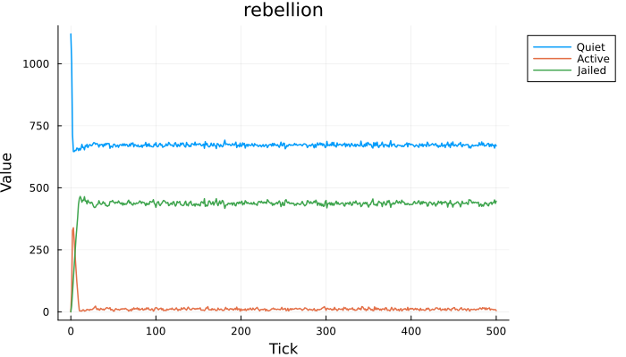
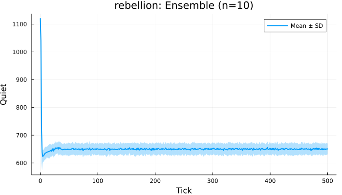
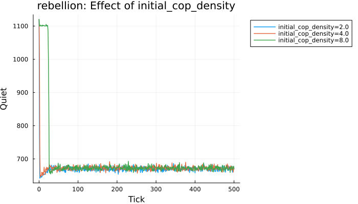

## Overview

### WHAT IS IT?

This project models the rebellion of a subjugated population against a central authority. It is is an adaptation of Joshua Epstein's model of civil violence (2002).

The population wanders around randomly. If their level of grievance against the central authority is high enough, and their perception of the risks involved is low enough, they openly rebel. A separate population of police officers ("cops"), acting on behalf of the central authority, seeks to suppress the rebellion. The cops wander around randomly and arrest people who are actively rebelling.

### HOW IT WORKS

Each "agent," or member of the general population, has an individual level of grievance toward the central authority. GRIEVANCE is based on the agent's PERCEIVED-HARDSHIP, which is assigned randomly at startup, and on GOVERNMENT-LEGITIMACY, which is global across agents and specified by a slider in the interface.

Each agent also calculates an individual risk of rebelling at the beginning of each turn.  This ESTIMATED-ARREST-PROBABILITY, is based on the number of cops and already rebelling agents within VISION patches, namely 1 - exp (- k * (C/A)<sub>v</sub>) --- where (C/A)<sub>v</sub> is the ratio of cops to active agents, and k is a constant set in "startup" to ensure a reasonable value when there is only one cop and one agent within a particular field of vision.  In our implementation, we changed one aspect of Epstein's description.  After dividing by C by A, we take the "floor" of the result (that is, round downwards to an integer).  Without this change, the model does not exhibit punctuated equilibrium.  The effect of the change is that if there are more rebels than cops in the neighborhood, the probability of arrest is zero, otherwise it is very nearly 1.0.  In other words, the rule could be written more simply as:

      ifelse a > c [ report 0 ] [ report 0.99 ]

An agent's NET-RISK is the product of the calculated ESTIMATED-ARREST-PROBABILITY and RISK-AVERSION randomly set for each agent at birth.

The model cycles through three different rules, known as M (move), A (agents) and C (cops):

- Movement rule M says that each cop and non-imprisoned agent moves to a random unoccupied site within VISION patches.

- Agent rule A says that if an agent's GRIEVANCE exceeds the NET-RISK by a small threshold (set by default to 0.1 in "setup"), the agent decides to rebel.  This is noted by changing the agent's border color from blue to red.  (It is also possible for the agent to move from rebellion to quiet, in which case the border color changes from red to blue.)

- Cop rule C says that each cop should look for active agents within VISION patches.  If at least one exists, the cop randomly selects one active agent and sends it to jail for a number of turns between 0 and MAX-JAIL-TERM (settable by a slider in the interface) and moves to the patch of the jailed agent. The patch of the jailed agent is considered unoccupied.

### THINGS TO NOTICE

Watch how agents exhibit deceptive behavior by changing their public state when cops are present, despite a constant level of private grievance. To see this press the WATCH ONE button, slow down the model, switch to the 3D view and zoom in on the selected agent. It may be easier to see this phenomenon if you change the sliders, especially reducing the VISION.

Watch the plot of active agents. Notice that it exhibits "punctuated equilibrium" --- periods of quiescence followed by periods of rebellion.

### THINGS TO TRY

Epstein claims that movement of the agents causes more frequent episodes of rebellion. Run the model with the MOVEMENT? switch on and off to see if you get this result.

Compare the effects of a gradual erosion in the perceived legitimacy of the central authority to a smaller, but immediate drop. For example, set GOVERNMENT-LEGITIMACY to 0.9 and reduce it to zero over 250 runs, plotting the legitimacy and the number of active agents. Now do another run, beginning with legitimacy at 0.9. This time, leave the legitimacy constant for 80 runs and then drop it to 0.7 at once. Observe the results. Try to explain them. Think of historical examples of this phenomena. What are the implications of this result for the strategy of revolutionary leaders?

Epstein quotes de Tocqueville: "It is not always when things are going from bad to worse that revolutions break out. On the contrary, it oftener happens that when a people that has put up with oppressive rule over a long period without protest suddenly finds the government relaxing its pressure, it takes up arms against it." Test de Tocqueville's observation in the model by comparing the effects of a gradual erosion in perceived legitimacy with a gradual erosion in the number of cops. Observe the results. Explain the difference.

### EXTENDING THE MODEL

Write a reporter procedure that reports `true` when there is a rebellion, `false` during quiescent periods.

Measure the intervals between episodes of rebellion. What is the distribution of these waiting times?

Try changing some of Epstein's assumptions as below. Do these changes create qualitative differences in results?

Change GOVERNMENT-LEGITIMACY such that it increases proportionally with the number of nearby jailed agents.

Change the model such that each agent's `grievance` is influenced by the value of other nearby agents.

### NETLOGO FEATURES

Note the use of a patch variable to store precomputed neighborhood agentsets.  This improves performance because the neighborhoods don't have to be calculated over and over again.

### CREDITS AND REFERENCES

This model, and the preceding explanation, is adapted from Joshua M. Epstein, "Modeling civil violence: An agent-based computational approach", Proceedings of the National Academy of Sciences, Vol. 99, Suppl. 3, May 14, 2002, and is available at
https://www.ncbi.nlm.nih.gov/pmc/articles/PMC128592/.

### HOW TO CITE

If you mention this model or the NetLogo software in a publication, we ask that you include the citations below.

For the model itself:

* Wilensky, U. (2004).  NetLogo Rebellion model.  http://ccl.northwestern.edu/netlogo/models/Rebellion.  Center for Connected Learning and Computer-Based Modeling, Northwestern University, Evanston, IL.

Please cite the NetLogo software as:

* Wilensky, U. (1999). NetLogo. http://ccl.northwestern.edu/netlogo/. Center for Connected Learning and Computer-Based Modeling, Northwestern University, Evanston, IL.

### COPYRIGHT AND LICENSE

Copyright 2004 Uri Wilensky.


This model is licensed under the Creative Commons Attribution-NonCommercial-ShareAlike 3.0 License.  To view a copy of this license, visit https://creativecommons.org/licenses/by-nc-sa/3.0/ or send a letter to Creative Commons, 559 Nathan Abbott Way, Stanford, California 94305, USA.

NetLogo itself is free software for non-commercial use under the terms of the GNU General Public License ([see full license information here](https://ccl.northwestern.edu/netlogo/docs/copyright.html)).

To inquire about commercial licenses for either NetLogo or specific models from the models library, please contact netlogo-commercial-admin@ccl.northwestern.edu.

This model was created as part of the projects: PARTICIPATORY SIMULATIONS: NETWORK-BASED DESIGN FOR SYSTEMS LEARNING IN CLASSROOMS and/or INTEGRATED SIMULATION AND MODELING ENVIRONMENT. The project gratefully acknowledges the support of the National Science Foundation (REPP & ROLE programs) -- grant numbers REC #9814682 and REC-0126227.

<!-- 2004 -->

## Parameters

| Parameter | Type | Default | Description |
|-----------|------|---------|-------------|
| `grid_width` | `Int` | `40` | NetLogo: 0-39 |
| `grid_height` | `Int` | `40` | grid height |
| `initial_cop_density` | `Float64` | `4.0` | percent |
| `initial_agent_density` | `Float64` | `70.0` | percent |
| `government_legitimacy` | `Float64` | `0.82` | government legitimacy |
| `max_jail_term` | `Int` | `30` | max jail term |
| `vision` | `Float64` | `7.0` | vision |
| `movement` | `Bool` | `true` | movement |
| `k` | `Float64` | `2.3` | k |
| `threshold` | `Float64` | `0.1` | threshold |
| `max_ticks` | `Int` | `500` | max ticks |

## Source Code

The Julia code to run this model:

```julia
using ArkModelZoo
_, trajectory = run_rebellion()
```

## Time Series

{width=100%}

## Ensemble Runs

Ten replicates with different random seeds, showing mean ± standard deviation.

{width=100%}

## Parameter Sensitivity

Varying `initial_cop_density`.

{width=100%}


## Appendix: Source Code

This model is implemented in the [Ark.jl](https://github.com/sdwfrost/Ark.jl) Entity-Component-System (ECS) framework. The code is split into five files, each with a distinct role:

- **Parameters**: a mutable struct holding all configurable values.
- **Components**: lightweight data types attached to individual entities (agents).
- **Resources**: world-level shared state accessible to all systems.
- **Systems**: functions that operate on entities each tick, defining model behavior.
- **Model**: wiring that assembles the world, registers resources and systems, and provides the run entry point.

### Parameters (`parameters.jl`)

The parameter struct uses `@kwdef` so that every field has a default value and can be overridden by keyword. These defaults match the original NetLogo model's slider settings.

```julia
Base.@kwdef mutable struct REBParams
    grid_width::Int = 40           # NetLogo: 0-39
    grid_height::Int = 40
    initial_cop_density::Float64 = 4.0    # percent
    initial_agent_density::Float64 = 70.0 # percent
    government_legitimacy::Float64 = 0.82
    max_jail_term::Int = 30
    vision::Float64 = 7.0
    movement::Bool = true
    k::Float64 = 2.3
    threshold::Float64 = 0.1
    max_ticks::Int = 500
    seed::Int = 42
end
```

### Components (`components.jl`)

Components are lightweight data types attached to individual entities (agents). Mutable structs hold per-entity state, while empty tag structs act as markers for the ECS query system to efficiently filter entities.

```julia
mutable struct REBAgent
    x::Int
    y::Int
    risk_aversion::Float64
    perceived_hardship::Float64
    active::Bool
    jail_term::Int
end
REBAgent() = REBAgent(0, 0, 0.0, 0.0, false, 0)

mutable struct REBCop
    x::Int
    y::Int
end
REBCop() = REBCop(0, 0)
```

### Resources (`resources.jl`)

Resources are world-level singletons shared across all systems, used for global state and aggregate statistics.

```julia
mutable struct REBGrid
    width::Int
    height::Int
    cells::Matrix{Entity}              # agent or cop entity (zero_entity if empty)
    neighborhoods::Array{Vector{Tuple{Int,Int}}, 2}  # cached
end

function REBGrid(w::Int, h::Int, vision::Float64)
    cells = fill(zero_entity, w, h)
    neighborhoods = Array{Vector{Tuple{Int,Int}}}(undef, w, h)
    v = floor(Int, vision)
    for x in 1:w, y in 1:h
        nb = Tuple{Int,Int}[]
        for dx in -v:v, dy in -v:v
            (dx == 0 && dy == 0) && continue
            if sqrt(dx^2 + dy^2) <= vision
                nx = mod1(x + dx, w)
                ny = mod1(y + dy, h)
                push!(nb, (nx, ny))
            end
        end
        neighborhoods[x, y] = nb
    end
    REBGrid(w, h, cells, neighborhoods)
end

mutable struct REBStats
    num_quiet::Int
    num_active::Int
    num_jailed::Int
end
REBStats() = REBStats(0, 0, 0)
```

### Systems (`systems.jl`)

Systems contain the model logic and execute in a defined order each tick. Each system struct implements either `initialize!` (run once at setup) or `update!` (run every tick).

```julia
struct InitREBSystem <: System end

function initialize!(::InitREBSystem, world::World)
    params = get_resource(world, REBParams)
    rng = get_resource(world, RNGResource).rng
    grid = get_resource(world, REBGrid)
    w, h = grid.width, grid.height

    # Collect all cells
    all_cells = [(x, y) for x in 1:w for y in 1:h]
    Random.shuffle!(rng, all_cells)

    n_patches = w * h
    n_cops = round(Int, params.initial_cop_density * 0.01 * n_patches)
    n_agents = round(Int, params.initial_agent_density * 0.01 * n_patches)

    idx = 1
    for _ in 1:n_cops
        x, y = all_cells[idx]; idx += 1
        eid = new_entity!(world, (REBCop(x, y),))
        grid.cells[x, y] = eid
    end

    for _ in 1:n_agents
        x, y = all_cells[idx]; idx += 1
        ra = rand(rng)
        ph = rand(rng)
        eid = new_entity!(world, (REBAgent(x, y, ra, ph, false, 0),))
        grid.cells[x, y] = eid
    end

    _reb_update_stats!(world)
    return nothing
end

struct REBGoSystem <: System end

function update!(::REBGoSystem, world::World)
    params = get_resource(world, REBParams)
    rng = get_resource(world, RNGResource).rng
    grid = get_resource(world, REBGrid)

    # Collect all turtles (agents + cops) with shuffled ask
    agents_list = Tuple{Entity, REBAgent}[]
    cops_list = Tuple{Entity, REBCop}[]
    for (eids, agents) in Query(world, (REBAgent,))
        @inbounds for i in eachindex(agents)
            push!(agents_list, (eids[i], agents[i]))
        end
    end
    for (eids, cops) in Query(world, (REBCop,))
        @inbounds for i in eachindex(cops)
            push!(cops_list, (eids[i], cops[i]))
        end
    end

    # Build combined list for "ask turtles" — agents and cops interleaved
    all_turtles = Vector{Tuple{Symbol, Int}}()
    for i in eachindex(agents_list)
        push!(all_turtles, (:agent, i))
    end
    for i in eachindex(cops_list)
        push!(all_turtles, (:cop, i))
    end
    Random.shuffle!(rng, all_turtles)

    for (kind, idx) in all_turtles
        if kind == :agent
            _, ag = agents_list[idx]
            # Move (if not jailed)
            if ag.jail_term == 0
                _reb_move!(rng, ag, grid, params, world)
            end
            # Determine behavior
            if ag.jail_term == 0
                grievance = ag.perceived_hardship * (1.0 - params.government_legitimacy)
                # Count cops and active agents in neighborhood
                nb = grid.neighborhoods[ag.x, ag.y]
                n_cops = 0; n_active = 0
                for (nx, ny) in nb
                    neid = grid.cells[nx, ny]
                    is_zero(neid) && continue
                    if has_components(world, neid, (REBCop,))
                        n_cops += 1
                    elseif has_components(world, neid, (REBAgent,))
                        nag = get_components(world, neid, (REBAgent,))[1]
                        if nag.active
                            n_active += 1
                        end
                    end
                end
                a_count = 1 + n_active
                arrest_prob = 1.0 - exp(-params.k * floor(n_cops / a_count))
                ag.active = (grievance - ag.risk_aversion * arrest_prob > params.threshold)
            end
        else  # cop
            _, cop = cops_list[idx]
            _reb_cop_move!(rng, cop, grid, params, world)
            # Enforce: arrest a random active agent in vision
            nb = grid.neighborhoods[cop.x, cop.y]
            active_in_vision = Tuple{Int,Int}[]
            for (nx, ny) in nb
                neid = grid.cells[nx, ny]
                is_zero(neid) && continue
                if has_components(world, neid, (REBAgent,))
                    nag = get_components(world, neid, (REBAgent,))[1]
                    if nag.active
                        push!(active_in_vision, (nx, ny))
                    end
                end
            end
            if !isempty(active_in_vision)
                sx, sy = active_in_vision[rand(rng, 1:length(active_in_vision))]
                seid = grid.cells[sx, sy]
                suspect = get_components(world, seid, (REBAgent,))[1]
                suspect.active = false
                suspect.jail_term = rand(rng, 0:max(params.max_jail_term - 1, 0))
                # Cop moves to suspect's patch
                grid.cells[cop.x, cop.y] = zero_entity
                cop.x = sx; cop.y = sy
                # Suspect stays but is jailed (they share cell briefly)
            end
        end
    end

    # Decrement jail terms
    for (_, ag) in agents_list
        if ag.jail_term > 0
            ag.jail_term -= 1
        end
    end

    _reb_update_stats!(world)
    return nothing
end

function _reb_move!(rng, ag::REBAgent, grid::REBGrid, params::REBParams, world::World)
    params.movement || return
    nb = grid.neighborhoods[ag.x, ag.y]
    targets = Tuple{Int,Int}[]
    for (nx, ny) in nb
        eid = grid.cells[nx, ny]
        if is_zero(eid)
            push!(targets, (nx, ny))
        elseif has_components(world, eid, (REBAgent,))
            nag = get_components(world, eid, (REBAgent,))[1]
            if nag.jail_term > 0
                push!(targets, (nx, ny))
            end
        end
    end
    isempty(targets) && return
    tx, ty = targets[rand(rng, 1:length(targets))]
    # Only move to truly empty cells (not just jailed — simplification for grid)
    if is_zero(grid.cells[tx, ty])
        grid.cells[ag.x, ag.y] = zero_entity
        grid.cells[tx, ty] = _reb_find_entity(world, ag)
        ag.x = tx; ag.y = ty
    end
end

function _reb_cop_move!(rng, cop::REBCop, grid::REBGrid, params::REBParams, world::World)
    nb = grid.neighborhoods[cop.x, cop.y]
    targets = Tuple{Int,Int}[]
    for (nx, ny) in nb
        eid = grid.cells[nx, ny]
        if is_zero(eid)
            push!(targets, (nx, ny))
        end
    end
    isempty(targets) && return
    tx, ty = targets[rand(rng, 1:length(targets))]
    eid_cop = grid.cells[cop.x, cop.y]
    grid.cells[cop.x, cop.y] = zero_entity
    grid.cells[tx, ty] = eid_cop
    cop.x = tx; cop.y = ty
end

function _reb_find_entity(world::World, ag::REBAgent)
    # Find the entity for this agent by scanning
    for (eids, agents) in Query(world, (REBAgent,))
        @inbounds for i in eachindex(agents)
            if agents[i] === ag
                return eids[i]
            end
        end
    end
    return zero_entity
end

function _reb_update_stats!(world::World)
    stats = get_resource(world, REBStats)
    nq = 0; na = 0; nj = 0
    for (_, agents) in Query(world, (REBAgent,))
        @inbounds for i in eachindex(agents)
            ag = agents[i]
            if ag.jail_term > 0
                nj += 1
            elseif ag.active
                na += 1
            else
                nq += 1
            end
        end
    end
    stats.num_quiet = nq
    stats.num_active = na
    stats.num_jailed = nj
end

struct REBTerminationSystem <: System end

function update!(::REBTerminationSystem, world::World)
    params = get_resource(world, REBParams)
    tick = get_resource(world, Tick)
    if tick.tick + 1 >= params.max_ticks
        get_resource(world, Terminate).stop = true
    end
    return nothing
end
```

### Model (`model.jl`)

The model file assembles all pieces: it creates the ECS `World` with the required component types, registers resources, builds the `Scheduler` with systems in execution order, and exposes the public `run` entry point. The observer pattern records the trajectory each tick.

```julia
function rebellion_world(; initial_capacity::Int = 4096)
    return World(REBAgent, REBCop; initial_capacity = initial_capacity, allow_mutable = true)
end

function rebellion_systems()
    return (InitREBSystem(), REBGoSystem(), REBTerminationSystem())
end

function rebellion_model(params::REBParams = REBParams())
    world = rebellion_world()
    _add_standard_resources!(world, params)
    add_resource!(world, REBGrid(params.grid_width, params.grid_height, params.vision))
    add_resource!(world, REBStats())
    scheduler = Scheduler(world, rebellion_systems())
    initialize!(scheduler)
    return scheduler
end

struct REBObserver end

function reb_headers(::REBObserver)
    return ["Quiet", "Active", "Jailed"]
end

function reb_values(::REBObserver, world::World)
    stats = get_resource(world, REBStats)
    return Float64[stats.num_quiet, stats.num_active, stats.num_jailed]
end

function run_rebellion(; params::REBParams = REBParams(), observe::Bool = true)
    return _run_model(rebellion_model, REBObserver(), reb_values; params, observe)
end
```
