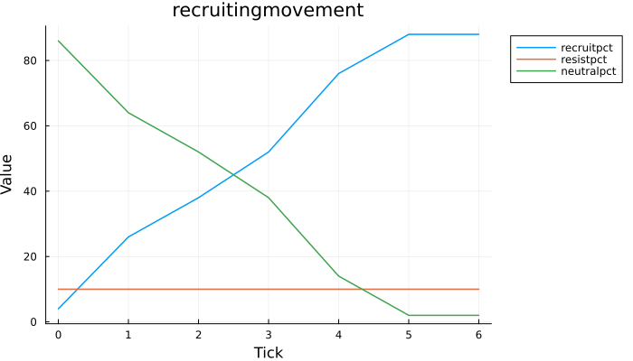
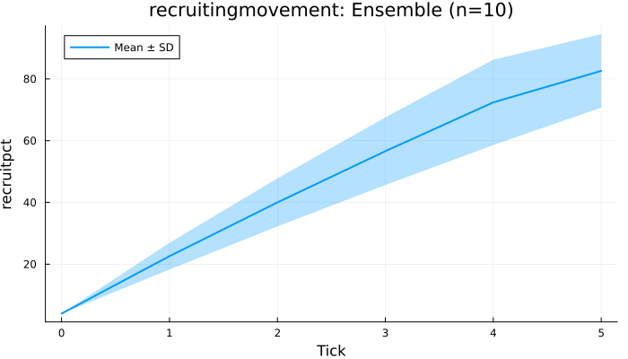
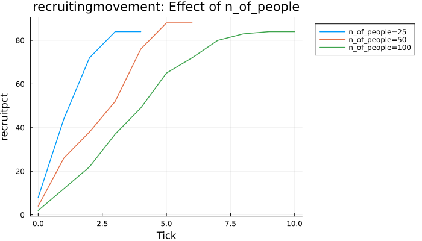

# Recruiting Movement


- [Overview](#overview)
- [Parameters](#parameters)
- [Source Code](#source-code)
- [Time Series](#time-series)
- [Ensemble Runs](#ensemble-runs)
- [Parameter Sensitivity](#parameter-sensitivity)
- [Appendix: Source Code](#appendix-source-code)
  - [Parameters (`parameters.jl`)](#parameters-parametersjl)
  - [Components (`components.jl`)](#components-componentsjl)
  - [Resources (`resources.jl`)](#resources-resourcesjl)
  - [Systems (`systems.jl`)](#systems-systemsjl)
  - [Model (`model.jl`)](#model-modeljl)

## Overview

This vignette demonstrates the **Recruiting Movement** model implemented
in [ArkModelZoo.jl](https://github.com/sdwfrost/ArkModelZoo.jl) using
the Ark.jl ECS framework.

## Parameters

| Parameter               | Type  | Default | Description           |
|-------------------------|-------|---------|-----------------------|
| `n_of_people`           | `Int` | `50`    | n of people           |
| `average_people_degree` | `Int` | `6`     | average people degree |
| `n_initiators`          | `Int` | `2`     | n initiators          |
| `resistance_threshold`  | `Int` | `10`    | resistance threshold  |
| `max_ticks`             | `Int` | `100`   | max ticks             |

## Source Code

The Julia code to run this model:

``` julia
using ArkModelZoo
_, trajectory = run_recruitingmovement()
```

## Time Series



## Ensemble Runs

Ten replicates with different random seeds, showing mean ± standard
deviation.



## Parameter Sensitivity

Varying `n_of_people`.



## Appendix: Source Code

This model is implemented in the
[Ark.jl](https://github.com/sdwfrost/Ark.jl) Entity-Component-System
(ECS) framework. The code is split into five files, each with a distinct
role:

- **Parameters**: a mutable struct holding all configurable values.
- **Components**: lightweight data types attached to individual entities
  (agents).
- **Resources**: world-level shared state accessible to all systems.
- **Systems**: functions that operate on entities each tick, defining
  model behavior.
- **Model**: wiring that assembles the world, registers resources and
  systems, and provides the run entry point.

### Parameters (`parameters.jl`)

The parameter struct uses `@kwdef` so that every field has a default
value and can be overridden by keyword. These defaults match the
original NetLogo model’s slider settings.

``` julia
Base.@kwdef mutable struct RecMovParams
    n_of_people::Int = 50
    average_people_degree::Int = 6
    n_initiators::Int = 2
    resistance_threshold::Int = 10
    max_ticks::Int = 100
    seed::Int = 42
end
```

### Components (`components.jl`)

Components are lightweight data types attached to individual entities
(agents). Mutable structs hold per-entity state, while empty tag structs
act as markers for the ECS query system to efficiently filter entities.

``` julia
struct RecMovDummy end
```

### Resources (`resources.jl`)

Resources are world-level singletons shared across all systems, used for
global state and aggregate statistics.

``` julia
mutable struct RecMovState
    n_agents::Int
    x::Vector{Float64}
    y::Vector{Float64}
    color::Vector{Symbol}        # :green, :blue, :red
    adj::Vector{Set{Int}}
end

function RecMovState()
    RecMovState(0, Float64[], Float64[], Symbol[], Set{Int}[])
end

function _recmov_add_agent!(state::RecMovState, x::Float64, y::Float64)
    state.n_agents += 1
    push!(state.x, x)
    push!(state.y, y)
    push!(state.color, :blue)
    push!(state.adj, Set{Int}())
    return state.n_agents
end

mutable struct RecMovStats
    recruitpct::Float64
    resistpct::Float64
    neutralpct::Float64
end
RecMovStats() = RecMovStats(0.0, 0.0, 0.0)
```

### Systems (`systems.jl`)

Systems contain the model logic and execute in a defined order each
tick. Each system struct implements either `initialize!` (run once at
setup) or `update!` (run every tick).

``` julia
# --- Helpers ---

function _recmov_distance(state::RecMovState, i::Int, j::Int)
    dx = state.x[i] - state.x[j]
    dy = state.y[i] - state.y[j]
    return sqrt(dx * dx + dy * dy)
end

function _recmov_build_network!(rng, state::RecMovState, avg_degree::Int)
    n = state.n_agents
    num_links = div(avg_degree * n, 2)
    for _ in 1:num_links
        src = rand(rng, 1:n)
        # Find nearest unlinked agent
        best = 0
        best_dist = Inf
        for j in 1:n
            if j != src && !(j in state.adj[src])
                d = _recmov_distance(state, src, j)
                if d < best_dist
                    best_dist = d
                    best = j
                end
            end
        end
        if best > 0
            push!(state.adj[src], best)
            push!(state.adj[best], src)
        end
    end
    # Ensure single connected component
    _recmov_bridge_components!(rng, state)
end

function _recmov_find_components(state::RecMovState)
    visited = falses(state.n_agents)
    components = Vector{Vector{Int}}()
    for i in 1:state.n_agents
        if !visited[i]
            comp = Int[]
            stack = Int[i]
            visited[i] = true
            while !isempty(stack)
                node = pop!(stack)
                push!(comp, node)
                for nb in state.adj[node]
                    if !visited[nb]
                        visited[nb] = true
                        push!(stack, nb)
                    end
                end
            end
            push!(components, comp)
        end
    end
    return components
end

function _recmov_bridge_components!(rng, state::RecMovState)
    while true
        comps = _recmov_find_components(state)
        length(comps) <= 1 && break
        # Bridge first two components
        a = comps[1][rand(rng, 1:length(comps[1]))]
        b = comps[2][rand(rng, 1:length(comps[2]))]
        push!(state.adj[a], b)
        push!(state.adj[b], a)
    end
end

function _recmov_tally!(state::RecMovState, stats::RecMovStats)
    n = state.n_agents
    ng = count(c -> c == :green, state.color)
    nr = count(c -> c == :red, state.color)
    nb = count(c -> c == :blue, state.color)
    stats.recruitpct = round(100.0 * ng / n, digits=1)
    stats.resistpct  = round(100.0 * nr / n, digits=1)
    stats.neutralpct = round(100.0 * nb / n, digits=1)
end

# --- Systems ---

struct InitRecMovSystem <: System end

function initialize!(::InitRecMovSystem, world::World)
    params = get_resource(world, RecMovParams)
    rng = get_resource(world, RNGResource).rng
    state = get_resource(world, RecMovState)
    stats = get_resource(world, RecMovStats)

    # Create agents at random positions (scaled by 0.90 as in NetLogo)
    # World is -30..30 non-wrapping
    for _ in 1:params.n_of_people
        x = (rand(rng) * 2.0 - 1.0) * 0.90 * 30.0
        y = (rand(rng) * 2.0 - 1.0) * 0.90 * 30.0
        _recmov_add_agent!(state, x, y)
    end

    # Build spatially-clustered network
    _recmov_build_network!(rng, state, params.average_people_degree)

    # NetLogo order: initiators first, then resistance
    # ask n-of N-Initiators peoples [ receive-invitation ]
    all_indices = collect(1:state.n_agents)
    shuffle!(rng, all_indices)
    n_init = min(params.n_initiators, state.n_agents)
    for i in 1:n_init
        state.color[all_indices[i]] = :green
    end

    # setup-resist: ask peoples with [color = blue] [if random 100 <= Resistance-threshold [set color red]]
    for i in 1:state.n_agents
        if state.color[i] == :blue
            if rand(rng, 0:99) <= params.resistance_threshold
                state.color[i] = :red
            end
        end
    end

    _recmov_tally!(state, stats)
    return nothing
end

struct RecMovGoSystem <: System end

function update!(::RecMovGoSystem, world::World)
    state = get_resource(world, RecMovState)
    stats = get_resource(world, RecMovStats)

    # Check stop condition: no blue agent has a green neighbor
    any_spreadable = false
    for i in 1:state.n_agents
        if state.color[i] == :blue
            for nb in state.adj[i]
                if state.color[nb] == :green
                    any_spreadable = true
                    break
                end
            end
        end
        any_spreadable && break
    end

    if !any_spreadable
        get_resource(world, Terminate).stop = true
        return nothing
    end

    # Spread: blue agents with green neighbors become green
    to_convert = Int[]
    for i in 1:state.n_agents
        if state.color[i] == :blue
            for nb in state.adj[i]
                if state.color[nb] == :green
                    push!(to_convert, i)
                    break
                end
            end
        end
    end
    for i in to_convert
        state.color[i] = :green
    end

    _recmov_tally!(state, stats)
    return nothing
end

struct RecMovTerminationSystem <: System end

function update!(::RecMovTerminationSystem, world::World)
    params = get_resource(world, RecMovParams)
    tick = get_resource(world, Tick)
    if tick.tick + 1 >= params.max_ticks
        get_resource(world, Terminate).stop = true
    end
    return nothing
end
```

### Model (`model.jl`)

The model file assembles all pieces: it creates the ECS `World` with the
required component types, registers resources, builds the `Scheduler`
with systems in execution order, and exposes the public `run` entry
point. The observer pattern records the trajectory each tick.

``` julia
function recruitingmovement_world(; initial_capacity::Int = 128)
    return World(RecMovDummy; initial_capacity=initial_capacity, allow_mutable=true)
end

function recruitingmovement_systems()
    return (
        InitRecMovSystem(),
        RecMovGoSystem(),
        RecMovTerminationSystem(),
    )
end

function recruitingmovement_model(params::RecMovParams = RecMovParams())
    world = recruitingmovement_world()
    _add_standard_resources!(world, params)
    add_resource!(world, RecMovState())
    add_resource!(world, RecMovStats())
    scheduler = Scheduler(world, recruitingmovement_systems())
    initialize!(scheduler)
    return scheduler
end

struct RecMovObserver end

function recruitingmovement_headers(::RecMovObserver)
    return ["recruitpct", "resistpct", "neutralpct"]
end

function recruitingmovement_values(::RecMovObserver, world::World)
    stats = get_resource(world, RecMovStats)
    return Float64[stats.recruitpct, stats.resistpct, stats.neutralpct]
end

function run_recruitingmovement(; params::RecMovParams = RecMovParams(), observe::Bool = true)
    return _run_model(recruitingmovement_model, RecMovObserver(), recruitingmovement_values; params, observe)
end
```
