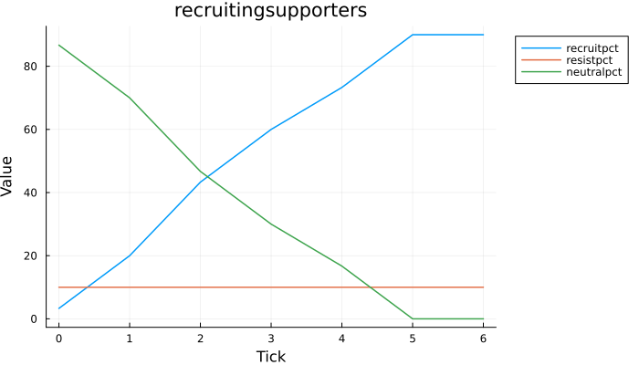
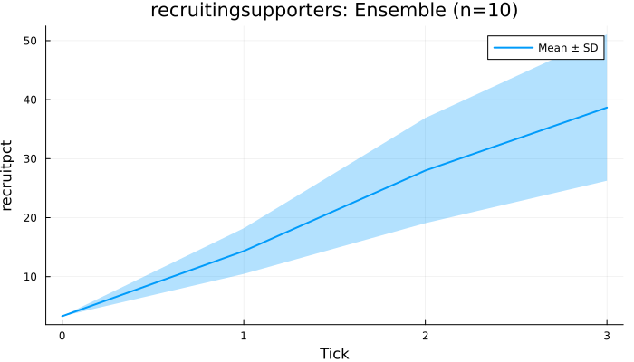
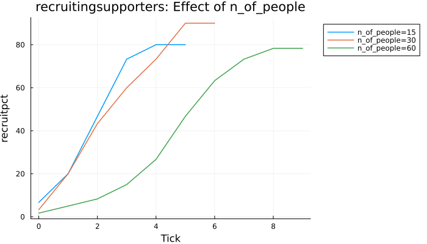

## Overview

This vignette demonstrates the **Recruiting Supporters** model implemented in [ArkModelZoo.jl](https://github.com/sdwfrost/ArkModelZoo.jl) using the Ark.jl ECS framework.

## Parameters

| Parameter | Type | Default | Description |
|-----------|------|---------|-------------|
| `n_of_people` | `Int` | `30` | n of people |
| `average_people_degree` | `Int` | `4` | average people degree |
| `n_initiators` | `Int` | `1` | n initiators |
| `resistance_threshold` | `Int` | `20` | resistance threshold |
| `max_ticks` | `Int` | `50` | max ticks |

## Source Code

The Julia code to run this model:

```julia
using ArkModelZoo
_, trajectory = run_recruitingsupporters()
```

## Time Series

{width=100%}

## Ensemble Runs

Ten replicates with different random seeds, showing mean ± standard deviation.

{width=100%}

## Parameter Sensitivity

Varying `n_of_people`.

{width=100%}


## Appendix: Source Code

This model is implemented in the [Ark.jl](https://github.com/sdwfrost/Ark.jl) Entity-Component-System (ECS) framework. The code is split into five files, each with a distinct role:

- **Parameters**: a mutable struct holding all configurable values.
- **Components**: lightweight data types attached to individual entities (agents).
- **Resources**: world-level shared state accessible to all systems.
- **Systems**: functions that operate on entities each tick, defining model behavior.
- **Model**: wiring that assembles the world, registers resources and systems, and provides the run entry point.

### Parameters (`parameters.jl`)

The parameter struct uses `@kwdef` so that every field has a default value and can be overridden by keyword. These defaults match the original NetLogo model's slider settings.

```julia
Base.@kwdef mutable struct RecSupParams
    n_of_people::Int = 30
    average_people_degree::Int = 4
    n_initiators::Int = 1
    resistance_threshold::Int = 20
    max_ticks::Int = 50
    seed::Int = 42
end
```

### Components (`components.jl`)

Components are lightweight data types attached to individual entities (agents). Mutable structs hold per-entity state, while empty tag structs act as markers for the ECS query system to efficiently filter entities.

```julia
struct RecSupDummy end
```

### Resources (`resources.jl`)

Resources are world-level singletons shared across all systems, used for global state and aggregate statistics.

```julia
mutable struct RecSupState
    n_agents::Int
    x::Vector{Float64}
    y::Vector{Float64}
    color::Vector{Symbol}        # :green, :blue, :red
    adj::Vector{Set{Int}}
end

function RecSupState()
    RecSupState(0, Float64[], Float64[], Symbol[], Set{Int}[])
end

function _recsup_add_agent!(state::RecSupState, x::Float64, y::Float64)
    state.n_agents += 1
    push!(state.x, x)
    push!(state.y, y)
    push!(state.color, :blue)
    push!(state.adj, Set{Int}())
    return state.n_agents
end

mutable struct RecSupStats
    recruitpct::Float64
    resistpct::Float64
    neutralpct::Float64
end
RecSupStats() = RecSupStats(0.0, 0.0, 0.0)
```

### Systems (`systems.jl`)

Systems contain the model logic and execute in a defined order each tick. Each system struct implements either `initialize!` (run once at setup) or `update!` (run every tick).

```julia
# --- Helpers ---

function _recsup_distance(state::RecSupState, i::Int, j::Int)
    dx = state.x[i] - state.x[j]
    dy = state.y[i] - state.y[j]
    return sqrt(dx * dx + dy * dy)
end

function _recsup_build_network!(rng, state::RecSupState, avg_degree::Int)
    n = state.n_agents
    num_links = div(avg_degree * n, 2)
    for _ in 1:num_links
        src = rand(rng, 1:n)
        best = 0
        best_dist = Inf
        for j in 1:n
            if j != src && !(j in state.adj[src])
                d = _recsup_distance(state, src, j)
                if d < best_dist
                    best_dist = d
                    best = j
                end
            end
        end
        if best > 0
            push!(state.adj[src], best)
            push!(state.adj[best], src)
        end
    end
    _recsup_bridge_components!(rng, state)
end

function _recsup_find_components(state::RecSupState)
    visited = falses(state.n_agents)
    components = Vector{Vector{Int}}()
    for i in 1:state.n_agents
        if !visited[i]
            comp = Int[]
            stack = Int[i]
            visited[i] = true
            while !isempty(stack)
                node = pop!(stack)
                push!(comp, node)
                for nb in state.adj[node]
                    if !visited[nb]
                        visited[nb] = true
                        push!(stack, nb)
                    end
                end
            end
            push!(components, comp)
        end
    end
    return components
end

function _recsup_bridge_components!(rng, state::RecSupState)
    while true
        comps = _recsup_find_components(state)
        length(comps) <= 1 && break
        a = comps[1][rand(rng, 1:length(comps[1]))]
        b = comps[2][rand(rng, 1:length(comps[2]))]
        push!(state.adj[a], b)
        push!(state.adj[b], a)
    end
end

function _recsup_tally!(state::RecSupState, stats::RecSupStats)
    n = state.n_agents
    ng = count(c -> c == :green, state.color)
    nr = count(c -> c == :red, state.color)
    nb = count(c -> c == :blue, state.color)
    stats.recruitpct = round(100.0 * ng / n, digits=1)
    stats.resistpct  = round(100.0 * nr / n, digits=1)
    stats.neutralpct = round(100.0 * nb / n, digits=1)
end

# --- Systems ---

struct InitRecSupSystem <: System end

function initialize!(::InitRecSupSystem, world::World)
    params = get_resource(world, RecSupParams)
    rng = get_resource(world, RNGResource).rng
    state = get_resource(world, RecSupState)
    stats = get_resource(world, RecSupStats)

    for _ in 1:params.n_of_people
        x = (rand(rng) * 2.0 - 1.0) * 0.90 * 16.0
        y = (rand(rng) * 2.0 - 1.0) * 0.90 * 16.0
        _recsup_add_agent!(state, x, y)
    end

    _recsup_build_network!(rng, state, params.average_people_degree)

    # NetLogo: ask peoples with [color = blue] [ if random 100 <= Resistance-threshold [set color red] ]
    for i in 1:state.n_agents
        if rand(rng, 0:99) <= params.resistance_threshold
            state.color[i] = :red
        end
    end

    blue_agents = findall(c -> c == :blue, state.color)
    n_init = min(params.n_initiators, length(blue_agents))
    for i in 1:n_init
        idx = blue_agents[rand(rng, 1:length(blue_agents))]
        state.color[idx] = :green
        deleteat!(blue_agents, findfirst(==(idx), blue_agents))
    end

    _recsup_tally!(state, stats)
    return nothing
end

struct RecSupGoSystem <: System end

function update!(::RecSupGoSystem, world::World)
    state = get_resource(world, RecSupState)
    stats = get_resource(world, RecSupStats)

    any_spreadable = false
    for i in 1:state.n_agents
        if state.color[i] == :blue
            for nb in state.adj[i]
                if state.color[nb] == :green
                    any_spreadable = true
                    break
                end
            end
        end
        any_spreadable && break
    end

    if !any_spreadable
        get_resource(world, Terminate).stop = true
        return nothing
    end

    to_convert = Int[]
    for i in 1:state.n_agents
        if state.color[i] == :blue
            for nb in state.adj[i]
                if state.color[nb] == :green
                    push!(to_convert, i)
                    break
                end
            end
        end
    end
    for i in to_convert
        state.color[i] = :green
    end

    _recsup_tally!(state, stats)
    return nothing
end

struct RecSupTerminationSystem <: System end

function update!(::RecSupTerminationSystem, world::World)
    params = get_resource(world, RecSupParams)
    tick = get_resource(world, Tick)
    if tick.tick + 1 >= params.max_ticks
        get_resource(world, Terminate).stop = true
    end
    return nothing
end
```

### Model (`model.jl`)

The model file assembles all pieces: it creates the ECS `World` with the required component types, registers resources, builds the `Scheduler` with systems in execution order, and exposes the public `run` entry point. The observer pattern records the trajectory each tick.

```julia
function recruitingsupporters_world(; initial_capacity::Int = 128)
    return World(RecSupDummy; initial_capacity=initial_capacity, allow_mutable=true)
end

function recruitingsupporters_systems()
    return (
        InitRecSupSystem(),
        RecSupGoSystem(),
        RecSupTerminationSystem(),
    )
end

function recruitingsupporters_model(params::RecSupParams = RecSupParams())
    world = recruitingsupporters_world()
    _add_standard_resources!(world, params)
    add_resource!(world, RecSupState())
    add_resource!(world, RecSupStats())
    scheduler = Scheduler(world, recruitingsupporters_systems())
    initialize!(scheduler)
    return scheduler
end

struct RecSupObserver end

function recruitingsupporters_headers(::RecSupObserver)
    return ["recruitpct", "resistpct", "neutralpct"]
end

function recruitingsupporters_values(::RecSupObserver, world::World)
    stats = get_resource(world, RecSupStats)
    return Float64[stats.recruitpct, stats.resistpct, stats.neutralpct]
end

function run_recruitingsupporters(; params::RecSupParams = RecSupParams(), observe::Bool = true)
    return _run_model(recruitingsupporters_model, RecSupObserver(), recruitingsupporters_values; params, observe)
end
```
