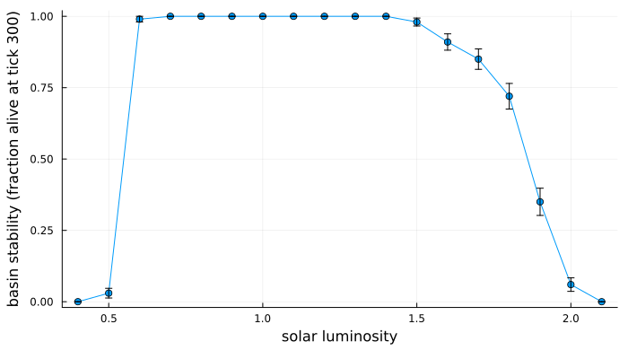
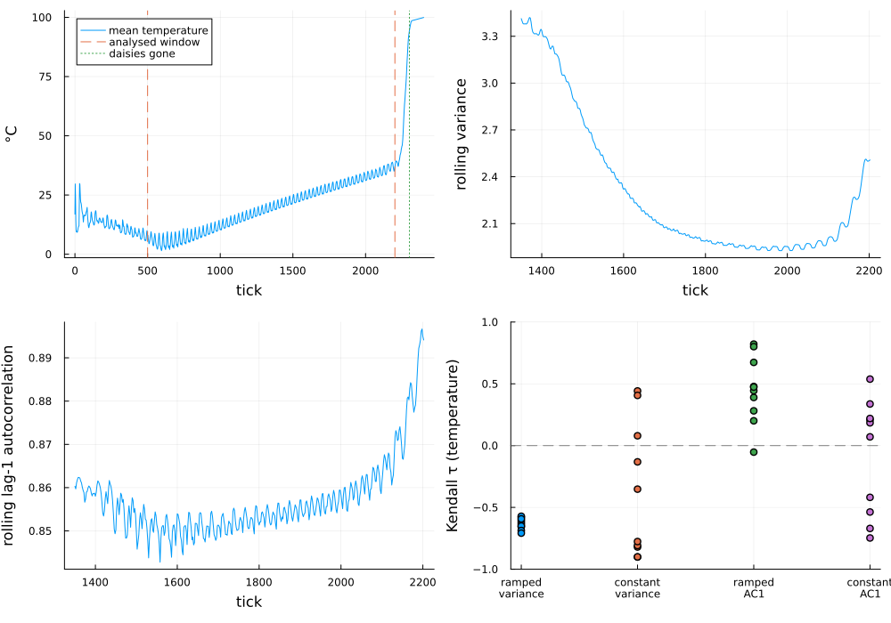
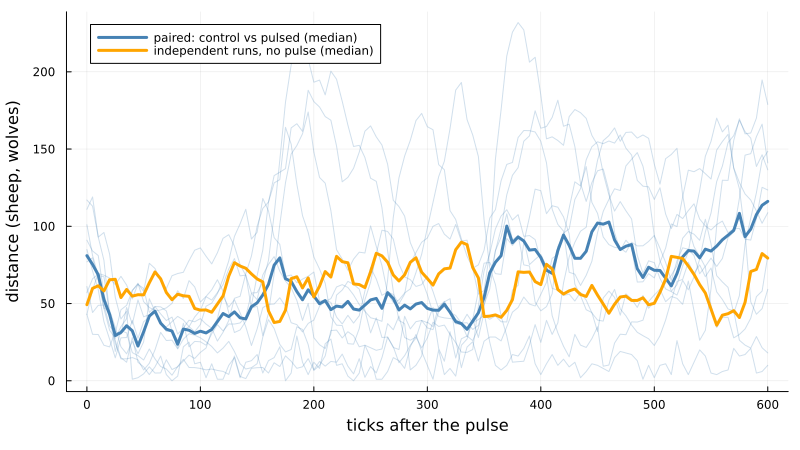

## Overview

Agent-based models have no equations to linearise, so their resilience has to be measured
from simulations. This vignette does that for two models in the zoo: Daisyworld and
Wolf–Sheep predation. It uses
[DynamicalResilience.jl](https://github.com/ecorecipes/DynamicalResilience.jl), whose metrics
take a SciML problem and algorithm, exactly as `solve` does.

ArkModelZoo wraps the two models as SciML problems, `DaisyworldProblem` and
`WolfSheepProblem`, advanced one tick at a time by `TickStepping()`. Each has an integrator
with the parts of SciML's integrator interface that the metrics use:

- `init` and `step!(integ, dt, true)`;
- `reinit!`, which replays a run exactly, random numbers included;
- `set_u!` to impose a perturbation;
- `EnsembleProblem` for many runs.

The state `u` is a short summary of the world:

| Model | `u` |
|---|---|
| Daisyworld | mean temperature, white cover, black cover (fractions of cells) |
| Wolf–Sheep | numbers of sheep, wolves and green grass patches |

Setting a new summary moves the world by the smallest random change with that summary.
Daisies or animals are removed at random, or added as at initialisation; temperatures are
shifted uniformly. Those random choices come from a stream kept apart from the model's, so a
perturbation does not itself change the model's random numbers.

```julia
using ArkModelZoo
prob = DaisyworldProblem(DaisyworldParams(solar_luminosity = 1.2); tspan = (0, 300))
sol = solve(prob, TickStepping())          # sol.u[end] == [T, white cover, black cover]
integ = init(prob)
step!(integ, 100, true)
set_u!(integ, [NaN, integ.u[2] / 2, NaN])  # remove half the white daisies; NaN leaves a component alone
```

All the numbers below come from `resilience.jl` in this folder, run with
`julia -t 4 --project=vignettes vignettes/resilience/resilience.jl`.

## Daisyworld: how much of the state space leads to life?

Basin stability (Menck et al. 2013) is the fraction of random perturbations from which a system
returns to an attractor. Here the starting white and black covers are drawn uniformly from
[0, 0.5]. A run counts as returning if daisies still cover more than 5% of the planet at tick
300.

```julia
covers0 = (u, rng) -> [NaN, 0.5rand(rng), 0.5rand(rng)]
alive = u -> u[2] + u[3] > 0.05
basin_stability(DaisyworldProblem(DaisyworldParams(solar_luminosity = L); u0 = [NaN, 0.2, 0.2],
                                  tspan = (0, 300)), TickStepping();
                sample_perturbation = covers0, returned = alive, trajectories = 100,
                ensemble = EnsembleThreads(), seed = 1)
```

{width=100%}

- **Below 0.6 almost every start freezes.** Even a planet half covered in black daisies rarely
  warms itself enough: none survive at a luminosity of 0.4, and 0.03 at 0.5.
- **From 0.6 to 1.4 every start survives** (0.99 at 0.6).
- **Above 1.4 the basin shrinks steadily:** 0.98 at 1.5, 0.91 at 1.6, 0.72 at 1.8, 0.35 at 1.9,
  0.06 at 2.0 and none at 2.1.

On the hot side, whether the daisies survive depends more and more on where the planet starts.
Each start also has its own model noise: `basin_stability` gives every trajectory its own model
seed, drawn from its `seed` argument. So the fraction reflects both the starting covers and the
model's chance events. With `noise = :common` all trajectories share one model seed and differ
only in their starting covers.

## Daisyworld: warnings before the collapse

A slowly forced system approaching a tipping point should recover more slowly from small
fluctuations. Its fluctuations then grow more variable and more autocorrelated (Scheffer et al.
2009).

- **The ramp:** solar luminosity rises from 1.0 by 0.0005 per tick (`ramped_series` with a
  `ramp` that reassigns `integ.p`).
- **The analysis:** `early_warning` takes the series of mean temperature and of white cover
  from tick 500 to 100 ticks before the daisies vanish. It removes a Gaussian trend, computes
  the rolling variance and lag-1 autocorrelation over windows of half the series, and measures
  their trend with Kendall's τ.
- **The null:** the same window from runs at a constant luminosity of 1.0.
- **Replication:** ten seeds of each.

```julia
ramp = (p, t) -> (q = deepcopy(p); q.solar_luminosity = 1.0 + 0.0005t; q)
s = ramped_series(prob, TickStepping(); saveat = 0:2:2400, ramp = ramp, observe = copy)
early_warning(temperature[window]; t = s.t[window], window = 0.5)
```

{width=100%}

| Indicator, Kendall τ (mean over 10 seeds; number positive) | ramped | constant |
|---|---|---|
| lag-1 autocorrelation, white cover | **0.68** (10/10) | −0.24 (3/10) |
| lag-1 autocorrelation, temperature | **0.45** (9/10) | −0.08 (6/10) |
| variance, white cover | −0.93 (0/10) | −0.55 (1/10) |
| variance, temperature | −0.63 (0/10) | −0.38 (3/10) |

- **Lag-1 autocorrelation is a usable warning here.** It rises before the collapse in every
  ramped run for white cover, and in nine of ten for temperature. At constant luminosity it has
  no consistent trend.
- **Variance is not a warning: it falls.** A likely reason is that white cover approaches
  saturation (above 0.9) as the planet heats, and a bounded share fluctuates less as it fills
  the grid. The collapse comes when even a nearly white planet cannot cool itself, not through
  growing fluctuations.
- **One series is not enough.** At constant luminosity, single-series τ ranges from −0.9 to 0.5,
  so a trend in one run is weak evidence on its own.
- **The ramped planet holds on longer than a planet at fixed luminosity.** The daisies vanish at
  luminosities of 2.14–2.15 (ticks 2280–2304), where the basin above is empty. The ramped
  planet inherits a high white cover from the cooler past; a planet started from random covers
  at that luminosity does not get one. This is path dependence: hysteresis in the sense the
  original model asks about.

## Wolf–Sheep: return after a pulse

- **The pulse:** at tick 300 half the sheep are removed (`set_u!`).
- **The comparison:** `recovery` compares that run with the unperturbed control, replayed from
  the same seed by `reinit!`, measuring the distance in (sheep, wolves) every 5 ticks.
- **The limit:** in an agent-based model the two runs cannot stay paired. After the pulse they
  have different numbers of animals, so they draw different random numbers and decorrelate.
- **The noise floor:** to separate return from decorrelation, the distance is compared with
  that between two independent runs with no pulse (`recovery` with different `seed` and
  `perturbed_seed`).

```julia
halve_sheep = (u, rng) -> [u[1] / 2, u[2], u[3]]
recovery(prob, TickStepping(); perturb = halve_sheep, observe = u -> u[1:2],
         t_pulse = 300, horizon = 600, interval = 5)
```

{width=100%}

- **The pulse effect dies away within about 20–40 ticks.** The paired runs then sit closer
  together than independent runs: they share the past.
- **They then decorrelate.** By about 350 ticks after the pulse, they are as different as two
  independent realisations.
- **Return time** is measured as the time until the paired distance first falls to the median
  distance between independent runs. Its median is 10 ticks over ten seeds (range 0–285).
- **Often the pulse makes no measurable difference.** Halving the sheep moves the system by
  43–117 animals, while two independent runs typically differ by 17–117. In three seeds the
  pulse was already within that noise.

## Wolf–Sheep: is coexistence a basin?

Here the starting numbers of sheep (0–300) and wolves (0–150) are drawn at random. A run counts
as coexisting if both species are still present at tick 1000.

- **With grass:** 39% ± 5% of starts coexist.
- **Without grass:** none do.

Coexistence here is a property of only part of the state space: most random starts lose one
species within 1000 ticks, through the large predator–prey oscillations that the default
parameters produce. As in the Daisyworld basin, each start has its own model seed.

## Caveats

- **A summary is not a state.** Setting `u` picks one of many microstates with that summary. A
  perturbation is therefore a family of possible changes, and its outcome can depend on which
  one is drawn.
- **Paired runs decorrelate.** A distance that stops shrinking may mean noise has taken over,
  not that the system has failed to return. Always compare with the noise floor.
- **Kendall τ of one series is noisy.** Report its distribution over seeds, against a null
  without forcing.
- **Small samples.** Basin fractions use 100 starts each and the warnings use 10 seeds; the
  standard errors are in `results.toml`.
