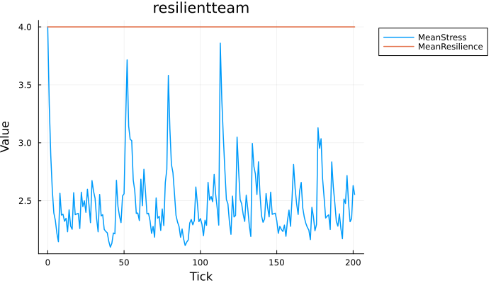
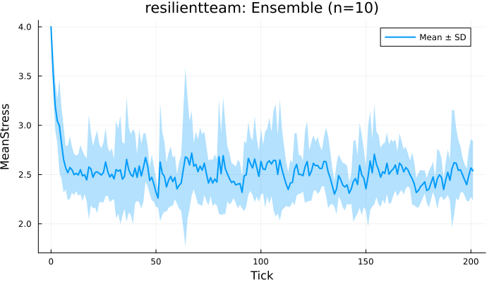
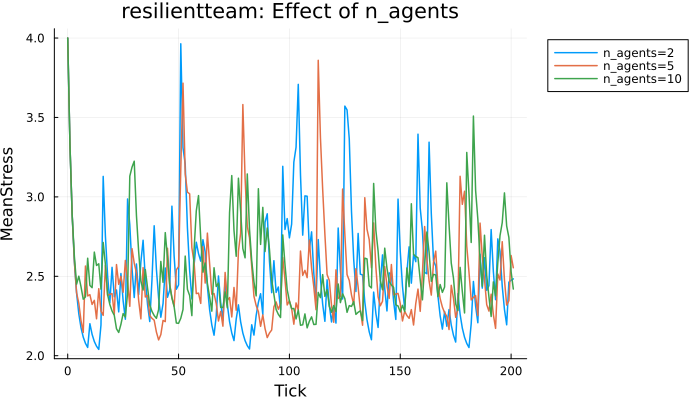

# Resilient Team


- [Overview](#overview)
- [Parameters](#parameters)
- [Source Code](#source-code)
- [Time Series](#time-series)
- [Ensemble Runs](#ensemble-runs)
- [Parameter Sensitivity](#parameter-sensitivity)
- [Appendix: Source Code](#appendix-source-code)
  - [Parameters (`parameters.jl`)](#parameters-parametersjl)
  - [Components (`components.jl`)](#components-componentsjl)
  - [Resources (`resources.jl`)](#resources-resourcesjl)
  - [Systems (`systems.jl`)](#systems-systemsjl)
  - [Model (`model.jl`)](#model-modeljl)

## Overview

This vignette demonstrates the **Resilient Team** model implemented in
[ArkModelZoo.jl](https://github.com/sdwfrost/ArkModelZoo.jl) using the
Ark.jl ECS framework.

## Parameters

| Parameter    | Type      | Default | Description |
|--------------|-----------|---------|-------------|
| `n_agents`   | `Int`     | `5`     | n agents    |
| `scale_min`  | `Float64` | `1.0`   | scale min   |
| `scale_max`  | `Float64` | `7.0`   | scale max   |
| `init_value` | `Float64` | `4.0`   | init value  |
| `init_rate`  | `Float64` | `0.5`   | init rate   |
| `num_ticks`  | `Int`     | `200`   | num ticks   |

## Source Code

The Julia code to run this model:

``` julia
using ArkModelZoo
_, trajectory = run_resilient()
```

## Time Series



## Ensemble Runs

Ten replicates with different random seeds, showing mean ± standard
deviation.



## Parameter Sensitivity

Varying `n_agents`.



## Appendix: Source Code

This model is implemented in the
[Ark.jl](https://github.com/sdwfrost/Ark.jl) Entity-Component-System
(ECS) framework. The code is split into five files, each with a distinct
role:

- **Parameters**: a mutable struct holding all configurable values.
- **Components**: lightweight data types attached to individual entities
  (agents).
- **Resources**: world-level shared state accessible to all systems.
- **Systems**: functions that operate on entities each tick, defining
  model behavior.
- **Model**: wiring that assembles the world, registers resources and
  systems, and provides the run entry point.

### Parameters (`parameters.jl`)

The parameter struct uses `@kwdef` so that every field has a default
value and can be overridden by keyword. These defaults match the
original NetLogo model’s slider settings.

``` julia
Base.@kwdef mutable struct ResilientParams
    seed::Int = 42
    n_agents::Int = 5
    scale_min::Float64 = 1.0
    scale_max::Float64 = 7.0
    init_value::Float64 = 4.0
    init_rate::Float64 = 0.5
    zipf_values::Vector{Int} = [1, 2, 3, 4, 5, 6, 7]
    zipf_weights::Vector{Float64} = [0.818, 0.143, 0.020, 0.010, 0.005, 0.003, 0.001]
    num_ticks::Int = 200
end
```

### Components (`components.jl`)

Components are lightweight data types attached to individual entities
(agents). Mutable structs hold per-entity state, while empty tag structs
act as markers for the ECS query system to efficiently filter entities.

``` julia
struct ResilientDummy end
```

### Resources (`resources.jl`)

Resources are world-level singletons shared across all systems, used for
global state and aggregate statistics.

``` julia
mutable struct ResilientAgentState
    belief::Vector{Float64}
    belongsafe::Vector{Float64}
    contribute::Vector{Float64}
    hope::Vector{Float64}
    resilience::Vector{Float64}
    strength::Vector{Float64}
    stress::Vector{Float64}
    trusted::Vector{Float64}
    # Rates
    blame_rate::Vector{Float64}
    gratitude_rate::Vector{Float64}
    hope_rate::Vector{Float64}
    listen_rate::Vector{Float64}
    spend_rate::Vector{Float64}
    recovery_rate::Vector{Float64}
    seekhelp_rate::Vector{Float64}
    trust_rate::Vector{Float64}
end

function ResilientAgentState(n::Int, init_val::Float64, init_rate::Float64)
    return ResilientAgentState(
        fill(init_val, n), fill(init_val, n), fill(init_val, n), fill(init_val, n),
        fill(init_val, n), fill(init_val, n), fill(init_val, n), fill(init_val, n),
        fill(init_rate, n), fill(init_rate, n), fill(init_rate, n), fill(init_rate, n),
        fill(init_rate, n), fill(init_rate, n), fill(init_rate, n), fill(init_rate, n),
    )
end

mutable struct ResilientRelationState
    # Numerator variables (N_*)
    n_blame::Matrix{Float64}
    n_feedback::Matrix{Float64}
    n_gratitude::Matrix{Float64}
    n_interact_rate::Matrix{Float64}
    n_recrimination::Matrix{Float64}
    n_seekhelp::Matrix{Float64}
    n_spend::Matrix{Float64}
    n_stress::Matrix{Float64}
    n_trust::Matrix{Float64}
    # Decision variables (D_*)
    d_belief::Matrix{Float64}
    d_blame::Matrix{Float64}
    d_gratitude::Matrix{Float64}
    d_hope::Matrix{Float64}
    d_listen::Matrix{Float64}
    d_seekhelp::Matrix{Float64}
    d_spend::Matrix{Float64}
end

function ResilientRelationState(n::Int)
    return ResilientRelationState(
        ones(n, n), ones(n, n), ones(n, n),
        fill(0.5, n, n),
        ones(n, n), ones(n, n), ones(n, n), ones(n, n), ones(n, n),
        ones(n, n), ones(n, n), ones(n, n), ones(n, n), ones(n, n), ones(n, n), ones(n, n),
    )
end

mutable struct ResilientEnvState
    ei_stress::Vector{Float64}
    eg_stress::Float64
end

ResilientEnvState(n::Int) = ResilientEnvState(zeros(n), 0.0)

mutable struct ResilientStats
    mean_stress::Float64
    mean_resilience::Float64
end

ResilientStats() = ResilientStats(0.0, 0.0)
```

### Systems (`systems.jl`)

Systems contain the model logic and execute in a defined order each
tick. Each system struct implements either `initialize!` (run once at
setup) or `update!` (run every tick).

``` julia
# --- Helper: Zipf-weighted sampling ---
function _resilient_zipf_sample(rng, values::Vector{Int}, weights::Vector{Float64})
    r = rand(rng)
    cumw = 0.0
    for i in eachindex(values)
        cumw += weights[i]
        if r <= cumw
            return Float64(values[i])
        end
    end
    return Float64(values[end])
end

# --- Helper: Scale value from [x_min, x_max] to [a, b] ---
@inline function _resilient_scale(x::Float64, x_min::Float64, x_max::Float64, a::Float64, b::Float64)
    if x_max == x_min
        return a
    end
    return ((x - x_min) / (x_max - x_min)) * (b - a) + a
end

# --- Systems ---

struct InitResilientSystem <: System end

function initialize!(::InitResilientSystem, world::World)
    params = get_resource(world, ResilientParams)
    agents = get_resource(world, ResilientAgentState)
    stats = get_resource(world, ResilientStats)
    stats.mean_stress = mean(agents.stress)
    stats.mean_resilience = mean(agents.resilience)
end

struct ResilientEnvSystem <: System end

function update!(::ResilientEnvSystem, world::World)
    params = get_resource(world, ResilientParams)
    rng = get_resource(world, RNGResource).rng
    env = get_resource(world, ResilientEnvState)
    n = params.n_agents

    # EI_stress and EG_stress drawn from Zipf distribution
    for i in 1:n
        env.ei_stress[i] = _resilient_zipf_sample(rng, params.zipf_values, params.zipf_weights)
    end
    env.eg_stress = _resilient_zipf_sample(rng, params.zipf_values, params.zipf_weights)
end

struct ResilientPerceiveSystem <: System end

function update!(::ResilientPerceiveSystem, world::World)
    params = get_resource(world, ResilientParams)
    agents = get_resource(world, ResilientAgentState)
    env = get_resource(world, ResilientEnvState)
    a = params.scale_min
    b = params.scale_max
    n = params.n_agents

    for i in 1:n
        # stress += scaled(EI_stress + EG_stress), then divide by scaled(resilience)
        raw_env = env.ei_stress[i] + env.eg_stress
        scaled_env = _resilient_scale(raw_env, 2.0, 14.0, a, b)
        agents.stress[i] += scaled_env
        scaled_resilience = _resilient_scale(agents.resilience[i], 1.0, 7.0, 1.0, 2.0)
        agents.stress[i] /= scaled_resilience
        agents.stress[i] = clamp(agents.stress[i], 1.0, 7.0)
    end
end

struct ResilientDecisionSystem <: System end

function update!(::ResilientDecisionSystem, world::World)
    params = get_resource(world, ResilientParams)
    agents = get_resource(world, ResilientAgentState)
    rels = get_resource(world, ResilientRelationState)
    a = params.scale_min
    b = params.scale_max
    n = params.n_agents

    for i in 1:n
        # D_listen for all relations from i
        for j in 1:n
            i == j && continue
            raw = agents.listen_rate[i] * (agents.resilience[i] + agents.belongsafe[i] - agents.stress[i]) / 2.0
            rels.d_listen[i, j] = clamp(_resilient_scale(raw, -3.5, 6.5, a, b), a, b)
        end

        # Mean incoming N_trust for agent i
        trust_sum = 0.0
        trust_count = 0
        for j in 1:n
            j == i && continue
            trust_sum += rels.n_trust[j, i]
            trust_count += 1
        end
        mean_n_trust = trust_count > 0 ? trust_sum / trust_count : 1.0

        # D_seekhelp
        for j in 1:n
            i == j && continue
            if agents.stress[i] > agents.resilience[i] && mean_n_trust > 3.0
                raw = agents.seekhelp_rate[i] * (mean_n_trust + agents.belongsafe[i] + agents.stress[i])
                rels.d_seekhelp[i, j] = clamp(_resilient_scale(raw, 0.0, 10.5, a, b), a, b)
            else
                rels.d_seekhelp[i, j] = 1.0
            end
        end

        # D_blame
        for j in 1:n
            i == j && continue
            if agents.stress[i] > agents.resilience[i] && mean_n_trust < 4.0
                raw = agents.blame_rate[i] * ((8.0 - agents.belongsafe[i]) + agents.stress[i] + (8.0 - mean_n_trust))
                rels.d_blame[i, j] = clamp(_resilient_scale(raw, 0.0, 10.5, a, b), a, b)
            else
                rels.d_blame[i, j] = 1.0
            end
        end

        # D_spend
        for j in 1:n
            i == j && continue
            mean_n_seekhelp = 0.0
            sh_count = 0
            for k in 1:n
                k == i && continue
                mean_n_seekhelp += rels.n_seekhelp[k, i]
                sh_count += 1
            end
            mean_n_seekhelp = sh_count > 0 ? mean_n_seekhelp / sh_count : 1.0
            raw = agents.spend_rate[i] * (mean_n_seekhelp + agents.resilience[i] + agents.belongsafe[i])
            rels.d_spend[i, j] = clamp(_resilient_scale(raw, 0.0, 10.5, a, b), a, b)
        end
    end
end

struct ResilientChangeSystem <: System end

function update!(::ResilientChangeSystem, world::World)
    params = get_resource(world, ResilientParams)
    agents = get_resource(world, ResilientAgentState)
    rels = get_resource(world, ResilientRelationState)
    a = params.scale_min
    b = params.scale_max
    n = params.n_agents

    for i in 1:n
        # trusted = mean of incoming N_trust
        trust_sum = 0.0
        trust_count = 0
        for j in 1:n
            j == i && continue
            trust_sum += rels.n_trust[j, i]
            trust_count += 1
        end
        agents.trusted[i] = trust_count > 0 ? trust_sum / trust_count : 1.0

        # belongsafe = scaled((mean D_seekhelp + (8 - mean D_blame)*3))
        seekhelp_sum = 0.0
        blame_sum = 0.0
        count = 0
        for j in 1:n
            j == i && continue
            seekhelp_sum += rels.d_seekhelp[j, i]
            blame_sum += rels.d_blame[j, i]
            count += 1
        end
        mean_seekhelp = count > 0 ? seekhelp_sum / count : 1.0
        mean_blame = count > 0 ? blame_sum / count : 1.0
        raw = mean_seekhelp + (8.0 - mean_blame) * 3.0
        agents.belongsafe[i] = clamp(_resilient_scale(raw, 0.0, 28.0, a, b), a, b)
    end
end

struct ResilientActSystem <: System end

function update!(::ResilientActSystem, world::World)
    params = get_resource(world, ResilientParams)
    agents = get_resource(world, ResilientAgentState)
    rels = get_resource(world, ResilientRelationState)
    n = params.n_agents

    # N_seekhelp: reset all to 1, then each agent sets max D_seekhelp relation to 7
    for i in 1:n, j in 1:n
        rels.n_seekhelp[i, j] = 1.0
    end
    for i in 1:n
        max_val = -Inf
        max_j = 0
        for j in 1:n
            j == i && continue
            if rels.d_seekhelp[i, j] > max_val
                max_val = rels.d_seekhelp[i, j]
                max_j = j
            end
        end
        if max_j > 0
            rels.n_seekhelp[i, max_j] = 7.0
        end
    end
end

struct ResilientStatsSystem <: System end

function update!(::ResilientStatsSystem, world::World)
    agents = get_resource(world, ResilientAgentState)
    stats = get_resource(world, ResilientStats)
    stats.mean_stress = mean(agents.stress)
    stats.mean_resilience = mean(agents.resilience)
end

struct ResilientTerminationSystem <: System end

function update!(::ResilientTerminationSystem, world::World)
    params = get_resource(world, ResilientParams)
    tick = get_resource(world, Tick).tick
    if tick >= params.num_ticks
        get_resource(world, Terminate).stop = true
    end
end
```

### Model (`model.jl`)

The model file assembles all pieces: it creates the ECS `World` with the
required component types, registers resources, builds the `Scheduler`
with systems in execution order, and exposes the public `run` entry
point. The observer pattern records the trajectory each tick.

``` julia
function resilient_world(; initial_capacity::Int = 128)
    return World(ResilientDummy; initial_capacity=initial_capacity, allow_mutable=true)
end

function resilient_systems()
    return (
        InitResilientSystem(),
        ResilientEnvSystem(),
        ResilientPerceiveSystem(),
        ResilientDecisionSystem(),
        ResilientChangeSystem(),
        ResilientActSystem(),
        ResilientStatsSystem(),
        ResilientTerminationSystem(),
    )
end

function resilient_model(params::ResilientParams = ResilientParams())
    world = resilient_world()
    _add_standard_resources!(world, params)
    add_resource!(world, ResilientAgentState(params.n_agents, params.init_value, params.init_rate))
    add_resource!(world, ResilientRelationState(params.n_agents))
    add_resource!(world, ResilientEnvState(params.n_agents))
    add_resource!(world, ResilientStats())
    scheduler = Scheduler(world, resilient_systems())
    initialize!(scheduler)
    return scheduler
end

struct ResilientObserver end

function resilient_headers(::ResilientObserver)
    return ["MeanStress", "MeanResilience"]
end

function resilient_values(::ResilientObserver, world::World)
    stats = get_resource(world, ResilientStats)
    return Float64[stats.mean_stress, stats.mean_resilience]
end

function run_resilient(; params::ResilientParams = ResilientParams(), observe::Bool = true)
    return _run_model(resilient_model, ResilientObserver(), resilient_values; params, observe)
end
```
