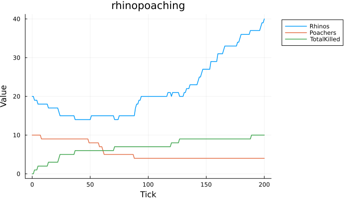
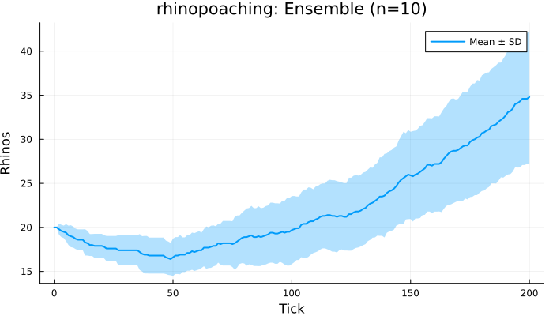
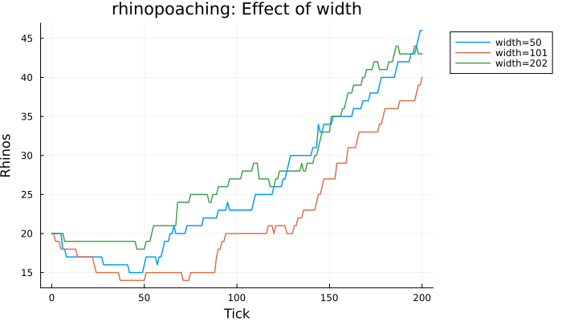

## Overview

### WHAT IS IT?

This model explores the dynamic interaction between three agents involved in rhino poaching: rhinos, poachers, and rangers. The agents make decisions based on their environment and are also influenced by other agents. A population of rhino agents live inside a protected area and are moving around. Poachers try to find these rhino’s in order to kill them. Rangers try to find the poachers in order to capture them and ultimately prevent the rhino population from going extinct. The model can be used to identify optimal ranger strategies under varying environmental conditions, but also for studying various strategies that poachers may use to avoid detection or for successfully finding rhinos.

### HOW IT WORKS

**The world**
The world is created by the "SETUP-PARK" button.
The patches at the border of the world are colored black and represent the area outside the reserve. All other patches represent the protected area where a population of rhinos live. These patches contain a varying amount of resources (ranged from 0-1), roughness (ranged from 1-5), home range information (to which rhino does this patch belongs to) and finally signs of recent rhino, poacher and ranger activity. Resources can represent food, water or other features that are relevant to your species of interest. These resources are diffused to create more natural and realistic gradients. All patches have a resource regrowth rate. Some patches do not contain any resources, here called 'sandy areas'. The slider "SANDY-AREAS" gives you control over the percentage of patches with no resources. Roughness is also an umbrella term for features that may make an area less desirable or more difficult to move through (for example, mountains or dense vegetation). Agents moving through rough areas results the agent waiting an extra tick (slowing them down).By default all patches are equally “easy” to traverse with a roughness value of 1. Adding rough areas with the "ROUGH-AREAS" slider creates the specified amount of rough patches with the maximum value of 5 and a radius around it to smooth out the effect. All this information was combined into one variable named "patch attractiveness". This value is used to direct each agent's movement and described in more detail for each agent.

There are several visualization options available from the "VISUALIZATION" drop-menu.
The option RESOURCE_COLOURS visualizes the amount of resources available in each patch, colored by a shade of green. The higher the amount of resources, the more darker the shade of green. The patches with a resources value of 0 (the sandy patches) are colored brown.
The option ROUGHNESS_COLORS visualizes all patches with a roughness value larger than 1 along a shade of red. Patches with a roughness value equal to 1 are visualized based on their resources.
The option RHINO_HOME-RANGES shows how the rhino territories are distributed. The color of the patch is the same as the color of the rhino it belongs to. Please note that the rhino colors are randomly distributed so it may occur that two rhinos have the same color. The next section describes how home ranges are formed.

**Rhinos**
The rhino agents are created and put in place by the "SETUP-RHINOS" button.
The number of rhino agents is determined by the NUM-RHINOS slider. Rhinos are randomly placed in the world. If another agent is within a radius of 10 patches, the rhino is moved to a random different patch without any agents within that radius. If none of the patches can for-fill that condition, the rhino will be placed on a random patch that is has not been taken yet. Each 1.5 patch in the rhino’s radius is added to its home range, and it expands when the rhino is moving. If a rhino was killed by poachers, all of its home range patches become unoccupied.
The rhinos move by making a weighted decisions by based on the variables of its neighboring patches. The variables involved are the amount of resources, the roughness, and the distance to other rhinos. Each of these variables were scaled from 0 to 1 with 1 indicating the high preference. The variables are then summed and the divided by the sum of weights. The weights for the rhinos are "RESOURCE-WEIGHT", "ROUGHNESS-WEIGHT", "RHINO-AVOID-WEIGHT", and "GOAL-WEIGHT", and are adjustable in the interface. This information was stored in the variable ‘patch attractiveness’ that describes the overall attractiveness and hence the likelihood that the rhino will go to that patch. This was done by using the rnd:weighted-one-of function. To reduce the likelihood that rhinos will enter territories of other rhinos, the patch attractiveness of neighbors that belong to one of the other rhinos, are divided by 10. Once the rhino moved to one of the neighboring cells, it will consume 1% of the available resources.
After moving to a new patch, the rhino will consume 1% of the resources (specified by the FORAGE-AMOUNT slider), add the patch to its territory and a 50% chance of leaving signs in that patch. The rhino will also remember and avoid the last 3 visited patches.

**Poachers**
Poachers are added by the SETUP-HUMANS procedure and placed at a random patch on one of the black border patches. The number of poachers in the world can be changed by using the "NUM-POACHERS" slider. The time available for hunting is specified by the "POACHER-TIME" slider. When time has run out, they will leave the park. The variables involved in poacher movement are signs of recent rhino activity, signs of ranger activity, roughness, resources, and distance to goal. The weights for poacher decision-making are "RANGER-AVOID-WEIGHT", "HUNT-RHINO-WEIGHT", "ROUGHNESS-WEIGHT", "RESOURCE-WEIGHT", and "GOAL-WEIGHT". Poachers check if there are rhinos within the "POACHER-VISION" radius. If so, the poacher will kill it, remove it from the world and move towards the nearest border patch. Poachers will lay low after successfully escaping the reserve (regardless if a rhino was killed or not). The lay low time was defined as twice the "POACHER-TIME" plus random 100. Poachers also have a 50% chance of leaving signs, whereas killing a rhino will leave permanent signs. Poachers remember patches where they killed rhinos as success sites, patches with recent-rhino-activity as good-sites, and patches with ranger activity as failure sites. The success and failure sites are used to plan new poaching trips and to determine where the poacher will enter the park next.

**Rangers**
The SETUP-HUMANS procedure also builds ranger camps and create rangers. The number of camps and rangers can be specified with the "NUM-CAMPS" and "NUM-RANGERS" slider respectively. Camps are put either randomly, at fixed locations or manually. This can be set from the "CAMP-PLACEMENT" drop-down menu (where "WE-DECIDE" is the manual option). Rangers sprout from camps and start their first patrol there. Rangers use movement rules similar to poachers, only their aim is to find poachers. Their movement is directed by goal distance and weight, rhino signs, poacher signs and roughness. This again accumulates into a patch attractiveness, allowing rangers to pick the highest relative attractiveness with a degree of randomness. The duration of each patrol is specified by the "PATROL-LENGTH" slider. When a ranger detects a poacher within the "RANGER-RADIUS" slider, the poacher was caught and removed from the world. Patches with poacher signs are remembered as risky areas whereas non-poaching sites are remembered as safe-areas. This information is used in the planning of the next patrols. Rangers also have a 50% chance of leaving signs. When the patrol-time ends, rangers move to the nearest camp or border patch and wait a number of ticks before going out again. Ranger agents have two strategies that can be specified from the "PATROL-TYPE" drop-down-menu. The "STANDARD-PATROL" is the weighted decision-making as described above. The "FENCE-PATROL" lets the ranger team moves along the border of the reserve and do not make weighted decisions. If the ranger enters a patch with poacher signs, the PATROL-LENGTH will be reset to 0, and from here makes weighted decisions similar to the STANDARD-PATROL strategy. This represents a so-called 'response time' that will take over when an illegal entry was detected.

The signs of rhinos, poachers, and rangers will decrease in value over time. When it reaches 0, the signs are not visible for the agents.

### THINGS TO NOTICE

This is an abstract representation of a protected area. The units (patches and ticks) are an arbitrary measurement and don't map directly to real world time or space. This can only be done when this model is applied to a specific context or setting where one can define what one tick or patch means in the real world.

### THINGS TO TRY

The aim is to find ranger strategies that match the existing or realistic anti-poaching strategies, in order to keep as many rhinos alive as possible. It is important to make these ranger strategies realistic and practically feasible.
How does adding more teams, longer patrols, influence the number of surviving rhinos? Is one strategy more effective than the other? What will happen if the rangers or poachers know better the whereabouts of the rhinos?

### EXTENDING THE MODEL

The strength of this general model and the behavioral rules is that they can be applied to any park or reserve and that one can make additional assumptions to better fit their specific setting. The model should be regarded as a first step to understand the wildlife crime and would only benefit from further improvements and extensions.
Additional ranger strategies can be developed, added and tested in this model. This model focuses on active poaching (searching and shooting an animal), but passive poaching such as traps and snares can also be implemented and subsequently test which anti-poaching strategies work best for this poaching activity. 
Also rangers and poachers may start learning more from one another (communication can lead to success and failure sites being shared), or the effect of corruption. 
One may also try to change the environment to better represent a real-life national park or reserve by, for example, creating rivers or different types of habits.

### NETLOGO FEATURES

To allow for the random weighted decision rules for agent movement use: extensions [rnd]
Allowing the use of: rnd:weighted-one-of

### RELATED MODELS

The wolf-sheep predation model and the mammoths model are similar as they look the dynamic interactions between two types of agents.
Tuskless elephants is another model related to poaching.

### CREDITS AND REFERENCES

We would like to thank Michael Mäs and Andrew Lemieux for their support and help in building the model.

## Parameters

| Parameter | Type | Default | Description |
|-----------|------|---------|-------------|
| `width` | `Int` | `101` | width |
| `height` | `Int` | `101` | height |
| `num_rhinos` | `Int` | `20` | num rhinos |
| `num_poachers` | `Int` | `10` | num poachers |
| `num_rangers` | `Int` | `4` | num rangers |
| `max_roughness` | `Float64` | `0.6` | fraction of rough terrain |
| `sprout_delay_time` | `Int` | `500` | ticks before resource sprouts in rough cells |
| `resource_regrow_rate` | `Float64` | `0.01` | logistic regrowth rate |
| `rhino_reproduce_prob` | `Float64` | `0.01` | per-tick reproduction probability |
| `poacher_detect_range` | `Float64` | `5.0` | poacher search radius for rhino signs |
| `ranger_detect_range` | `Float64` | `3.0` | ranger detection radius for poachers |
| `poacher_kill_range` | `Float64` | `2.0` | poacher kill radius for rhinos |
| `rhino_forage_radius` | `Int` | `3` | neighbourhood search for foraging |
| `activity_decay` | `Float64` | `0.99` | per-tick decay of rhino activity signs |
| `home_weight` | `Float64` | `0.3` | weight of home-range fidelity |
| `resource_weight` | `Float64` | `0.7` | weight of resource attraction |
| `max_rhinos` | `Int` | `100` | pre-allocated capacity |
| `max_ticks` | `Int` | `200` | max ticks |

## Source Code

The Julia code to run this model:

```julia
using ArkModelZoo
_, trajectory = run_rhinopoaching()
```

## Time Series

{width=100%}

## Ensemble Runs

Ten replicates with different random seeds, showing mean ± standard deviation.

{width=100%}

## Parameter Sensitivity

Varying `width`.

{width=100%}


## Appendix: Source Code

This model is implemented in the [Ark.jl](https://github.com/sdwfrost/Ark.jl) Entity-Component-System (ECS) framework. The code is split into five files, each with a distinct role:

- **Parameters**: a mutable struct holding all configurable values.
- **Components**: lightweight data types attached to individual entities (agents).
- **Resources**: world-level shared state accessible to all systems.
- **Systems**: functions that operate on entities each tick, defining model behavior.
- **Model**: wiring that assembles the world, registers resources and systems, and provides the run entry point.

### Parameters (`parameters.jl`)

The parameter struct uses `@kwdef` so that every field has a default value and can be overridden by keyword. These defaults match the original NetLogo model's slider settings.

```julia
Base.@kwdef mutable struct RhinoParams
    width::Int = 101
    height::Int = 101
    num_rhinos::Int = 20
    num_poachers::Int = 10
    num_rangers::Int = 4
    max_roughness::Float64 = 0.6             # fraction of rough terrain
    sprout_delay_time::Int = 500             # ticks before resource sprouts in rough cells
    resource_regrow_rate::Float64 = 0.01     # logistic regrowth rate
    rhino_reproduce_prob::Float64 = 0.01     # per-tick reproduction probability
    poacher_detect_range::Float64 = 5.0      # poacher search radius for rhino signs
    ranger_detect_range::Float64 = 3.0       # ranger detection radius for poachers
    poacher_kill_range::Float64 = 2.0        # poacher kill radius for rhinos
    rhino_forage_radius::Int = 3             # neighbourhood search for foraging
    activity_decay::Float64 = 0.99           # per-tick decay of rhino activity signs
    home_weight::Float64 = 0.3               # weight of home-range fidelity
    resource_weight::Float64 = 0.7           # weight of resource attraction
    max_rhinos::Int = 100                    # pre-allocated capacity
    max_ticks::Int = 200
    seed::Int = 42
end
```

### Components (`components.jl`)

Components are lightweight data types attached to individual entities (agents). Mutable structs hold per-entity state, while empty tag structs act as markers for the ECS query system to efficiently filter entities.

```julia
struct RhinoDummy end
```

### Resources (`resources.jl`)

Resources are world-level singletons shared across all systems, used for global state and aggregate statistics.

```julia
mutable struct RhinoState
    # Rhinos (pre-allocated to max_rhinos)
    n_rhinos::Int
    rhino_x::Vector{Float64}
    rhino_y::Vector{Float64}
    rhino_heading::Vector{Float64}
    rhino_alive::Vector{Bool}
    rhino_home_x::Vector{Float64}
    rhino_home_y::Vector{Float64}
    rhino_ticks_alive::Vector{Int}
    # Poachers
    n_poachers::Int
    poacher_x::Vector{Float64}
    poacher_y::Vector{Float64}
    poacher_heading::Vector{Float64}
    poacher_alive::Vector{Bool}
    poacher_goal::Vector{Int}   # 0=journey-to, 1=hunting, 2=journey-after
    poacher_caught::Vector{Bool}
    # Rangers
    n_rangers::Int
    ranger_x::Vector{Float64}
    ranger_y::Vector{Float64}
    ranger_heading::Vector{Float64}
    # Grid
    width::Int
    height::Int
    resources::Matrix{Float64}
    max_resources::Matrix{Float64}
    roughness::Matrix{Float64}
    rhino_activity::Matrix{Float64}
    # Stats
    total_killed::Int
end


mutable struct RhinoStats
    n_rhinos::Int
    n_poachers::Int
    total_killed::Int
end
RhinoStats() = RhinoStats(0, 0, 0)
```

### Systems (`systems.jl`)

Systems contain the model logic and execute in a defined order each tick. Each system struct implements either `initialize!` (run once at setup) or `update!` (run every tick).

```julia
# --- Helpers ---

function _rhino_weighted_choice(rng, items, weights)
    total = sum(weights)
    if total <= 0.0
        return items[rand(rng, 1:length(items))]
    end
    r = rand(rng) * total
    cumul = 0.0
    for (item, w) in zip(items, weights)
        cumul += w
        if cumul >= r
            return item
        end
    end
    return items[end]
end

@inline function _rhino_dist(x1, y1, x2, y2)
    return sqrt((x1 - x2)^2 + (y1 - y2)^2)
end

# --- Initialization ---

struct InitRhinoSystem <: System end

function initialize!(::InitRhinoSystem, world::World)
    state = get_resource(world, RhinoState)
    stats = get_resource(world, RhinoStats)
    stats.n_rhinos = sum(state.rhino_alive)
    stats.n_poachers = sum(state.poacher_alive)
    stats.total_killed = state.total_killed
    return nothing
end

# --- Resource Regrowth ---

struct RhinoResourceGrowSystem <: System end

function update!(::RhinoResourceGrowSystem, world::World)
    params = get_resource(world, RhinoParams)
    state = get_resource(world, RhinoState)

    for x in 1:state.width, y in 1:state.height
        if state.roughness[x, y] < 1.0
            state.resources[x, y] += params.resource_regrow_rate *
                (state.max_resources[x, y] - state.resources[x, y])
        end
    end
    return nothing
end

# --- Activity Decay ---

struct RhinoActivityDecaySystem <: System end

function update!(::RhinoActivityDecaySystem, world::World)
    params = get_resource(world, RhinoParams)
    state = get_resource(world, RhinoState)

    state.rhino_activity .*= params.activity_decay
    return nothing
end

# --- Rhino Forage ---

struct RhinoForageSystem <: System end

function update!(::RhinoForageSystem, world::World)
    params = get_resource(world, RhinoParams)
    rng = get_resource(world, RNGResource).rng
    state = get_resource(world, RhinoState)
    w, h = state.width, state.height
    radius = params.rhino_forage_radius

    for i in 1:length(state.rhino_alive)
        !state.rhino_alive[i] && continue

        gx = clamp(round(Int, state.rhino_x[i]), 1, w)
        gy = clamp(round(Int, state.rhino_y[i]), 1, h)

        # Leave activity at current location
        state.rhino_activity[gx, gy] += 1.0

        # Forage: weighted random choice of neighboring cell
        candidates = Tuple{Int,Int}[]
        weights = Float64[]

        for dx in -radius:radius, dy in -radius:radius
            (dx == 0 && dy == 0) && continue
            nx = gx + dx
            ny = gy + dy
            (nx < 1 || nx > w || ny < 1 || ny > h) && continue
            state.roughness[nx, ny] >= 1.0 && continue

            res_score = state.resources[nx, ny]
            home_dist = _rhino_dist(Float64(nx), Float64(ny),
                                    state.rhino_home_x[i], state.rhino_home_y[i])
            home_score = max(0.0, 1.0 - home_dist / 50.0)

            score = params.resource_weight * res_score + params.home_weight * home_score * 10.0
            if score > 0.0
                push!(candidates, (nx, ny))
                push!(weights, score)
            end
        end

        if !isempty(candidates)
            chosen = _rhino_weighted_choice(rng, candidates, weights)
            state.rhino_x[i] = Float64(chosen[1])
            state.rhino_y[i] = Float64(chosen[2])
        else
            angle = rand(rng) * 2π
            state.rhino_x[i] = clamp(state.rhino_x[i] + cos(angle) * 2.0, 1.0, Float64(w))
            state.rhino_y[i] = clamp(state.rhino_y[i] + sin(angle) * 2.0, 1.0, Float64(h))
        end

        # Consume resources
        new_gx = clamp(round(Int, state.rhino_x[i]), 1, w)
        new_gy = clamp(round(Int, state.rhino_y[i]), 1, h)
        consumed = min(state.resources[new_gx, new_gy], 1.0)
        state.resources[new_gx, new_gy] -= consumed

        # Slowly drift home range
        state.rhino_home_x[i] = 0.99 * state.rhino_home_x[i] + 0.01 * state.rhino_x[i]
        state.rhino_home_y[i] = 0.99 * state.rhino_home_y[i] + 0.01 * state.rhino_y[i]

        state.rhino_ticks_alive[i] += 1
    end
    return nothing
end

# --- Rhino Reproduction ---

struct RhinoReproduceSystem <: System end

function update!(::RhinoReproduceSystem, world::World)
    params = get_resource(world, RhinoParams)
    rng = get_resource(world, RNGResource).rng
    state = get_resource(world, RhinoState)
    w, h = state.width, state.height

    n_alive = sum(state.rhino_alive)
    n_alive >= params.max_rhinos && return nothing

    for i in 1:length(state.rhino_alive)
        !state.rhino_alive[i] && continue
        state.rhino_ticks_alive[i] < 50 && continue

        if rand(rng) < params.rhino_reproduce_prob
            n_alive >= params.max_rhinos && break

            slot = findfirst(x -> !x, state.rhino_alive)
            slot === nothing && break

            state.rhino_alive[slot] = true
            state.rhino_x[slot] = clamp(state.rhino_x[i] + (rand(rng) - 0.5) * 2.0, 1.0, Float64(w))
            state.rhino_y[slot] = clamp(state.rhino_y[i] + (rand(rng) - 0.5) * 2.0, 1.0, Float64(h))
            state.rhino_heading[slot] = rand(rng) * 360.0
            state.rhino_home_x[slot] = state.rhino_x[slot]
            state.rhino_home_y[slot] = state.rhino_y[slot]
            state.rhino_ticks_alive[slot] = 0
            n_alive += 1
        end
    end
    return nothing
end

# --- Poacher System ---

struct RhinoPoacherSystem <: System end

function update!(::RhinoPoacherSystem, world::World)
    params = get_resource(world, RhinoParams)
    rng = get_resource(world, RNGResource).rng
    state = get_resource(world, RhinoState)
    w, h = state.width, state.height

    for i in 1:state.n_poachers
        !state.poacher_alive[i] && continue
        state.poacher_caught[i] && continue

        if state.poacher_goal[i] == 0
            # Journey to crime: move toward high rhino activity
            gx = clamp(round(Int, state.poacher_x[i]), 1, w)
            gy = clamp(round(Int, state.poacher_y[i]), 1, h)

            best_dx, best_dy = 0.0, 0.0
            best_activity = 0.0
            search_r = round(Int, params.poacher_detect_range)

            for dx in -search_r:search_r, dy in -search_r:search_r
                (dx == 0 && dy == 0) && continue
                nx = gx + dx
                ny = gy + dy
                (nx < 1 || nx > w || ny < 1 || ny > h) && continue
                if state.rhino_activity[nx, ny] > best_activity
                    best_activity = state.rhino_activity[nx, ny]
                    best_dx = Float64(dx)
                    best_dy = Float64(dy)
                end
            end

            if best_activity > 0.1
                dist = sqrt(best_dx^2 + best_dy^2)
                if dist > 0.0
                    state.poacher_x[i] += best_dx / dist * 1.5
                    state.poacher_y[i] += best_dy / dist * 1.5
                end
                state.poacher_goal[i] = 1
            else
                angle = state.poacher_heading[i] + (rand(rng) - 0.5) * 60.0
                state.poacher_heading[i] = angle
                θ = deg2rad(angle)
                state.poacher_x[i] += sin(θ) * 1.5
                state.poacher_y[i] += cos(θ) * 1.5
            end

        elseif state.poacher_goal[i] == 1
            # Hunting: try to kill a rhino
            killed_this_step = false
            for j in 1:length(state.rhino_alive)
                !state.rhino_alive[j] && continue
                d = _rhino_dist(state.poacher_x[i], state.poacher_y[i],
                                state.rhino_x[j], state.rhino_y[j])
                if d < params.poacher_kill_range
                    state.rhino_alive[j] = false
                    state.total_killed += 1
                    killed_this_step = true
                    break
                end
            end

            if killed_this_step
                state.poacher_goal[i] = 2
            else
                angle = state.poacher_heading[i] + (rand(rng) - 0.5) * 30.0
                state.poacher_heading[i] = angle
                θ = deg2rad(angle)
                state.poacher_x[i] += sin(θ) * 1.0
                state.poacher_y[i] += cos(θ) * 1.0
                if rand(rng) < 0.1
                    state.poacher_goal[i] = 0
                end
            end

        else  # goal == 2: flee toward nearest edge
            edge_dx = state.poacher_x[i] < Float64(w) / 2.0 ? -1.5 : 1.5
            edge_dy = state.poacher_y[i] < Float64(h) / 2.0 ? -1.5 : 1.5
            state.poacher_x[i] += edge_dx + (rand(rng) - 0.5)
            state.poacher_y[i] += edge_dy + (rand(rng) - 0.5)

            # Reached edge → respawn at new edge position
            if state.poacher_x[i] <= 1.0 || state.poacher_x[i] >= Float64(w) ||
               state.poacher_y[i] <= 1.0 || state.poacher_y[i] >= Float64(h)
                state.poacher_goal[i] = 0
                if rand(rng) < 0.5
                    state.poacher_x[i] = rand(rng) < 0.5 ? 1.0 : Float64(w)
                    state.poacher_y[i] = rand(rng) * (h - 1) + 1.0
                else
                    state.poacher_x[i] = rand(rng) * (w - 1) + 1.0
                    state.poacher_y[i] = rand(rng) < 0.5 ? 1.0 : Float64(h)
                end
            end
        end

        state.poacher_x[i] = clamp(state.poacher_x[i], 1.0, Float64(w))
        state.poacher_y[i] = clamp(state.poacher_y[i], 1.0, Float64(h))
    end
    return nothing
end

# --- Ranger System ---

struct RhinoRangerSystem <: System end

function update!(::RhinoRangerSystem, world::World)
    params = get_resource(world, RhinoParams)
    rng = get_resource(world, RNGResource).rng
    state = get_resource(world, RhinoState)
    w, h = state.width, state.height

    for i in 1:state.n_rangers
        angle = state.ranger_heading[i] + (rand(rng) - 0.5) * 90.0
        state.ranger_heading[i] = angle
        θ = deg2rad(angle)
        state.ranger_x[i] = clamp(state.ranger_x[i] + sin(θ) * 2.0, 1.0, Float64(w))
        state.ranger_y[i] = clamp(state.ranger_y[i] + cos(θ) * 2.0, 1.0, Float64(h))

        for j in 1:state.n_poachers
            !state.poacher_alive[j] && continue
            state.poacher_caught[j] && continue
            d = _rhino_dist(state.ranger_x[i], state.ranger_y[i],
                            state.poacher_x[j], state.poacher_y[j])
            if d < params.ranger_detect_range
                state.poacher_caught[j] = true
                state.poacher_alive[j] = false
            end
        end
    end
    return nothing
end

# --- Stats ---

struct RhinoStatsSystem <: System end

function update!(::RhinoStatsSystem, world::World)
    state = get_resource(world, RhinoState)
    stats = get_resource(world, RhinoStats)
    stats.n_rhinos = sum(state.rhino_alive)
    stats.n_poachers = sum(state.poacher_alive)
    stats.total_killed = state.total_killed
    return nothing
end

# --- Termination ---

struct RhinoTerminationSystem <: System end

function update!(::RhinoTerminationSystem, world::World)
    params = get_resource(world, RhinoParams)
    tick = get_resource(world, Tick)
    if tick.tick + 1 >= params.max_ticks
        get_resource(world, Terminate).stop = true
    end
    return nothing
end
```

### Model (`model.jl`)

The model file assembles all pieces: it creates the ECS `World` with the required component types, registers resources, builds the `Scheduler` with systems in execution order, and exposes the public `run` entry point. The observer pattern records the trajectory each tick.

```julia
function _build_rhino_state(params::RhinoParams, rng)
    w, h = params.width, params.height

    resources = zeros(Float64, w, h)
    max_resources = zeros(Float64, w, h)
    roughness = zeros(Float64, w, h)

    for x in 1:w, y in 1:h
        resources[x, y] = -log(max(rand(rng), 1e-10)) * 10.0
        max_resources[x, y] = resources[x, y]
        roughness[x, y] = rand(rng) < params.max_roughness ? 1.0 : 0.0
    end

    mr = params.max_rhinos
    rhino_x = zeros(Float64, mr)
    rhino_y = zeros(Float64, mr)
    rhino_heading = zeros(Float64, mr)
    rhino_alive = fill(false, mr)
    rhino_home_x = zeros(Float64, mr)
    rhino_home_y = zeros(Float64, mr)
    rhino_ticks = zeros(Int, mr)

    for i in 1:params.num_rhinos
        rx = rand(rng) * (w - 1) + 1.0
        ry = rand(rng) * (h - 1) + 1.0
        rhino_x[i] = rx
        rhino_y[i] = ry
        rhino_heading[i] = rand(rng) * 360.0
        rhino_alive[i] = true
        rhino_home_x[i] = rx
        rhino_home_y[i] = ry
    end

    np = params.num_poachers
    poacher_x = zeros(Float64, np)
    poacher_y = zeros(Float64, np)
    poacher_heading = zeros(Float64, np)
    poacher_alive = fill(true, np)
    poacher_goal = zeros(Int, np)
    poacher_caught = fill(false, np)

    for i in 1:np
        if rand(rng) < 0.5
            poacher_x[i] = rand(rng) < 0.5 ? 1.0 : Float64(w)
            poacher_y[i] = rand(rng) * (h - 1) + 1.0
        else
            poacher_x[i] = rand(rng) * (w - 1) + 1.0
            poacher_y[i] = rand(rng) < 0.5 ? 1.0 : Float64(h)
        end
        poacher_heading[i] = rand(rng) * 360.0
    end

    nrg = params.num_rangers
    ranger_x = zeros(Float64, nrg)
    ranger_y = zeros(Float64, nrg)
    ranger_heading = zeros(Float64, nrg)

    cx, cy = w / 2.0, h / 2.0
    offset = min(w, h) / 4.0
    corners = [(cx - offset, cy - offset), (cx + offset, cy - offset),
               (cx - offset, cy + offset), (cx + offset, cy + offset)]
    for i in 1:min(nrg, 4)
        ranger_x[i] = corners[i][1]
        ranger_y[i] = corners[i][2]
        ranger_heading[i] = rand(rng) * 360.0
    end
    for i in 5:nrg
        ranger_x[i] = cx + (rand(rng) - 0.5) * offset
        ranger_y[i] = cy + (rand(rng) - 0.5) * offset
        ranger_heading[i] = rand(rng) * 360.0
    end

    return RhinoState(
        params.num_rhinos, rhino_x, rhino_y, rhino_heading, rhino_alive,
        rhino_home_x, rhino_home_y, rhino_ticks,
        np, poacher_x, poacher_y, poacher_heading, poacher_alive, poacher_goal, poacher_caught,
        nrg, ranger_x, ranger_y, ranger_heading,
        w, h, resources, max_resources, roughness, zeros(Float64, w, h),
        0,
    )
end

function rhinopoaching_world(; initial_capacity::Int = 128)
    return World(RhinoDummy; initial_capacity = initial_capacity, allow_mutable = true)
end

function rhinopoaching_systems()
    return (
        InitRhinoSystem(),
        RhinoResourceGrowSystem(),
        RhinoActivityDecaySystem(),
        RhinoForageSystem(),
        RhinoReproduceSystem(),
        RhinoPoacherSystem(),
        RhinoRangerSystem(),
        RhinoStatsSystem(),
        RhinoTerminationSystem(),
    )
end

function rhinopoaching_model(params::RhinoParams = RhinoParams())
    world = rhinopoaching_world()
    rng_resource = RNGResource(Xoshiro(params.seed))
    add_resource!(world, Tick(0))
    add_resource!(world, Terminate(false))
    add_resource!(world, rng_resource)
    add_resource!(world, deepcopy(params))
    add_resource!(world, _build_rhino_state(params, rng_resource.rng))
    add_resource!(world, RhinoStats())
    scheduler = Scheduler(world, rhinopoaching_systems())
    initialize!(scheduler)
    return scheduler
end

struct RhinoObserver end

function rhino_headers(::RhinoObserver)
    return ["Rhinos", "Poachers", "TotalKilled"]
end

function rhino_values(::RhinoObserver, world::World)
    stats = get_resource(world, RhinoStats)
    return Float64[stats.n_rhinos, stats.n_poachers, stats.total_killed]
end

function run_rhinopoaching(; params::RhinoParams = RhinoParams(), observe::Bool = true)
    return _run_model(rhinopoaching_model, RhinoObserver(), rhino_values; params, observe)
end
```
